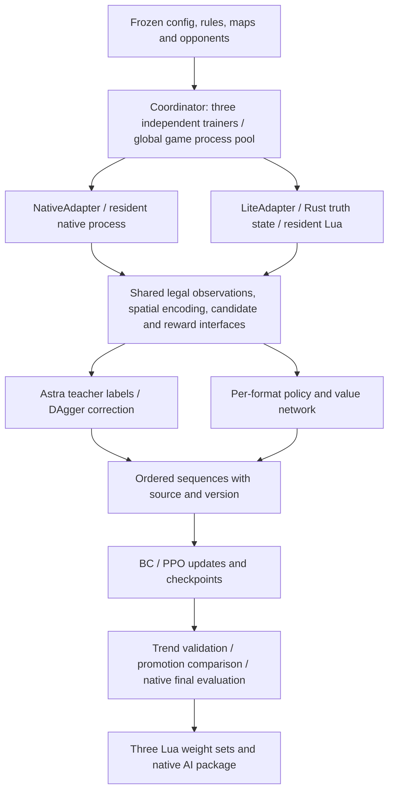

# WesnothLearning V5 Architecture and Implementation Status

> Language: English | [中文](architecture_zh.md)

Updated 2026-10-24. This file replaces the root PLAN.md and is the single maintained document for architecture, parameters and implementation status. Implemented-but-unaccepted items and their minimal test plans belong in [TEST.md](TEST.md) (the new native terminal-state capture remains pending); handover startup, maintenance and instruction-driven tuning are in [instructions.md](instructions.md). The [historical acceptance report](../verification/archive/TEST_before_cleanup_20261022.md) and raw results stay in `verification/`; experiments and weights stay in `runs/` and `delivery/` and are not copied into docs.

Status meanings: **implemented** means usable code and the corresponding entry points exist; **partially implemented** means explicit gaps remain or evidence covers only limited scenarios; **not implemented** / **not executed** mean the implementation is missing or no real run has happened. Implementation, minimal test pass, full acceptance pass and stronger play are four different things.

## 1. Goals and boundaries

- Train three independent models: `duel`, `ffa4` and `team2v2`. Parameters, optimizers, RNG state, memory, reward controllers, data and historical policy pools are isolated per format.
- High-frequency sampling targets the self-owned Rust lite engine; native Wesnoth **1.18.8** keeps migration audits, native play-strength evaluation and the final deployment entry. This round of formal experiments used lite only, per user instruction.
- The final game AI runs pure Lua inference with three independent weight sets and depends at runtime on no Python, Rust, CUDA or external inference process.
- Priority order: legal deployment with no hidden-information leakage → per-game wall time and CPU efficiency → core combat semantics → faithful reproduction of secondary mechanics. Documented approximations are allowed; unit/terrain types are not deleted to fake coverage, and scripted abilities are not treated as ordinary attacks.
- The only self-written teacher / fixed self-written opponent is Astra. The official RCA baseline is available only in native; lite uses Astra, same-format historical policies and the current policy, and does not invent cheap baselines.
- A general campaign WML/Lua interpreter, third-party eras, GUI, animation, audio, networking and replay rendering are outside the lite runtime scope.
- The Ubuntu CPU server is the primary acceptance environment; Windows is reference only. V4 weights, the installed AI and historical experiments are retained. The 2026-10-21/22 OOM, stop and replay optimizations are recorded in archive reports; T1–T4 passed restricted acceptance on 2026-10-22.

On 2026-10-23 old server training was archived and cleaned per user instruction: only the raw directories and logs of the two formal experiments `v5_lite20h_20261022_210712` and `v5_lite6000_replay_20261022_012336` remain. The five earlier formal experiments (including V4 weights) and one loopback run were compressed to `/home/tongshu/myDev/wesnothLearning/training_archives/20261023_212221/`, compared item by item and then deleted from their original directories; original dates, frozen sources, rule identities and artifacts are preserved inside the archive. The installed AI, rules, sources and the most recent isolated acceptance directory are untouched; the index and restore instructions are in the [archive record](../verification/training_archive_20261023/REPORT.md).

The most recent formal experiment `runs/v5_lite20h_20261022_210712` used frozen schema 4/v2, 300/600/400 pure lite, 8 workers and CPU, and ended in failure from `KeyError('astra_coverage5')` in the v100 control metrics. The three trainers failed at 2026-10-23 03:42:59, 07:05:52 and about 07:55; the main process exited at 08:10. All stopped at v100 with BC only; valid teacher games were 332/624/440 and none met the real BC eligibility gates. The old 09:00 force-entry task did not run and did not modify checkpoints. The original report mixed reference games into the replay; the exact frozen panel replay is 4/0/0 control blocks, with layer counts 6/6/12 and a per-collection reference cap of 12, not a whole-experiment cap. See the [failure review](../verification/training_failure_review_20261023/REPORT.md); the original report keeps its date and content.

The user then authorized repairs and minimal Ubuntu tests: keep the `ref[name]` fix, add bounded reference re-collection, real terminal-state statistics, the learning-side opening gate, the failure phase and the schema 5 index regression, and add independent phase entry points. Formal training was stopped at that acceptance point; schema 4 experiments cannot be resumed directly with schema 5 sources. The Ubuntu isolated directory passed real BC → explicit-override PPO → two PPO rounds → final evaluation for all three formats, but real unpassed BC gates and an incomplete final panel remain. Acceptance scope and commands are in the [repair report](../verification/training_repair_20261023/REPORT.md).

The later schema-5 run `runs/v5_lite18h_20261024_003512` in the isolated Ubuntu directory suffered a global OOM during PPO collection on 2026-10-24 at 10:07–10:08 and was stopped at the user's request around 12:58. Its latest duel/FF4/2v2 checkpoints (versions 212/88/50) load successfully; training remains stopped. Collection retains full live trajectories, outside the trainer read budgets, and the shared pool failure left a waiting coordinator/trainer. Exact memory evidence, remaining allocation uncertainty and unapplied repair directions are in the [OOM investigation](../verification/bc_oom_20261024/REPORT.md). No restart, source migration or parameter change was performed.

The collection-side OOM repair is now accepted for a bounded Ubuntu pressure replay: full exact trajectories/DAgger records use private temporary buffers, coverage counters stay small, diagnostics read only their required legal fields, and shard/index writers consume records without rebuilding a whole-game row list or JSON string. Eight concurrent 1,621-decision replays plus three resident trainer replay pools completed with 5.40 GiB group peak PSS and 9.14 GiB minimum MemAvailable; complete sequence hashes match the old baseline. This does not measure eight live-engine rollouts, worst-case training activations or formal throughput. The original run remains stopped; no frozen-source migration or BC read-share repair was performed. See the [collection memory acceptance](../verification/bc_memory_repair_20261024_1321/REPORT.md).

The shared-pool failure shutdown is also accepted: any coordinator exception terminates its remaining trainers before joining, so a worker loss cannot leave trainers waiting indefinitely for replies. A real spawned worker-death injection completed with zero active children; failure remains explicit and is not retried or hidden. See the [pool-exit acceptance](../verification/bc_pool_exit_20261024/REPORT.md). The stopped formal experiment has not been migrated or resumed.

On 2026-10-24 at 14:20 the user-authorized continuation started as `runs/v5_lite_resume_20261024_1420` under `/home/tongshu/myDev/wesnothLearning/validation_memory_repair_20261024_1321`. The controlled migration preserves the original run, manifest and checkpoints; the derivative freezes the accepted memory/shutdown repairs and restores duel/FF4/2v2 v212/v88/v50 with identical model, optimizer, RNG, counters and real eligibility. FF4/2v2 retain their original forced-PPO provenance and unpassed BC gates. Only the total budget changes: original start retained, total deadline **2026-10-24 22:30 Asia/Shanghai**, update boundary **18:50:52** using the existing 10/12 split. All formats use explicit PPO until that boundary, then the continuation wrapper requests final evaluation using the remaining shared budget. CPU, 8 global workers, 1 trainer thread and all training/reward settings remain frozen. The parent remains a required read-only corpus/policy source. Recovery assertions and observed live progress are in the [continuation report](../verification/training_resume_20261024_1415/REPORT.md).

At 14:33:55 all three continuations had saved new PPO updates: duel v219 / 2198 optimizer steps, FF4 v91 / 1786, and 2v2 v51 / 698, with no new errors. See the [final recovery check](../verification/training_resume_20261024_1415/HANDOFF_1434.md); this confirms resumed training, not future convergence or final evaluation completion.

The 2026-10-24 15:47–15:53 read-only quality review finds continuing PPO progress (v261/v107/v57), but small/noisy validation panels and limited updates per collected batch. All reward configs remain at version 0. A real Ubuntu reproduction confirms that adaptive reward windows stop refreshing once three exist (58 newer duel blocks remain queued); FF4/2v2 instead still lack two windows. A KL-stop metrics return also omits exposure counters, so those counters and historical BC accuracies cannot establish PPO stagnation. Neither defect was changed, and the offline refreshed duel windows still recommend no coefficient change. See the [quality investigation](../verification/training_stall_20261024_1544/REPORT.md) for measured limits and the next narrow checks; the running experiment and rewards were left untouched.

The adaptive reward rolling-window fix is accepted on 2026-10-24: every complete 12-block window is now processed, only the newest three windows are retained, and incomplete blocks remain queued. Three new regressions fail on the old code and pass with the fix; the 14 related Ubuntu checks and captured 55-block backlog replay pass. The captured backlog becomes 7 pending blocks with the latest three windows and no recommended coefficient change. Trigger thresholds, reward rules, event/version handling and PPO are unchanged. This is source acceptance only: the running continuation keeps its original frozen implementation until an explicitly authorized migration or new run. See the [window-fix acceptance](../verification/reward_window_fix_20261024_1607/REPORT.md).

## 2. Overall structure and responsibilities



| Responsibility | Entry points | Status |
| --- | --- | --- |
| Rule capture, freezing, declaration audit | `engine_lite/capture.py`, `freeze.py`, `audit.py` | Implemented; coverage boundaries in section 3 |
| Rust single source of truth, rule resolution and PyO3 batch API | `engine_lite/src/{model,state,combat,lib}.rs` | Implemented; public approximations remain |
| Native/lite adapters, Lua host and Astra queries | `learning/adapters.py`, `native_transport.py`, `lite_host.py`, `engine_lite/lua/host.lua` | Astra wired for all three formats; limited validation scope in section 8 |
| Shared observations, candidates, spatial and routing | `lua/{observation,candidates,spatial,routing}.lua` | Implemented; student candidates are generated before teacher queries |
| Model, sequences, supervision and RL training | `learning/{model,sequences,data,train}.py` | Implemented; limited real updates done |
| Three-trainer coordination and shared worker pool | `learning/coordinator.py`, `experiment.py`, `schedule.py` | Implemented, lite by default; startup checks the six-faction training closure |
| Reward formula, metrics, batch-boundary control | `learning/{rewards,reward_metrics,control}.py`, `lua/rewards.lua` | Implemented; reward coefficients are non-gradient |
| Benchmarks, native differential, BC diagnostics and export | `learning/{benchmark,benchmark_runner,audit,export}.py`, `engine_lite/differential.py` | Entry points implemented; full acceptance and strength experiments are not |

The shared interface covers `reset`, `observe`, `legal_actions`, `step`, `snapshot/restore` and `close`, and provides batch observation/path/prediction plus Lua decision calls. Python `pos/to` are zero-based row-major indices; Lua uses one-based hex coordinates. Python weapon indices start at 0, Lua at 1. `snapshot` is the referee truth state; policies only ever receive the player's legal view.

Lite decisions add `generate_candidates` (default true): the sampling loop disables full student candidate generation only for Astra seats that are not being collected, while keeping their legal observations, Astra planning, execution and memory updates; teacher-collected seats, student inference, DAgger and bootstrap keep full candidates. T2 acceptance passed on 2026-10-22: `C.generate` was called 0 times on uncollected seats and their candidates were just one `end_turn`, and both paths agreed on teacher actions and post-execution state; the earlier temporary probe's ~39–40% loop-time reduction remains non-acceptance data.

## 3. Rule data, runtime semantics and isolation

### 3.1 Current frozen data

Default rule package: `data/rules/1.18.8-training/`, promoted unchanged from Ubuntu's `verification/v5_lite_default_20261021/capture-maps/frozen/`; the old `data/rules/1.18.8/` and dated evidence are retained.

| Item | Current result |
| --- | --- |
| Native scopes | 20/20, 0 missing |
| Data | 587 units, 438 terrains, original WML, provenance and scope fully retained; includes the composite terrains of the 10 formal maps |
| Unit coverage labels | 0 exact, 470 approximate, 117 unsupported_script |
| core | 303 of 308 units runnable; 5 units limited by retained unit events |
| Actual six-faction closure | 158 distinct units; leaders/recruitment → all upgrade/plague types, with no missing or unsupported declarations |
| Rules SHA-256 | `d6fceafe7d0c9c67c750551b9901dbfb2b22290992a8daa1616a460e11826dca` |
| Package-level flags | `complete=false`, `native_accepted=false`, `performance_accepted=false` |

The user accepted the rule coverage within the current training scope. The 158-unit closure passing does not mean campaign behavior of all 587 types is implemented, nor that every semantic is exact. The core event-limited types are Fire Ant Egg, Fog Clearer, Giant Ant Egg, Giant Scorpion and Sand Scuttler.

### 3.2 Implemented

- Isolated native capture, campaign define/difficulty contexts, cross-scope terrain unification, namespaced conflicting type IDs, upgrade and plague reference rewriting, provenance hashing and rejection of corrupted WML.
- Hex movement, terrain costs, blocking, ZOC/ambush, castle recruitment connectivity, village economy, per-strike attack/counterattack, death interruption, experience and the default upgrade path.
- Time-of-day/faction/resistance modifiers; poison, slow, drain, firststrike, magical, marksman, charge, berserk, swarm, basic plague, backstab and steadfast.
- Standard heal/cure/rest, feeding, teleport, declared concealment/nightstalk; added swamp/full-move burrow concealment, stun/ZOC, absorb, deflect, diversion, parameterized drain, shock/swift, distract, inspire, vanguard, initiative, parameterized/terrain-scoped regeneration, darken and Quenoth conditional healing.
- Independent reproducible combat/recruit RNG; the fast engine does not need to match native for a given seed; per-strike hits can be injected for differential tests. Candidates, teacher and predictions never advance the real combat RNG stream.
- Per-side fog/shroud, explored terrain, last legal enemy information with age, village memory; configured map/view sharing, four-way rotation, elimination and team victory.

### 3.3 Explicit approximations and unimplemented items

Composite modifier rounding, counterattack weapon selection and full native declaration filters remain approximate. Random trait generation and retention across upgrades, AMLA/upgrade choices, independent `vision_costs/jamming` and runtime variants are still incomplete. The remaining 117 types mostly depend on campaign events, dummies, scripted plague, WML variables/multi-attack/song states and similar; the launcher refuses initial units, recruitment, upgrade or plague chains containing unimplemented declarations.

The originally planned incremental vision/pathfinding caches, adjacency precomputation, cross-game rule sharing and tighter trajectory I/O have not all landed; full vision recomputation, JSON boundary transport and prediction-state copies remain. A batch API existing does not mean the whole trainer uses batch inference or has eliminated these costs.

Rule truth state is only for the referee, resolution, differential tests and explicit reward labels. Policies, Astra, candidates and predictions may not bypass visibility through object references, shared caches, hidden friend/enemy information or unknown maps. Re-observing after a normal ambush/contact movement interruption is not a policy fault.

### 3.4 Default entry and training-scope acceptance

New experiments use lite and the recorded rule approximations by default and never fall back to native automatically. Rule selection order is explicit `--rules-dir` → `WESNOTH_RULES_DIR` → `data/rules/1.18.8-training/`. The CLI binds the directory before importing features/models; programmatic experiment creation binds it before constructing models; the same directory is passed to jobs and adapters and frozen into the manifest together with rule hash, provenance and training closure. Resuming uses the rule directory from the original manifest and rejects conflicting parameters. Maps keep the existing frozen map entry.

Default checked loading reads the small `catalog-summary.json`, verifies the rules.json hash, provenance and the 1.18.8 version, then checks the full recruit/leader/upgrade/plague closure on the actual six-faction configuration. Unsupported or missing references still block startup; peripheral campaign scripts do not block standard training. Runtime does not parse or retain the ~50 MB full catalog; historical packages without a summary keep compatible loading. `training_acceptance` records scope and profile hash and means implementation coverage is ready, not that all native semantics or performance targets are met; `acceptance_scope='full'` keeps the original three-flag package gate with the original flags still false.

The 10 training/validation/holdout native maps are frozen into `data/rules/1.18.8/maps/` with their distribution provenance. The capture entry reads these maps by default and also supports `--maps-dir`, delegating composite terrain to native queries for real unit movement/defense values; aliases are not guessed and terrains are not substituted to fill tables. Expanding from 291 to 438 terrains changed rule identity and feature schema, so old checkpoints cannot resume directly against the new vocabulary.

## 4. Model: three instances, six components

Architecture id `relational_v5`. The current implementation is **schema 5, 776,178 parameters per set** (587-unit vocabulary), adding tactical action features and each entity's relative next strike round; the network body is unchanged. Ubuntu isolated wiring, real updates, checkpoint restore and Python/Lua numerics are accepted. Restricted six-faction BC movement-input acceptance passed; the full BC quality gates remain separate and are not all passed. The failed older experiments froze schema 4 with 772,530 parameters; schema 3/4 data, weights and optimizers are not zero-filled into the new schema.

| Component | Implemented structure |
| --- | --- |
| Units and relations | Type embedding 16, unit projection 64, 2 layers × 4-head entity attention, FFN 128; actor and target use the full representation |
| Spatial | 16×16 shared board, 2 layers of 3×3, 16-channel convolutions; 19 cells within radius 2 around the candidate destination projected to 32 dims |
| Short-term memory | GRU 128, updated once per side per own turn |
| Long-term memory | Up to 32 turn summaries of 64 dims each with age, attention read, FIFO write |
| Action head | Scene/memory, actor/target, action features, local terrain and geometry → 512 → 256 → 128 → 1 |
| Value head | Same legal-observation context → hidden 128 → scalar value |

Opponents are encoded in 16 dims and pooled by mean/max. Up to 128 entities join attention, with candidate-relevant units and leaders first; overflow units still enter the spatial summary and un-attended acting entities are projected separately; at most 128 action candidates and 16 high-cost combat forecasts. Work budget, ordering and tie-breaks must agree across both engines, with the native action deadline as the outer guard.

The candidate rules frozen by older formal experiments are `fixed-20000-v2`; the following accepted behavior persists (v3 keeps it): score with public information, first keep each unit's primary legal full moves, then fill remaining slots by unit/type rotation; 2v2 keeps allied-occupied villages as strategic targets while destinations still exclude occupied cells. When lite passes village memory to Astra it uses the teacher-required `x*1000+y` key, and the snapshot handles JSON key conversion. This batch of duel/2v2 move-coverage changes passed T3 acceptance on 2026-10-22: fixed-state semantics covered keys/vision/snapshot/allied village/injured branches/128 cap and 16 forecasts; real samples gave duel moves 84/84 and team2v2 moves 135/135, `audit_bc` coverage 0.983 with `coverage_pass` true; the old move coverage of 88.45%/65.79% is retained as historical data and not rewritten as a new conclusion.

On 2026-10-23 a local candidate `fixed-20000-v3` was added: computed public tactical destination scores, relative gain versus staying put, risk and risk change, home-guard distance, allied support and a preferred-move flag feed the action head; entities additionally carry whether the enemy's next strike crosses a round. The stay-put score reuses the existing threat map and adds no combat forecasts, teacher calls or hidden information. The candidate set used for coverage is not trimmed by these inputs, and candidate/forecast caps are unchanged. A local holdout comparison on the same data, same initialization and 120 full-network updates per arm across three game families: FF4 moves 10/73→37/73 (13.70%→50.68%), 2v2 19/90→46/90 (21.11%→51.11%), duel 25/80→46/80 (31.25%→57.50%); this is an input ablation, not a comparison against the existing remote checkpoint. 169 related regressions pass. Evidence: `verification/bc_move_fix_20261023/REPORT.md`; the frozen weights then ran on 8 other short games, giving a joint six-faction holdout move rate of FF4 28/223→98/223 (12.56%→43.95%) and 2v2 34/237→111/237 (14.35%→46.84%) with no further optimization updates; FF4 undead challenge alone is still 15/49 (30.61%). Windows is reference only, and the training collection side covered only three factions in short games; this round also fixed the regression where the v3 inserted field made repeated_move misread move_primary, and historical comparisons keep their original identity and do not automatically represent the corrected new-trajectory quality. Ubuntu wiring/phase chains and real weight numerics passed; the subsequent [Ubuntu investigation](../verification/bc_rootcause_20261023_2318/REPORT.md) accepted the corrected movement benefit using four FF4 training families. On this small sample the recruit/attack and overall BC gates are not all passed.

New games reset memory; elimination or teammate death does not. Repeated evaluation, read-only teacher queries and bootstrap do not commit memory. Training backpropagates over 8 own turns, recomputes prefixes with current weights and does not reuse old hidden states across parameter updates. One forward pass batch-encodes unique historical observations and reuses state along shared prefixes; the GRU graph is shared only among samples with the same truncation boundary, old prefixes carry no gradient, and the 32-slot long-term memory is unchanged. Tensors are built in batches by field. The frozen lite student caches history encodings per game and side keyed by history length and current turn, recomputes immediately when either changes, and bootstrap does not commit memory. Pure Lua and PyTorch counterparts, sequence replay and numeric verification entry points all exist; continuous-sequence deployment acceptance on formal long-training weights has not been executed.

## 5. Data and training flow

### 5.1 Collection target (user adjustment on 2026-10-22)

| Format | Native valid teacher games | Added lite teacher games | Total |
| --- | ---: | ---: | ---: |
| duel | 0 | 300 | 300 |
| ffa4 | 0 | 600 | 600 |
| team2v2 | 0 | 400 | 400 |
| Total | 0 | 1300 | 1300 |

Default config, CLI and programmatic experiment creation all use 300/600/400 valid lite teacher games for duel/FF4/2v2 with 0 native anchors, keeping the Astra teacher; failed games do not count toward the target and batches truncate to the remaining quota. Default sampling and final comparison both use lite, and the final comparison is against a frozen Astra only and does not claim native strength. Explicit native selection keeps the same 300/600/400 total target, with the native floor defaulting to the corresponding total target. The CLI `--native-bc-games` and `--evaluation-engine` keep explicit overrides; existing frozen experiments resume with their original config. Only defaults changed here; no new launch was authorized, and the old 18000-game/18 h experiment stays stopped.

### 5.2 BC → student rollout / DAgger → PPO

1. Freeze rules, maps, opponents, sources, config and budget; the three trainers share the global game process pool.
2. Astra teacher sampling alternates with BC updates, adding 8 games per format per batch by default. Exact action cross-entropy is kept while action type, acting unit and target/destination are also supervised; normal path interruptions keep the original legal intent and the actual execution result.
3. BC switches to PPO only after satisfying corpus size, candidate coverage, imitation quality and opening behavior together. After 10 consecutive BC quality records without improvement, more teacher games and student corrections are added, and only then is the BC learning rate lowered; gates are never relaxed automatically.
4. Student rollouts query Astra, currently once per four learner decisions in lite with at most 32 per game. The teacher keeps an independent legal history and only plans; uncovered/failed labels are recorded as diagnostics and never masquerade as on-policy student behavior. Prioritizing queries by difficulty such as high entropy or repeated moves remains a later optimization.
5. PPO consumes 4 games per format per batch by default, using student trajectories from the same frozen policy/reward/engine version, plus same-format BC rehearsal. When both BC and DAgger data exist they split 50/50; if the raw pool has qualified human data, Astra/human is 75%/25%; when both native and lite exist, training samples split 50/50. These resampling weights are not collection-ratio claims.

On 2026-10-23 the user asked for phase entry points: default auto keeps the automatic eligibility gates above; `run --phase bc` runs BC only, while `phase ppo`/`phase evaluate` request the next independent phase, effective at batch boundaries during a run and requiring resume after a stop. BC/PPO are saved as `bc_complete`/`ppo_complete` respectively and later phases never run implicitly. `phase ppo --force --reason` is the explicit entry that skips BC eligibility, keeps the real effective/gate results and records the reason and command id; it does not rewrite checkpoint eligibility bits. A phase request can raise that phase's budget explicitly with `--hours`, saving an independent phase_deadline without touching the original clock/manifest. Once final evaluation starts, training cannot resume in the same directory. Final selection prefers an existing promoted best, then last_ppo, last_bc, latest, avoiding a fallback to old BC when PPO updates exist. Implementation and minimal acceptance evidence are in this round's verification report; no formal training launch is authorized now.

Human-replay restoration, compatibility checks and the import entry are implemented; formally usable human corpora and their pretraining benefit have no completed evidence, so candidate replay counts are not training-sample counts. Each sample stores format, schema/architecture, engine/rules/RNG, policy/reward versions, provenance, teacher, teammate context, game family and truncated bootstrap. `game_family` splits training/validation at about 80%/20%, families never cross the split, and decisions are drawn with equal weight per game.

Ordered sequences, compressed SQLite index blocks, full prefixes, window sampling and sharded validation are implemented. Shard rows are written as "metadata + fixed-width float32 numeric block" (`learning/rowpack.py`), and reads stream game by game: under a dual budget of gz bytes (96 MiB) and retained bytes (768 MiB) only sampled windows are kept, and whole games are no longer cached across updates; validation reads are bounded by `bc_validation_records` with a fixed seed. Each batch records shard count, gz bytes, retained bytes, rows and peak RSS into `state.history`; trainers also keep an `RLIMIT_AS` backstop and write `trainer_exit.log` on nonzero exit. Metrics separately record environment games, collection batches, optimization steps, distinct game families, decisions and effective data passes, so one "epoch" number cannot conflate them.

### 5.3 Training defaults

| Parameter | CPU | CUDA / shared rules |
| --- | --- | --- |
| Global game workers | 8 | 8; T1 config and the T4 real 8-worker chain (peak PSS 4.02 GiB) accepted on 2026-10-22 |
| Threads per trainer | 1 | 1 |
| Decisions read per BC step | 2048 | 8192, rotated by version, not a corpus cap |
| Sequences / micro-batch | 4 / 32 decisions | 8 / 64 decisions, 8-own-turn window |
| Updates | 4 epochs | BC learning rate 3e-4; PPO 1e-4 |
| PPO | clip 0.2, value loss 0.5, gradient clip 0.5 | entropy 0.01, BC auxiliary 0.10, stop the batch's remaining updates when approximate KL > 0.02 |
| Turn cap | 60 in training | 30 for routine native comparisons, truncation rates reported separately |
| Budget | 12 hours by default | updates allowed in the first 10/12, frozen evaluation in the last 2/12, resume does not reset the deadline |

BC gates: overall candidate coverage ≥90%, recruit/move/attack each ≥80%; exact-match rate ≥40% overall, ≥60% recruit, ≥35% move/attack, ≥32 records per class, cross-entropy below 85% of the uniform policy; openings must leave the keep, take villages and end turns sensibly. A 64-decision small-set fit, full holdout input confusion and teacher correction on student states have separate diagnostic entries; formal full-corpus diagnostics and training results are not complete.

### 5.4 Teachers and opponents

Astra is available as a native teacher in all three formats, with the baseline teammate retained in native 2v2. The lite host provides the read-only WML/unit/helper interface that the real four-player Astra scripts use, including `wml.get_child` and heal/weapon declarations; the experiment-frozen Astra ZIP is used and teacher policies are not modified. Minimal historical loopback results for teacher BC and student DAgger/PPO across the three formats are in the archive reports above; the current collection target is a total of 1300 pure lite games, the 20-hour formal experiment at this specification has failed, and formal training was not restarted this round; the earlier 18000/38400 plan is kept as history.

The native PPO opponent pool is 50%/25%/25% fixed/historical/current, with 2v2 teammates split by context; the lite fixed opponent pool contains only Astra, baseline teammate slots use Astra and are separately marked `astra_partner`, never mixed into native baseline results.

## 6. Rewards and online control

Implemented training reward: terminal + economy/control potential difference + first-exploration delta.

```text
r = r_terminal
  + w_economy * (gamma^delta_turn * Phi_economy_next - Phi_economy_now)
  + w_control * (gamma^delta_turn * Phi_control_next - Phi_control_now)
  + w_explore * first_exploration_delta
```

Duel/team wins are +1, draws 0, losses -1; FFA ranks are centered within the game and scaled to [-1,1]. gamma=1, GAE lambda=0.95 handled over own-turn spans; normal terminals zero the potential while truncation keeps the value/potential bootstrap of the legal final state, and failed games are not trained. Native play-strength evaluation looks at native wins/ranks; this round's lite comparison reports only lite wins/ranks, does not select models by shaping totals and makes no native-strength claim.

Economy includes gold, HP-converted army value and 20 per village, averaged across team members, normalized against the other opposing side so recruiting cannot earn free points. Map control uses legal own-visible/allied with last-seen age information, bounded multi-source paths and per-turn caching; strategic tile weights sample villages/keeps/passages at 4/2/1. Exploration de-duplicates per game on first legal observation, excludes the initial known area, does not double-count shared teammate areas and is off by default when fog is disabled. The referee can export reward scalars; hidden unit/map fields never enter the actor or shared value inputs.

| Coefficient | Initial | Automatic range |
| --- | ---: | ---: |
| terminal | 1.0 | fixed |
| economy | 0.15 | 0.05–0.20 |
| control | 0.10 | 0.02–0.15 |
| explore (whole-game cap) | 0.10 | 0–0.15 |

Each format's `RewardController` supports fixed/scheduled/adaptive, adaptive by default; it adjusts within bounds from actual behavior, reward and validation metrics as a rule-based controller, not optimizer-learned coefficients. Manual and automatic updates share one atomic queue, take effect only at batch boundaries and increment `reward_version`; a game and a PPO update both use the same frozen config. Event logs and checkpoints record old/new config, source, reason, sequence number and checksum, replay on resume without resetting state. Whether long-term automatic tuning improves play has not been verified by long experiments.

## 7. Maps, validation, performance and deployment

Repair decisions of 2026-10-23 (lite minimal acceptance in the repair report; new native capture awaits TEST acceptance): control metrics use separate initial/eliminated/terminal observations, and both normal elimination and early victory count; when a terminal is reached before turns 5/10, later horizons use an explicit absorbing state. Eliminated sides have zero control/leader survival, exploration keeps the last legal cumulative amount, HP loss comes from the real own terminal state and existing observations; the winning side keeps its real terminal. Budget truncation and failures do not synthesize terminals and missing data is not zero-filled; none of these snapshots enter the actor, BC/PPO data or memory. Metric version `terminal-horizons-v2` is not mixed with old statistics. The opening check covers only the learning side, and end-turn checks the remaining movement of non-leader units that still have legal destinations (still ≤4), never penalizing a kept-home leader or immobile units. Any metric failure is recorded and freezes adaptive auto-tuning; a real training failure exits nonzero through the failed phase, retains pending data and does not run the final holdout evaluation automatically. Insufficient references stay explicitly inconclusive; each re-collection adds at most 12, later validation continues by gap, and attempted failed sequences are not reused. Promotion must actually reach 12 full blocks; fewer than 30 blocks at the end stays inconclusive. Internal policy restore verifies schema/weight hash, the internal directory is not subject to the SDK submission package size limit, and the formal submission limit remains.

### 7.1 Maps and model selection

| Format | Training maps (plus 50% Arena) | Validation | Final holdout |
| --- | --- | --- | --- |
| duel | The Freelands, Weldyn Channel, Sablestone Delta | Hamlets | Caves of the Basilisk, Ruined Passage |
| ffa4 / team2v2 | Clash, Isar's Cross | Loris River | Morituri |

Map freezes record native version, hash, terrain/start positions and the unified rules; full Ladder scenario semantics are not claimed. Holdout maps never participate in reward tuning, hard-example sampling or model selection.

Trend validation runs every 10 update batches by default with 6/4/8 games; every 100 update batches replaces the trend panel with a promotion panel against Astra and each existing champion with at least 12 full rotation blocks each, splitting 2v2 by teammate context. This scheduling and reporting code exists, but formal candidate promotion and play-strength conclusions have not run. Final native evaluation uses at least 30 full rotation blocks per opponent and reports wins/draws/losses/ranks with per-block bootstrap intervals. The budget-constrained in-run native audit queue, the ~5% audit cost and the full mixed pipeline still lack real evidence.

### 7.2 Performance targets and existing evidence

The target is native/lite ≥5× on both wall time and total CPU core-seconds at equal work; the current memory acceptance criterion is a native/lite peak PSS ratio ≥1.3, superseding the original PLAN's 5× memory target. A ratio of 1.3 means lite PSS is about 76.9% of native, not "30% lower". Cold start and resident hot state are reported separately and include process-tree CPU and sampled PSS; speed may not be claimed by raising concurrency, ending early or using fewer actions.

The existing old frozen-package regular, single-worker, 30-full-rotation-block benchmarks: duel cold/hot wall about 5.44/11.88×, FFA4 about 5.88/22.30×, 2v2 about 5.94/22.36×, PSS ratio about 1.65–1.69. **These cover only observe/legal_actions/end_turn, exclude full candidates, teacher and student inference, and are not a re-acceptance of the new rule package.** End-to-end native/lite termination reasons and action counts differ and were explicitly judged incomparable. Dense, 4/8-worker throughput, mixed audit pipelines and full-decision end-to-end performance still lack evidence; future changes get minimal verification only, and the matrix is not rerun to fill documentation.

### 7.3 Native delivery

PyTorch → pure Lua export, three-format routing, checkpoint loading and continuous-sequence numeric audit entries are implemented. `weights_duel.lua`, `weights_ffa4.lua` and `weights_team2v2.lua` are emitted separately, the matching weights are selected and cached at game start, other-player-count FFA may reuse ffa4 without a strength claim, and other team relationships need explicit handling. Small closed-loop checkpoints already show about 2.3e-8 maximum Python/Lua error; the 128-candidate/continuous-memory audit on formal long-training weights has not run.

The final package currently exceeds the original SDK 16 MiB limit. The user is temporarily ignoring that package limit and the strict 1pp/0.5 HP statistical gates as a current blocker; ignoring is not resolving, and the official production SDK must not be quietly relaxed. There is still no final model package, no formal native strength conclusion and no replacement of the installed AI.

Reference projects are design comparisons only; unlicensed code is not copied. Native semantics follow the fixed 1.18.8 build/data; if GPL code is actually ported, applicable copyright, license and corresponding source are retained, and the whole delivery cannot be blanket-labelled as project-owned MIT.

## 8. Existing validation and unfinished items

This section is a status summary; accepted scope and evidence are in the [historical acceptance report](../verification/archive/TEST_before_cleanup_20261022.md) and the 2026-10-22 `verification/pretrain_acceptance_20261022/`, while implemented-but-unaccepted items are in [TEST.md](TEST.md) (only scopes still lacking evidence).

| Scope | Status and evidence boundary |
| --- | --- |
| New rule coverage | This round's implementation done: 25 types newly supported, 158-unit training closure cleared; 23 new minimal Ubuntu cases and 2 new native per-strike scenarios passed |
| Representative native differential | Older rule package 13/13 passed; the new package or all abilities cannot be marked exact from this |
| Quota and concurrency changes | Ubuntu acceptance passed on 2026-10-22 (T1): duel/FF4/2v2 at 300/600/400 lite, 0 native, 1300 total, 8 global workers, 1 thread per trainer; CLI defaults match programmatic defaults, explicit `--bc-games`/`--workers` take effect, resume keeps the frozen target and deadline, the last batch truncates to the remaining quota and failed games do not count. Evidence `verification/pretrain_acceptance_20261022/T1_ubuntu.txt` |
| Per-seat candidate generation | Ubuntu acceptance passed on 2026-10-22 (T2): uncollected Astra seats had 0 full candidate calls (just one `end_turn` candidate); collected seats, student policy, DAgger and truncated bootstrap still generate full candidates, and both paths agree on teacher actions, state and collection labels. Evidence `verification/pretrain_acceptance_20261022/T123_affected_suite.txt` |
| duel/2v2 move coverage | Ubuntu acceptance passed on 2026-10-22 (T3): teacher village memory key `x*1000+y` with retention on lost vision, side isolation and snapshot round-trip; 2v2 allied-occupied villages affect strategic targets only and are not destinations; duel injured branch; candidate pool cap 128, primary full moves retained, 16 combat forecasts. Real samples: duel move 84/84, team2v2 135/135, `audit_bc` coverage 0.983 with `coverage_pass` true, source v2. Evidence `verification/pretrain_acceptance_20261022/t3_coverage.json` |
| Real native small loopback | Ran 7 games with 4 workers, limited BC/PPO updates in all three formats, checkpoints and numeric audit passed |
| Historical native anchor validation | One extra native 2v2 / Clash / 1-turn game passed with 6/6 teacher actions matching; validated new rule binding, real scheduling and effective shards |
| Real lite small loopback | 6 games with 3 workers on the final 438-terrain package: real Astra teacher/BC, student/DAgger/PPO per format, checkpoints and numeric verification passed with about 2.38e-8 maximum error |
| 8-worker restricted real chain | Ubuntu acceptance passed on 2026-10-22 (T4): 9 teacher games (≤10 turns, including duel `the_freelands` and ffa4/team2v2 `clash` native maps) plus 3 lite rollout games, broker peak 8, scheduler active peak 8, all three trainers exit code 0; one BC and one PPO batch update with checkpoint readback of versions 1/2, DAgger queries 1/4/1 and valid bootstrap; peak PSS 4.02 GiB (cap 12), lowest available 10.46 GiB, swap growth 0, no leftover processes. Evidence `verification/pretrain_acceptance_20261022/T4_summary.json` |
| 2026-10-23 phase and failure repairs | 71 related Ubuntu checks and 7 later affected checks passed; one real BC plus two PPO updates per game family in all three formats, real resume and final selection of v102 PPO; two real Astra games per family for the opening check, learner side and kept-home leader accounting passed; Python/Lua error <1.6e-8 over two consecutive turns and 128 candidates. The small 1/30-block panel stays inconclusive and proves neither convergence nor strength. See `verification/training_repair_20261023/REPORT.md` |
| Frozen-package test adaptation | Fixed; capacity assertions follow the actual vocabulary, the real smoke uses the current feature directory, and the corresponding minimal Ubuntu items pass |
| Corrected schema 5 BC movement quality (T5) | Accepted restricted Ubuntu six-faction movement benefit: reuse 2v2 257/507 (50.69%) versus zeroed 79/507 (15.58%); FF4 with four training families, same 120 updates and fresh predeclared holdout reaches 126/257 (49.03%) versus 28/257 (10.89%). Two-family overfitting/limited trajectory diversity was an important factor; no model/loss/default change was adopted. Formal recruit/attack/overall gates remain unpassed. [Follow-up evidence](../verification/bc_rootcause_20261023_2318/REPORT.md); the original failure is preserved. |
| Lite teacher state reuse | Fixed protected JSON-array metatable copying after restore and duplicate Lua-host installation during adapter reset. Two new real Rust/Lua regressions failed before the fix and pass after the Ubuntu release rebuild; one real-game restored teacher query also passes without workaround. Fresh policy/model/candidate contracts are unchanged. [Evidence](../verification/bc_rootcause_20261023_2318/REPORT.md) |
| Default startup/memory path | Done; lite by default, unified rule binding, training-closure gate and light checked loading; normal coordinator and three-trainer initialization pass |
| Four-player lite teacher | Real frozen Astra wired; added the read-only WML projection and 2v2 sparse-side memory snapshot round-trip; minimal cases and the real four-player small loopback pass |
| Formal maps | Added the 10 frozen native maps and the 147 missing composite terrains; all map terrain coverage and format checks pass |
| Full-pipeline performance | Not done: end-to-end equal work, dense, concurrency and audit-inclusive costs still lack evidence |
| Production corpus and long training | Read-memory gap fixed, historical 42 min loopback peak PSS 6.4 GiB; historical replay and batch-tensor optimizations passed 10 minimal tests, real micro-batch output/gradient comparison in all three formats and BC update/checkpoint readback. The old 18000-game pure lite / 18 h experiment is stopped; the 1300-game formal experiment failed under schema 4, and schema 5 formal training and convergence are unfinished |
| Final native evaluation/delivery | Not executed; package limits temporarily ignored, no claim of beating Astra or strong humans |

Ordinary training wiring and short-game chains are complete; the high-memory problem exposed by formal runs is fixed and passed real loopback acceptance, with evidence in the archive reports above; the latest pure lite formal experiment failed, see section 1. Full-pipeline performance and formal strength still need real experiment evidence; peripheral campaigns and costly full semantics keep explicit limits and are not expanded into a general WML engine by default.

## 9. File layout and maintenance

```text
README.md                  repository entry (English); Chinese mirror docs/README_zh.md
docs/architecture.md       architecture, current parameters, implemented/unimplemented status (this file)
docs/instructions.md       agent startup/resume, training maintenance and instruction-driven tuning
docs/TEST.md               implemented but unaccepted items and the minimal tests toward formal training
docs/THIRD_PARTY.md        third-party code, reference opponent packages and official licensing
AGENTS.md                  agent working and documentation maintenance rules (English only)
engine_lite/               Rust, PyO3, native capture/freeze/audit, direct Lua host
learning/                  coordinator, adapters, model, sequences, training, rewards, evaluation and export
lua/                       native deployment and the legal observation/candidate/memory/reward shared by both engines
tests/                     one suite per behavior family; shared fixtures in tests/v5/helpers.py
benchmarks/                engine benchmark contracts
vendor/arena/              vendored WesnothArena native v2 SDK
data/                      captured inputs, not source; provisioned, never hand-edited
data/rules/1.18.8-training/ default 587-unit rule package, distributable with the development tree
data/rules/1.18.8/         historical rule package and frozen native maps, keeping the original experiment identity
data/datasets/             human and teacher data, sequence indexes
data/humanData/            raw replay dumps pulled from the game install
data/humanData_curated/    curated 1.18.8 replays used for BC
data/opponents/            frozen reference opponent packages
data/references/           third-party source excerpts, untracked
runs/<run>/<format>/       per-format training state, weights, schedules and policy history
runs/<run>/control/        batch-boundary config and append-only control events
verification/              raw evidence with dates/rule hashes; the source development package excludes it by default
delivery/                  explicitly exported model packages and manifests; historical experiments stay as-is
tmp/                       scratch space; nothing here is evidence
```

`data/` groups every captured input, so the source tree has one directory for material that can be re-provisioned. The 2026-10-24 move put `rules/`, `datasets/`, `humanData*`, `opponents/` and `references/` under it, and the defaults, CLI help, tests and instructions follow that layout. `verification/`, `delivery/`, `runs/` and `tmp/` stay at the root because frozen reports, run manifests and hashes record those exact paths; moving them would break the audit trail.

Each English doc has a `_zh` mirror beside it (`docs/architecture_zh.md`, module docs such as `engine_lite/README_zh.md`); edits update both in the same change. When adding features, changing parameters or completing acceptance, update the corresponding responsibility row, status and evidence links in this file; TEST.md keeps only implemented-but-unaccepted items and minimal plans. Real commands, results, version/rule hashes go into dated verification reports, and an accepted item is deleted from TEST.md as a whole; the maintenance rules are in the root AGENTS.md. Sync instructions.md when run entries or maintenance flows change. Run only the minimal checks this change requires and that have not already passed; retest accepted items only when the corresponding sources/data changed or a new failure makes it relevant. Historical reports keep their original dates and hashes and are not rewritten as new acceptance. `docs/` keeps only these maintained entries; detailed logs and research data belong in the corresponding code directory or `verification/`, avoiding parallel plans and status files.
