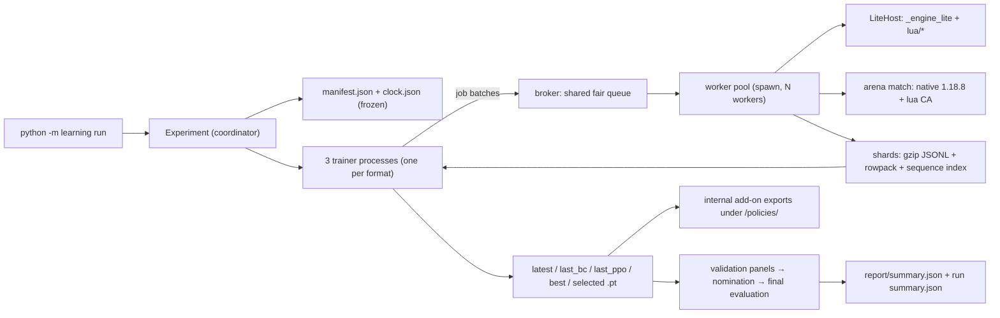

# WesnothLearning architecture

> Language: English | [中文](architecture_zh.md)

Updated 2026-10-31. This file describes only the current implementation. Dated evidence, failed runs and superseded decisions stay in `verification/`; remaining acceptance work is in [TEST.md](TEST.md); operating steps are in [instructions.md](instructions.md).

## 1. Scope and boundaries

The project trains one Wesnoth 1.18.8 policy for three formats: `duel` (2 players), `ffa4` (4 players, individual scoring) and `team2v2` (4 players, teams `[1,2,1,2]`).

Two rule backends share one observation/action contract:

- **native** — the real 1.18.8 game driven through the vendored WesnothArena SDK and a Lua CA add-on. It is the rules authority and the only backend for reference evaluation.
- **lite** — the Rust extension `engine_lite/` (`lite-0.2`), deterministic by design, used for cheap collection, rollouts and internal panels.

Learning is behavioural cloning (BC) from a declared teacher, followed by PPO driven by a reward controller. Delivery is a Lua AI add-on with exported weights; training never installs itself into the game.

Not claimed: lite/native rule equivalence, native performance acceptance, or playing strength.

## 2. Repository layout

| Path | Contents |
| --- | --- |
| `learning/` | Python coordinator: trainer processes, adapters, data pipeline, model, rewards, evaluation, export, bundle and maintenance tools |
| `engine_lite/` | Rust/PyO3 deterministic engine, embedded Lua 5.4 host, rule capture/audit tools (`audit`, `capture`, `freeze`, `inventory`, `differential`) |
| `lua/` | Add-on Lua shared by the native deployment and the lite host: observation, candidates, spatial/relational network, routing, rewards, teacher |
| `vendor/arena/` | Vendored WesnothArena native SDK (runtime, match runner, bots, faction/leader/recruit profile) |
| `data/rules/` | Frozen rules: `1.18.8-training` (default, 587 units / 438 terrains) and historical `1.18.8` |
| `data/` | Captured inputs: `humanData/`, `humanData_curated/`, `replays/` (packed lobby replay pull, one tar per month), `replays_curated/` (standard-era human games curated from it), `datasets/`, `opponents/gpt6astra.zip` (the frozen teacher package) |
| `tests/` | `tests/v5/` contract suites, legacy unit suites, manual smoke scripts, shared fixtures in `tests/v5/helpers.py` |
| `benchmarks/` | Frozen engine workload contract (`contract.json`) and its runner |
| `runs/<run>/` | Per-run manifests, per-format state, schedules and checkpoints (not tracked) |
| `verification/` | Dated acceptance and diagnosis reports; frozen evidence, never edited retroactively |
| `delivery/` | Explicitly exported model packages |
| `docs/` | The four resident documents (architecture, instructions, TEST, THIRD_PARTY), each with a `_zh` mirror |

## 3. Processes and data flow

- `Experiment` (`learning/coordinator.py`) freezes `manifest.json` and `clock.json`, then spawns one trainer process per requested format. `FormatExperiment` (`learning/experiment.py`) owns exactly one format's model, optimizer, reward controller, RNG stream and history.
- Trainers submit job batches to the broker. The broker runs one fixed-size worker pool (`ProcessPoolExecutor`, spawn) for all formats, marks past-deadline jobs `budget_interrupted`, logs every result to `<run>/<format>/jobs.jsonl`, and returns whole batches to the owning trainer.
- A worker runs one game through `sample.play_job`: lite games in-process via `LiteHost`; native games via the arena match runner driving one resident Wesnoth process with isolated user/add-on directories and file-backed Lua RPC (`native_transport`).
- Worker exceptions return `infrastructure_error` and fail the owning batch; trainer exits are recorded, and no format retries another format's games.

## 4. Rules and engines

`data/rules/1.18.8-training` is the default frozen inventory (`rules.json` sha256 `d6fceafe7d0c9c67c750551b9901dbfb2b22290992a8daa1616a460e11826dca`, source hash `c08f8a08…`, rules version `lite-0.1-c08f8a08d6fb802d`). `catalog-summary.json` records 587 units, 438 terrains, coverage 0 exact / 470 approximate / 117 unsupported scripts, and `training_acceptance.native_semantics_accepted = false`, `performance_accepted = false`.

- `rules_catalog.load()` verifies the file hash, the source hash and the version; training scope accepts recorded approximations. Startup additionally requires the six-faction training closure (leaders, recruits and every reachable advance/plague) to exist in the inventory, else the run refuses to start.
- `LiteAdapter` checks the extension build tuple (`ENGINE_VERSION='lite-0.2'`, `RNG_VERSION='deterministic-expected_damage_v1'`, `COMBAT_VERSION='expected_damage_v1'`) against the declared identity before use.
- `_engine_lite.LiteEngine(rules_json, spec_json)` exposes `reset`, `observe`/`observe_batch`, `legal_actions`/`legal_batch`, `step`/`step_batch` (restores the pre-batch state when an action is illegal), `snapshot`/`restore`, `forecast`, `configure_host`, `decision` and `execute_candidate`. JSON `pos`/`to` are zero-based row-major indices; the Lua bridge converts them to one-based hex coordinates and fixes the observing side, so no policy can switch views. `GameSpec` states width/height, flat terrain, sides, units, seed and `max_turns`; `side.id` is contiguous from 1 and `allow_approximate` must be explicit. Snapshots are referee truth and never reach a policy.
- Deterministic combat: each strike resolves to `ceil(damage × chance × 1.10)`; slow multiplies damage by `ceil(3/4)` before hit chance; poison ticks 6 HP at the unit's own turn; no combat RNG and no hit injection. `forecast()` is a point mass and accepts `samples` only for compatibility.
- Implemented lite mechanics: terrain-cost movement, visible-enemy ZOC, friendly passage, connected-castle recruiting/economy, village capture, fog/shroud/history terrain, ally sharing, side rotation, leader elimination and team endgame, per-strike death/counterattack/XP advancement, slow, poison, drain, firststrike, marksman, magical, charge, berserk, basic plague, healing/rest, concealment/nightstalk/teleport, deterministic strikes.
- Approximate lite paths: adjacent leadership, illumination, backstab, steadfast, counterattack plague, one-step teleport cost. Known gaps: composite modifier rounding, full weapon-declaration filtering, variant instances, random traits, AMLA choices, exact status-clear timing, vision costs/jamming, ranged pathfinding ZOC, campaign events. Unknown abilities/scripts block recruitment chains rather than degrade silently.
- `lua/` is the single legality/observation implementation: native Wesnoth loads it as an add-on, and `LiteHost` loads the same modules into the embedded Lua VM.

## 5. Observation, candidates and rows

`learning/features.py` (`VERSION = 5`) is the input contract. `schema()` fixes every ordered feature name and scale and is exported verbatim as `features.lua`, so the trainer and Lua consume identical inputs.

| Group | Contents |
| --- | --- |
| global | 20 base scalars (players, board size, gold/income, unit/HP totals, leader HP, turn, enemies, villages, allies) + own/enemy composition (level, fast, injured, damage type) + remaining moves, previous end turns, repeated moves |
| opponent | 8 base scalars + composition |
| action | 24 base scalars (kind, HP/cost, movement, approach, village, healing, defense, threat, expected damage, kill/death probability, leader flags, predicted combat) + max HP/moves/level, alignment, resistances, per-terrain cost/defense, three weapon summaries, village ownership, goal progress, repeated move |
| entity | 18 base scalars (position, HP, moves, attacks, XP, level, leader, relation, statuses, age) + a subset of action features + `next_round` |
| geometry | 16 scalars (actor/target/candidate x/y and normalized deltas, hex distance, full attack range) |
| spatial | 10 channels on a 16×16 board plus the 19-neighbour local patch |

The shared Lua generator uses `fixed-20000-v4`: up to 12 combat (attack/move_attack), 12 recruit and 12 move candidates, with actor/recruit-type diversity. Unused slots are filled deterministically from remaining unique candidates up to 36 actionable entries, or all available entries when fewer exist. End-turn has a separate slot (37 total maximum). Training, lite evaluation and native deployment score this same set without a second truncation. The candidate contract is part of the schema: existing checks reject old checkpoint/export schemas; frozen files are not migrated or rewritten.

Rows are the training contract: schema 6, encoded by `rowpack` v2 (JSON metadata plus one base64 float32 block per row) inside gzip JSONL shards. Each row carries engine/rules/RNG/combat/candidate/reward versions, reward formula, scenario family, split rule, game family, teacher identity and source (`astra`, `human`, `policy`). `data.validate_record` rejects any row whose provenance, widths, finiteness, intent fields or reward configuration disagree with the frozen run.

Actor inputs never contain referee truth: reward scalars, teacher actions, unseen units, unexplored terrain and RNG state are stripped before the policy sees a decision.

A job record is the run's per-game log line, so it holds per-decision evidence only where a consumer reads it: `behavior` on opening probes (the BC opening gate) and `reward_diagnostics` on validation and reward-reference rows (the reward controller). Every other game keeps its aggregates — coverage, eligibility, truncation, shard identity.

Teacher capabilities are declared, not assumed:

- `gpt6astra` — the frozen per-decision Lua teacher (`learning/teachers/`, derived source; `data/opponents/gpt6astra.zip` is its lineage and the package every manifest ships). The derived source adapts only where lite rules changed: attack scoring from `expected_damage_v1`, slow worth 25% damage plus its movement restriction, poison 6 points per tick. `teacher_profile` with `teacher_source_sha256` travels in rows, checkpoints, job metadata and exports, so one run never mixes profiles.

A fresh manifest freezes that package and names its lineage as the teacher, so teacher and DAgger shards carry one identity. `LiteHost` refuses official-baseline seats and accepts only the declared `gpt6astra` source.

## 6. Policy network

Architecture id `relational_v5`, one independent model per format (roughly 0.77 M parameters; the exact count is frozen in each manifest).

| Component | Shape |
| --- | --- |
| unit embedding | 588 × 16 |
| opponent encoder | 16 |
| entity attention | 2 layers, 4 heads × 16, FFN 128, residual |
| board convolution | two 3×3 convolutions, 16 channels |
| local patch | 19 × 10 → 32 |
| scene encoder | `[global, opponent mean/max, entity pool, board mean]` → GRU 128 |
| memory | 32 slots × 64, query/key/value read with age decay |
| action scorer | context + action + geometry → 512 → 256 → 128 → 1 |
| value head | context → 128 → 1 |

`context()` replays the last 8 own-turn rows per side, differentiates only active rows, runs the GRU prefix without gradients and caches per boundary so minibatches reuse histories. `lua/network.lua` + `lua/relational.lua` are the deployment twin; export verifies Python/Lua parity at ≤1e-5 on a real candidate sequence.

## 7. Rewards and online control

Reward formula `v5-potential-1` (`learning/rewards.py`):

- terminal: ±1 / 0 for duel and team2v2; centred rank points normalized by maximum deviation for ffa4;
- economy potential: gold + army cost·HP fraction + 20·villages, averaged per team and normalized by `200 + Σ|potential|`;
- per-row transition: potential difference with `γ^Δturn`, explicit truncation bootstrap, and an exploration ledger for first visits of visible hexes within reach.

`RewardController` (`learning/control.py`) stores an append-only event chain (sequence number, previous checksum, checksum) per format. It advances on complete validation windows of 12 blocks over matched map/faction strata with Astra references, and changes one coefficient at a time within ±10% while staying inside `economy 0.05–0.20`, `control 0.02–0.15`, `explore 0–0.15`. Adaptive proposals tick only after two comparable windows; holdout/final/test partitions never tune rewards; pending commands apply at batch boundaries. Evidence is built by `learning/reward_metrics.py` from matched validation windows: policy games are compared against Astra references on the same map/faction/teammate context with at least four independent game families per stratum, and incomplete records land in `excluded_evidence` rather than completing a block.

## 8. Training pipeline

A run is `<run>/<format>/` containing `state.json`, atomic checkpoints (`latest.pt`, `last_bc.pt`, `last_ppo.pt`, `best.pt`, `selected.pt`, `selection.json`, `bc_gate.json`), `schedules/`, `jobs.jsonl`, `validation/`, `policies/` and `report/`.

Stages run in order: `calibration` → `bc` → `ppo` → `final`.

1. **Calibration** collects three blocks of fixed reference games on validation maps, writes `controls.json`, and moves to BC. A single fixed reference skips collection.
2. **BC** samples teacher/BC rows with per-source, per-engine and per-family quotas, trains equal-weight sequence windows, and reports loss, CE versus uniform, and per-kind accuracy. Gates: coverage ≥90% overall and ≥80% per class; imitation effective (≥32 samples per class, CE < 85% of uniform, accuracy thresholds); corpus/audit checks; and at least 12 distinct scenario families. Those four must pass before PPO unless `--phase ppo --force <reason>` is used, which keeps `effective = false`. The four-game opening probe is recorded in `bc_gate.json` as evidence (`blocking: false`) but does not gate: it is a behaviour spot check, not a quality measure. `effective` is recomputed from the stored gate at every BC batch and every validation.
3. **PPO** trains on the batch just collected for the current policy snapshots (rollout shards of one reward/engine/teacher identity), while teacher and human rows are read separately as the BC rehearsal set. Batch preparation enforces the `scenario-v2/no-drop-v1` contract: rows are partitioned before identity is committed, and any excluded row raises instead of being dropped. Updates use a deterministic per-epoch window plan, logical-batch KL (rejection threshold 0.02, checked before the optimizer step) and per-step counters so a resumed boundary reproduces the uninterrupted future.
4. **Validation** runs every 10 versions against the teacher and the champion, using full seat rotations; a trend panel needs 3 distinct scenario families, a promotion panel (version %100) needs 12 blocks with ≥12 distinct families and re-evaluates the champion on the same blocks.
5. **Selection** nominates at most one complete latest candidate against `best.pt` using recorded matching panels; final evaluation freezes `selected.pt` before touching holdout maps and reports 30 blocks with ≥12 distinct families.

The clock reserves 10/12 of `hours` for updates and 2/12 for frozen evaluation; `final_holdout_hours` is carved out of the evaluation window.

Checkpoints are written atomically beside `state.json`; resume validates the manifest hash, schema, weights and optimizer state; a branch run also accepts the parent manifest hash its inherited checkpoint still pins. `--branch-from` copies a complete `latest.pt` into a new run with parent identities, new clock and seed, and either a kept or reset optimizer.

## 9. Evaluation and selection

`learning/evaluate.py` scores a game by official result (2-player/team win 1, draw 1/3, loss 0; ffa4 centred rank points) and compares policy versus control per format over complete rotation blocks. Differences get a cluster bootstrap (5,000 resamples, 2.5/97.5 percentiles) clustered by scenario family, so repeated identical layouts cannot inflate evidence.

Comparison status precedence: `infrastructure_error` → `inconclusive` (missing/underfilled blocks) → `insufficient_design` (fewer distinct families than required) → `passed` (interval low > 0) → `not_passed` (interval high ≤ 0) → `inconclusive`.

`selection.py` reuses only complete, matching 12-block panels and keeps the champion unless the candidate both passes and scores higher. Reports are machine-readable JSON plus a short Markdown profile report; schedule, seed, control and engine identity are recorded with every panel.

## 10. Delivery

- `ensure_export()` writes internal add-ons with features, weights, config and export metadata; these are not subject to the SDK submission size limit. Config retains `candidate_budget_ms=200` and has no independent `score_limit`; every phase scores the complete shared-generator result.
- `python -m learning export` writes a deployable add-on (all three formats, `arena.json` schema 2, vendored runtime, numeric parity record) and `python -m learning package` zips it as `delivery/NeuralArena.zip`. Export requires matching engine/teacher identity, trained weights and current-schema audit parity.
- `python -m learning bundle` builds the extraction-ready Ubuntu 24.04 training archive (`BUNDLE_MANIFEST.json`, `SHA256SUMS`, fixed member modes, run state and evidence excluded); `verify-bundle` re-checks it statically.

## 11. Tooling

| Command | Purpose |
| --- | --- |
| `run` / `phase` | start, resume or branch an experiment; request BC/PPO/evaluation at a batch boundary |
| `collect` / `train` / `evaluate` / `report` | isolated job collection, one BC/PPO update, job scoring, reports |
| `export` / `package` / `bundle` / `verify-bundle` | add-on export, delivery zip, training archive, static verification |
| `audit bc` / `audit fit` | full-set BC representation diagnostics; explicitly invoked tiny-fit probe |
| `benchmark engines` | measured native/lite workload comparison (never infers unmeasured resources) |
| `rules` / `freeze-map` | freeze native rule captures; add a frozen map identity |
| `import-human` / `replay_curate` | verified human replay import; replay curation over local saves and lobby archives, recording mid-game controller hand-overs per side |
| `replay_fetch` | provision one hosted archive month of replays into `data/replays/<YYYYMM>/`, resumable and verifiable |
| `control show` / `control set` | inspect or queue reward-control changes |

Differential tooling: `python -m engine_lite.differential` audits lite versus native on bounded real battles; `engine_lite.audit`/`inventory`/`capture`/`freeze` handle rule evidence without launching training.

The benchmark workload is fixed by `benchmarks/contract.json`: paired native/lite manifests, cold and resident-hot cache, equal-work and end-to-end modes, and 30 complete seat-rotation blocks per group. Acceptance needs an identical host, CPU quota and `work_signature`, process-tree CPU including the coordinator, PSS (never RSS) and both wall and CPU at least 5× native; missing artifacts, faults or unequal work stay `inconclusive`.

## 12. Default parameters

| Parameter | Default |
| --- | --- |
| formats / engine / evaluation engine | all three / `lite` / follows the sampling engine |
| hours / workers / device / trainer threads | 12 / 8 / `cpu` (trainer) / 1 |
| seed | 20261018 in the configuration; `run` passes 20261017 by default |
| BC teacher-game targets | duel 300, ffa4 600, team2v2 400 |
| native BC games | same as teacher targets for native, 0 for lite |
| validation games per event | duel 6, ffa4 4, team2v2 8 (full rotations) |
| validation interval / final blocks | 10 versions / 30 blocks |
| min distinct families | trend 3; promotion, final, gate 12 |
| BC batch games / records | 8 / 2048 CPU (8192 CUDA) |
| BC validation records | 1024 / 4096 |
| BC accuracy floors | all 0.40, recruit 0.60, move 0.35, attack 0.35 |
| epochs / minibatch / micro | 4 / 256 / min(256, 32 CPU or 64 CUDA) |
| BC learning rate / PPO learning rate | 3e-4 / 1e-4 |
| PPO clip / value / entropy / BC aux / grad clip | 0.2 / 0.5 / 0.01 / 0.10 / 0.5 |
| KL limit / plan version | 0.02 / 2 |
| reward mode / ranges | adaptive / economy 0.05–0.20, control 0.02–0.15, explore 0–0.15 |
| shared candidate limit | 36 actions + 1 end-turn (all phases) |
| turn cap | 30 (training, calibration, panels) |
| shard budgets | 96 MiB compressed, 768 MiB retained estimate |
| final holdout hours | 0 |

`validate_config` enforces the hard floors (1–16 global workers, ≥30 final blocks, rollout multiple of 4, rotations covering every format, 2v2 validation multiple of 8, `native_bc_games` ≤ teacher targets).

## 13. Limits and open gaps

- Lite rules are approximate (470 of 587 units) and explicitly not native-accepted; whole-package performance is unaccepted.
- Lite combat is deterministic; native combat is stochastic. Cross-engine numeric equality is not claimed.
- DAgger is Astra-only: the frozen teacher answers per-decision queries, and every correction row carries that identity.
- The official baseline is native-only; lite runs cannot evaluate against it.
- The curated replay corpus (`data/replays_curated/`, 1,076 standard-era games) is staging; only the 197 games recorded under 1.18.8 reach BC. A lobby archive starts from its `[scenario]` block, because 1.18.8 expands the scenario and merges the recorded RNG itself; a lobby archive without `[carryover_sides_start].random_seed` is skipped as `missing_initial_rng`. Replay markers may only run before an action and once at the end, since the replay machine rejects a `[custom_command]` reached inside a synced context. Three games were prepared, played by official 1.18.8 and imported as 84 BC rows (`verification/curated_bc_20261031/REPORT.md`); wider corpus play is not claimed.
- Native play is reproducible from its seed: `match.play_game` writes the seed into the scenario, so `runtime.lua` calls `math.randomseed(seed)`, and preloads `.runtime/entropy.so` (built by `setup.sh`) with `ARENA_ENTROPY_SEED`, so Wesnoth's default and per-action C++ RNGs draw from a seeded stream instead of OS entropy. A stock duel played twice from seed 20261017 produced identical decisive event streams (`verification/native_seed_20261031/REPORT.md`). Games from different seeds still differ; cross-seed native comparison uses recorded counts only, and lite/native equality is not claimed.
- Ubuntu unit, candidate provenance and numerical-parity evidence for the shared 37-candidate contract is in `verification/candidate_budget_20261031/REPORT.md`. Historical short-duel timings with 24 candidates do not accept the new native one-second budget; that performance acceptance remains open. No strength improvement is claimed.
- No convergence or playing-strength claim exists for any run.

## 14. Documentation map

| Document | Responsibility |
| --- | --- |
| `README.md` / `docs/README_zh.md` | repository entry |
| `docs/architecture.md` | this file: structure, contracts, parameters |
| `docs/instructions.md` | operating steps, Ubuntu bundle and instruction-driven tuning |
| `docs/TEST.md` | remaining acceptance items only |
| `docs/THIRD_PARTY.md` | licensing |
| `verification/<date>/REPORT.md` | dated commands, identities and results |

Maintenance rules live in the root `AGENTS.md`; evidence is never retro-fitted, and an accepted item leaves `TEST.md` as a whole.
