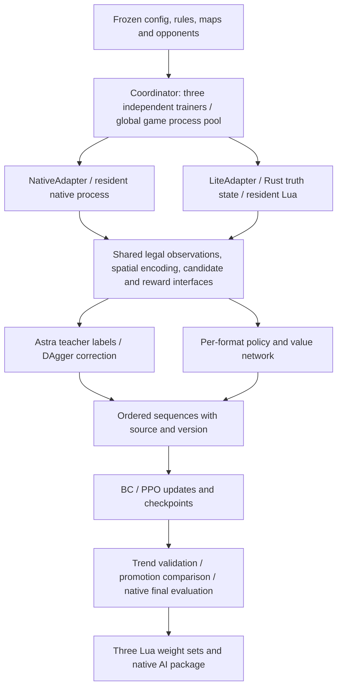
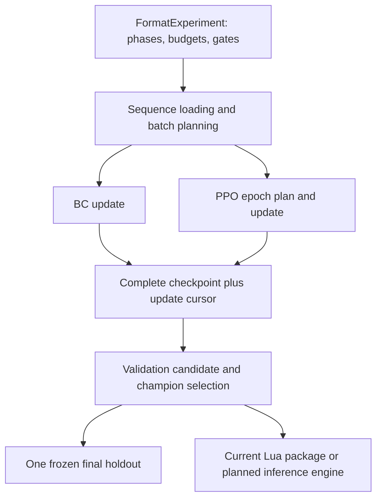

# WesnothLearning V5 Architecture and Implementation Status

> Language: English | [中文](architecture_zh.md)

Updated 2026-10-27. This file replaces the root PLAN.md and is the single maintained document for architecture, parameters and implementation status. Implemented-but-unaccepted items and their minimal test plans belong in [TEST.md](TEST.md) (the new native terminal-state capture remains pending); handover startup, maintenance and instruction-driven tuning are in [instructions.md](instructions.md). The [historical acceptance report](../verification/archive/TEST_before_cleanup_20261022.md) and raw results stay in `verification/`; experiments and weights stay in `runs/` and `delivery/` and are not copied into docs.

Status meanings: **implemented** means usable code and the corresponding entry points exist; **partially implemented** means explicit gaps remain or evidence covers only limited scenarios; **not implemented** / **not executed** mean the implementation is missing or no real run has happened. Implementation, minimal test pass, full acceptance pass and stronger play are four different things.

**Repair acceptance, 2026-10-25:** the [six defects reproduced in the independent review](../verification/refactor_review_20261025/REPORT.md) are fixed by PRs #32–#37. [Twelve isolated Ubuntu regressions passed](../verification/refactor_repairs_20261025/REPORT.md) on source `831eedb` (implementation `36cc99f`), with no real games or formal training. This accepts those nomination/export-identity/recovery/teacher-record paths only. The first Ubuntu setup failed before tests; the separate SDK package attempt still fails its unchanged 16 MiB gate. P6 remains optional/unimplemented, N1 unaccepted, and full-board teacher tactics, strength and a new real three-format phase chain remain unrun. Original reports are preserved.

**Fresh training startup, 2026-10-25:** source `822082d`, CPU lite, three formats and unchanged eight-worker/300–600–400 scale; isolated run `training_lite30h_20261025/source/runs/v5_lite30h_20261025`, PID/session 225153. Started 14:40:27 Asia/Shanghai; exact 25/1/4-hour schedule and total deadline October 26 20:40:27 are frozen. Six Ubuntu budget checks passed before launch. At 14:52:47, all three formats have valid collection, committed optimizer updates (76/40/36) and newer checkpoints; no trainer errors. Startup is verified. This is not completed training or strength evidence. See [startup report](../verification/final_review_lite30h_20261025/REPORT.md) and 10.16.

**Completed run and local-trial installation, 2026-10-26:** the fresh run finished at 16:35:34 Asia/Shanghai, all trainer exit codes 0, all BC gates passed and each final panel completed 30 blocks without faults. Latest versions 470/213/136; selected 400/100/100. Final lite Astra results are not_passed / inconclusive / not_passed. The separate local add-on NeuralArena20261026 is installed under the user’s explicit local-trial exception. FFA4 float32/Lua parity still fails the unchanged 1e-5 gate (2.2106e-5); LOCAL_TRIAL.json retains the failure. Duel/2v2 parity, 19 installed file identities, Lua syntax and actual native registration passed; 44 old-model files are unchanged. See [export report](../verification/lite_export_20261026/REPORT.md) and [installation record](../verification/lite_export_20261026/INSTALLATION.md). Native strength is not accepted; frozen training and old installations remain intact.

**PPO root-cause diagnosis, 2026-10-26:** eleven read-only probes ran against the completed run's frozen data (all exit 0, no game, no optimizer step, no file written outside a new isolated directory). Proven: the update loses 31 % of its frozen batch to a split applied after the batch identity was committed; the split is keyed on a family hash that contains the seed, so 5/6 duel scenarios sit on both sides; the 30-block final gate is 3–6 deterministic games repeated 5–10 times; the KL gate abandons the unvisited windows of the batch; the policy does move (KL 1.75, 33 % of decisions change) while no panel improves; 11 of 19 stock RCA candidate actions are C++. Ruled out: the behaviour/update input contract on all 421 rows, batched-vs-single and train-vs-eval forwards, GAE/potential/truncation wiring, "PPO is not updating". The bilingual [PPO rebuild plan](ppo_refactor_plan.md) defines ten one-behaviour PRs, the target interfaces and the stock RCA migration; decisions are recorded in 10.18. No runtime change, corpus, checkpoint or historical report was modified, and no training was started.

## 1. Goals and boundaries

- Train three independent models: `duel`, `ffa4` and `team2v2`. Parameters, optimizers, RNG state, memory, reward controllers, data and historical policy pools are isolated per format.
- High-frequency sampling targets the self-owned Rust lite engine; native Wesnoth **1.18.8** keeps migration audits, native play-strength evaluation and the final deployment entry. This round of formal experiments used lite only, per user instruction.
- The current installed AI uses pure Lua inference with three independent weight sets. The user also accepts a separate inference engine with Lua as the game adapter; pure Lua is no longer a mandatory delivery constraint. The external-engine route is planned, not implemented or validated; its protocol must expose only legal public observations and candidates (section 10).
- Priority order: legal deployment with no hidden-information leakage → per-game wall time and CPU efficiency → core combat semantics → faithful reproduction of secondary mechanics. Documented approximations are allowed; unit/terrain types are not deleted to fake coverage, and scripted abilities are not treated as ordinary attacks.
- Current implementation and historical runs use Astra as the only self-written teacher / fixed opponent; official RCA is native-only. On 2026-10-26 the user decided to replace all future active Astra roles with stock Wesnoth 1.18.8 default RCA. This supersedes the Astra-only future design, but replacement is planned, not implemented; see 10.17. Historical identities and evidence remain unchanged.
- A general campaign WML/Lua interpreter, third-party eras, GUI, animation, audio, networking and replay rendering are outside the lite runtime scope.
- The Ubuntu CPU server is the primary acceptance environment; Windows is reference only. V4 weights, the installed AI and historical experiments are retained. The 2026-10-21/22 OOM, stop and replay optimizations are recorded in archive reports; T1–T4 passed restricted acceptance on 2026-10-22.

On 2026-10-23 old server training was archived and cleaned per user instruction: only the raw directories and logs of the two formal experiments `v5_lite20h_20261022_210712` and `v5_lite6000_replay_20261022_012336` remain. The five earlier formal experiments (including V4 weights) and one loopback run were compressed to `/home/tongshu/myDev/wesnothLearning/training_archives/20261023_212221/`, compared item by item and then deleted from their original directories; original dates, frozen sources, rule identities and artifacts are preserved inside the archive. The installed AI, rules, sources and the most recent isolated acceptance directory are untouched; the index and restore instructions are in the [archive record](../verification/training_archive_20261023/REPORT.md).

The most recent formal experiment `runs/v5_lite20h_20261022_210712` used frozen schema 4/v2, 300/600/400 pure lite, 8 workers and CPU, and ended in failure from `KeyError('astra_coverage5')` in the v100 control metrics. The three trainers failed at 2026-10-23 03:42:59, 07:05:52 and about 07:55; the main process exited at 08:10. All stopped at v100 with BC only; valid teacher games were 332/624/440 and none met the real BC eligibility gates. The old 09:00 force-entry task did not run and did not modify checkpoints. The original report mixed reference games into the replay; the exact frozen panel replay is 4/0/0 control blocks, with layer counts 6/6/12 and a per-collection reference cap of 12, not a whole-experiment cap. See the [failure review](../verification/training_failure_review_20261023/REPORT.md); the original report keeps its date and content.

The user then authorized repairs and minimal Ubuntu tests: keep the `ref[name]` fix, add bounded reference re-collection, real terminal-state statistics, the learning-side opening gate, the failure phase and the schema 5 index regression, and add independent phase entry points. Formal training was stopped at that acceptance point; schema 4 experiments cannot be resumed directly with schema 5 sources. The Ubuntu isolated directory passed real BC → explicit-override PPO → two PPO rounds → final evaluation for all three formats, but real unpassed BC gates and an incomplete final panel remain. Acceptance scope and commands are in the [repair report](../verification/training_repair_20261023/REPORT.md).

The later schema-5 run `runs/v5_lite18h_20261024_003512` in the isolated Ubuntu directory suffered a global OOM during PPO collection on 2026-10-24 at 10:07–10:08 and was stopped at the user's request around 12:58. Its latest duel/FF4/2v2 checkpoints (versions 212/88/50) load successfully; training remains stopped. Collection retains full live trajectories, outside the trainer read budgets, and the shared pool failure left a waiting coordinator/trainer. Exact memory evidence, remaining allocation uncertainty and unapplied repair directions are in the [OOM investigation](../verification/bc_oom_20261024/REPORT.md). No restart, source migration or parameter change was performed.

The collection-side OOM repair is now accepted for a bounded Ubuntu pressure replay: full exact trajectories/DAgger records use private temporary buffers, coverage counters stay small, diagnostics read only their required legal fields, and shard/index writers consume records without rebuilding a whole-game row list or JSON string. Eight concurrent 1,621-decision replays plus three resident trainer replay pools completed with 5.40 GiB group peak PSS and 9.14 GiB minimum MemAvailable; complete sequence hashes match the old baseline. This does not measure eight live-engine rollouts, worst-case training activations or formal throughput. The original run remains stopped; no frozen-source migration or BC read-share repair was performed. See the [collection memory acceptance](../verification/bc_memory_repair_20261024_1321/REPORT.md).

The shared-pool failure shutdown is also accepted: any coordinator exception terminates its remaining trainers before joining, so a worker loss cannot leave trainers waiting indefinitely for replies. A real spawned worker-death injection completed with zero active children; failure remains explicit and is not retried or hidden. See the [pool-exit acceptance](../verification/bc_pool_exit_20261024/REPORT.md). The stopped formal experiment has not been migrated or resumed.

On 2026-10-24 at 14:20 the user-authorized continuation started as `runs/v5_lite_resume_20261024_1420` under `/home/tongshu/myDev/wesnothLearning/validation_memory_repair_20261024_1321`. The controlled migration preserves the original run, manifest and checkpoints; the derivative freezes the accepted memory/shutdown repairs and restores duel/FF4/2v2 v212/v88/v50 with identical model, optimizer, RNG, counters and real eligibility. FF4/2v2 retain their original forced-PPO provenance and unpassed BC gates. Only the total budget changes: original start retained, total deadline **2026-10-24 22:30 Asia/Shanghai**, update boundary **18:50:52** using the existing 10/12 split. All formats use explicit PPO until that boundary, then the continuation wrapper requests final evaluation using the remaining shared budget. CPU, 8 global workers, 1 trainer thread and all training/reward settings remain frozen. The parent remains a required read-only corpus/policy source. Recovery assertions and observed live progress are in the [continuation report](../verification/training_resume_20261024_1415/REPORT.md).

At 14:33:55 all three continuations had saved new PPO updates: duel v219 / 2198 optimizer steps, FF4 v91 / 1786, and 2v2 v51 / 698, with no new errors. See the [final recovery check](../verification/training_resume_20261024_1415/HANDOFF_1434.md); this confirms resumed training, not future convergence or final evaluation completion.

The 2026-10-24 15:47–15:53 read-only quality review finds continuing PPO progress (v261/v107/v57), but small/noisy validation panels and limited updates per collected batch. All reward configs remain at version 0. A real Ubuntu reproduction confirms that adaptive reward windows stop refreshing once three exist (58 newer duel blocks remain queued); FF4/2v2 instead still lack two windows. A KL-stop metrics return also omits exposure counters, so those counters and historical BC accuracies cannot establish PPO stagnation. Neither defect was changed, and the offline refreshed duel windows still recommend no coefficient change. See the [quality investigation](../verification/training_stall_20261024_1544/REPORT.md) for measured limits and the next narrow checks; the running experiment and rewards were left untouched.

The adaptive reward rolling-window fix is accepted on 2026-10-24: every complete 12-block window is now processed, only the newest three windows are retained, and incomplete blocks remain queued. Three new regressions fail on the old code and pass with the fix; the 14 related Ubuntu checks and captured 55-block backlog replay pass. The captured backlog becomes 7 pending blocks with the latest three windows and no recommended coefficient change. Trigger thresholds, reward rules, event/version handling and PPO are unchanged. This is source acceptance only: the running continuation keeps its original frozen implementation until an explicitly authorized migration or new run. See the [window-fix acceptance](../verification/reward_window_fix_20261024_1607/REPORT.md).

On the user's next instruction, the former continuation was stopped at 16:21:48 and the accepted window fix deployed to a new frozen source root `/home/tongshu/myDev/wesnothLearning/validation_window_fix_20261024_1630`. The derivative `runs/v5_lite_windowfix_20261024_1630` started at 16:31:29 from the retained complete best PPO checkpoints duel/FF4 v100/v100, with 2v2 latest legal v60 as an explicitly unpromoted fallback. Selected model, optimizer and RNG states are preserved; completed v100 validation is replayed from existing results without new games. The original runs/checkpoints remain intact. Config changes only extend the total deadline to **2026-10-25 00:00 Asia/Shanghai**; the original start and 10/12 split put the PPO cutoff at **2026-10-24 20:05:52**. The wrapper then enters final evaluation within the remaining budget. CPU, 8 workers, 1 trainer thread, all reward coefficients, BC eligibility and existing forced-PPO provenance are preserved. Deployment, checkpoint selection and live progress are in the [deployment handoff](../verification/window_deploy_20261024_1620/REPORT.md).

At 16:41:14 the deployed continuation has committed PPO updates in all formats: duel v105 / 1795 optimizer steps, FF4 v103 / 1828, team2v2 v61 / 756, with error=null. See the [completed deployment check](../verification/window_deploy_20261024_1620/HANDOFF_1642.md).

The continuation completed normally at **20:42:45 on 2026-10-24**, exit code 0, with all 30 final blocks per format. Latest trained versions are duel/FFA4/2v2 **211/143/80**; final selection retained **100/100/80**. All lite Astra comparisons are **not_passed**, with score differences -1.55/-.11528/-1.175 and 95% intervals wholly below zero. Final models are downloaded to `delivery/lite_final_20261024/` and installed as the separate local add-on **NeuralArena20261024**; old installed models remain. Three real two-turn export audits pass the existing 1e-5 Python/Lua threshold, and native 1.18.8 registration preprocessing succeeds; native playing strength remains untested. The [strength review](../verification/model_strength_20261024_2120/REPORT.md) records incomplete FFA4/2v2 BC, bounded-read underfill, frequent micro-chunk KL stops and exact duel v110/v200 weight duplication after rollback. No training fix or reward tuning was made during this review; T6 remains pending. The historical startup snapshots above do not mean a process is still active.

**Proposed training refactor, not implemented:** [GitHub source research](../verification/github_refactor_research_20261024/REPORT.md) recommends retaining the lite engine, public observations, three networks and Lua deployment while separating bounded sequence loading, BC/PPO update loops and checkpoint purposes. Borrow logical-batch versus microbatch separation from imitation, indexed sequence access from robomimic and ordered PPO traversal from SB3-Contrib/CleanRL. Keep current-weight raw-prefix replay, window weighting and acceptance gates; minibatch KL stopping is also used upstream and is not by itself a diagnosed bug. Separate behavior-preserving extraction, BC underfill repair and PPO coverage/KL changes, with minimal recorded-data checks per change. Research does not authorize implementation or training. At the user's subsequent request, [TEST.md](TEST.md) now includes a bounded prospective test design with explicit unimplemented/unwritten status.

## 2. Overall structure and responsibilities



| Responsibility | Entry points | Status |
| --- | --- | --- |
| Rule capture, freezing, declaration audit | `engine_lite/capture.py`, `freeze.py`, `audit.py` | Implemented; coverage boundaries in section 3 |
| Rust single source of truth, rule resolution and PyO3 batch API | `engine_lite/src/{model,state,combat,lib}.rs` | Implemented; public approximations remain |
| Native/lite adapters, Lua host and Astra queries | `learning/adapters.py`, `native_transport.py`, `lite_host.py`, `engine_lite/lua/host.lua` | Astra wired for all three formats; limited validation scope in section 8 |
| Shared observations, candidates, spatial and routing | `lua/{observation,candidates,spatial,routing}.lua` | Implemented; student candidates are generated before teacher queries |
| Model, sequences, supervision and RL training | `learning/{model,sequences,data,train}.py` | Implemented; limited real updates done |
| Three-trainer coordination and shared worker pool | `learning/coordinator.py`, `experiment.py`, `schedule.py` | Implemented, lite by default; startup checks the six-faction training closure |
| Reward formula, metrics, batch-boundary control | `learning/{rewards,reward_metrics,control}.py`, `lua/rewards.lua` | Implemented; reward coefficients are non-gradient |
| Benchmarks, native differential, BC diagnostics and export | `learning/{benchmark,benchmark_runner,audit,export}.py`, `engine_lite/differential.py` | Entry points implemented; full acceptance and strength experiments are not |

The shared interface covers `reset`, `observe`, `legal_actions`, `step`, `snapshot/restore` and `close`, and provides batch observation/path/prediction plus Lua decision calls. Python `pos/to` are zero-based row-major indices; Lua uses one-based hex coordinates. Python weapon indices start at 0, Lua at 1. `snapshot` is the referee truth state; policies only ever receive the player's legal view.

Lite decisions add `generate_candidates` (default true): the sampling loop disables full student candidate generation only for Astra seats that are not being collected, while keeping their legal observations, Astra planning, execution and memory updates; teacher-collected seats, student inference, DAgger and bootstrap keep full candidates. T2 acceptance passed on 2026-10-22: `C.generate` was called 0 times on uncollected seats and their candidates were just one `end_turn`, and both paths agreed on teacher actions and post-execution state; the earlier temporary probe's ~39–40% loop-time reduction remains non-acceptance data.

## 3. Rule data, runtime semantics and isolation

### 3.1 Current frozen data

Default rule package: `data/rules/1.18.8-training/`, promoted unchanged from Ubuntu's `verification/v5_lite_default_20261021/capture-maps/frozen/`; the old `data/rules/1.18.8/` and dated evidence are retained.

| Item | Current result |
| --- | --- |
| Native scopes | 20/20, 0 missing |
| Data | 587 units, 438 terrains, original WML, provenance and scope fully retained; includes the composite terrains of the 10 formal maps |
| Unit coverage labels | 0 exact, 470 approximate, 117 unsupported_script |
| core | 303 of 308 units runnable; 5 units limited by retained unit events |
| Actual six-faction closure | 158 distinct units; leaders/recruitment → all upgrade/plague types, with no missing or unsupported declarations |
| Rules SHA-256 | `d6fceafe7d0c9c67c750551b9901dbfb2b22290992a8daa1616a460e11826dca` |
| Package-level flags | `complete=false`, `native_accepted=false`, `performance_accepted=false` |

The user accepted the rule coverage within the current training scope. The 158-unit closure passing does not mean campaign behavior of all 587 types is implemented, nor that every semantic is exact. The core event-limited types are Fire Ant Egg, Fog Clearer, Giant Ant Egg, Giant Scorpion and Sand Scuttler.

### 3.2 Implemented

- Isolated native capture, campaign define/difficulty contexts, cross-scope terrain unification, namespaced conflicting type IDs, upgrade and plague reference rewriting, provenance hashing and rejection of corrupted WML.
- Hex movement, terrain costs, blocking, ZOC/ambush, castle recruitment connectivity, village economy, per-strike attack/counterattack, death interruption, experience and the default upgrade path.
- Time-of-day/faction/resistance modifiers; poison, slow, drain, firststrike, magical, marksman, charge, berserk, swarm, basic plague, backstab and steadfast.
- Standard heal/cure/rest, feeding, teleport, declared concealment/nightstalk; added swamp/full-move burrow concealment, stun/ZOC, absorb, deflect, diversion, parameterized drain, shock/swift, distract, inspire, vanguard, initiative, parameterized/terrain-scoped regeneration, darken and Quenoth conditional healing.
- Independent reproducible recruit RNG and scenario seeds in the frozen `lite-0.1` build; `lite-0.2` instead resolves each strike deterministically under `expected_damage_v1` and removes the combat RNG, hit injection and the unused recruit placeholder. The fast engine does not need to match native for a given seed. Candidates, teacher and predictions never advance a real RNG stream.
- Per-side fog/shroud, explored terrain, last legal enemy information with age, village memory; configured map/view sharing, four-way rotation, elimination and team victory.

**New user decision, implemented in `lite-0.2`, awaiting acceptance:** lite's random combat is replaced by the versioned deterministic `expected_damage_v1` ruleset, slow/poison are weakened and Astra adaptation follows (10.13). The RNG description above describes the frozen `lite-0.1` build, not the current lite runtime. Native 1.18.8 keeps its original rules.

### 3.3 Explicit approximations and unimplemented items

Composite modifier rounding, counterattack weapon selection and full native declaration filters remain approximate. Random trait generation and retention across upgrades, AMLA/upgrade choices, independent `vision_costs/jamming` and runtime variants are still incomplete. The remaining 117 types mostly depend on campaign events, dummies, scripted plague, WML variables/multi-attack/song states and similar; the launcher refuses initial units, recruitment, upgrade or plague chains containing unimplemented declarations.

The originally planned incremental vision/pathfinding caches, adjacency precomputation, cross-game rule sharing and tighter trajectory I/O have not all landed; full vision recomputation, JSON boundary transport and prediction-state copies remain. A batch API existing does not mean the whole trainer uses batch inference or has eliminated these costs.

Rule truth state is only for the referee, resolution, differential tests and explicit reward labels. Policies, Astra, candidates and predictions may not bypass visibility through object references, shared caches, hidden friend/enemy information or unknown maps. Re-observing after a normal ambush/contact movement interruption is not a policy fault.

### 3.4 Default entry and training-scope acceptance

New experiments use lite and the recorded rule approximations by default and never fall back to native automatically. Rule selection order is explicit `--rules-dir` → `WESNOTH_RULES_DIR` → `data/rules/1.18.8-training/`. The CLI binds the directory before importing features/models; programmatic experiment creation binds it before constructing models; the same directory is passed to jobs and adapters and frozen into the manifest together with rule hash, provenance and training closure. Resuming uses the rule directory from the original manifest and rejects conflicting parameters. Maps keep the existing frozen map entry.

Default checked loading reads the small `catalog-summary.json`, verifies the rules.json hash, provenance and the 1.18.8 version, then checks the full recruit/leader/upgrade/plague closure on the actual six-faction configuration. Unsupported or missing references still block startup; peripheral campaign scripts do not block standard training. Runtime does not parse or retain the ~50 MB full catalog; historical packages without a summary keep compatible loading. `training_acceptance` records scope and profile hash and means implementation coverage is ready, not that all native semantics or performance targets are met; `acceptance_scope='full'` keeps the original three-flag package gate with the original flags still false.

The 10 training/validation/holdout native maps are frozen into `data/rules/1.18.8/maps/` with their distribution provenance. The capture entry reads these maps by default and also supports `--maps-dir`, delegating composite terrain to native queries for real unit movement/defense values; aliases are not guessed and terrains are not substituted to fill tables. Expanding from 291 to 438 terrains changed rule identity and feature schema, so old checkpoints cannot resume directly against the new vocabulary.

## 4. Model: three instances, six components

Architecture id `relational_v5`. The current implementation is **schema 5, 776,178 parameters per set** (587-unit vocabulary), adding tactical action features and each entity's relative next strike round; the network body is unchanged. Ubuntu isolated wiring, real updates, checkpoint restore and Python/Lua numerics are accepted. Restricted six-faction BC movement-input acceptance passed; the full BC quality gates remain separate and are not all passed. The failed older experiments froze schema 4 with 772,530 parameters; schema 3/4 data, weights and optimizers are not zero-filled into the new schema.

| Component | Implemented structure |
| --- | --- |
| Units and relations | Type embedding 16, unit projection 64, 2 layers × 4-head entity attention, FFN 128; actor and target use the full representation |
| Spatial | 16×16 shared board, 2 layers of 3×3, 16-channel convolutions; 19 cells within radius 2 around the candidate destination projected to 32 dims |
| Short-term memory | GRU 128, updated once per side per own turn |
| Long-term memory | Up to 32 turn summaries of 64 dims each with age, attention read, FIFO write |
| Action head | Scene/memory, actor/target, action features, local terrain and geometry → 512 → 256 → 128 → 1 |
| Value head | Same legal-observation context → hidden 128 → scalar value |

Opponents are encoded in 16 dims and pooled by mean/max. Up to 128 entities join attention, with candidate-relevant units and leaders first; overflow units still enter the spatial summary and un-attended acting entities are projected separately; at most 128 action candidates and 16 high-cost combat forecasts. Work budget, ordering and tie-breaks must agree across both engines, with the native action deadline as the outer guard.

The candidate rules frozen by older formal experiments are `fixed-20000-v2`; the following accepted behavior persists (v3 keeps it): score with public information, first keep each unit's primary legal full moves, then fill remaining slots by unit/type rotation; 2v2 keeps allied-occupied villages as strategic targets while destinations still exclude occupied cells. When lite passes village memory to Astra it uses the teacher-required `x*1000+y` key, and the snapshot handles JSON key conversion. This batch of duel/2v2 move-coverage changes passed T3 acceptance on 2026-10-22: fixed-state semantics covered keys/vision/snapshot/allied village/injured branches/128 cap and 16 forecasts; real samples gave duel moves 84/84 and team2v2 moves 135/135, `audit_bc` coverage 0.983 with `coverage_pass` true; the old move coverage of 88.45%/65.79% is retained as historical data and not rewritten as a new conclusion.

On 2026-10-23 a local candidate `fixed-20000-v3` was added: computed public tactical destination scores, relative gain versus staying put, risk and risk change, home-guard distance, allied support and a preferred-move flag feed the action head; entities additionally carry whether the enemy's next strike crosses a round. The stay-put score reuses the existing threat map and adds no combat forecasts, teacher calls or hidden information. The candidate set used for coverage is not trimmed by these inputs, and candidate/forecast caps are unchanged. A local holdout comparison on the same data, same initialization and 120 full-network updates per arm across three game families: FF4 moves 10/73→37/73 (13.70%→50.68%), 2v2 19/90→46/90 (21.11%→51.11%), duel 25/80→46/80 (31.25%→57.50%); this is an input ablation, not a comparison against the existing remote checkpoint. 169 related regressions pass. Evidence: `verification/bc_move_fix_20261023/REPORT.md`; the frozen weights then ran on 8 other short games, giving a joint six-faction holdout move rate of FF4 28/223→98/223 (12.56%→43.95%) and 2v2 34/237→111/237 (14.35%→46.84%) with no further optimization updates; FF4 undead challenge alone is still 15/49 (30.61%). Windows is reference only, and the training collection side covered only three factions in short games; this round also fixed the regression where the v3 inserted field made repeated_move misread move_primary, and historical comparisons keep their original identity and do not automatically represent the corrected new-trajectory quality. Ubuntu wiring/phase chains and real weight numerics passed; the subsequent [Ubuntu investigation](../verification/bc_rootcause_20261023_2318/REPORT.md) accepted the corrected movement benefit using four FF4 training families. On this small sample the recruit/attack and overall BC gates are not all passed.

New games reset memory; elimination or teammate death does not. Repeated evaluation, read-only teacher queries and bootstrap do not commit memory. Training backpropagates over 8 own turns, recomputes prefixes with current weights and does not reuse old hidden states across parameter updates. One forward pass batch-encodes unique historical observations and reuses state along shared prefixes; the GRU graph is shared only among samples with the same truncation boundary, old prefixes carry no gradient, and the 32-slot long-term memory is unchanged. Tensors are built in batches by field. The frozen lite student caches history encodings per game and side keyed by history length and current turn, recomputes immediately when either changes, and bootstrap does not commit memory. Pure Lua and PyTorch counterparts, sequence replay and numeric verification entry points all exist; continuous-sequence deployment acceptance on formal long-training weights has not been executed.

## 5. Data and training flow

### 5.1 Collection target (user adjustment on 2026-10-22)

| Format | Native valid teacher games | Added lite teacher games | Total |
| --- | ---: | ---: | ---: |
| duel | 0 | 300 | 300 |
| ffa4 | 0 | 600 | 600 |
| team2v2 | 0 | 400 | 400 |
| Total | 0 | 1300 | 1300 |

Default config, CLI and programmatic experiment creation all use 300/600/400 valid lite teacher games for duel/FF4/2v2 with 0 native anchors, keeping the Astra teacher; failed games do not count toward the target and batches truncate to the remaining quota. Default sampling and final comparison both use lite, and the final comparison is against a frozen Astra only and does not claim native strength. Explicit native selection keeps the same 300/600/400 total target, with the native floor defaulting to the corresponding total target. The CLI `--native-bc-games` and `--evaluation-engine` keep explicit overrides; existing frozen experiments resume with their original config. Only defaults changed here; no new launch was authorized, and the old 18000-game/18 h experiment stays stopped.

### 5.2 BC → student rollout / DAgger → PPO

1. Freeze rules, maps, opponents, sources, config and budget; the three trainers share the global game process pool.
2. Astra teacher sampling alternates with BC updates, adding 8 games per format per batch by default. Exact action cross-entropy is kept while action type, acting unit and target/destination are also supervised; normal path interruptions keep the original legal intent and the actual execution result.
3. BC switches to PPO only after satisfying corpus size, candidate coverage, imitation quality and opening behavior together. After 10 consecutive BC quality records without improvement, more teacher games and student corrections are added, and only then is the BC learning rate lowered; gates are never relaxed automatically.
4. Student rollouts query Astra, currently once per four learner decisions in lite with at most 32 per game. The teacher keeps an independent legal history and only plans; uncovered/failed labels are recorded as diagnostics and never masquerade as on-policy student behavior. Prioritizing queries by difficulty such as high entropy or repeated moves remains a later optimization.
5. PPO consumes 4 games per format per batch by default, using student trajectories from the same frozen policy/reward/engine version, plus same-format BC rehearsal. When both BC and DAgger data exist they split 50/50; if the raw pool has qualified human data, Astra/human is 75%/25%; when both native and lite exist, training samples split 50/50. These resampling weights are not collection-ratio claims.

On 2026-10-23 the user asked for phase entry points: default auto keeps the automatic eligibility gates above; `run --phase bc` runs BC only, while `phase ppo`/`phase evaluate` request the next independent phase, effective at batch boundaries during a run and requiring resume after a stop. BC/PPO are saved as `bc_complete`/`ppo_complete` respectively and later phases never run implicitly. `phase ppo --force --reason` is the explicit entry that skips BC eligibility, keeps the real effective/gate results and records the reason and command id; it does not rewrite checkpoint eligibility bits. A phase request can raise that phase's budget explicitly with `--hours`, saving an independent phase_deadline without touching the original clock/manifest. Once final evaluation starts, training cannot resume in the same directory. Final selection prefers an existing promoted best, then last_ppo, last_bc, latest, avoiding a fallback to old BC when PPO updates exist. Implementation and minimal acceptance evidence are in this round's verification report; no formal training launch is authorized now.

Human-replay restoration, compatibility checks and the import entry are implemented; formally usable human corpora and their pretraining benefit have no completed evidence, so candidate replay counts are not training-sample counts. A replay recorded under another game version is refused before preparation (`other_version`), because the labels would otherwise claim 1.18.8 rules for older combat and recruit numbers; the [2026-10-29 audit](../verification/ppo_refactor_r5_20261029/REPORT.md) finds no 1.18.8 era_default standard-multiplayer replay in the curated inventory, so no qualified human rehearsal pool can be derived from the existing inputs. Each sample stores format, schema/architecture, engine/rules/RNG, policy/reward versions, provenance, teacher, teammate context, game family and truncated bootstrap. `game_family` splits training/validation at about 80%/20%, families never cross the split, and decisions are drawn with equal weight per game.

Ordered sequences, compressed SQLite index blocks, full prefixes, window sampling and sharded validation are implemented. Shard rows are written as "metadata + fixed-width float32 numeric block" (`learning/rowpack.py`), and reads stream game by game: under a dual budget of gz bytes (96 MiB) and retained bytes (768 MiB) only sampled windows are kept, and whole games are no longer cached across updates; validation reads are bounded by `bc_validation_records` with a fixed seed. Each batch records shard count, gz bytes, retained bytes, rows and peak RSS into `state.history`; trainers also keep an `RLIMIT_AS` backstop and write `trainer_exit.log` on nonzero exit. Metrics separately record environment games, collection batches, optimization steps, distinct game families, decisions and effective data passes, so one "epoch" number cannot conflate them.

### 5.3 Training defaults

| Parameter | CPU | CUDA / shared rules |
| --- | --- | --- |
| Global game workers | 8 | 8; T1 config and the T4 real 8-worker chain (peak PSS 4.02 GiB) accepted on 2026-10-22 |
| Threads per trainer | 1 | 1 |
| Decisions read per BC step | 2048 | 8192, rotated by version, not a corpus cap |
| Sequences / micro-batch | 4 / 32 decisions | 8 / 64 decisions, 8-own-turn window |
| Updates | 4 epochs | BC learning rate 3e-4; PPO 1e-4 |
| PPO | clip 0.2, value loss 0.5, gradient clip 0.5 | entropy 0.01, BC auxiliary 0.10, stop the batch's remaining updates when approximate KL > 0.02 |
| Turn cap | 60 in training | 30 for routine native comparisons, truncation rates reported separately |
| Budget | 12 hours by default | updates allowed in the first 10/12, frozen evaluation in the last 2/12, resume does not reset the deadline |

BC gates: overall candidate coverage ≥90%, recruit/move/attack each ≥80%; exact-match rate ≥40% overall, ≥60% recruit, ≥35% move/attack, ≥32 records per class, cross-entropy below 85% of the uniform policy; openings must leave the keep, take villages and end turns sensibly. A 64-decision small-set fit, full holdout input confusion and teacher correction on student states have separate diagnostic entries; formal full-corpus diagnostics and training results are not complete.

### 5.4 Teachers and opponents

Astra is available as a native teacher in all three formats, with the baseline teammate retained in native 2v2. The lite host provides the read-only WML/unit/helper interface that the real four-player Astra scripts use, including `wml.get_child` and heal/weapon declarations; the experiment-frozen Astra ZIP is used and teacher policies are not modified. Minimal historical loopback results for teacher BC and student DAgger/PPO across the three formats are in the archive reports above; the current collection target is a total of 1300 pure lite games, the 20-hour formal experiment at this specification has failed, and formal training was not restarted this round; the earlier 18000/38400 plan is kept as history.

The native PPO opponent pool is 50%/25%/25% fixed/historical/current, with 2v2 teammates split by context; the lite fixed opponent pool contains only Astra, baseline teammate slots use Astra and are separately marked `astra_partner`, never mixed into native baseline results.

## 6. Rewards and online control

Implemented training reward: terminal + economy/control potential difference + first-exploration delta.

```text
r = r_terminal
  + w_economy * (gamma^delta_turn * Phi_economy_next - Phi_economy_now)
  + w_control * (gamma^delta_turn * Phi_control_next - Phi_control_now)
  + w_explore * first_exploration_delta
```

Duel/team wins are +1, draws 0, losses -1; FFA ranks are centered within the game and scaled to [-1,1]. gamma=1, GAE lambda=0.95 handled over own-turn spans; normal terminals zero the potential while truncation keeps the value/potential bootstrap of the legal final state, and failed games are not trained. Native play-strength evaluation looks at native wins/ranks; this round's lite comparison reports only lite wins/ranks, does not select models by shaping totals and makes no native-strength claim.

Economy includes gold, HP-converted army value and 20 per village, averaged across team members, normalized against the other opposing side so recruiting cannot earn free points. Map control uses legal own-visible/allied with last-seen age information, bounded multi-source paths and per-turn caching; strategic tile weights sample villages/keeps/passages at 4/2/1. Exploration de-duplicates per game on first legal observation, excludes the initial known area, does not double-count shared teammate areas and is off by default when fog is disabled. The referee can export reward scalars; hidden unit/map fields never enter the actor or shared value inputs.

| Coefficient | Initial | Automatic range |
| --- | ---: | ---: |
| terminal | 1.0 | fixed |
| economy | 0.15 | 0.05–0.20 |
| control | 0.10 | 0.02–0.15 |
| explore (whole-game cap) | 0.10 | 0–0.15 |

Each format's `RewardController` supports fixed/scheduled/adaptive, adaptive by default; it adjusts within bounds from actual behavior, reward and validation metrics as a rule-based controller, not optimizer-learned coefficients. Manual and automatic updates share one atomic queue, take effect only at batch boundaries and increment `reward_version`; a game and a PPO update both use the same frozen config. Event logs and checkpoints record old/new config, source, reason, sequence number and checksum, replay on resume without resetting state. Whether long-term automatic tuning improves play has not been verified by long experiments.

## 7. Maps, validation, performance and deployment

Repair decisions of 2026-10-23 (lite minimal acceptance in the repair report; new native capture awaits TEST acceptance): control metrics use separate initial/eliminated/terminal observations, and both normal elimination and early victory count; when a terminal is reached before turns 5/10, later horizons use an explicit absorbing state. Eliminated sides have zero control/leader survival, exploration keeps the last legal cumulative amount, HP loss comes from the real own terminal state and existing observations; the winning side keeps its real terminal. Budget truncation and failures do not synthesize terminals and missing data is not zero-filled; none of these snapshots enter the actor, BC/PPO data or memory. Metric version `terminal-horizons-v2` is not mixed with old statistics. The opening check covers only the learning side, and end-turn checks the remaining movement of non-leader units that still have legal destinations (still ≤4), never penalizing a kept-home leader or immobile units. Any metric failure is recorded and freezes adaptive auto-tuning; a real training failure exits nonzero through the failed phase, retains pending data and does not run the final holdout evaluation automatically. Insufficient references stay explicitly inconclusive; each re-collection adds at most 12, later validation continues by gap, and attempted failed sequences are not reused. Promotion must actually reach 12 full blocks; fewer than 30 blocks at the end stays inconclusive. Internal policy restore verifies schema/weight hash, the internal directory is not subject to the SDK submission package size limit, and the formal submission limit remains.

### 7.1 Maps and model selection

| Format | Training maps (plus 50% Arena) | Validation | Final holdout |
| --- | --- | --- | --- |
| duel | The Freelands, Weldyn Channel, Sablestone Delta | Hamlets | Caves of the Basilisk, Ruined Passage |
| ffa4 / team2v2 | Clash, Isar's Cross | Loris River | Morituri |

Map freezes record native version, hash, terrain/start positions and the unified rules; full Ladder scenario semantics are not claimed. Holdout maps never participate in reward tuning, hard-example sampling or model selection.

Trend validation runs every 10 update batches by default with 6/4/8 games; every 100 update batches replaces the trend panel with a promotion panel against Astra and each existing champion with at least 12 full rotation blocks each, splitting 2v2 by teammate context. This scheduling and reporting code exists, but formal candidate promotion and play-strength conclusions have not run. Final native evaluation uses at least 30 full rotation blocks per opponent and reports wins/draws/losses/ranks with per-block bootstrap intervals. The budget-constrained in-run native audit queue, the ~5% audit cost and the full mixed pipeline still lack real evidence.

### 7.2 Performance targets and existing evidence

The target is native/lite ≥5× on both wall time and total CPU core-seconds at equal work; the current memory acceptance criterion is a native/lite peak PSS ratio ≥1.3, superseding the original PLAN's 5× memory target. A ratio of 1.3 means lite PSS is about 76.9% of native, not "30% lower". Cold start and resident hot state are reported separately and include process-tree CPU and sampled PSS; speed may not be claimed by raising concurrency, ending early or using fewer actions.

The existing old frozen-package regular, single-worker, 30-full-rotation-block benchmarks: duel cold/hot wall about 5.44/11.88×, FFA4 about 5.88/22.30×, 2v2 about 5.94/22.36×, PSS ratio about 1.65–1.69. **These cover only observe/legal_actions/end_turn, exclude full candidates, teacher and student inference, and are not a re-acceptance of the new rule package.** End-to-end native/lite termination reasons and action counts differ and were explicitly judged incomparable. Dense, 4/8-worker throughput, mixed audit pipelines and full-decision end-to-end performance still lack evidence; future changes get minimal verification only, and the matrix is not rerun to fill documentation.

### 7.3 Native delivery

PyTorch → pure Lua export, three-format routing, checkpoint loading and continuous-sequence numeric audit entries are implemented. `weights_duel.lua`, `weights_ffa4.lua` and `weights_team2v2.lua` are emitted separately, the matching weights are selected and cached at game start, other-player-count FFA may reuse ffa4 without a strength claim, and other team relationships need explicit handling. Small closed-loop checkpoints already show about 2.3e-8 maximum Python/Lua error. The 2026-10-24 final weights passed a minimal real two-turn/128-candidate audit (<1e-5), not a long native-game deployment audit; see the [installation record](../verification/model_strength_20261024_2120/REPORT.md). A separate inference engine with a Lua adapter is an accepted design option, with its implementation and acceptance planned in section 10.

The three-model local add-on exceeds the original SDK 16 MiB limit and was installed as a separate local package on 2026-10-24, retaining previous installed models. It is not an accepted competition submission. The user temporarily ignores that package limit and the strict 1pp/0.5 HP statistical gates as current blockers; the official SDK remains unchanged. There is no formal native strength conclusion. External-engine delivery has its own proposed local package contract in section 10 and cannot be labelled SDK-compatible without separate evidence.

Reference projects are design comparisons only; unlicensed code is not copied. Native semantics follow the fixed 1.18.8 build/data; if GPL code is actually ported, applicable copyright, license and corresponding source are retained, and the whole delivery cannot be blanket-labelled as project-owned MIT.

## 8. Existing validation and unfinished items

This section is a status summary; accepted scope and evidence are in the [historical acceptance report](../verification/archive/TEST_before_cleanup_20261022.md) and the 2026-10-22 `verification/pretrain_acceptance_20261022/`, while implemented-but-unaccepted items are in [TEST.md](TEST.md) (only scopes still lacking evidence).

| Scope | Status and evidence boundary |
| --- | --- |
| New rule coverage | This round's implementation done: 25 types newly supported, 158-unit training closure cleared; 23 new minimal Ubuntu cases and 2 new native per-strike scenarios passed |
| Representative native differential | Older rule package 13/13 passed; the new package or all abilities cannot be marked exact from this |
| Quota and concurrency changes | Ubuntu acceptance passed on 2026-10-22 (T1): duel/FF4/2v2 at 300/600/400 lite, 0 native, 1300 total, 8 global workers, 1 thread per trainer; CLI defaults match programmatic defaults, explicit `--bc-games`/`--workers` take effect, resume keeps the frozen target and deadline, the last batch truncates to the remaining quota and failed games do not count. Evidence `verification/pretrain_acceptance_20261022/T1_ubuntu.txt` |
| Per-seat candidate generation | Ubuntu acceptance passed on 2026-10-22 (T2): uncollected Astra seats had 0 full candidate calls (just one `end_turn` candidate); collected seats, student policy, DAgger and truncated bootstrap still generate full candidates, and both paths agree on teacher actions, state and collection labels. Evidence `verification/pretrain_acceptance_20261022/T123_affected_suite.txt` |
| duel/2v2 move coverage | Ubuntu acceptance passed on 2026-10-22 (T3): teacher village memory key `x*1000+y` with retention on lost vision, side isolation and snapshot round-trip; 2v2 allied-occupied villages affect strategic targets only and are not destinations; duel injured branch; candidate pool cap 128, primary full moves retained, 16 combat forecasts. Real samples: duel move 84/84, team2v2 135/135, `audit_bc` coverage 0.983 with `coverage_pass` true, source v2. Evidence `verification/pretrain_acceptance_20261022/t3_coverage.json` |
| Real native small loopback | Ran 7 games with 4 workers, limited BC/PPO updates in all three formats, checkpoints and numeric audit passed |
| Historical native anchor validation | One extra native 2v2 / Clash / 1-turn game passed with 6/6 teacher actions matching; validated new rule binding, real scheduling and effective shards |
| Real lite small loopback | 6 games with 3 workers on the final 438-terrain package: real Astra teacher/BC, student/DAgger/PPO per format, checkpoints and numeric verification passed with about 2.38e-8 maximum error |
| 8-worker restricted real chain | Ubuntu acceptance passed on 2026-10-22 (T4): 9 teacher games (≤10 turns, including duel `the_freelands` and ffa4/team2v2 `clash` native maps) plus 3 lite rollout games, broker peak 8, scheduler active peak 8, all three trainers exit code 0; one BC and one PPO batch update with checkpoint readback of versions 1/2, DAgger queries 1/4/1 and valid bootstrap; peak PSS 4.02 GiB (cap 12), lowest available 10.46 GiB, swap growth 0, no leftover processes. Evidence `verification/pretrain_acceptance_20261022/T4_summary.json` |
| 2026-10-23 phase and failure repairs | 71 related Ubuntu checks and 7 later affected checks passed; one real BC plus two PPO updates per game family in all three formats, real resume and final selection of v102 PPO; two real Astra games per family for the opening check, learner side and kept-home leader accounting passed; Python/Lua error <1.6e-8 over two consecutive turns and 128 candidates. The small 1/30-block panel stays inconclusive and proves neither convergence nor strength. See `verification/training_repair_20261023/REPORT.md` |
| Frozen-package test adaptation | Fixed; capacity assertions follow the actual vocabulary, the real smoke uses the current feature directory, and the corresponding minimal Ubuntu items pass |
| Corrected schema 5 BC movement quality (T5) | Accepted restricted Ubuntu six-faction movement benefit: reuse 2v2 257/507 (50.69%) versus zeroed 79/507 (15.58%); FF4 with four training families, same 120 updates and fresh predeclared holdout reaches 126/257 (49.03%) versus 28/257 (10.89%). Two-family overfitting/limited trajectory diversity was an important factor; no model/loss/default change was adopted. Formal recruit/attack/overall gates remain unpassed. [Follow-up evidence](../verification/bc_rootcause_20261023_2318/REPORT.md); the original failure is preserved. |
| Lite teacher state reuse | Fixed protected JSON-array metatable copying after restore and duplicate Lua-host installation during adapter reset. Two new real Rust/Lua regressions failed before the fix and pass after the Ubuntu release rebuild; one real-game restored teacher query also passes without workaround. Fresh policy/model/candidate contracts are unchanged. [Evidence](../verification/bc_rootcause_20261023_2318/REPORT.md) |
| Default startup/memory path | Done; lite by default, unified rule binding, training-closure gate and light checked loading; normal coordinator and three-trainer initialization pass |
| Four-player lite teacher | Real frozen Astra wired; added the read-only WML projection and 2v2 sparse-side memory snapshot round-trip; minimal cases and the real four-player small loopback pass |
| Formal maps | Added the 10 frozen native maps and the 147 missing composite terrains; all map terrain coverage and format checks pass |
| Full-pipeline performance | Not done: end-to-end equal work, dense, concurrency and audit-inclusive costs still lack evidence |
| Production corpus and long training | Read-memory gap fixed, historical 42 min loopback peak PSS 6.4 GiB; historical replay and batch-tensor optimizations passed 10 minimal tests, real micro-batch output/gradient comparison in all three formats and BC update/checkpoint readback. The old 18000-game pure lite / 18 h experiment is stopped; the 1300-game formal experiment failed under schema 4, and schema 5 formal training and convergence are unfinished |
| Final native evaluation/delivery | Native strength not evaluated; final lite models installed locally on 2026-10-24 with bounded numeric/registration checks. External-engine delivery is planned only; no claim of beating Astra or strong humans |
| Ubuntu 24.04 training bundle | Implemented and locally tested: `python -m learning bundle` builds the deterministic archive and `verify-bundle` checks it statically, with 16 builder/verifier and 11 setup/train script checks passing and git, venv, run state, evidence and delivery excluded. Extraction, `setup.sh`, the Wesnoth build and training start on Ubuntu 24.04 are NOT RUN; `PKG1` in [TEST.md](TEST.md) tracks them, and installation is the only thing a passing bundle proves. Details in [bundle.md](bundle.md) |

Ordinary training wiring and short-game chains are complete; the high-memory problem exposed by formal runs is fixed and passed real loopback acceptance, with evidence in the archive reports above; the latest pure lite formal experiment failed, see section 1. Full-pipeline performance and formal strength still need real experiment evidence; peripheral campaigns and costly full semantics keep explicit limits and are not expanded into a general WML engine by default.

## 9. File layout and maintenance

```text
README.md                  repository entry (English); Chinese mirror docs/README_zh.md
setup.sh                   clean Ubuntu 24.04 install: apt packages, venv, pinned torch, _engine_lite, Wesnoth 1.18.8; starts no sampling or training
train.sh                   one lite experiment on explicit user instruction; logs to runs/logs/<run>.log
docs/architecture.md       architecture, current parameters, implemented/unimplemented status (this file)
docs/instructions.md       agent startup/resume, training maintenance and instruction-driven tuning
docs/TEST.md               implemented but unaccepted items and the minimal tests toward formal training
docs/bundle.md             build/verify the extraction-ready archive, clean-machine install, training start and its acceptance limit
docs/THIRD_PARTY.md        third-party code, reference opponent packages and official licensing
AGENTS.md                  agent working and documentation maintenance rules (English only)
engine_lite/               Rust, PyO3, native capture/freeze/audit, direct Lua host
learning/                  coordinator, adapters, model, sequences, training, rewards, evaluation and export
lua/                       native deployment and the legal observation/candidate/memory/reward shared by both engines
tests/                     one suite per behavior family; shared fixtures in tests/v5/helpers.py
benchmarks/                engine benchmark contracts
vendor/arena/              vendored WesnothArena native v2 SDK
data/                      captured inputs, not source; provisioned, never hand-edited
data/rules/1.18.8-training/ default 587-unit rule package, distributable with the development tree
data/rules/1.18.8/         historical rule package and frozen native maps, keeping the original experiment identity
data/datasets/             dataset import inputs; currently human/import.json
data/humanData/            raw replay dumps pulled from the game install
data/humanData_curated/    curated 1.18.8 replays used for BC
data/opponents/            frozen reference opponent packages
data/references/           third-party source excerpts, untracked
runs/<run>/<format>/       per-format training state, weights, schedules and policy history
runs/<run>/control/        batch-boundary config and append-only control events
verification/              raw evidence with dates/rule hashes; the source development package excludes it by default
delivery/                  explicitly exported model packages and manifests; historical experiments stay as-is
dist/                      build output; `python -m learning bundle --output dist/<name>.tar.gz` writes the extraction-ready training archive here
tmp/                       scratch space; nothing here is evidence
```

`data/` groups every captured input, so the source tree has one directory for material that can be re-provisioned. The 2026-10-24 move put `rules/`, `datasets/`, `humanData*`, `opponents/` and `references/` under it, and the defaults, CLI help, tests and instructions follow that layout. `verification/`, `delivery/`, `runs/` and `tmp/` stay at the root because frozen reports, run manifests and hashes record those exact paths; moving them would break the audit trail.

Each English doc has a `_zh` mirror beside it (`docs/architecture_zh.md`, module docs such as `engine_lite/README_zh.md`); edits update both in the same change. When adding features, changing parameters or completing acceptance, update the corresponding responsibility row, status and evidence links in this file; TEST.md keeps only implemented-but-unaccepted items and minimal plans. Real commands, results, version/rule hashes go into dated verification reports, and an accepted item is deleted from TEST.md as a whole; the maintenance rules are in the root AGENTS.md. Sync instructions.md when run entries or maintenance flows change. Run only the minimal checks this change requires and that have not already passed; retest accepted items only when the corresponding sources/data changed or a new failure makes it relevant. Historical reports keep their original dates and hashes and are not rewritten as new acceptance. `docs/` keeps only these maintained entries; detailed logs and research data belong in the corresponding code directory or `verification/`, avoiding parallel plans and status files.

## 10. Detailed training and delivery refactor plan — IN PROGRESS

### 10.1 Decision, authority and intended outcome

This section is the maintained plan, replacing the short proposal in section 1 for implementation decisions. Implementation started only after a later explicit user instruction; this text, not authorization to train or collect, remains the contract.

| Phase | Status |
|---|---|
| P1 learners extracted (`bc.py`, `ppo.py`, `checkpoints.py`) | Implemented, awaiting acceptance |
| P2 bounded BC filling | Implemented, awaiting acceptance |
| P3 PPO traversal and recovery | Implemented, awaiting acceptance |
| P4 logical-batch stopping | Implemented, awaiting acceptance |
| P5a checkpoint operations | Implemented, awaiting acceptance |
| P5b final nomination | Implemented, awaiting acceptance |
| P6a/P6b external inference | Not implemented |
| P7a deterministic lite combat | Implemented, awaiting acceptance |
| P7b Astra adaptation | Implemented, awaiting acceptance |

The user also accepts **a standalone inference engine with Lua as the game adapter**. Pure Lua remains the current working delivery, rather than a mandatory target for every future network. External inference feasibility and packaging are a separate workstream; they are not prerequisites for correcting BC/PPO. No backend, IPC mechanism or new model architecture is claimed implemented by this decision.

The intended outcomes are concrete:

1. A caller can see how much valid teacher data actually entered BC and why a requested batch was underfilled.
2. A PPO epoch has an inspectable window plan; visited samples, applied updates, KL rejection and deadline cancellation are counted separately.
3. Computation microbatch size controls memory rather than silently defining the statistical batch or changing the stop rule.
4. Recovery continues the saved experiment, a branch explicitly changes its future plan, and final evaluation tests one frozen selected candidate.
5. Training and deployment can use the same tensor model through an external engine, provided ordinary Wesnoth 1.18.8 can support the required Lua bridge.
6. Lite combat resolves each strike deterministically under the new expected-damage/slow/poison contract, and Astra plans against those same rules (P7, 10.13).

These are structural and correctness goals. No specific convergence gain, throughput multiplier or Astra victory is promised. Strength still requires the original complete comparison panels.

### 10.2 Baseline, preserved contracts and exclusions

Use the [final-run review](../verification/model_strength_20261024_2120/REPORT.md) as the frozen baseline, not a newly sampled corpus: selected versions 100/100/80, final scores below Astra, 2v2 BC attack accuracy 12/85, BC rehearsal read median about 550/2048, frequent KL stops, and identical old/new duel v110/v200 weights after restoring v100. These are separate observations, not proof of a single root cause.

Preserve during P1–P5:

- Lite rules and their hash; legal public observations; candidate ordering, action semantics and 128-candidate cap; teacher identity; feature schema 5 and the current model architecture.
- Three independent format models, optimizers, RNGs, histories and controllers; shared 8-worker collection and 1 trainer thread. Do not add a second game pool or permanent loader workers.
- Existing 300/600/400 valid teacher-game targets, zero native anchors, four update epochs, BC/PPO learning rates 3e-4/1e-4, PPO clip .2, gradient clip .5, current reward coefficients and BC gates. New configuration names may expose existing effective quantities without silently changing them.
- Complete raw legal prefixes, first committed observation per own turn, read-only teacher queries, genuine termination versus truncation, bootstrap validity and family-level train/validation separation.
- Frozen manifest/source checks, input provenance, the existing evaluation block requirements and confidence-based champion checks. A failed or incomplete check is not repaired by lowering its threshold.

P1–P5 exclude rule-engine semantics; the user's later decision adds that change as separate P7, not part of mechanical learner extraction. New rewards, increasing teacher-game counts, expanding the network, changing RL algorithm, full corpus re-encoding, generic plugin systems and broad benchmark matrices remain excluded. New model research can be proposed separately once the delivery constraint is relaxed.

### 10.3 Target responsibilities and interfaces



| Responsibility | Current owner | Planned owner and small interface |
| --- | --- | --- |
| Compatibility entry | `learning/train.py` | Keep `train`, `checkpoint`, `restore_rng`, quality/auxiliary entry imports available; dispatch to the owning modules |
| BC objective and update | BC branches inside `train.py` | `learning/bc.py`: update one planned BC input and return update metrics |
| PPO objective and update | PPO branches inside `train.py` | `learning/ppo.py`: update a frozen on-policy rollout using an explicit epoch plan |
| Shared update mechanics | Mixed into `train.py` | Small private helpers for weighted accumulation/counters; add a module only if both learners really share it |
| Raw sequence storage/replay | `learning/sequences.py` | Retain raw prefix/index ownership; extract bounded batch planning only when its own inputs/outputs become clearer |
| Recovery state | `train.py`, `experiment.py`, external continuation scripts | `learning/checkpoints.py` for serialization/restore invariants; orchestration still owns phases and deadlines |
| Promotion and final nomination | `FormatExperiment.validate_model/final_evaluation` | A focused selection module/helper; `FormatExperiment` retains scheduling and the established collector |
| Optional external inference | No production delivery implementation | A later `learning/inference/` package and a small Lua adapter, only after P6a feasibility |

Names are implementation destinations, not an instruction to create empty classes. Keep each changed source below 1000 lines and avoid editing the grandfathered large tests; use new focused suites with existing helpers. Move code before changing its behavior, in a separate PR.

Draft data interfaces, **not runnable commands or implemented types**:

| Value | Required content and meaning |
| --- | --- |
| Batch request | Format, partition, source/engine quotas, requested target rows, own-turn window length, seed/cursor, compressed-read and retained-memory budgets |
| Window reference | Stable sequence/family/side identity, supervised target interval, raw prefix reference and original provenance; never a saved policy hidden vector |
| Loaded batch | Target rows, shared raw prefixes, actual source/family/type counts, bytes admitted, and an explicit underfill reason |
| Epoch plan | Rollout/model identity, ordered eligible window references per epoch, next unapplied logical-batch position and sampler state |
| Update result | Stop reason, applied optimizer steps, committed decision exposures, visited-but-unapplied decisions, unique windows/decisions, weighted losses/KL, clip fraction and resumable cursor |
| Selection result | Candidate/champion hashes, validation schedule identity, full comparison outcome, chosen hash/version and reason; never a holdout-derived tuning decision |

### 10.4 Sequence reading and BC underfill

**Problem:** current `read_shards` assigns each selected family a share before knowing how many families fit the 96 MiB gz budget. Long games exhaust that budget after few families, leaving usable examples in already decoded games while the target remains underfilled.

Planned operation:

1. Read existing metadata before large payloads: format, source, engine, partition, family, sequence lengths and compressed sizes. Reuse the SQLite metadata where its content identity is verified; old shards must still have a read-compatible path.
2. Keep the existing provenance buckets and family weighting. Make a deterministic admission plan under the compressed-read budget; record selected versus admitted families. Avoid reserving target slots for families that cannot be admitted.
3. Decode admitted families one at a time, attach complete raw histories once and choose supervised windows. Fill a first fair allocation, then backfill unused target capacity from additional windows of admitted families where retained memory permits. A second allocation must not decode the same gz again or fabricate new family diversity.
4. Backfill inside the original quota bucket before changing a source mix. If a bucket has insufficient legal data or budget, return that deficit explicitly; do not silently borrow away native/human/DAgger guarantees. BC's existing original-versus-DAgger and family sampling rules remain visible.
5. Prefix data are charged once per shared retained sequence, target rows separately. Only supervised targets may be shortened to respect the target limit; their actual prior committed history remains intact. Uncovered teacher intents remain prefix context, not invented supervised labels.
6. Release windows not retained. Do not retain an entire decoded corpus between updates. Stop with `gz_budget`, `retain_budget`, `insufficient_data` or `window_limit` as appropriate, rather than returning an unexplained small batch.

Keep defaults 96 MiB compressed admission and 768 MiB estimated retained memory initially. These are input/retention budgets, **not a proven whole-process RSS bound**: transient decoding, tensors and optimizer activations also cost memory. A family larger than the admission budget must be reported as such; do not grant the first game an unrecorded unlimited exception. Preserve the existing trainer memory guard and collector streaming behavior.

Statistics: requested/returned supervised rows; decoded/admitted/retained family counts; unique supervised windows; compressed bytes and retained estimate; source/engine/family and recruit/move/attack/end-turn counts; underfill reason. Retained counts are not counts of every example optimized; the learner records that separately.

First implementation uses the existing gzip and SQLite representation. SQLite currently stores a whole compressed sequence payload, and gzip is not cheap random access to arbitrary windows. Indexed window storage, HDF5 and mmap are deferred unless measurements after this repair still identify decoding as the bottleneck.

### 10.5 BC update and validation semantics

Separate BC from PPO without changing its objective: exact teacher-choice cross entropy, existing grouped auxiliary supervision and valid value-target loss keep their weights. Preserve the sampler's original/DAgger/source/engine/family rules. Do not silently add per-action loss weighting to compensate for the poor 2v2 attack result.

Expose three quantities independently: input-pool target (currently CPU 2048), windows contributing to one optimizer step (currently 4 on CPU), and decisions in one computation microbatch (currently capped at 32). The existing `minibatch` option must be documented as its actual cap until an explicit compatible replacement is implemented; old manifests must not acquire new effective defaults on resume.

Retain window-equal weighting: each window has weight `1 / windows_in_step`; each decision in that window has weight `1 / window_decisions`. Microbatch loss scaling must reproduce that objective, including a short final chunk. A CPU/GPU change must not accidentally change sample meaning through padding or chunk boundaries.

Keep validation families separate and deterministic. Report sample count alongside every action accuracy; fewer than 32 required examples is insufficient evidence, not zero accuracy or a gate pass. Teacher-game quota, imitation, coverage and opening checks all remain real prerequisites for automatic PPO. Explicit forced PPO continues to record its unmet gates and reason; it is never re-labelled as successful BC.

### 10.6 PPO traversal, KL and measurable learning

**P3: coverage first.** Create a stable list of eligible on-policy target windows for the frozen rollout. Shuffle references once per epoch and traverse without replacement while keeping within-window time order. Prefix overlap is expected; supervised target intervals should be disjoint within the plan. Report a deliberately repeated target if any future sampling rule introduces one. A KL stop can leave the epoch incomplete; do not pad the count by replaying visited windows.

**P4: statistical batch separate from computation chunks.** Group the planned windows into one logical optimizer batch. All its microbatches use the same pre-step parameter state. Accumulate gradients as today to bound activations, and accumulate KL with the same window/decision weights as the objective:

```text
logical_KL = mean_over_windows(mean_over_real_target_decisions(exp(logp-old_logp)-1-(logp-old_logp)))
```

Check the completed logical-batch KL before applying its optimizer step. If it exceeds the unchanged .02 threshold, discard that batch's accumulated gradients, record its inspected targets, and finish the update with `kl_stop`. Do not average KL across different parameter updates. Keep PPO clip .2, entropy/BC auxiliary coefficients and gradient clipping unchanged. Compare this design with the current microchunk stop on one frozen input before adopting the behavioral change; upstream minibatch stopping alone is not a diagnosed defect.

Every exit must produce the same result schema:

- `completed`: all intended epochs/batches applied; a final short batch uses its actual window count.
- `kl_stop`: some planned work was rejected; record pre-step KL, rejected position and applied versus inspected work.
- `deadline`: no partially accumulated step is applied; preserve the next unapplied batch and its reproducible sampling state.
- A genuine exception remains a failure with the existing traceback/failed-stage path; it is not converted to a successful stop.

Count committed decisions only after optimizer.step. Count inspection separately, include unique target IDs and per-source rehearsal exposure, and label diagnostics as pre-step or post-step. Existing completed-batch `version` semantics stay unchanged initially; a completed zero-step batch must explicitly report zero changed-weight steps rather than implying improvement.

PPO must still reject mixed behavior versions/reward configurations and invalid bootstrap; BC rehearsal is not on-policy trajectory data. Preserve current-weight raw-prefix replay and its truncation-of-gradient contract; do not substitute stale stored RNN states. Any cache crossing a weight update must be invalidated; fixed-weight deployment sessions may retain their own incremental state.

### 10.7 Recovery, branching and final selection

Persist model, optimizer, owned RNG states, reward controller, rollout identity, epoch permutation and next unapplied logical batch in one atomic checkpoint. Saving weights after one step with a cursor from another step is invalid. A mid-batch deadline discards gradients and restores the pre-batch sampling RNG state, so the same BC rehearsal choices can be recreated. Save frequency remains an explicit policy; crash recovery restores the most recent atomic saved point, not an unsaved last instruction.

Keep three operations distinct:

| Operation | State restored/changed | Permitted effect |
| --- | --- | --- |
| Resume original run | Latest valid full checkpoint, optimizer/RNG/cursor/config/clock | Continue its saved future plan; no new hours or seed by implication |
| Branch from checkpoint | Explicit source checkpoint plus specified new future seed/plan/config and lineage | New run/manifest, with the choice to keep or reset optimizer explicit; defaults proposed to retain it |
| Evaluate/export selected model | Frozen chosen weights and identity | No training-state mutation, no random-state scrambling, no new optimizer |

The normal loader already uses latest.pt; the duplicated duel path came from an explicit best-v100 derivative migration. Do not weaken exact recovery to conceal that choice. An old checkpoint lacking a new epoch plan stays with its original matching sources, or needs a documented migration at a completed batch boundary. Do not invent an exact continuation in the middle of an old randomly sampled batch.

For final selection, nominate at most one latest complete candidate against the retained champion on the established validation layouts. Reuse an already complete matching panel only when weights, source/rule identity and schedule match. Off-cycle nomination must use full 12-block promotion/Astra evidence and the existing champion comparison rule, rather than promoting a one-block trend score.

For a future run, the final budget must explicitly contain selection validation followed by the untouched 30-block final holdout. The original total deadline is not extended; reserve timing is frozen in the new manifest before launch. If selection cannot finish, keep the already qualified champion or an explicitly unpromoted fallback and report why. If the final panel cannot finish, it is inconclusive. Freeze one selection before the holdout; never compare several candidates on the holdout and then pick the winner. This is a proposed scheduling change, not an edit to any existing run's clock.

Selection checkpoints must represent completed bookkeeping: no new best file should look as though its own completed validation is still pending. Save selected-kind/version/reason from the actual chosen checkpoint, not from a different current runner state. Preserve the original weights and evidence when a candidate loses or is inconclusive.

### 10.8 Standalone inference plus Lua bridge

**Proposed first backend:** a persistent local CPU process running the existing PyTorch Policy/checkpoint loader. Reuse the exact training feature encoder and inference code before considering TorchScript/ONNX/C++ or a different network. This removes mandatory Lua tensor reimplementation from future model choices; it does not itself authorize a larger model or a CUDA dependency.

Responsibilities:

| Lua/game side | Inference-engine side |
| --- | --- |
| Capture the legal player's view, build legal ordered candidates, infer format from the public opening roster | Load only the matching format's frozen weights; encode the supplied public payload and score candidates |
| Execute the returned candidate in Wesnoth and report actual changed/committed outcome | Maintain per-game/per-side recurrent state and pending predictions, using actual commit notifications |
| Produce public post-action memory-write observations; handle the end-turn commit exactly once | Commit memory only after confirmation; queries/bootstrap/repeated evaluation do not advance it |
| Own game action legality and cancellation | Return index/log-probability/value plus identities; never run rule simulation to discover unseen state |

Draft wire contract, protocol version independent of feature schema. Specify UTF-8 framing, finite numeric values and the schema's coordinate/feature conventions; establish one round-trip representation before optimizing binary encoding. Predict sends the current public row, and commit sends its public memory write, rather than retransmitting the entire game history for each action:

- Session: protocol/feature/model/rule identities, supported format, game ID and side. Load one fixed model version for a game; an evaluation game cannot hot-swap weights.
- Predict: session ID, monotonic request ID, own turn, observation/candidate identity, public global/opponent/spatial/action features, and purpose (`act` or read-only `bootstrap`). No referee snapshot, RNG draws, reward_raw, hidden units or opponent weights.
- Response: matching IDs/identity, **zero-based** candidate index, value/log-probability and pending-memory token. Lua converts the index once to its one-based array, verifies it belongs to the outstanding candidate list, then executes that list entry.
- Commit: matching pending token and actual committed flag plus the public memory-write observation. Duplicate confirmation is idempotent; a stale response cannot execute against a newer observation.
- Reset/close: game/side identity; a new game cannot inherit a previous game's memory. Retries must not duplicate an action or memory commit.

Bootstrap must leave both committed state and an outstanding action's pending token unchanged. If an engine exits, times out or returns a mismatched model/session, report a failed inference and do not silently substitute another policy or execute a stale choice. Initial external delivery may support only newly started games if declared; saved-game reload or process reconnection requires a version-bound state snapshot or legal-prefix reconstruction and its own minimal check, rather than silently restarting memory at zero.

Do not attach a training/referee RPC endpoint to the policy. Existing `native_transport.py`/`native_rpc.lua` demonstrate a **controller-launched training/differential transport**, not an accepted ordinary-game inference plugin. Its judge-capable payload cannot simply be forwarded to a model.

**P6a must settle transport feasibility first.** Inspect which communication operations stock Wesnoth 1.18.8 actually permits in an ordinary multiplayer Lua add-on on Ubuntu. Prototype one request/response and one confirmed commit through that supported route, before choosing socket, launcher-mediated stdio or the project's existing command-file pattern. The last pattern currently drives a custom training scenario; normal gameplay, blocking behavior and reload semantics remain unverified. Do not assume LuaSocket or an arbitrary native extension is available.

If a launcher is required, the delivery states that requirement openly. It owns one engine process per game, a persistent channel and shutdown; never launch Python or reload weights for every decision. Use the smallest supported local transport, not a new HTTP/gRPC service. Windows packaging is a separate reference-target check after Ubuntu feasibility, not an acceptance blocker for the training refactor. A feasible bridge is not the same as an approved multiplayer-server feature.

Planned local delivery: model files and their manifest, inference executable/runtime launcher, Lua add-on, backend/protocol version, dependencies/licenses and install/start instructions. The existing pure Lua package remains usable until the external route passes its own tests. Package size is measured and reported; neither route gains an SDK competition-compatibility claim automatically.

Minimal inference acceptance uses the same actual frozen observations as the reference tensor model: all three formats, continuous own-turn memory, 128 candidates, interleaved sides, query-without-commit, duplicate evaluation and game reset. Compare logits/value to the declared reference tolerance (initially 1e-5) and deterministic action selection; investigate near-tie action differences explicitly. Later run one short native integration scenario to prove the bridge actually executes a legal action and closes cleanly. Measure model-load/cold and steady inference plus round-trip time on that same bounded input; set any latency gate from the observed baseline before a larger deployment, not from an invented speedup target.

### 10.9 Phases, PR ownership and completion gates

The table below preserves the original phase responsibilities; current implementation/evidence status is in 10.1 and 10.15. P1–P5b/P7 are implemented with bounded evidence, while P6 remains unimplemented. Each PR owns one behavior; keep mechanical moves separate from sampling, objective or scheduling changes. The main reviewer checks the exact head/evidence before merging to master and pushing. Independent work may use separate branches, but dependent PRs do not assume one another's unmerged interfaces.

| Phase | Owned change and likely files | Completion gate and excluded work |
| --- | --- | --- |
| P0: this plan | `docs/architecture.md` and `_zh` | Detailed mirrored plan, user delivery-option update, no production changes; no test execution |
| P1: extract learners | `learning/train.py`, `bc.py`, `ppo.py`, minimal shared helper if needed | Public imports/signature and old numerical/update behavior preserved; no new sampler, KL decision or coefficient |
| P2: bounded BC filling | `learning/sequences.py` or a focused loader module, read stats in `experiment.py` | Deterministic fair filling/backfill, complete prefixes and truthful memory/source counts; no larger budgets or rewritten corpus |
| P3: PPO traversal/recovery | `ppo.py`, a small epoch-plan helper, checkpoint cursor wiring | No-replacement target coverage and resumable plan agree; do not combine with a KL estimator change |
| P4: logical-batch stopping/metrics | `ppo.py`, owning result/counter wiring | Same weighted objective across micro sizes, pre-step KL rejection, all exits counted; .02/clip/rewards unchanged |
| P5a: checkpoint operations | `checkpoints.py`, existing run/phase entry owners | Resume versus explicit branch semantics and atomic cursor/RNG restore; no new implicit deadline or seed |
| P5b: final nomination | Existing validation/final selection owners | One off-cycle validation candidate can be considered before one frozen holdout; preserve full panels and champion rules |
| P6a/P6b: external inference | Later inference package/Lua bridge, then packaging | First ordinary-game IPC feasibility; then real model/session parity and minimal native execution. Training changes do not wait for this optional delivery |
| P7a: deterministic lite rules — Implemented, awaiting acceptance | `engine_lite/src/{combat,state,model,lib}.rs`, forecast/host/adapters and owning provenance checks | One versioned combat/status contract shared by execution and public forecast; no combat RNG or old sampled forecast; TEST R1/R2; no teacher heuristic tuning |
| P7b: Astra rule adaptation — Implemented, awaiting acceptance | Maintained teacher source/loader and lite host; new derived teacher package | Teacher consumes new damage/status rules and uses revised heuristics; original package stays frozen; TEST R3; no network/reward/BC-count tuning |

P1 precedes P3/P4. P2 is logically independent after the loader interface is understood. P3 needs recovery support in the same change for its new traversal cursor; P5a must not defer that guarantee. P5b waits for reliable complete checkpoint identities. P6a can be investigated after separate authorization without changing the learner. Numeric model/feature changes, if eventually desired, form a later separately accepted experiment.

P7a is implemented as `lite-0.2` (`expected_damage_v1`) and awaits the Ubuntu R1/R2 runs. P7b derives `learning/teachers/gpt6astra/` from the frozen archive and routes lite Astra seats through that source; the archive stays read-only and the source hash travels in rows, checkpoints, jobs and exports. P7a follows the P1 parity baseline and precedes P7b. P7 is a separate behavior change, not a new requirement to rewrite P2–P5. Before any new formal corpus/run adopts deterministic lite, P7a/R1/R2 and P7b/R3 wiring must pass, with teacher-strength acceptance reported separately. Optional P6 does not block that training; native transfer strength remains separate.

### 10.10 Verification requirements — partial evidence, acceptance blocked

Use existing `tests/v5/helpers.py` plus small new suites, not broad edits to the grandfathered files. Reuse existing passing engine/teacher/rule evidence unless the relevant source changes. Every new behavior needs an assertion that fails on reverting it. Proposed test names below are specifications, not existing tests.

| Change | Smallest discriminating check | Required assertion |
| --- | --- | --- |
| P1 | Fixed tiny BC and PPO inputs, identical weights/optimizer/RNG, before/after extraction | Losses, parameter/optimizer changes, calls and legacy return contract agree within existing numeric tolerances |
| P2 | Two admitted families with many windows and a third outside a small gz budget | Additional rows use already decoded families without extra gz reads, proper buckets and prefix identity remain; insufficient retained memory reports a deficit rather than claiming target fulfillment |
| P3 | A few unequal-length non-overlapping windows for two epochs | Each target window occurs once per complete epoch, chronology stays ordered, interrupted/resumed next indices and final parameters match the uninterrupted saved-plan reference |
| P4 | One fixed logical batch partitioned into micro sizes 8 and 32 | Weighted loss/KL/gradient and stop outcome match; a rejected batch changes no parameters; normal/KL/deadline exits count only applied work as committed |
| P5a | Two complete checkpoints with distinct model/RNG/cursor identities | Resume loads latest completely; explicit fork records its source and new plan; no hybrid optimizer/RNG; old incompatible mid-batch state is not silently accepted |
| P5b | Existing collector replaced with recorded schedule/results | An eligible off-cycle candidate may win; incomplete or inconclusive evidence cannot promote it; holdout is created only after the selected identity is frozen and never chooses between candidates |
| P6 | Recorded public sequence and later one authorized short native scenario | No hidden fields cross the adapter, per-side memory and commit order match reference, action maps to the supplied list, process persists and shuts down |
| P7a — implemented, awaiting acceptance | Hand-calculated per-strike/status fixtures plus public forecast/execution comparison | Damage/rounding/turn timing are exact, no combat RNG remains, forecasts and consumers agree; incompatible old trajectories/snapshots are rejected (TEST R1/R2) |
| P7b | Six fixed tactical decisions plus one shared three-format route/phase trace | Adapted Astra values damage/slow/poison under the new profile, remains legal/public-only and is versioned; bounded checks do not claim preserved strength (TEST R3) |

After local affected checks, planned Ubuntu acceptance reuses the downloaded real teacher/on-policy records from `verification/model_strength_20261024_2120/` read-only. One input per affected format is sufficient to check parsing and current-model replay; no new teacher corpus is needed. P2 may use the recorded long 2v2 game once to check actual fill and memory, rather than repeat the 8-worker pressure matrix.

Key transitions must be exercised after their owners change: BC completion/failed BC gate → PPO request; first two PPO updates and checkpoint readback; interruption/resume of a pending update; PPO completion → candidate freeze → final evaluator. Start with a recorded collector to avoid new games and prove orchestration. A later explicitly authorized minimal real Ubuntu chain verifies runtime wiring; its reduced game panel remains inconclusive and cannot substitute for the 30-block strength gate. [TEST.md](TEST.md) consolidates these checks as C1–C9, deterministic rules/Astra as R1–R3, optional inference as D1, and the existing native terminal capture gap (formerly T6) as N1. Bounded prior results and the blocked independent review are linked above; do not infer full acceptance.

No suite, gradient experiment, engine game or server command runs merely because this table is present. Tests that require absent data/runtime are reported not run, with the missing input stated.

### 10.11 Compatibility, rollback and delivery records

- **Raw data:** preserve schema-5 captured rows and original hashes. New scheduling metadata gets its own execution-format version; a learner refactor does not by itself justify changing observation schema. Any required storage conversion writes a new derived index, not an edited original shard.
- **Checkpoints:** old runs retain original sources, environments and clocks. New code can load matching model weights for explicit initialization, but exact optimizer/cursor resume requires a declared compatible execution version. Migration is explicit, at a defined complete boundary, and records model/optimizer/RNG identities and source parent.
- **Rollback:** revert the owning PR on a branch and resume only a checkpoint compatible with that source. Keep old and derivative run directories; do not rewrite a manifest, re-sort history or overwrite installed models to simulate rollback.
- **Evidence:** per-phase dated `verification/` report with exact commands, commit/rule/model/data identities, before/after failures and limits. Do not edit the earlier research or strength reports to describe future success.
- **Maintained docs:** update this section's phase status as work actually happens; update `instructions.md` only when an entry point becomes runnable, and keep its mirror. Normally TEST.md receives implemented-but-unaccepted changes with a minimal Ubuntu plan. The user's subsequent explicit request adds prospective cases for this refactor, labelled unimplemented/unwritten; this exception grants no execution permission. On implementation record actual test entry points; after acceptance archive evidence and delete the whole pending item.
- **Delivery:** retain both unaccepted and accepted evaluation labels. Structural checks or exported files do not turn a model that failed Astra into a passed model.

### 10.12 Decisions still requiring evidence

| Decision | What will settle it | Blocks |
| --- | --- | --- |
| Whether admitted-family backfill is enough, or a chunked sequence index is needed | Actual fill/decoded cost and transient memory of the existing long 2v2 record after P2 | Further storage optimization only |
| Whether logical-batch KL improves useful exposure at a safe step size | One fixed-batch comparison after P3, then separately authorized small training evidence | Adopting P4 behavior, not learner extraction |
| Timing reserved for final nomination under the unchanged total budget | New-run reserve implemented; predeclared 25/1/4-hour schedule, see 10.16 | Accepted six Ubuntu checks; 25/1/4 frozen in the new manifest (10.16) |
| Which ordinary-game Lua transport works without assuming extra runtime facilities | P6a one-request/commit prototype on native Ubuntu 1.18.8 | External inference delivery only |
| Whether eager CPU PyTorch should become a packaged/compiled backend | Same-input numeric parity, process/load cost and observed round-trip latency | Compiled backend choice only |
| Whether the current model or reward must change | Corrected training exposure plus comparable validation and behavior evidence | A later model/reward experiment |

No decision here should be filled in with a guessed performance number or a weakened gate. The implemented repairs and their bounded evidence are recorded in 10.15; further implementation and training still require their own instructions.

### 10.13 Deterministic lite combat and Astra adaptation — Implemented, awaiting acceptance

**Decision and scope.** The user requests replacing the lite combat RNG with deterministic damage to remove hit/miss luck from training fights. This is a new training ruleset, not an unbiased reproduction of native combat: the 10% uplift, upward rounding, death order and guaranteed on-hit effects change balance. It removes combat-outcome noise, not stochastic policy exploration, data shuffling, initialization or scenario sampling. No convergence/strength gain is assumed. Native gameplay remains stochastic; a Lua inference bridge cannot change native rules by itself.

**Per-strike contract, proposed identity `expected_damage_v1`:**

1. Let `D` be nonnegative integer damage for one successful strike after existing time-of-day, resistance, leadership, charge/backstab/absorb and other non-slow modifiers, with their documented compound-rounding approximation retained. Apply these modifiers once, identically for attack and retaliation.
2. If the striking unit is slowed, use `S = ceil(3 * D / 4)`; otherwise `S = D`. This means **75% remaining damage**, not a 75% reduction. Slow's rounding occurs here, before the expectation calculation.
3. Let `p` be original effective hit chance in integer percent after terrain, magical/marksman and chance-reducing specials, bounded to 0–100. Resolve each eligible strike as `E = ceil(S * p * 1.10 / 100)`, implemented with wide integer arithmetic `(11*S*p + 999) // 1000`. “Add 10%” means multiply expected damage by **1.10**, not add ten percentage points to hit chance. Do not round `S*p/100` first. If `S=0` or `p=0`, damage is zero; `p=0` cannot apply hit effects. With `p>0`, the strike connects deterministically, including a zero-damage weapon's existing on-hit semantics.
4. Example: `D=10,p=60` gives **7 per strike**; three strikes are three separate 7-damage opportunities, not one collapsed attack. `D=10,p=100` gives 11. A slowed `D=10,p=60` gives `ceil(10*.75)=8`, then `ceil(8*.6*1.1)=6`. The final HP loss is capped by current HP.
5. Preserve strike counts/order, retaliation, firststrike, berserk/swarm, early death interruption, XP/advance, drain/plague/feeding and other declared semantics. Use actual dealt HP loss for drain and downstream accounting. Chance-based connection is replaced, not terrain defense: `p` still scales damage. Do not multiply by `p`/1.10 again in predictions, candidates, reward or Astra.

**Statuses:**

- Slow keeps its existing movement restriction and lifetime: currently slowed terrain movement costs are doubled. Keep that shared path/execution behavior; do not also halve the movement budget. Only its attack-damage multiplier changes from half to 75%, rounded upward as above. Newly applied slow affects subsequent eligible strikes, including retaliation, and expires at the existing side boundary.
- Poison deals **6 HP per normal poison tick**, at the poisoned unit's own turn boundary, not every side's turn in ffa4/team2v2. Preserve immunity, non-stacking, existing nonlethal HP floor, rest/heal/cure/regeneration precedence and tick timing; isolated no-rest/no-heal poison loses exactly 6, while existing rest/treatment can alter net HP change.
- For otherwise eligible connected strikes, poison/slow apply deterministically to surviving susceptible targets; do not introduce a second status roll. Other on-hit statuses retain existing eligibility/immunity/lifetime. Audit their stronger guaranteed application, but additional nerfs or status stacking changes need a separate decision rather than guessed coefficients.

**One rule implementation, all consumers:**

- Refactor `combat::resolve/strike` and the narrow status tick owner. Remove `Random`, combat RNG state and hit-draw/injection paths from the new lite runtime, plus the currently unused recruit-RNG placeholder; keep Python policy/sampler/optimizer RNGs and scenario seeds. Old runs replay with their frozen old build, not a second stochastic branch inside the new resolver. Old `inject_hits` must be removed or fail explicitly as unsupported, never silently influence results.
- Replace `Game::forecast`'s 128-sample Monte Carlo loop with one deterministic resolution on a clone built only from the same legal public context. Preserve required `average_hp`, HP-distribution and poisoned/slowed interface fields using point-mass outcomes and 0/1 statuses, with effective sample count 1. A legacy `samples` argument may be accepted only as ignored compatibility input, clearly marked; it cannot cause repeated simulation or report invented sample counts. Hypothetical attacker position must be honored. Prediction cannot mutate live state or reveal hidden aura/units/terrain.
- `engine_lite/lua/host.lua`'s `simulate_combat`, `lua/candidates.lua`, teacher forecasts and any handcrafted damage/kill/status features must use that same rule contract. Audit embedded 50%-slow/8-poison/old variance assumptions and avoid double-discounting. Native `simulate_combat` remains native; delivery records which rules produced features. Keep observation tensor layout/model architecture unless a required semantic encoding change is explicitly versioned.

**Astra adaptation (P7b):** first route visible-context simulation to the exact new resolver, then change only proven mismatches in weapon/retaliation/kill-risk ranking, poison value (6 per valid future tick with immunity/cure), slow value (75% damage plus unchanged movement restriction), and probabilistic risk bonuses that are no longer meaningful. Preserve recruitment, movement and team-role logic unless the six tactical fixtures show a rule-dependent error; retain finite forecast/candidate budgets. Freeze a new teacher source/config hash and rule identity for all three formats. Do not hand-edit frozen opponent packages: derive a new package from maintained source and record lineage. Teacher queries remain read-only and cannot access the referee. Tactical success is wiring acceptance; strength under the new rules still needs matched validation.

**Provenance, compatibility and rollout:**

- The captured unit catalog may retain its original bytes/hash, but that hash alone no longer identifies dynamics. Add an explicit effective combat/status profile version/hash and new engine/snapshot identity; include them with teacher hash in jobs, manifests, shards/indexes, checkpoints, reference metrics, caches, historical opponent entries and exports. Replace the old combat `rng_version` with an explicit deterministic/not-applicable marker rather than falsely advertising xoshiro. Public metadata may expose the rule profile, never referee RNG/state.
- Old stochastic teacher labels/returns, PPO trajectories, BC caches and calibration panels do not count as new-rule evidence and cannot silently mix into the new formal run. Frozen F2 data can still supply public starting contexts for recomputation, not new-rule outcomes. Old weights are usable only as explicitly recorded initialization in a new run with freshly declared optimizer/controller/plan and newly computed rule-dependent features; not exact continuation of an old optimizer/rollout/clock. Preserve all original files/hashes. Record execution/profile compatibility separately from the observation schema number.
- Once R1/R2 and R3 wiring pass on Ubuntu, use a new run/data namespace and the new profile for the next explicitly authorized lite training. Keep 300/600/400, 8 workers, trainer thread, learner/reward coefficients and quality/promotion/holdout gates unchanged. Reuse the C7 short phase chain under the new profile; do not launch another chain just for P7 if the same new-profile trace already covers it.
- Compare adapted versus unadapted frozen Astra **inside the same new deterministic environment**, using matched maps/factions/roles/initial states, never old-rule win rates as parity evidence. R3 defines bounded tactical/smoke checks and the separate complete-panel strength requirement. Native transfer strength must later be measured in unchanged original Wesnoth; no deterministic-lite result satisfies that gate.

**Acceptance:** TEST R1 (hand-calculated rules), R2 (forecast/provenance/phase wiring), R3 (teacher adaptation and separately labelled strength). Existing stochastic-combat distribution/differential evidence is superseded only for the intentionally changed behavior; preserve unrelated legal/movement tests. Differential mismatches for damage/slow/poison are recorded expected rule differences, not misreported native parity or weakened global differential gates. The `lite-0.2` engine/forecast Rust/Python checks have bounded Ubuntu results in the original report; V1–V6 identity/export/recovery cases now have the targeted evidence in 10.15; R3 full-board/strength gaps remain open.

### 10.14 Post-refactor reduced full-loop run — duel fallback observed, incomplete acceptance

The original report records duel BC→PPO→checkpoint resume→final evaluation, with no retained champion or uninterrupted same-future control. It does not cover V1/V2 or all three formats. Preserve the observed success; the complete contract below remains pending.

After P1–P7 acceptance and merge, the user authorizes one reduced-game end-to-end lite run on the isolated Ubuntu tree: BC, at least two PPO updates, a checkpoint stop/resume at an applied-batch boundary, and the final-evaluation entry. It uses the smallest game/format panel that still exercises those transitions, freezes its config/manifest before launch, and checks progress every 30 minutes. This is wiring/loop evidence only: it is not formal training, does not claim convergence or strength, and does not relax any BC/PPO/promotion/holdout gate. Results go to a new dated `verification/` report.

### 10.15 V1–V6 repair acceptance — bounded Ubuntu checks passed

PRs #32–#37 each own one reproduced behavior. The [new report](../verification/refactor_repairs_20261025/REPORT.md) records 12 Ubuntu tests on `831eedb`, exact source/rule/teacher identities and retained failures. C9 and the six repair items are archived out of TEST; broader unproved assertions remain there.

- **V1 / final nomination:** select at most one latest complete candidate. Run full 12-block Astra and champion validation on the existing seed/layout within the original final deadline; hash-bound complete nomination panels are reusable. Missing time, underfilled/failed panels or no qualified champion score retain the champion with a reason. Persist panels and one selected hash before holdout. Re-entry reuses the selected hash and logged holdout jobs. Explicit reserve budgeting for a future manifest remains a proposal; no existing clock was extended.
- **V2 / checkpoints:** latest/last/best use one complete writer carrying feature/rule, engine/combat/teacher, manifest and execution identity. Best is saved after validation bookkeeping, including clearing pending validation. Selected preserves those bytes; export checks matching identities. Three-format numeric/metadata wiring passed on tiny synthetic public sequences with package assembly isolated. The actual SDK package-size failure is not an export-package pass.
- **V3 / PPO accounting:** cursor results retain cumulative optimizer/decision/inspected/committed totals on every exit. Interrupted work remains pending, then global counters settle once on completion. The two-epoch fixture commits 22 decisions both continuously and across a saved boundary.
- **V4 / BC cancellation:** cancelling after sampling, during accumulation or before step clears gradients and restores the batch's Python sampler RNG. Checkpoint resume matches subsequent sample IDs, parameters, optimizer and RNG in the tiny continuous control.
- **V5 / frozen inputs:** the content-v2 rollout digest binds target IDs, row provenance and training content, plus raw legal recurrent prefixes. One-row hashing and call-local shared-prefix digests avoid rebuilding a full history payload. Valid changed inputs reject before update; equivalent rereads remain stable. Old pending content-v1 identities are not silently migrated; frozen runs keep matching sources.
- **V6 / teachers:** native 1.18.8 Astra and deterministic-lite Astra validate against their own engine/RNG/combat/profile and supplied source identity. Legacy native rows may omit the lite profile; new native rows explicitly declare `native`. The existing native source tag is retained, not represented as a newly measured archive hash. Cross-rule identities reject; no native game was run.

Unchanged Rust, shared Lua and teacher source trees match the original `e1181ea` acceptance source, and the catalog hash is unchanged. Reuse the original 273/17/13 results only for unchanged responsibilities; they do not replace these new checks. Rewards, thresholds, game quotas and training scale are unchanged. No full corpus re-encoding, full-suite rerun or formal training occurred.

### 10.16 Final budget reservation and authorized 30-hour launch

New-run `final_holdout_hours` defaults to zero and is frozen in config/manifest. It must be finite, nonnegative and smaller than the final 2/12 budget. Nomination alone subtracts it from the original evaluation deadline; holdout and total clocks retain that deadline. Missing legacy settings keep zero. Incomplete evidence retains the champion under V1. This implements the future-manifest reservation proposed in 10.15.

The requested fresh CPU lite run predeclares 25 hours of updates, one hour of nomination and four hours of holdout; eight shared workers, one trainer thread, BC targets 300/600/400, zero native anchors and 30 final blocks. Historical three-format 420-game final evaluation took 36m53 in the [2026-10-24 report](../verification/model_strength_20261024_2120/REPORT.md); this informs the allocation without guaranteeing new-profile throughput. Quality, reward and training scale remain unchanged. Six local reference and six Ubuntu focused checks passed; the authorized run started at 2026-10-25 14:40:27 Asia/Shanghai. Startup progress and frozen identities are recorded in [the new report](../verification/final_review_lite30h_20261025/REPORT.md).

### 10.17 PPO static diagnosis and stock RCA replacement — planned, not executed

The [2026-10-26 static review](../verification/ppo_static_review_20261026/REPORT.md) finds exact 6/3/3-block score periods in the completed run and identifies scenario/split independence, behavior replay and optimizer dynamics, reward/GAE weighting, teacher/candidate errors and checkpoint/domain comparisons as diagnosis leads. Score repetition is not proof of trajectory duplication. No new root cause or strength acceptance is claimed.

The user requests complete future replacement of Astra with stock 1.18.8 default RCA: BC teacher, DAgger/rehearsal, fixed opponents/fillers/partners, reward calibration, evaluation and provenance. Student self-play roles remain; historical Astra artifacts are read-only. Current lite substitutes Astra for baseline; native teacher queries also call Astra. Complete C++ RCA action capture and legal read-only teacher querying are unproven. Native-first capability verification is proposed; neither a string rename nor selecting native completes migration, and native combat/randomness cannot silently share lite identity.

The bilingual [diagnosis and replacement plan](ppo_diagnosis_plan.md) defines bounded evidence steps, discriminators, owners and stop conditions. This supersedes earlier Astra-only plans for future active paths; earlier acceptance remains scoped to its original implementation. No runtime changes, SSH, optimizer probes, tests, new games or training occurred for this planning phase. Proposed checks are unwritten/not run and do not authorize execution. Native N1 and existing export/packaging failures remain open under their original gates.

### 10.18 PPO root-cause diagnosis completed — decisions, no runtime change

The [2026-10-26 dynamic diagnosis](../verification/ppo_rootcause_20261026/REPORT.md) ran eleven read-only probes against the frozen run's data (exit 0, no native game, no optimizer step, writes only inside `diag_ppo_20261026/`). Content hashes of every imported module equal the frozen tree's, so the probes measure the run's own code. It proves four implementation defects, one measurement defect, one learning-mechanism conflict (supported, not proven), and rules out the input contract, the forward paths, the reward/GAE wiring and "PPO is not updating". Consequences are recorded as decisions; implementation is planned in the bilingual [PPO rebuild plan](ppo_refactor_plan.md) and starts only on its own branches.

- **Split identity (D1).** Partition on a *scenario* identity — format, board identity, factions, teams, starts, engine/combat/rules — never on a hash that contains the seed. `game_family` keeps its present value and seed so recorded shards, checkpoint identities and de-duplication stay valid; `scenario_family` becomes the split key, and rows declare `split_rule`. Reason: a family that includes the seed is a *run* identity; using it as a split key put 5/6 duel scenarios on both sides of a deterministic engine.
- **Batch eligibility (D2).** Whether a decision is trainable is decided when the batch is composed, not during the update. `prepare()` may not silently drop rows; an ineligible row fails the batch loudly and the count is reported. Reason: 130 of 421 frozen rows were collected, identity-committed and then discarded.
- **KL gate accounting (D3; revised with user approval 2026-10-27).** KL rejection ends the batch and explicitly accounts for remaining work as `stopped_by_kl`; only deadline/interruption retains pending work. Fixed weights and old behavior probabilities reproduce the same rejected KL on resume ([probe](../verification/ppo_refactor_r3_probe_20261027/probe.py)), so guaranteed later optimization is withdrawn. The threshold remains 0.02 pre-step. Zero-update rejection creates no version; partial commitment settles once, and interrupted attempts create no version or promotion candidate.
- **Panel independence (D4).** A panel's evidence is the number of distinct scenarios, reported alongside the repetition count; the bootstrap resamples distinct scenarios; a design below a frozen `min_distinct` reports `insufficient_design` instead of passed/inconclusive. Reason: the 30-block gate is 3–6 deterministic games repeated 5–10 times, and selection reasons already show it.
- **Imitation target (D5).** PPO's auxiliary imitation may not target the policy that the same run scores the learner against. When teacher and control coincide — which is the post-replacement situation, both being stock RCA — imitation is legal as BC initialisation and illegal as a per-step PPO term. Reason: a permanent 10 % pull toward the panel opponent, measured as an aligned gradient.
- **Reward row contract (D6).** Rows name the step reward and the terminal reward separately (`schema 6`); values are byte-identical and coefficients untouched. Reason: `reward` is the terminal reward on every row today, with one consumer — correct arithmetic, unsafe contract.
- **Replacement route (D7).** Stock RCA is a native-only role: the official baseline runs as `--controller <side>:ai` with no `--ai-config`; lite batches are self-play and history only; per-decision teacher query is not achievable because attacks and recruitment are C++ candidate actions, so labels come from event capture and per-decision DAgger retires unless a turn-level takeover is proven by a bounded fixture. Reason: `lite_host` cannot host the baseline, and a Lua wrapper cannot see 11 of 19 candidate actions.
- **Attribution (D8).** Phase A/B repair and the teacher/engine/randomness change are separate; no result may credit the PPO repair with gains measured after the replacement, and the lite-versus-native training-domain choice is decided by one matched panel after the reference path exists.
- **Verdict evidence scope (D9).** Every verdict — promotion/final panel and BC gate alike — reports the number of distinct scenarios behind it and fails as `insufficient_design` below a frozen floor; the BC gate additionally declares itself initialisation evidence only, never on-policy strength. Reason: D4 covers panels, but the gate is the other verdict site and reports none of this. A follow-up probe ([`k_gate_scope`](../verification/ppo_gate_scope_20261026/REPORT.md)) found the duel corpus behind 99.19 % imitation is 300 games over 4 boards, half of it one board, with 300 distinct families because the seed is inside the family. The same probe replaces "unmeasured" with a number for the gate that D4 supplies for panels; no historical verdict is rewritten.

Status: diagnosis **implemented** (evidence recorded); R1 **accepted on 2026-10-27** ([27 focused Ubuntu checks](../verification/ppo_refactor_r1_20261027/REPORT.md)); R2 **accepted on 2026-10-27** ([20 focused checks plus one FFA4/2v2 update check](../verification/ppo_refactor_r2_20261027/REPORT.md)). PPO composition now chooses eligible scenarios before freezing, updates reject non-training rows, BC retains its explicit validation partition, and the frozen batch contract rejects legacy resume. R3 **accepted on 2026-10-27** ([14 focused Ubuntu checks](../verification/ppo_refactor_r3_20261027/REPORT.md)), adding explicit work totals and retaining pending only for interruption; R4 **accepted on 2026-10-27** ([30 focused Ubuntu checks](../verification/ppo_refactor_r4_20261027/REPORT.md)) and its scenario roster **accepted on 2026-10-28** ([37 focused checks plus a planned-floor probe](../verification/ppo_refactor_r4_20261029/REPORT.md)), so planned final, promotion and collection panels reach the frozen floors, freezing scenario floors and clustering repetitions; BC verdicts declare initialisation-only scope. Existing coverage remains insufficient with no lowered floor. R5 **accepted on 2026-10-27** ([23 focused Ubuntu checks](../verification/ppo_refactor_r5_20261027/REPORT.md)), excluding control identities/hashes from PPO rehearsal while keeping BC initialisation; a positive coefficient with no qualified pool fails. On 2026-10-28 the user authorized the runner policy opt-in: the runner persists its own PPO rollout shards and admits them to the PPO rehearsal pool, so the auxiliary term rehearses the frozen policy's rows and `rehearsal_sources` discloses them as `source='policy'` with `policy_sha256`; the current batch is included deliberately, since excluding it recreates the empty-pool failure at the first PPO update. This is self-imitation, not expert supervision; the curated human corpus stays empty and the strength effect is unmeasured. R6 **bounded acceptance on 2026-10-27** ([37 Ubuntu checks and 421-row bit parity](../verification/ppo_refactor_r6_20261027/REPORT.md)): reward-row schema 6 is separate from feature schema 5, rowpack v2 is unchanged and schemas cannot mix in training; local fixture/extension failures remain explicit. R7 **identity/wiring acceptance on 2026-10-27** ([39 Ubuntu checks and Lua syntax](../verification/ppo_refactor_r7_20261027/REPORT.md)): new manifests name stock RCA, preserve baseline, use native references and Lite student/history seats; query=none and capture_sha256=null do not claim capture capability. R8 **accepted on 2026-10-28 as capability evidence**: 19 focused Ubuntu checks pass and a controlled three-game native fixture freezes default entropy so the capture-off and capture-on engine-event streams are byte-identical; one observer context labels each engine decision, so recruit 11 events resolve as 2 matched plus 9 merged, moveto 8 as 1 matched plus 2 ambiguous plus 5 merged, attack 5 as 3 matched plus 2 ambiguous, with zero unmatched; full takeover is unsupported by a probed surface ([rerun report](../verification/ppo_refactor_r8_20261028/RERUN.md)). New stock records freeze a capture hash; recall/advance labels and any corpus remain unobserved. R9 **accepted on 2026-10-28 as capability evidence** ([23 focused checks and one real stock teacher game](../verification/ppo_refactor_r9_20261029/REPORT.md)): a query-less teacher reaches games only as full all-baseline native games, per-decision queries are refused, and `dagger_status=unsupported_with_stock_rca` is written to state and report; and the label limit it recorded is closed by R8b below. R10 **accepted on 2026-10-28 as capability evidence** ([33 focused Ubuntu checks plus a reproducible repository bundle](../verification/ppo_refactor_r10_20261029/REPORT.md)): a bundle writes `identities.teacher`, re-derives the rules and capture hashes from the shipped sources, ships no opponent package the teacher does not declare, and reports print the teacher line and the split rule; manifests without `identities` stay historical. R8b **accepted on 2026-10-28** ([33 focused Ubuntu checks and two real stock games at the BC coverage gate](../verification/ppo_refactor_r8b_20261030/REPORT.md)): an attack event names the weapon index the engine reports, candidates that differ only in scoring fields share one public intent, and the coverage denominator counts decisions, so `all 82/88 = 0.932` with zero ambiguous events; the 128-candidate budget, invisible advances and the runner's 16 MiB native log cap remain corpus limits. Native N1, full-board teacher tactics and strength remain open under their original gates. TEST gains no speculative entries; remaining proposed checks are described in the plan as unwritten.
