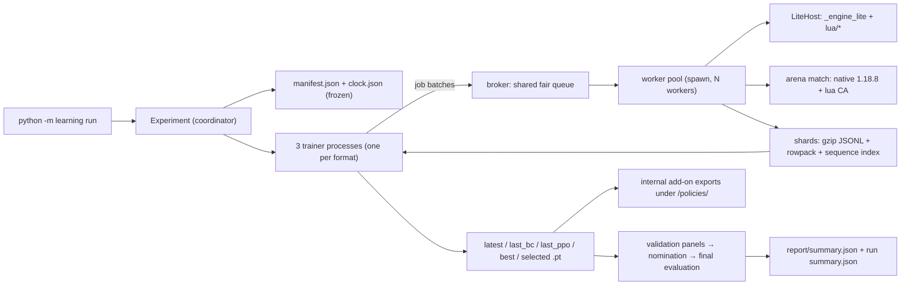

# WesnothLearning architecture

> Language: English | [中文](architecture_zh.md)

Updated 2026-10-31. This file describes only the current implementation. Dated evidence, failed runs and superseded decisions stay in `verification/`; remaining acceptance work is in [TEST.md](TEST.md); operating steps are in [instructions.md](instructions.md).

## 1. Scope and boundaries

The project trains one Wesnoth 1.18.8 policy for three formats: `duel` (2 players), `ffa4` (4 players, individual scoring) and `team2v2` (4 players, teams `[1,2,1,2]`).

Two rule backends share one observation/action contract:

- **native** — the real 1.18.8 game driven through the vendored WesnothArena SDK and a Lua CA add-on. It is the rules authority and the only backend for reference evaluation.
- **lite** — the Rust extension `engine_lite/` (`lite-0.2`), reproducible from a seed, used for cheap collection, rollouts and internal panels.

Learning is behavioural cloning (BC) from a declared teacher, followed by PPO driven by a reward controller. Delivery is a Lua AI add-on with exported weights; training never installs itself into the game.

Open areas include full lite/native rule equivalence, native performance acceptance and trained-policy strength.

## 2. Repository layout

| Path | Contents |
| --- | --- |
| `learning/` | Python coordinator: trainer processes, adapters, data pipeline, model, rewards, evaluation, export, bundle and maintenance tools |
| `engine_lite/` | Rust/PyO3 seeded engine, embedded Lua 5.4 host, rule capture/audit tools (`audit`, `capture`, `freeze`, `inventory`, `differential`) |
| `lua/` | Add-on Lua shared by the native deployment and the lite host: observation, candidates, spatial/relational network, routing, rewards, teacher |
| `vendor/arena/` | Vendored WesnothArena native SDK (runtime, match runner, bots, faction/leader/recruit profile) |
| `data/rules/` | Frozen rules: `1.18.8-combat-filtered` (default, 587 units / 438 terrains) and historical `1.18.8` |
| `data/` | Captured inputs: `humanData/`, `humanData_curated/`, `replays/` (packed lobby replay pull, one tar per month), `replays_curated/` (standard-era human games curated from it), `datasets/`, `opponents/gpt6astra.zip` (the frozen teacher package) |
| `tests/` | `tests/v5/` contract suites, legacy unit suites, manual smoke scripts, shared fixtures in `tests/v5/helpers.py` |
| `benchmarks/` | Frozen engine workload contract (`contract.json`) and its runner |
| `runs/<run>/` | Per-run manifests, per-format state, schedules and checkpoints (not tracked) |
| `verification/` | Dated acceptance and diagnosis reports; frozen evidence, never edited retroactively |
| `delivery/` | Explicitly exported model packages |
| `docs/` | The four resident documents (architecture, instructions, TEST, THIRD_PARTY), each with a `_zh` mirror |

## 3. Processes and data flow

- `Experiment` (`learning/coordinator.py`) freezes `manifest.json` and `clock.json`, then spawns one trainer process per requested format. `FormatExperiment` (`learning/experiment.py`) owns exactly one format's model, optimizer, reward controller, RNG stream and history.
- Trainers submit job batches to the broker. The broker runs one fixed-size worker pool (`ProcessPoolExecutor`, spawn) for all formats, marks past-deadline jobs `budget_interrupted`, logs every result to `<run>/<format>/jobs.jsonl`, repairs one interrupted trailing line when a log is first opened and appends later results without rereading it, and returns whole batches to the owning trainer.
- A worker runs one game through `sample.play_job`: lite games in-process via `LiteHost`; native games via the arena match runner driving one resident Wesnoth process with isolated user/add-on directories and file-backed Lua RPC (`native_transport`).
- Lite final-panel jobs request a score-only path for Astra seats. It tracks publicly observed village ownership and unit home hexes, calls the same teacher planner and executes each action through the shared Lua executor. Jobs collecting learner rows, opening behavior or reward diagnostics use the full observations and outcomes.
- Final student seats generate the full legal scene and candidate set and capture post-action sightings on every action. They request the neural memory row on the first successful action per seat and turn. Reward labels and opening diagnostics are computed by jobs with those consumers. [Matched student validation replay](../verification/lite_score_policy_20261104/REPORT.md)
- The Lite Lua host computes hex distance from signed axial offsets. On a fixed team validation board the change reduced single-worker wall time from 23.27 to 21.96 seconds and preserved all 1,031 actions and referee events. [Worker profile](../verification/lite_lua_cost_20261104/REPORT.md)
- Worker exceptions return `infrastructure_error` and fail the owning batch; trainer exits are recorded, and no format retries another format's games.

## 4. Rules and engines

`data/rules/1.18.8-combat-filtered` is the default frozen inventory (`rules.json` sha256 `e6b4f6200b0a8ad58a536b844fff37cfa9e0091bf0a0b702a8982155310f2f17`, source hash `58ead901…`, rules version `lite-combat-2-58ead901dadf8ebe`). `catalog-summary.json` records 587 units, 438 terrains, coverage 0 exact / 467 approximate / 120 unsupported scripts, and `training_acceptance.native_semantics_accepted = false`, `performance_accepted = false`.

- `rules_catalog.load()` verifies the file hash, the source hash and the version; training scope accepts recorded approximations. Startup additionally requires the six-faction training closure (leaders, recruits and every reachable advance/plague) to exist in the inventory, else the run refuses to start.
- `LiteAdapter` checks the extension build tuple (`ENGINE_VERSION='lite-0.2'`, `RNG_VERSION='splitmix64-rejection-v1'`, `COMBAT_VERSION='probabilistic_combat_v6'`) against the declared identity before use.
- `_engine_lite.LiteEngine(rules_json, spec_json)` exposes `reset`, `observe`/`observe_batch`, `legal_actions`/`legal_batch`, `step`/`step_batch` (restores the pre-batch state when an action is illegal), `snapshot`/`restore`, `forecast`, `configure_host`, `decision` and `execute_candidate`. JSON `pos`/`to` are zero-based row-major indices; the Lua bridge converts them to one-based hex coordinates and fixes the observing side, so no policy can switch views. `GameSpec` states width/height, flat terrain, sides, units, seed and `max_turns`; `side.id` is contiguous from 1 and `allow_approximate` must be explicit. Snapshots are referee truth and never reach a policy.
- Seeded combat (`probabilistic_combat_v6`): each strike samples hit/miss from a referee-only SplitMix64 stream with unbiased percent rolls; full hit damage has no uplift, slow uses native half-damage rounding and poison ticks 8 HP. Snapshots include the stream, batch rollback restores it, and public predictions never read or consume it. `forecast()` propagates merged HP/status probabilities; `samples` is ignored and returned as 0. Like native prediction, berserk stops after a round with >=99% death probability and reports `approximate=true`; actual execution retains its 30-round maximum.
- Retaliation compares matching-range weapon distributions by kill-minus-death, poison-adjusted HP balance and damage, using native 0.01 comparison tolerance. Execution skips prediction when zero or one counter is eligible. Native prediction includes fatal-hit debuffs and heals advancement branches to the current max HP; conditional poison recovery uses native marginal estimates. These advancement forecasts report `approximate=true`. Execution grants 4 XP for level-zero kills and clears poison/slow on type advancement. Fixed native comparisons and Python/Rust regression evidence: `verification/combat_boundaries_20261102/REPORT.md`. Standard AMLA execution accepts only the exact captured declaration: +3 max HP, full healing, rounded +20% max XP, poison/slow clearing and at most 100 applications; feeding bonuses survive. The training gate requires compiled declarations for all 158 reachable units (65 standard AMLA). Evidence: `verification/standard_amla_20261102/REPORT.md`. Weapon accuracy and opposing parry now modify the ordinary hit chance before clamping and magical/marksman effects; forecast and execution share the same calculation. Eleven fixed native cases and affected regression checks pass (`verification/weapon_accuracy_20261103/REPORT.md`). The compiler recognizes exact supported weapon declaration shapes and rejects unknown conditions or disable declarations. Nonpositive defense weights exclude counters; explicit zero-attack-weight weapons remain legal, matching native. Standard backstab requires a flanker hostile to the defender, including a third FFA faction, and excludes petrified flankers. R4 is accepted for this declared scope: 31 fixed native cases and 170 affected Python checks (`verification/weapon_filters_20261103/REPORT.md`).
- Implemented lite mechanics: terrain-cost movement, visible-enemy ZOC, friendly passage, connected-castle recruiting/economy, village capture, fog/shroud/history terrain, ally sharing, side rotation, leader elimination and team endgame, per-strike death/counterattack/XP advancement, slow, poison, drain, firststrike, marksman, magical, charge, berserk, basic plague, healing/rest, concealment/nightstalk/teleport, seeded hit/miss strikes.
- Approximate lite paths: adjacent leadership, illumination, backstab, steadfast, counterattack plague, one-step teleport cost. Known gaps: composite modifier rounding, custom weapon declarations, variant instances, random traits, AMLA choices, exact status-clear timing, vision costs/jamming, ranged pathfinding ZOC, campaign events. Frozen base-type weight diagnosis finds 26 nondefault declarations across all captures, none in the actual 158-unit training closure; that historical diagnosis is superseded for supported base weights by `verification/weapon_filters_20261103/REPORT.md`; arbitrary dynamic declarations remain unsupported. Unknown abilities/scripts block recruitment chains rather than degrade silently.
- Per-unit unpoisonable, undrainable and unplagueable flags join type immunity in attacks and retaliation. Forecast/execution respect poison and drain immunity; plague cannot convert an immune victim. Eighteen fixed legal-board cases verify teacher target/weapon selection, nonmutating queries and snapshot replay across all three formats; six native immunity battles also pass (`verification/teacher_immunity_20261103/REPORT.md`).
- `lua/` is the single legality/observation implementation: native Wesnoth loads it as an add-on, and `LiteHost` loads the same modules into the embedded Lua VM.

## 5. Observation, candidates and rows

`learning/features.py` (`VERSION = 5`) is the input contract. `schema()` fixes every ordered feature name and scale and is exported verbatim as `features.lua`, so the trainer and Lua consume identical inputs.

| Group | Contents |
| --- | --- |
| global | 20 base scalars (players, board size, gold/income, unit/HP totals, leader HP, turn, enemies, villages, allies) + own/enemy composition (level, fast, injured, damage type) + remaining moves, previous end turns, repeated moves |
| opponent | 8 base scalars + composition |
| action | 24 base scalars (kind, HP/cost, movement, approach, village, healing, defense, threat, expected damage, kill/death probability, leader flags, predicted combat) + max HP/moves/level, alignment, resistances, per-terrain cost/defense, three weapon summaries, village ownership, goal progress, repeated move |
| entity | 18 base scalars (position, HP, moves, attacks, XP, level, leader, relation, statuses, age) + a subset of action features + `next_round` |
| geometry | 16 scalars (actor/target/candidate x/y and normalized deltas, hex distance, full attack range) |
| spatial | 10 channels on a 16×16 board plus the 19-neighbour local patch |

The shared Lua generator charges a deterministic `work-12000-v8` work budget. It retains at most 36 actions plus end turn, with the same stage caps: 28 reach calls, 8 paths, 192 recruit probes, 32 attack probes, 48 move probes and 36 combat forecasts. Planning reserves 1,176 work units for move probes and forecasts, then shares its remaining allowance across mobile actors so early IDs cannot consume the whole planning budget. This does not increase the total 12,000 work limit.

Each mobile actor selects up to 16 nearby known villages; tactical goals are ranked relative to that actor before the 12-goal cap. Destination shortlisting interleaves proximity and threat-count rankings within the existing 64-position/40-eager-rating limits, retaining safe retreats as well as progress. The actor's primary move is probed first, then combat-adjacent landings, independently of whether a landing was first found as a village or position goal. Retained primary full moves take slots before the remaining recruit/combat/move allocation (nominal reserves 6/28/2, subject to the same 36-slot capacity). Unused capacity is filled deterministically without duplicate intents. Recruitment scans affordable types and up to eight legal castles per type within its shared probe cap; no claim of exhaustive type or slot coverage is made.

Training, lite evaluation and native deployment score this same set without another truncation. Candidate generation reads only legal visible context, never teacher answers. The contract is part of the schema, so old checkpoints/exports cannot silently resume under the new candidate set. Frozen evidence and weights are not rewritten.

Rows are the training contract: schema 6, encoded by `rowpack` v2 (JSON metadata plus one base64 float32 block per row) inside gzip JSONL shards. Each row carries engine/rules/RNG/combat/candidate/reward versions, reward formula, scenario family, split rule, game family, teacher identity and source (`astra`, `human`, `policy`). `data.validate_record` rejects any row whose provenance, widths, finiteness, intent fields or reward configuration disagree with the frozen run. BC trains the value head only on rows with valid outcomes, using `terminal_reward` in schema 6 and `reward` in schema 5.

Bounded shard reads consider the planned initial family pool in each provenance bucket before stopping on a filled row quota; a long first game cannot exclude the rest of that pool. Additional families only backfill a shortage. The existing compressed/retained-byte limits still bound admission, and complete raw prefixes remain attached. Frozen-batch replay expands FFA/team exposure from 22/9 to 30/14 families at the same 2048-row limit; this does not prove imitation quality. Evidence: `verification/bc_admission_20261102/REPORT.md`.

Bounded reads assign max-min family shares during admission and immediately release unused supervised targets before decoding another family. Adding families only shrinks previous shares; complete raw histories and fixed byte budgets remain attached. The frozen team read exposes 16/17 families at 2048 rows, with lower process peak RSS but more decoding time; see `verification/bc_retained_targets_20261102/REPORT.md`.

Fresh BC checks non-emptiness using the actual version-seeded teacher/DAgger/human training batch and reuses that read for its update. The prepared rows are released after the update attempt; they are not checkpointed or kept across collection. Resume reconstructs the batch and verifies its existing content identity. This removes a discarded full read measured at 11.90 s on the frozen team pool; 29 affected Ubuntu checks pass (`verification/bc_preflight_read_20261102/REPORT.md`). End-to-end speedup is unmeasured.

Actor inputs never contain referee truth: reward scalars, teacher actions, unseen units, unexplored terrain and RNG state are stripped before the policy sees a decision.

Each job records aggregate coverage, eligibility, truncation and shard identity. Opening probes add `behavior` for the BC opening gate. Ordinary BC and PPO validation games carry `meta.phase=validation`, and matched reference games carry `meta.phase=reward_reference`. These tags select the policy and reference horizons written to `reward_diagnostics` for the reward controller.

Teacher capabilities are declared, not assumed:

- `gpt6astra` — the frozen per-decision Lua teacher (`learning/teachers/`, derived source; `data/opponents/gpt6astra.zip` is its lineage and the package every manifest ships). The derived source adapts attack scoring to `probabilistic_combat_v6`: slow is worth 50% of the attacked target's damage estimate plus its movement restriction; poison is 8 points per tick. Other enemies contribute to danger cost but not the target's slow benefit. Slow benefit excludes fatal outcomes from the native marginal. The independent native/Lite target-attribution pair, three-format slow cases and lethal weapon-choice regression pass (`verification/teacher_slow_attribution_20261103/REPORT.md`, `verification/teacher_surviving_slow_20261103/REPORT.md`). `teacher_profile` with `teacher_source_sha256` travels in rows, checkpoints, job metadata and exports, so one run never mixes profiles.

A fresh manifest freezes that package and names its lineage as the teacher, so teacher and DAgger shards carry one identity. `LiteHost` refuses official-baseline seats and accepts only the declared `gpt6astra` source.

Native teacher execution stops its old plan when a move reveals an ambush (`status=2005`), even when the actor reached the planned hex; other move errors still fail. The actual native fixture verifies movement, newly visible Wose and zero follow-up attacks, alongside the three-strategy regression (`verification/teacher_ambush_20261103/REPORT.md`). The frozen opponent archive remains unchanged; maintained source edits produce a new automatically computed teacher identity.

Team teacher collection cyclically relabels its faction design so every faction appears at every focal seat once per 24 planned games. This corrects the previous team-roster exposure bias without consulting partitions or labels; physical scenario hashing still assigns train/validation. Distinct factions, all allied pairs, bot roles and non-team/evaluation designs are preserved. Schedule evidence: `verification/team_teacher_factions_20261102/REPORT.md`. The ordinary three-format gate subsequently passed on the current teacher and rules ([BC readiness](../verification/bc_ordinary_v6_20261103/REPORT.md)).

## 6. Policy network

Architecture id `relational_v5`, one independent model per format (roughly 0.77 M parameters; the exact count is frozen in each manifest).

| Component | Shape |
| --- | --- |
| unit embedding | 588 × 16 |
| opponent encoder | 16 |
| entity attention | 2 layers, 4 heads × 16, FFN 128, residual |
| board convolution | two 3×3 convolutions, 16 channels |
| local patch | 19 × 10 → 32 |
| scene encoder | `[global, opponent mean/max, entity pool, board mean]` → GRU 128 |
| memory | 32 slots × 64, query/key/value read with age decay |
| action scorer | context + action + geometry → 512 → 256 → 128 → 1 |
| value head | context → 128 → 1 |

`context()` retains eight own-turn rows of differentiable replay. BC/PPO reuse detached historical scenes and GRU prefixes within one logical optimizer step; active suffixes retain gradients and the next step starts a fresh cache. Frozen lite inference advances only newly committed rows, with per-side hidden state and 32 slots. Output/gradient and counted-work evidence: `verification/window_memory_20261101/REPORT.md`; full-training speedup is unmeasured. Python/Lua export parity remains <=1e-5. Relational Lua linear/scorer layers omit exact zero inputs using ascending column indices, preserving nonzero accumulation order. Frozen-input inference is 55%-62% faster on the measured Ubuntu cases; three trained models match the previous Lua outputs exactly. See `verification/native_inference_20261102/REPORT.md`.

BC imitation validation shares a local history cache across its 64-row inference chunks; all historical scenes may be reused under no-gradient inference while weights are unchanged. Each validation call starts fresh, and gradient-enabled replay retains its eight-turn suffix. A 130-decision/36-turn fixture reduces encoded scenes from 238 to 166 with matching gate metrics; 15 affected Ubuntu cases have passing evidence (`verification/bc_validation_cache_20261102/REPORT.md`). Production wall-clock and RSS changes are unmeasured.

## 7. Rewards and online control

Reward formula `v5-potential-1` (`learning/rewards.py`):

- terminal: ±1 / 0 for duel and team2v2; centred rank points normalized by maximum deviation for ffa4;
- economy potential: gold + army cost·HP fraction + 20·villages, averaged per team and normalized by `200 + Σ|potential|`;
- per-row transition: potential difference with `γ^Δturn`, explicit truncation bootstrap, and an exploration ledger for first visits of visible hexes within reach.

`RewardController` (`learning/control.py`) stores an append-only event chain (sequence number, previous checksum, checksum) per format. It advances on complete validation windows of 12 blocks over matched map/faction strata with Astra references, and changes one coefficient at a time within ±10% while staying inside `economy 0.05–0.20`, `control 0.02–0.15`, `explore 0–0.15`. Adaptive proposals tick only after two comparable windows; holdout/final/test partitions never tune rewards; pending commands apply at batch boundaries. Evidence is built by `learning/reward_metrics.py` from matched validation windows: policy games are compared against Astra references on the same map/faction/teammate context with at least four independent game families per stratum, and incomplete records land in `excluded_evidence` rather than completing a block.

## 8. Training pipeline

A run is `<run>/<format>/` containing `state.json`, atomic checkpoints (`latest.pt`, `last_bc.pt`, `last_ppo.pt`, `best.pt`, `selected.pt`, `selection.json`, `bc_gate.json`), `schedules/`, `jobs.jsonl`, `validation/`, `policies/` and `report/`.

Stages run in order: `calibration` → `bc` → `ppo` → `final`.

1. **Calibration** collects three blocks of fixed reference games on validation maps, writes `controls.json`, and moves to BC. A single fixed reference skips collection.
2. **BC** samples teacher/BC rows with per-source, per-engine and per-family quotas, trains equal-weight sequence windows, and reports loss, CE versus uniform, and per-kind accuracy. The gate separates the two failure modes: every coverage miss is counted under a reason code (`kind_absent`, `actor_absent`, `destination_absent`, `enemy_absent`, `weapon_absent`, `mode_absent`, `type_absent`, `slot_absent`) whose per-kind sum equals that kind's `total − matched`, and held-out fit is reported per kind as exact, same-kind, same-actor, same-destination and label-rank buckets over the rows that did survive retention. Gates: coverage ≥90% overall and ≥80% per class; imitation effective (≥32 samples per class, CE < 85% of uniform, accuracy thresholds); corpus/audit checks; and at least 12 distinct scenario families. Those four must pass before PPO unless `--phase ppo --force <reason>` is used, which keeps `effective = false`. The four-game opening probe is recorded in `bc_gate.json` as evidence (`blocking: false`) but does not gate: it is a behaviour spot check, not a quality measure. `effective` is recomputed from the stored gate at every BC batch and every validation. Windows are sampled with replacement through one representative each under source/engine/family quotas, independently of decision count. Metrics distinguish window visits, unique windows and repeats; the step cursor retains visited indices.
3. **PPO** trains on the batch just collected for the current policy snapshots (rollout shards of one reward/engine/teacher identity), while teacher and human rows are read separately as the BC rehearsal set. Batch preparation enforces the `scenario-v2/no-drop-v1` contract: rows are partitioned before identity is committed, and any excluded row raises instead of being dropped. Updates use a deterministic per-epoch window plan, logical-batch KL (rejection threshold 0.02, checked before the optimizer step) and per-step counters so a resumed boundary reproduces the uninterrupted future. An explicit `phase ppo --ppo-batches N` request checkpoints a per-format target. Newly scheduled batches count once they commit a positive number of optimizer steps. The trainer finishes due validation before stopping at the target.
4. **Validation** runs every 10 versions against the teacher and the champion, using full seat rotations; a trend panel needs 3 distinct scenario families, a promotion panel (version %100) needs 12 blocks with ≥12 distinct families and re-evaluates the champion on the same blocks.
5. **Selection** nominates at most one complete latest candidate against `best.pt` using recorded matching panels; final evaluation freezes `selected.pt` before touching holdout maps and reports 30 blocks with ≥12 distinct families.

The clock reserves 10/12 of `hours` for updates and 2/12 for frozen evaluation; `final_holdout_hours` is carved out of the evaluation window.

Checkpoints are written atomically beside `state.json`; resume validates the manifest hash, schema, weights and optimizer state; a branch run also accepts the parent manifest hash its inherited checkpoint still pins. `--branch-from` copies a complete `latest.pt` into a new run with parent identities, new clock and seed, and either a kept or reset optimizer. Corpus and coverage gates reuse eligible ancestor teacher results only for shard paths retained by that checkpoint; later ancestor collection is excluded and nested lineage is deduplicated by shard path. Thirty affected Ubuntu checks and a read-only 40-game parent check pass (`verification/branch_teacher_evidence_20261102/REPORT.md`).

A branch with `--branch-restart-bc` starts calibration with compatible parent weights, the original teacher and DAgger shard paths, and their lineage. Adam, counters, phase state, reward control and selection start fresh. Each format recomputes the ordinary gates after a child BC update. Original scenario-family partitions still apply to the reused data, including families used to select the parent checkpoint. [Ubuntu checks and v6 input identities](../verification/bc_branch_restart_20261104/REPORT.md)

## 9. Evaluation and selection

`learning/evaluate.py` scores a game by official result (2-player/team win 3, draw 1, loss 0; ffa4 rank points divided by 3) and compares policy versus control per format over complete rotation blocks. Differences get a cluster bootstrap (5,000 resamples, 2.5/97.5 percentiles) clustered by scenario family, so repeated identical layouts cannot inflate evidence.

Comparison status precedence: `infrastructure_error` → `inconclusive` (missing/underfilled blocks) → `insufficient_design` (fewer distinct families than required) → `passed` (interval low > 0) → `not_passed` (interval high ≤ 0) → `inconclusive`.

Teacher acceptance measures the maintained Astra teacher against the original Astra strategy with matching native ambush handling. It uses the scenario-cluster interval above, normalizes duel/team scores by 3, and requires each format's lower endpoint to exceed −0.05. Official 30-turn adjudications count toward the score. Team weights baseline-partner and self-team equally. The repaired teacher passed on the validation maps. Its independent 1,920-game duel interval was [−0.028125, +0.019271]. The unchanged four-player path retained the earlier FFA [−0.043611, +0.067917] and team [−0.034028, +0.029861] intervals. [Teacher acceptance and input identities](../verification/duel_landing_ni_20261103/REPORT.md)

`selection.py` reuses only complete, matching 12-block panels and keeps the champion unless the candidate both passes and scores higher. Reports are machine-readable JSON plus a short Markdown profile report; schedule, seed, control and engine identity are recorded with every panel.

## 10. Delivery

- The file-backed export audit uses a shared worker pool across formats and keeps each complete game-side sequence together. A policy rollout and its DAgger copy share a score computation only when their initial prefixes and every ordered model input, commit and memory write match byte for byte. Both streams undergo row validation and contribute turn and candidate evidence. The maximum Python/Lua error and coverage gates are checked per format.
- `ensure_export()` writes internal add-ons with features, weights, config and export metadata; these are not subject to the SDK submission size limit. Config carries no candidate budget; every caller uses the one generator contract, and every phase scores the complete shared-generator result.
- `python -m learning export` writes a deployable add-on (all three formats, `arena.json` schema 2, vendored runtime, numeric parity record) and `python -m learning package` zips it as `delivery/NeuralArena.zip`. Export requires matching engine/teacher identity, trained weights and current-schema audit parity.
- Weight files carry little-endian float32 vectors in base64 and a self-contained Lua decoder. Loading restores the existing tables exactly, including signed zero and subnormals; no quantization is applied. Sequence parity executes the same serialized source as deployment. The three-format add-on must still fit the SDK's 16 MiB uncompressed limit. Current SDK/sequence/native-loading acceptance: `verification/compact_weights_20261102/REPORT.md`.
- Frozen Lite policies and the export auditor evaluate those coefficients in binary64, matching Lua arithmetic. BC and PPO training use float32. A trained duel sequence passed the absolute `1e-5` candidate-logit and value tolerance. [Trained checkpoint precision](../verification/trained_export_precision_20261104/REPORT.md)
- `python -m learning bundle` builds the extraction-ready Ubuntu 24.04 training archive (`BUNDLE_MANIFEST.json`, `SHA256SUMS`, fixed member modes, run state and evidence excluded); `verify-bundle` re-checks it statically.

## 11. Tooling

| Command | Purpose |
| --- | --- |
| `run` / `phase` | start, resume or branch an experiment; request BC/PPO/evaluation at a batch boundary |
| `collect` / `train` / `evaluate` / `report` | isolated job collection, one BC/PPO update, job scoring, reports |
| `export` / `package` / `bundle` / `verify-bundle` | add-on export, delivery zip, training archive, static verification |
| `audit bc` / `audit fit` | full-set BC representation diagnostics; explicitly invoked tiny-fit probe |
| `benchmark engines` | measured native/lite workload comparison (never infers unmeasured resources) |
| `rules` / `freeze-map` | freeze native rule captures; add a frozen map identity |
| `import-human` / `replay_curate` | verified human replay import; replay curation over local saves and lobby archives, recording mid-game controller hand-overs per side |
| `replay_fetch` | provision one hosted archive month of replays into `data/replays/<YYYYMM>/`, resumable and verifiable |
| `control show` / `control set` | inspect or queue reward-control changes |

Differential tooling: `python -m engine_lite.differential` audits lite versus native on bounded real battles; `engine_lite.audit`/`inventory`/`capture`/`freeze` handle rule evidence without launching training.

The benchmark workload is fixed by `benchmarks/contract.json`: paired native/lite manifests, cold and resident-hot cache, equal-work and end-to-end modes, and 30 complete seat-rotation blocks per group. Acceptance needs an identical host, CPU quota and `work_signature`, process-tree CPU including the coordinator, PSS (never RSS) and both wall and CPU at least 5× native; missing artifacts, faults or unequal work stay `inconclusive`.

Training jobs bind the positive `training_max_turns` config before scenario eligibility, hashing and freezing. The bounded runner passes its declared 30; default and legacy configurations keep 60. Frozen schedules and resumed manifests remain authoritative; evaluation and opening probes keep independent limits. All 50 affected Ubuntu checks pass (`verification/training_turn_limit_20261102/REPORT.md`); this proves wiring, not ordinary BC or full-loop readiness.

The manual bounded runner counts each PPO phase's four-batch cap from that format's own entry batch. Both initial PPO and resume must finish as `ppo_complete`, with a higher committed batch and PPO update count, no pending training and no trainer error. Boundary records retain entry update counts and resulting states. Before audited export, every format must finish evaluation with nonempty control reports, all 30 blocks, no missing blocks/fault games and at least 12 distinct scenarios; statistical victory is not an operational gate. Thirteen deterministic Ubuntu checks cover these handoffs (`verification/bounded_final_20261102/REPORT.md`, original progress evidence in `verification/bounded_progress_20261102/REPORT.md`); real post-BC execution remains open.

## 12. Default parameters

| Parameter | Default |
| --- | --- |
| formats / engine / evaluation engine | all three / `lite` / follows the sampling engine |
| hours / workers / device / trainer threads | 12 / 8 / `cpu` (trainer) / 1 |
| seed | 20261018 in the configuration; `run` passes 20261017 by default |
| BC teacher-game targets | duel 300, ffa4 600, team2v2 400 |
| native BC games | same as teacher targets for native, 0 for lite |
| validation games per event | duel 6, ffa4 4, team2v2 8 (full rotations) |
| validation interval / final blocks | 10 versions / 30 blocks |
| min distinct families | trend 3; promotion, final, gate 12 |
| BC batch games / records | 8 / 2048 CPU (8192 CUDA) |
| BC validation records | 1024 / 4096 |
| BC accuracy floors | all 0.40, recruit 0.60, move 0.35, attack 0.35 |
| epochs / minibatch / micro | 4 / 256 / min(256, 32 CPU or 64 CUDA) |
| BC learning rate / PPO learning rate | 3e-4 / 1e-4 |
| PPO clip / value / entropy / BC aux / grad clip | 0.2 / 0.5 / 0.01 / 0.10 / 0.5 |
| KL limit / plan version | 0.02 / 2 |
| reward mode / ranges | adaptive / economy 0.05–0.20, control 0.02–0.15, explore 0–0.15 |
| shared candidate limit | 36 actions + 1 end-turn (all phases) |
| turn cap | training 60 (`training_max_turns`); calibration/panels 30; opening probe 5 |
| shard budgets | 96 MiB compressed, 768 MiB retained estimate |
| final holdout hours | 0 |

`validate_config` enforces the hard floors (1–16 global workers, ≥30 final blocks, rollout multiple of 4, rotations covering every format, 2v2 validation multiple of 8, `native_bc_games` ≤ teacher targets).

## 13. Limits and open gaps

- Lite rules are approximate (467 of 587 units) and explicitly not native-accepted; whole-package performance is unaccepted.
- Both backends now use stochastic combat; their RNG streams differ. Fixed-position probability parity does not establish complete cross-engine equivalence.
- The deterministic tactical surrogate has been replaced by seeded execution and public probability propagation. Fatal status, conditional/forced advancement and zero-level XP now have fixed native and automated regression evidence in `verification/combat_boundaries_20261102/REPORT.md`; the initial stochastic conversion remains documented at `verification/probabilistic_combat_20261102/REPORT.md`. Full native semantics remain open.
- DAgger is Astra-only: the frozen teacher answers per-decision queries, and every correction row carries that identity.
- The official baseline is native-only; lite runs cannot evaluate against it.
- The curated replay corpus (`data/replays_curated/`, 1,076 standard-era games) is staging; only the 197 games recorded under 1.18.8 reach BC. A lobby archive starts from its `[scenario]` block, because 1.18.8 expands the scenario and merges the recorded RNG itself; a lobby archive without `[carryover_sides_start].random_seed` is skipped as `missing_initial_rng`. Replay markers may only run before an action and once at the end, since the replay machine rejects a `[custom_command]` reached inside a synced context. Three games were prepared, played by official 1.18.8 and imported as 84 BC rows (`verification/curated_bc_20261031/REPORT.md`); wider corpus play is not claimed.
- Native play is reproducible from its seed: `match.play_game` writes the seed into the scenario, so `runtime.lua` calls `math.randomseed(seed)`, and preloads `.runtime/entropy.so` (built by `setup.sh`) with `ARENA_ENTROPY_SEED`, so Wesnoth's default and per-action C++ RNGs draw from a seeded stream instead of OS entropy. A stock duel played twice from seed 20261017 produced identical decisive event streams (`verification/native_seed_20261031/REPORT.md`). Games from different seeds still differ; cross-seed native comparison uses recorded counts only, and lite/native equality is not claimed.
- Shared candidate provenance and numerical-parity evidence is in `verification/candidate_budget_20261031_exact37/REPORT.md`; 45 affected Ubuntu checks pass for `work-12000-v8` in `verification/bc_root_20261101/REPORT.md`. Current seeded native timing passes in `verification/native_inference_20261102/REPORT_seeded.md`: six paired games, zero faults, scoring p95 122/133/114 ms and unchanged 37-candidate/12,000-work limits. Full event payloads match after excluding elapsed durations and canonicalizing independent per-side report batches. The unchanged dense baseline also passes on the idle host; total paired-panel cost falls 44.9%.
- The selected duel v12 policy completed the 120-game L1 native holdout with zero faults. Both controls scored 30/30 blocks across 30 distinct scenarios. Its official score differences were −1.00 against Astra and −0.65 against baseline. Both strength comparisons returned `not_passed`. [Selected-checkpoint final evaluation](../verification/selected_final_20261103/REPORT.md)
- Ordinary BC readiness is accepted for all three formats with the v6 teacher, v8 candidate budget, 30 turns and a target of 48 teacher games per format. The normal phase completed in 69m10s. Duel/FFA/team coverage was 90.29%/90.64%/93.22%, and held-out recruitment reached 64.18%/61.33%/62.82% against the 60% floor. All imitation, corpus and design gates passed. Duel used its ordinary plateau refresh. The separate approximately one-hour all-format PPO/resume/evaluation/export chain remains open under L2. [Ordinary BC report](../verification/bc_ordinary_v6_20261103/REPORT.md)
- Duel slow valuation uses the attacker's pre-move defense to give the same target a common status value across attack landings. Other-enemy exposure and landing defense use the candidate hex. The b0025 native board and a Lite regression accept the repair. [Fixed-board evidence](../verification/duel_slow_landing_20261103/REPORT.md)
- Convergence and playing strength of the trained policy remain open.

## 14. Documentation map

| Document | Responsibility |
| --- | --- |
| `README.md` / `docs/README_zh.md` | repository entry |
| `docs/architecture.md` | this file: structure, contracts, parameters |
| `docs/instructions.md` | operating steps, Ubuntu bundle and instruction-driven tuning |
| `docs/TEST.md` | remaining acceptance items only |
| `docs/THIRD_PARTY.md` | licensing |
| `verification/<date>/REPORT.md` | dated commands, identities and results |

Maintenance rules live in the root `AGENTS.md`; evidence is never retro-fitted, and an accepted item leaves `TEST.md` as a whole.
