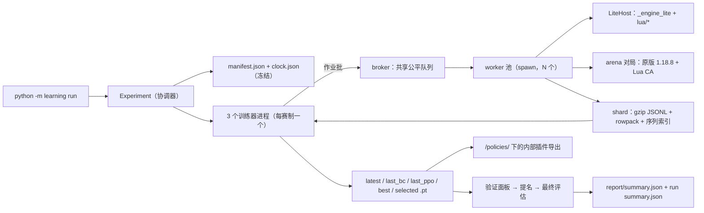

# WesnothLearning 架构

> 语言：[English](architecture.md) | 中文

本文件只描述当前实现。带日期的证据、失败运行与已被取代的决策留在 `verification/`；剩余验收工作见 [TEST_zh.md](TEST_zh.md)；运行与按指令调参见 [instructions_zh.md](instructions_zh.md)。

## 1. 范围与边界

项目为三种赛制训练同一套 Wesnoth 1.18.8 策略：`duel`（2 人）、`ffa4`（4 人，个人计分）、`team2v2`（4 人，队伍 `[1,2,1,2]`）。

两个规则后端共用同一观察／动作契约：

- **native** —— 通过 vendored WesnothArena SDK 与 Lua CA 插件驱动的真实 1.18.8 游戏。它是规则权威，也是参考评估的唯一后端。
- **lite** —— Rust 扩展 `engine_lite/`（`lite-0.2`），按种子复现，用于低成本采集、rollout 与内部面板。

学习流程为：从声明的教师做行为克隆（BC），随后由奖励控制器驱动的 PPO。交付物是带导出权重的 Lua AI 插件；训练不会把自己安装进游戏。

待验收范围包括完整 lite/native 规则等价、原版性能和训练后策略棋力。

## 2. 仓库布局

| 路径 | 内容 |
| --- | --- |
| `learning/` | Python 协调层：训练器进程、适配器、数据管线、模型、奖励、评估、导出、打包与维护工具 |
| `engine_lite/` | Rust/PyO3 确定性引擎、内嵌 Lua 5.4 宿主、规则采集/审计工具（`audit`、`capture`、`freeze`、`inventory`、`differential`） |
| `lua/` | 原版部署与 lite 宿主共用的插件 Lua：observation、candidates、spatial/relational 网络、routing、rewards、teacher |
| `vendor/arena/` | vendored WesnothArena 原版 SDK（runtime、对局运行器、bot、阵营/领袖/招募档案） |
| `data/rules/` | 冻结规则：`1.18.8-combat-filtered`（默认，587 单位 / 438 地形）与历史 `1.18.8` |
| `data/` | 采集输入：`humanData/`、`humanData_curated/`、`replays/`（整月大厅录像归档，每月一个 tar）、`replays_curated/`（从中整理的标准时代人类对局）、`datasets/`、`opponents/gpt6astra.zip`（冻结的教师包） |
| `tests/` | `tests/v5/` 契约套件、旧版单元套件、手工烟测脚本，共享夹具在 `tests/v5/helpers.py` |
| `benchmarks/` | 冻结的引擎负载契约（`contract.json`）及其运行器 |
| `runs/<run>/` | 每次运行的 manifest、各赛制状态、调度与检查点（不入库） |
| `verification/` | 带日期的验收与诊断报告；冻结证据，不得追溯修改 |
| `delivery/` | 显式导出的模型包 |
| `docs/` | 四份常驻文档（architecture、instructions、TEST、THIRD_PARTY），每份都有 `_zh` 镜像 |

## 3. 进程与数据流

- `Experiment`（`learning/coordinator.py`）冻结 `manifest.json` 与 `clock.json`，然后为每个请求赛制启动一个训练器进程。`FormatExperiment`（`learning/experiment.py`）只拥有一个赛制的模型、优化器、奖励控制器、RNG 流与历史。
- 训练器把作业批提交给 broker。broker 用一个固定大小的 worker 池（`ProcessPoolExecutor`，spawn）服务全部赛制，将超过截止时间的作业标为 `budget_interrupted`，把每个结果写入 `<run>/<format>/jobs.jsonl`，每个日志首次打开时只修掉一条被中断的不完整尾行，其后结果直接追加、不再重读，再把整批返回给所属训练器。
- worker 通过 `sample.play_job` 运行一局：lite 对局由 `LiteHost` 在进程内完成；原版对局由 arena 对局运行器驱动一个常驻 Wesnoth 进程（独立 user/add-on 目录，文件式 Lua RPC，见 `native_transport`）。
- Lite 最终评测为 Astra 席位启用仅计分路径。教师、PPO、DAgger、普通验证及奖励参考对局中，无需记录轨迹的固定 Astra 席位也使用该路径。它记录公开观察到的村庄归属和单位初始位置，调用相同的教师决策逻辑和共用的 Lua 执行器。学习席位、DAgger 查询及奖励时点快照保留完整观察。开局探针收集所有席位的动作诊断。[混合验证对照](../verification/lite_unrecorded_astra_20261104/REPORT.md)
- 最终评测中的学生席位生成完整的合法观察和候选集，每次行动后都更新可见信息。每个席位每回合首次成功执行动作时请求神经网络记忆行。需要奖励标签或开局诊断的对局仍计算这些数据。[同局学生验证对照](../verification/lite_score_policy_20261104/REPORT.md)
- Lite Lua 宿主通过有符号轴向位移计算六角距离。在固定的 2v2 验证对局中，单 worker 耗时从 23.27 秒降至 21.96 秒，全部 1,031 个动作及裁判事件均相同。[Worker 性能记录](../verification/lite_lua_cost_20261104/REPORT.md)
- worker 异常返回 `infrastructure_error` 并使所属批失败；训练器退出码被记录，任何赛制都不会重试其他赛制的对局。

## 4. 规则与引擎

`data/rules/1.18.8-combat-filtered` 是默认冻结清单（`rules.json` sha256 `e6b4f6200b0a8ad58a536b844fff37cfa9e0091bf0a0b702a8982155310f2f17`，source hash `58ead901…`，规则版本 `lite-combat-2-58ead901dadf8ebe`）。`catalog-summary.json` 记录 587 单位、438 地形、覆盖 0 exact / 467 approximate / 120 unsupported scripts，且 `training_acceptance.native_semantics_accepted = false`、`performance_accepted = false`。

- `rules_catalog.load()` 校验文件哈希、source hash 与版本；训练范围接受已记录的近似。启动还要求存在六阵营训练闭包（领袖、招募以及所有可达的升级/瘟疫链），否则拒绝启动。
- `LiteAdapter` 在使用前校验扩展构建三元组（`ENGINE_VERSION='lite-0.2'`、`RNG_VERSION='splitmix64-rejection-v1'`、`COMBAT_VERSION='probabilistic_combat_v6'`）与声明身份一致。
- Lua 假设落点预测从观察方当前可见的单位列表和已知地形出发，在副本中移动可见攻击者，再检查原有公开单位的隐蔽状态。假设移动可使此前可见的夹击者重新隐蔽，但不能发现隐藏的光环来源。已封存 v6 训练输入的复用仅覆盖经审查的 158 个单位及其记录的场景设置；历史自定义阵容需单独核实兼容性。[预测回归与适用范围](../verification/immutable_forecast_20261104/REPORT.md)
- `_engine_lite.LiteEngine(rules_json, spec_json)` 提供 `reset`、`observe`/`observe_batch`、`legal_actions`/`legal_batch`、`step`/`step_batch`（非法动作时恢复批次前状态）、`snapshot`/`restore`、`forecast`、`configure_host`、`decision` 和 `execute_candidate`。JSON 的 `pos`/`to` 是从 0 开始的行主序下标，Lua 桥接层转换为从 1 开始的六角坐标并锁定观察方，策略无法切换视角。`GameSpec` 明确给出宽高、平地地形、阵营、单位、种子和 `max_turns`；`side.id` 从 1 连续编号，`allow_approximate` 必须显式给出。快照是裁判真值，绝不下发给策略。
- 带种子战斗（`probabilistic_combat_v6`）：裁判内部 SplitMix64 无偏抽样命中；命中伤害无增益，减速按原版半伤害取整，中毒扣 8 HP。快照/回滚恢复随机流，公开预测不读取或消耗它。预测合并 HP/状态概率，samples 被忽略并返回 0。狂暴预测与原版相同，在某轮死亡概率达到 99% 后停止（`approximate=true`），实际执行仍最多 30 轮。
- 反击按同射程武器的击杀减死亡、中毒调整后 HP 差及损伤比较概率分布，使用原版 0.01 容差。执行在无反击或仅一把武器时跳过预测。原版预测包含致命命中的状态，升级分支恢复到当前最大 HP，条件升级的中毒恢复使用原版边缘概率估计；这类升级预测标记 `approximate=true`。执行中零级击杀给 4 XP，类型升级清除毒/减速。固定原版对照与 Python/Rust 回归见 `verification/combat_boundaries_20261102/REPORT.md`。标准 AMLA 仅接受捕获中的精确声明：最大 HP +3、回满血、最大经验按取整增加 20%、清毒/减速、最多 100 次，并保留吞噬加成。训练门禁要求 158 个可达单位均含编译声明，其中 65 个支持标准 AMLA。证据见 `verification/standard_amla_20261102/REPORT.md`。accuracy 和对方武器 parry 现已在普通命中率限制及魔法/精准效果之前生效，预测与执行共用计算。11 个固定原版案例和受影响回归通过（`verification/weapon_accuracy_20261103/REPORT.md`）。编译器精确识别受支持的武器声明形状，拒绝未知条件及禁用声明；非正防御权重排除反击，显式选择零攻击权重武器仍合法，与原版一致。标准背刺要求夹击者敌对目标，包括 FFA 第三方，且排除石化夹击者。R4 在此声明范围内通过验收：31 个固定原版案例及 170 项相关 Python 检查（`verification/weapon_filters_20261103/REPORT.md`）。
- lite 已实现机制：按地形代价移动、可见敌军 ZOC、友军通行、连通的城堡招募/经济、村庄占领、fog/shroud/历史地形、盟友共享、行动顺序轮转、领袖击杀与队伍终局、逐次攻击的死亡/反击/经验升级、slow、poison、drain、firststrike、marksman、magical、charge、berserk、基础 plague、治疗/休息、concealment/nightstalk/teleport、带种子命中抽样。
- lite 近似路径：相邻领导力、illumination、backstab、steadfast、反击触发 plague、单步 teleport 代价。已知缺口：复合修正取整、自定义武器声明、变体实例、随机特质、AMLA 选择、状态清除精确时机、视距代价/jamming、远程寻路 ZOC、战役事件。冻结基础类型权重诊断发现全部捕获中有 26 个非默认声明，均不在实际 158 单位训练闭包内；受支持基础权重的历史诊断已由 `verification/weapon_filters_20261103/REPORT.md` 中的验收补齐；任意动态声明仍不支持。未知能力/脚本会阻断招募链，而不是静默降级。
- 单位当前的 unpoisonable、undrainable、unplagueable 状态与类型免疫共同约束攻击和反击；预测与执行均遵守中毒/吸血免疫，瘟疫不转换免疫死者。18 个固定合法棋盘验证了三赛制教师目标/武器选择、查询不改变战局及快照复现，另有 6 个原版免疫战斗比较通过（`verification/teacher_immunity_20261103/REPORT.md`）。
- `lua/` 是唯一的合法性/观察实现：原版 Wesnoth 以插件方式加载它，`LiteHost` 把同一批模块加载进内嵌 Lua VM。

Lite 按单位槽位保存地形视野。单位类型或位置改变时，在固定地图上重算该单位的可视格。每次刷新仍按当前阵营、共享视野、隐匿、村庄和敌方记忆更新观察。快照保存已获得的知识，恢复和回滚副本从空的派生缓存开始。在一个冻结的组队验证对局中，进程 CPU 时间减少 12.56%，每个已提交动作后的所有公开观察均完全一致。[Ubuntu 对局记录与测试](../verification/vision_footprint_20261104/REPORT.md)

Lite 可达性与寻路对每个展开的格子只枚举一次六个相邻格。相邻己方村庄保留地形移动消耗，其余传送目的地沿用村庄原有顺序。Lua 寻路请求和合法动作枚举复用已按查询方视野筛选的单位。[枚举次数和验证对局一致性](../verification/public_reach_20261104/REPORT.md)

## 5. 观察、候选与行

`learning/features.py`（`VERSION = 5`）是输入契约。`schema()` 固定每个有序特征名与缩放，并原样导出为 `features.lua`，因此训练器与 Lua 消费完全相同的输入。

| 组 | 内容 |
| --- | --- |
| global | 20 个基础标量（人数、棋盘尺寸、金币/收入、单位/HP 总量、领袖 HP、回合、敌军、村庄、盟友）+ 己方/敌方构成（等级、快速、受伤、伤害类型）+ 剩余移动、上回合结束次数、重复移动 |
| opponent | 8 个基础标量 + 构成 |
| action | 24 个基础标量（类型、HP/造价、移动、接近、村庄、治疗、防御、威胁、预期伤害、击杀/阵亡概率、领袖标记、预测战斗）+ 最大 HP/移动/等级、阵营倾向、抗性、逐地形代价/防御、三个武器摘要、村庄归属、目标进度、重复移动 |
| entity | 18 个基础标量（位置、HP、移动、剩余攻击、经验、等级、领袖、关系、状态、时长）+ 动作特征子集 + `next_round` |
| geometry | 16 个标量（行动者/目标/候选的 x/y 与归一化差值、六边形距离、完整攻击范围） |
| spatial | 16×16 棋盘上的 9 个通道，外加 19 邻域局部块 |

共享候选生成采用确定性的 `work-12000-v8` 工作量预算，仍最多保留 36 个动作加结束回合。阶段上限保持 28 次 reach、8 次路径、192 次招募探测、32 次攻击探测、48 次移动探测与 36 次战斗预测。规划先为移动探测和预测预留 1,176 工作量，再按剩余可移动单位分摊规划额度，避免前面的单位耗尽整盘规划预算；总额仍为 12,000。

每个可移动单位选择附近最多 16 个已知村庄，战术目标按相对该单位的价值排序后保留最多 12 个。落点粗筛交替考虑接近目标与威胁数量，维持 64 个位置、40 个预评分位置的上限，同时保留安全撤离方向。先探测单位的主移动，再探测临敌落点；落点最初被归为村庄或位置目标，不再覆盖其攻击优先级。保留的各单位主整步移动先占位，再分配剩余招募/攻击/移动名额（名义预留 6/28/2，仍受总计 36 格约束），缺额确定性补齐且不重复。招募按可负担类型逐个检查，每类型最多八个合法城堡格，受共享探测上限限制，不保证穷尽全部类型与落点。

训练、lite 评估和原版部署评分同一集合，不再二次截断。生成器仅使用合法可见上下文，不读取教师答案。候选契约写入 schema，旧检查点/导出不能静默在新候选集合下恢复，冻结证据与权重不改写。

冻结公开战术夹具区分最终保留和前置提议限制：最终槽位分配可能排除局部预测更优的武器，而每类型八个位置的招募提议可能在最终候选上限未满时就排除更安全且可负担的位置组合。同一组夹具保留了撤退、领袖疗伤、占村、先减速与结束回合选项。这些例子只限定当前决策的动作支持，不能证明棋力上限，也不足以支持整体增加预算。[具体见证、冻结策略排名与诊断成本](../verification/candidate_support_20261106/REPORT.md)

行是训练契约：schema 6，由 `rowpack` v2 编码（JSON 元数据加每行一个 base64 float32 块），装在 gzip JSONL shard 中。每行携带任务/引擎/规则/RNG/战斗/候选/奖励身份、奖励公式、场景族、split 规则、对局族、教师身份与来源（`astra`、`human`、`policy`）。`data.validate_record` 拒绝不一致的出处、宽度、有限性、意图字段或奖励配置，训练读取要求匹配冻结任务身份。已知有限任务结果时，BC 价值监督使用 `terminal_reward - economy*reward_raw.economy - control*reward_raw.control`，与 PPO 完整回报相同；外部截断的 `value_valid=false`。历史 schema 5/6 数据仍可按原奖励语义用于只读诊断。

有界 shard 读取会先考虑每个来源桶规划的首批对局族，再按行配额决定停止，避免一个长对局提前排除池中其他对局；额外族仅用于补足缺口。原有压缩/保留字节预算继续约束准入，完整原始前缀仍被保留。同一冻结批次、同样 2048 行上限下，FFA/团战读入族数由 22/9 增至 30/14；这不证明模仿质量。证据：`verification/bc_admission_20261102/REPORT.md`。

有界读取在接纳每个对局时进行公平分配，在解码下一局前立即释放多余监督目标行。增加对局只会缩小已有份额；完整原始历史和固定字节上限保持不变。冻结团战读取在 2048 行下覆盖 16/17 局，进程峰值内存更低，但解码耗时增加；见 `verification/bc_retained_targets_20261102/REPORT.md`。

新 BC 批次使用实际版本种子下的教师/DAgger/人类训练批次判断非空，并直接复用该读取进行更新。更新尝试结束即释放，不写入检查点，也不跨采集保留。恢复重新读取批次并校验既有内容身份。这消除了冻结团战池中测得耗时 11.90 秒的废弃完整读取；29 项受影响 Ubuntu 检查通过（`verification/bc_preflight_read_20261102/REPORT.md`）。整轮训练提速尚未测量。

行动者输入永不含裁判真相：奖励标量、教师动作、未观察单位、未探索地形与 RNG 状态在策略看到决策之前被剥离。

单局日志记录覆盖率、可用性、截断状态和分片身份。开局探针额外记录 `behavior`，供 BC 开局检查使用。普通 BC 和 PPO 验证对局标记为 `meta.phase=validation`，匹配的参照对局标记为 `meta.phase=reward_reference`。采集器据此将策略和参照对局的分时点观测结果写入 `reward_diagnostics`，供奖励控制器读取。

教师能力是声明的，不是假设的：

- `gpt6astra` —— 冻结的按决策查询 Lua 教师（`learning/teachers/`，派生源码；`data/opponents/gpt6astra.zip` 是其血脉，也是每个 manifest 随包冻结的教师）。派生源码适配 `probabilistic_combat_v6` 的攻击评分：slow 价值为被攻击目标伤害估计的 50% 加移动限制，poison 每回合 8 点。其他敌军只参与危险代价，不增加目标的减速收益；减速收益从原版边际概率中排除死亡结果。独立原版/Lite 目标归因对照、三赛制减速案例及致死选武器回归通过（`verification/teacher_slow_attribution_20261103/REPORT.md`、`verification/teacher_surviving_slow_20261103/REPORT.md`）。`teacher_profile` 与 `teacher_source_sha256` 随行式记录、检查点、作业元数据和导出传递，单次运行不会混用不同 profile。

新实验在教师采集、DAgger、PPO 教师席、评测及奖励参照中使用维护版 Astra。Lite 接受维护版 Astra 源码，官方 baseline 仍仅走 Native。已停用的实验教师代码、测试、交付包及证据保存在本地被忽略的 `archive/` 目录中。[Astra 恢复检查](../verification/astra_restore_20261107/REPORT.md)

原版教师执行在移动揭露伏击（`status=2005`）后停止旧计划，即使已到达原定格；其他移动错误仍失败。真实原版夹具验证移动已发生、Wose 已可见、后续攻击为零，并有三种策略回归（`verification/teacher_ambush_20261103/REPORT.md`）。冻结对手包不变；维护中的源码修改会自动计算出新的教师身份。

团战教师采集循环重映射阵营名称，使每 24 个计划对局覆盖每个教师座位上的全部六阵营，修正原团战组合的样本偏置。调度不读取分区或标签，训练/验证仍由物理场景哈希决定；阵营互异、全部盟友配对、机器人角色及非团战/评估设计保持原样。调度证据见 `verification/team_teacher_factions_20261102/REPORT.md`。使用当前教师与规则的三赛制普通 BC 已通过（[证据](../verification/bc_ordinary_v6_20261103/REPORT.md)）。

## 6. 策略网络

架构 id `relational_v5`，每个赛制一个独立模型（约 0.77 M 参数；精确值冻结在各自 manifest 中）。

| 组件 | 形状 |
| --- | --- |
| 单位嵌入 | 588 × 16 |
| 对手编码 | 16 |
| 实体注意力 | 2 层，4 头 × 16，FFN 128，残差 |
| 棋盘卷积 | 两个 3×3 卷积，16 通道 |
| 局部块 | 19 × 9 → 32 |
| 场景编码 | `[global, 对手 mean/max, 实体池化, 棋盘均值]` → GRU 128 |
| 记忆 | 32 槽 × 64，带时长衰减的 query/key/value 读取 |
| 动作打分 | context + action + geometry → 512 → 256 → 128 → 1 |
| 价值头 | context → 128 → 1 |

`context()` 保留最近 8 个己方回合的可微重放。BC/PPO 在单个逻辑优化步内复用无梯度历史场景和 GRU 前缀，活跃后缀保持梯度；下一步重建缓存。冻结 lite 推理仅处理新提交的回合行，按边保存隐藏状态和 32 个槽位。数值/梯度与成本验证见 `verification/window_memory_20261101/REPORT.md`；不据此声明完整训练加速比例。Python/Lua 导出误差仍要求 ≤1e-5。 关系网络 Lua 线性层和评分层按递增列索引跳过精确零值，保持非零项累加顺序。Ubuntu 固定输入重放耗时降低 55%-62%，三个已训练模型的新旧 Lua 输出完全一致，见 `verification/native_inference_20261102/REPORT.md`。

BC 模仿验证在 64 行推理块之间共享本次调用的历史缓存；无梯度且权重不变时，全部历史场景均可复用。每次验证重新建立缓存，有梯度重放仍保留八回合后缀。130 个决策/36 回合夹具的场景编码量从 238 降至 166，门禁指标一致；15 项受影响 Ubuntu 检查已有通过证据（`verification/bc_validation_cache_20261102/REPORT.md`）。生产耗时与 RSS 变化尚未测量。

当前空间表示已证实两种有界信息损失。一对 32×16 的完全已知地形在同一空间格内改变地面路线连通性，完整 actor 张量和七个合法候选却完全相同。另一对 16×16 地形改变远处丘陵的位置；board 张量不同，但实际双卷积加均值池化编码器对应的含边界信息局部块多重集相同。邻近候选局部块、可见及最后可见实体坐标、已知区域掩码能够区分相应补偿对照。合法移动次序夹具证实同回合后续观察未写入循环记忆，但未证明有害的时机信息损失。四十个原始回合仍按三十二步脱离梯度加八步可微 GRU 重放；这不将 GAE 信用范围限制为八回合。尚未更改网络，也未证实棋力影响。[成对输入、结构论证与修复范围](../verification/representation_information_20261106/REPORT.md)

## 7. 奖励与在线控制

新运行使用任务 `official-score-30-v1` 和奖励公式 `v5-official-score-potential-1`（`learning/tasks.py`、`learning/rewards.py`）：

- 终局：duel/team 自身正式积分胜/平/负 `3/1/0` 通过 `z=2*score/3-1` 映射为 `(+1, -1/3, -1)`；FFA 正式名次分已在 `[0,1]`，使用 `z=2*score-1`；
- 经济势函数：金币 + 军队造价·HP 比例 + 20·村庄，按队伍平均，并用 `200 + Σ|potential|` 归一化；
- 逐行转移：仅任务结束时应用 `z`，加上 `phi(next)-phi(now)`；初始 `phi=.15*economy+.10*control`，gamma 固定为 1，探索系数固定为 0。

教师、DAgger 和 PPO 在完整第 30 回合后或自然胜负时结束任务。两种边界均应用正式结果、清零终点势函数并禁止 bootstrap；队友共享结果，包括此前已被淘汰的学习方。早于任务完成的真正外部采样截断仍保留终点势函数及必需的 critic bootstrap。Native 报告完成的第 30 回合；Lite 推进到第 31 回合后停止，没有执行第 31 回合，实际采样上限将它与第 29 回合后的截断区分。own-turn 时钟仍使用同一方相邻决策的回合差：同回合行动 `delta_turn=0`，跨多回合时 GAE 使用 `lambda**delta_turn`。

探索为零且 gamma 为 1 时，完整回报为 `z-phi(start)`，势函数只引入与状态相关的常数，不改变结果偏好；不添加提前获胜奖励或 critic clamp。已有 `turn/30` 观测标识剩余时间。任务身份固定在 config、赛程、奖励配置、数据行和检查点中；旧 `continuation-v1`/`v5-potential-1` 输入仍可只读诊断，但不能用于有限任务训练或恢复，冻结数据和证据不得重标。

新运行冻结 `config.gae_lambda`，默认值为 0.95。λ=1 时，到达任务终局的 PPO 样本使用完整成形回报作为价值目标。三对训练种子和 840 局 Lite 留出中，λ=1 相对 λ=0.95 的得分差为 −5.19 个百分点，95% 区间为 [−10.28, 0.00]。λ=1 未达到采用门槛。[预算、在线验收与配对得分](../verification/ppo_terminal_return_20261109/REPORT.md)

有限任务边界已通过 116 项 Ubuntu 检查，覆盖真实 Lite 终局夹具、真实 native Lua finish hook、任务身份/仅权重初始化及 PPO 单次读取接入。还原旧平局零奖励后，完整回报数值断言失败。这些检查证明边界接线；下文的独立有界单挑实验提供训练证据。[命令、源码身份与限制](../verification/finite_score_20261106/REPORT.md)

冻结 team 全量扫描覆盖已提交训练批的 924 局 / 341,940 个决策。到第 30 回合仍有 71.75% 的对局未结束，36.38% 的决策发生在此后。晚期触顶对局中，58.09% 的决策价值超出该运行 `.15/.10/.10` 系数下保守的完整回报范围 `[-1.25,+1.25]`。报告区分自然终局 MC 校准与截断 bootstrap 自洽性；GAE 拟合或假设有限上限目标均不构成棋力证据。[边界夹具、校准与目标对齐](../verification/team_critic_horizon_20261106/REPORT.md)

`RewardController`（`learning/control.py`）为每个赛制维护只追加的事件链（序号、前序校验和、校验和）。它在匹配地图/阵营分层、带 Astra 参考的完整 12 block 验证窗口上推进，每次只改一个系数且幅度 ≤±10%，并保持在 `economy 0.05–0.20`、`control 0.02–0.15` 之内。有限任务的探索系数始终为零，手动和计划更新同样受约束。自适应提议需两个可比窗口；holdout/final/test 分区永不调奖励；待处理命令在批边界生效。证据由 `learning/reward_metrics.py` 从匹配的验证窗口构建：策略对局与 Astra 参考按相同地图/阵营/队友上下文比较，每个分层至少四个独立对局族，缺失记录进入 `excluded_evidence` 而不是凑成完整块。

## 8. 训练管线

一次运行是 `<run>/<format>/`，包含 `state.json`、原子检查点（`latest.pt`、`last_bc.pt`、`last_ppo.pt`、`best.pt`、`selected.pt`、`selection.json`、`bc_gate.json`）、`schedules/`、`jobs.jsonl`、`validation/`、`policies/` 与 `report/`。

阶段按序执行：`calibration` → `bc` → `ppo` → `final`。

1. **Calibration** 在验证地图上采集三个 block 的固定参考对局，写入 `controls.json` 并转入 BC。只有单一固定参考时跳过采集。
2. **BC** 按来源/引擎/族配额采样教师行，训练等权序列窗口，报告 loss、相对均匀分布的 CE 与逐类准确率。门禁把两种失败分开：每个覆盖缺失都按原因码计数（`kind_absent`、`actor_absent`、`destination_absent`、`enemy_absent`、`weapon_absent`、`mode_absent`、`type_absent`、`slot_absent`），每类原因之和等于该类 `total − matched`；留存下来的行按类别报告精确、同类、同单位、同落点与标签排名分桶的拟合情况。门禁：总覆盖 ≥90% 且每类 ≥80%；模仿有效（每类 ≥32 样本、CE < 均匀分布的 85%、准确率达阈值）；语料/审计检查；至少 12 个不同场景族。这四项全过才进入 PPO，否则只能用 `--phase ppo --force <reason>`，且保持 `effective = false`。四局开局探针记入 `bc_gate.json` 作为证据（`blocking: false`），但不参与门禁：它是行为抽查，不是质量度量。`effective` 在每个 BC 批次与每次验证时都从已存门禁重新计算。 窗口按来源/引擎/局面族配额有放回抽样，每个窗口只有一个抽样名额，长度不影响被抽中概率；指标区分窗口访问次数、唯一窗口数和重复访问，游标保留已访问索引。
3. **PPO** 训练刚为当前策略快照采集的那一批（同一奖励/引擎/教师身份的 rollout shard），原教师、DAgger、人类与历史策略行作为独立复习池读取，然后执行评测 control 排除。`map-seat-faction-v1` 调度在 72 局单挑或 96 局四人赛中平衡训练地图、学习方座位与阵营，保留 50% 合成竞技场，其余平均分给原版训练地图。每个分层轮转所有合格的不同阵营有序组合；资格仅依赖冻结的公开场景身份、规则和回合上限，与种子、策略身份无关。[Ubuntu 覆盖与调度开销证据](../verification/ppo_scenario_coverage_20261106/REPORT.md)。批准备执行 `scenario-v2/no-drop-v1` 契约：先分区再提交身份，任何被排除行都会报错而不是被丢弃。更新使用确定性的逐 epoch 窗口计划、逻辑批 KL（拒绝阈值 0.02，在优化器步进前检查）与逐步计数器，使恢复的边界能复现未中断的未来。显式请求 `phase ppo --ppo-batches N` 将每种赛制的独立目标写入检查点。新调度的批次至少提交一步优化器更新才计数，训练器完成到期验证后停在目标边界。
4. **Validation** 每 10 个版本对比教师，使用完整座位轮转。普通面板明确预算单挑 6、FFA 12、团队 24 局：各赛制三个不同场景，团队包含两种队友上下文。连续面板按 block 数推进，遍历完整验证阵容。晋升面板（版本号 %100）需 12 block、≥12 个不同族，并在同一批 block 上重评冠军。配置拒绝不足以满足场景下限的预算，以及超过冻结设计容量的下限。[Ubuntu 预算与阵容证据](../verification/trend_budget_20261106/REPORT.md)
5. **Selection** 至多用已记录的可比面板从最新完整候选中提名一个对抗 `best.pt`；最终评估在触碰 holdout 地图之前冻结 `selected.pt`，并报告 30 block、≥12 个不同族。

PPO 复习有两个明确目标，在新运行的 `config.ppo_aux_target` 中冻结。`historical_action`（默认，旧配置缺少该字段时同样使用）对合格历史动作做交叉熵；`frozen_bc_kl` 只使用合格 policy/train 复习状态，在同一保留合法候选集上计算 `bc_aux * KL(stop_gradient(pi_BC) || pi_current)`。两种模式均保留评测 control 实现/标签哈希排除、场景分区、采样配额和等权窗口/微批次权重。仅将 Astra 标签的 source 改为 policy 不会使其合格。两个模型分别用自己的权重和缓存重放完整原始历史；锚点无梯度，其 value head 不提供蒸馏目标。系数仍来自既有逐批冻结的 `pending_train.reward_config.bc_aux`（默认 0.1），本模式不附带调参。

首次 PPO 导出或采集前，`learning/bc_anchor.py` 将完整且合格的 `last_bc.pt` 复制为 `<format>/frozen_bc.pt`。阶段/检查点状态固定文件与参数哈希、赛制、行 schema、特征/架构、任务、来源 manifest、父运行谱系和教师初始化谱系，不改写 manifest。同任务的 BC 分支只可使用父运行明确固定的完整 BC 端点，且必须与分支起始权重/版本/schema 一致。旧任务 actor 初始化必须获得自己的 BC 结果。恢复及每次更新都校验同一锚点，文件或身份缺失/变化会在更新前报错；可变的 latest/selected/last_bc 角色不能重定向锚点。没有合格 BC 端点时，强制 PPO 也不能使用此模式。[目标定义与冻结梯度证据](../verification/bc_retention_20261106/REPORT.md) 是对照依据；实现测试不能证明保持了分布或提升了棋力。

时钟把 `hours` 的 10/12 留给更新、2/12 留给冻结评估；`final_holdout_hours` 从评估窗口中划出。

可选冻结 BC 目标通过 43 项独立 Ubuntu loss/runner/resume/来源/分支检查；与有限任务、完整 rollout 读取集成后通过 88 项联合检查，覆盖真实 runner/export/resume、任务兼容分片，以及 weights-only 初始化或 BC 重启时丢弃旧锚点的分支行为。在有限任务下将 KL 换回历史动作 CE，真实 runner 对照断言按预期失败。[独立证据](../verification/frozen_bc_anchor_20261106/REPORT.md)与[统一验收](../verification/ppo_task_anchor_acceptance_20261106/REPORT.md)证明接线。基于生产版本 `eadad5d` 的预注册固定 Astra 单挑对照在 4 小时 1 分 30 秒内完成三对种子，每组至少 10,000 个新鲜决策。完整 420 局独立留出中，KL 相对历史动作得分差为 −2.59 个百分点（交叉 95% 区间 [−14.63,+7.78]）；两种 PPO 均未显著优于共享 BC，KL 相对 BC 的 −5 个百分点非劣标准也未建立。每组 selected 与 latest 相同。这一不确定结果不改变默认目标，也不证明收敛、原版棋力或一般分布保持。[协议、预算、得分与独立复算](../verification/duel_ppo_acceptance_20261107/REPORT.md)

检查点在 `state.json` 旁原子写入；恢复时校验 manifest 哈希、schema、权重与优化器状态，分支运行还接受其继承检查点仍指向的父 manifest 哈希。`--branch-from` 把完整 `latest.pt` 复制成新运行，记录父身份、新时钟与种子，并保留或重置优化器。语料与覆盖门禁只复用该检查点实际保留分片对应的合格祖先教师结果，排除祖先后续采集，并按分片路径去重嵌套谱系。30 项受影响 Ubuntu 检查及真实父运行 40 局只读检查通过（`verification/branch_teacher_evidence_20261102/REPORT.md`）。

带 `--branch-restart-bc` 的分支使用兼容父权重、原教师和 DAgger 分片路径及谱系，从校准阶段开始。Adam、计数器、阶段状态、奖励控制和选模状态重新初始化。各赛制在子运行完成 BC 更新后重新计算常规门禁。复用数据沿用原有场景族分区，包括参与父检查点选取的验证场景族。[Ubuntu 验证和 v6 输入标识](../verification/bc_branch_restart_20261104/REPORT.md)

跨任务初始化必须使用 `--branch-weights-only --phase bc`，可显式选择 `--branch-checkpoint last_bc`（默认 `latest`）及父格式的非空子集。仅保留兼容的 actor 参数，记录确切源检查点及哈希，重置价值头、优化器、语料、奖励控制、计数器和门禁；新运行必须重新取得 BC 资格。普通分支保持原有继承合同和格式集合。任务标识不进入物理场景族哈希；已有哈希包含回合上限，因此旧 60 回合与新 30 回合的 BC 分区可能不同。旧 BC 初始化的 actor 不能仅因任务变化就宣称新 BC 验证分区独立；实验验收必须考虑地图分组和初始化谱系。

PPO 效率诊断区分已提交、被 KL 拒绝和从未执行的工作。30 回合计分单挑对照的 636 条新对局记录提供 60,943 个决策和 1,317 个窗口，KL 拒绝占已检查决策访问的 16.92%。CPU 配对探针使用同一 BC、同一 Astra 对手和固定复习池，将独立轨迹由 4 条增至 8 条，每局准备耗时由 3.09 秒降至 1.72 秒，而每批准备加一个固定权重 epoch 的耗时由 16.95 秒增至 22.83 秒。固定 Astra 的单挑实验将同一全局对局序号流分为 4 局或 8 局批次。每批使用一个冻结策略版本，全部对局均提供合格轨迹后才进入 PPO。Ubuntu 测试验证了场景和种子配对、截止时排除不完整批次，以及八条轨迹更新的精确检查点恢复。三种子正式 Lite 单挑对照中，8 局批次每 PPO 小时获得的新鲜合格决策增加了 61.8%。批次、候选支持和空间编码三条路线的等墙钟得分区间均跨过零。默认采用 4 局批次和基线候选、特征契约。[有限任务成本](../verification/ppo_batch_cost_20261107/REPORT.md)、[4/8 局批次契约](../verification/ppo_batch_contract_20261107/REPORT.md)、[历史 60 回合任务的成本和策略移动](../verification/ppo_efficiency_20261106/REPORT.md)、[正式等墙钟对照](../verification/ppo_roadmap_acceptance_20261108/REPORT.md)。

新 PPO 批次只完整读取一次 rollout，并将全部行交给训练准备；`bc_records` 不限制当前策略轨迹。恢复 pending 更新时仍从冻结 shard 重读并比较原有内容身份，包括原始循环历史前缀。真正的空批次仍跳过，非空批次中的任何非训练行都会触发 no-drop 拒绝。BC 与复习池读取、内容哈希、验证、窗口计划及 KL 结算保持原有契约。[runner 回归与冻结输入的配对准备成本](../verification/rollout_read_once_20261106/REPORT.md)

## 9. 评估与选择

`learning/evaluate.py` 按官方结果给对局计分（2 人/队伍胜 3、平 1、负 0；ffa4 为名次点除以 3），并在完整轮转 block 上按赛制比较策略与控制方。差值按场景族聚类做 cluster bootstrap（5,000 次重采样，2.5/97.5 分位），因此重复的相同布局无法夸大证据。

比较状态优先级：`infrastructure_error` → `inconclusive`（缺块/块数不足）→ `insufficient_design`（不同族少于要求）→ `passed`（区间下界 > 0）→ `not_passed`（区间上界 ≤ 0）→ `inconclusive`。

教师验收将维护中的 Astra 教师与采用相同原版伏击处理的原始 Astra 策略比较。使用上述场景聚类区间，单挑及组队成绩除以 3，各赛制下界均须高于 −0.05。官方 30 回合裁定计入成绩；组队对基线队友与同策略队友等权计分。修复后的教师在验证地图上通过验收。独立 1920 局单挑区间为 [−0.028125, +0.019271]。相同的四人策略路径复用上轮混战 [−0.043611, +0.067917] 和组队 [−0.034028, +0.029861] 区间。[教师验收及输入身份](../verification/duel_landing_ni_20261103/REPORT.md)

`selection.py` 只复用完整且可比对的 12 block 面板，只有候选既通过又得分更高时才替换冠军。完整性判断在区组、场景和故障检查通过时接受不显著区间，但棋力结论仍阻止晋升。原有三个提名面板及 21 项 Ubuntu 检查已验证这一区分。[提名完整性证据](../verification/nomination_completeness_20261106/REPORT.md) 报告为机器可读 JSON 加简短 Markdown profile；每个面板都记录调度、种子、控制方与引擎身份。

最终报告分别列出 BC 终点、selected、最新完整检查点及尚未完成的更新，记录版本和检查点哈希；最终留出结果只属于 selected。`python -m learning.progress plan/run/report` 提供需要显式预算的三策略验证集对照：物理场景、种子、对手、座位轮转与队友上下文相同，至少 12 个不同场景。规划仅导出冻结策略并记录源码/规则/对手/检查点身份；`run` 是独立显式操作。12 block 的总成本为单挑 72、FFA 144 或团队 288 局，不自动增加训练预算。报告比较相对 BC 的归一化自身积分（单挑/团队除以 3），按场景聚类计算配对区间、等权处理队友上下文，并分别标示完整性与统计结论。不改变选择，也不使用留出集结果。[Ubuntu 进步报告证据](../verification/paired_progress_20261106/REPORT.md)

## 10. 交付

- 导出审计由各赛制共用一个进程池，同一对局同一方的完整序列归入同组。策略序列和 DAgger 副本只有在起始历史和每行按序输入、提交标志、记忆写入逐字节相同时才共用评分计算。两者都逐行校验并计入回合和候选覆盖证据，每种赛制单独检查 Python/Lua 最大误差与覆盖门槛。
- `ensure_export()` 写入内部插件及 features、weights、config、export 清单；内部插件不受 SDK 提交大小上限约束。配置不再携带候选预算，所有调用方共用同一生成器契约，各阶段评分共享生成器返回的完整集合。
- `python -m learning export` 写出可部署插件（三种赛制、`arena.json` schema 2、vendored runtime、数值一致性记录），`python -m learning package` 把它打包为 `delivery/NeuralArena.zip`。导出要求引擎/教师身份匹配、权重已训练、审计与当前 schema 一致。
- 权重文件以 base64 保存小端 float32 向量，并内嵌 Lua 解码器。加载后精确还原原有表结构，包括负零和非规格化数，不做量化。序列数值审计执行与部署相同的序列化源码。三赛制插件仍须满足 SDK 解压后 16 MiB 上限。当前 SDK、序列与原版加载验收见 `verification/compact_weights_20261102/REPORT.md`。
- 冻结的 Lite 策略和导出审计用双精度计算这些权重，与 Lua 的算术精度一致。BC 和 PPO 训练使用单精度。已训练单挑模型的一条完整对局序列通过了候选分数和价值的绝对误差门槛 `1e-5`。[真实检查点精度验收](../verification/trained_export_precision_20261104/REPORT.md)
- `python -m learning bundle` 构建可直接解压的 Ubuntu 24.04 训练归档（`BUNDLE_MANIFEST.json`、`SHA256SUMS`、固定成员权限，排除运行状态与证据）；`verify-bundle` 对其做静态复检。

## 11. 工具

| 命令 | 用途 |
| --- | --- |
| `run` / `phase` | 启动、恢复或分叉实验；在批边界请求 BC/PPO/评估 |
| `collect` / `train` / `evaluate` / `report` | 独立作业采集、单次 BC/PPO 更新、作业计分、报告 |
| `export` / `package` / `bundle` / `verify-bundle` | 插件导出、交付 zip、训练归档、静态复检 |
| `audit bc` / `audit fit` | 全量 BC 表示诊断；显式调用的小规模拟合探针 |
| `benchmark engines` | 实测 native/lite 负载对比（从不推断未测资源） |
| `rules` / `freeze-map` | 冻结原版规则采集；补充冻结地图身份 |
| `import-human` / `replay_curate` | 经验证的人类录像导入；本地存档与大厅归档两种格式的录像清单整理，并逐方记录中途换人 |
| `replay_fetch` | 把托管归档的整月回放供给到 `data/replays/<YYYYMM>/`，可续传、可校验 |
| `control show` / `control set` | 查看或排队奖励控制变更 |

差分工具：`python -m engine_lite.differential` 在有限真实对局上审计 lite 与原版；`engine_lite.audit`/`inventory`/`capture`/`freeze` 处理规则证据而不启动训练。

基准工作负载由 `benchmarks/contract.json` 固定：成对的 native/lite manifest、冷启动与常驻热态、等量工作与端到端两种模式，每组 30 个完整轮转块。验收要求主机、CPU 配额和 `work_signature` 完全一致，CPU 统计包含协调进程的整棵进程树，内存用 PSS（绝不以 RSS 代替），且 wall 与 CPU 都至少达到 native 的 5 倍；缺产物、故障或工作量不等一律保持 `inconclusive`。

训练任务在场景准入与赛程冻结前绑定固定的 `training_max_turns=30` 和任务身份。评估同为 30；开局探针保留五回合的外部截断。旧 60 回合赛程与 manifest 只能用原源码恢复，不能作为本任务继续运行；此前回合上限接线证据保留原范围（`verification/training_turn_limit_20261102/REPORT.md`）。

有界运行器要求各赛制在停机前和恢复后分别提交一个新的 PPO 批次，完成到期的中期验证轮换，并在留出评测前冻结选模。Ubuntu 源码 `3b6bc06` 从已验收的 BC 输入重新训练，完成全部 18 局中期验证，在 864 秒内部截止内用 851.87 秒完成了 420/420 局终评。90 个区组均完整，零故障。三个选定的 v3 检查点已导出，Python 与 Lua 的最大绝对误差为 7.11×10⁻¹⁴。整链用时 28 分 44 秒，正常退出。[完整有界回环及验收范围](../verification/bounded_public_final_20261104/REPORT.md)

## 12. 默认参数

| 参数 | 默认值 |
| --- | --- |
| 赛制 / 引擎 / 评估引擎 | 三种 / `lite` / 跟随采样引擎 |
| 小时 / worker / 设备 / 训练器线程 | 12 / 8 / `cpu`（训练器）/ 1 |
| 种子 | 配置内 20261018；`run` 默认传入 20261017 |
| BC 教师对局目标 | duel 300、ffa4 600、team2v2 400 |
| 原版 BC 对局 | native 引擎取教师目标，lite 为 0 |
| 每次普通验证对局数 | duel 6、ffa4 12、team2v2 24（共 42 局；三个场景完整轮转） |
| 验证间隔 / final block | 10 个版本 / 30 block |
| 最少不同场景族 | 趋势 3；晋升、final、门禁 12 |
| BC 批对局 / 记录 | 8 / 2048 CPU（CUDA 8192） |
| BC 验证记录 | 1024 / 4096 |
| BC 准确率下限 | 总 0.40、招募 0.60、移动 0.35、攻击 0.35 |
| epoch / minibatch / micro | 4 / 256 / min(256, CPU 32 或 CUDA 64) |
| BC 学习率 / PPO 学习率 | 3e-4 / 1e-4 |
| PPO clip / value / entropy / BC 辅助 / 梯度裁剪 | 0.2 / 0.5 / 0.01 / 0.10 / 0.5 |
| PPO 辅助目标 | `historical_action`；新运行可选 `frozen_bc_kl` |
| PPO GAE λ | 默认 0.95；新运行冻结 `config.gae_lambda` |
| KL 上限 / 计划版本 | 0.02 / 2 |
| 奖励模式 / 取值范围 | adaptive / economy 0.05–0.20、control 0.02–0.15、explore 0；gamma 1 |
| 共享候选上限 | 36 个动作 + 1 个结束回合（所有阶段） |
| 任务 / 回合上限 | `official-score-30-v1`；训练/校准/面板 30；开局诊断 5 |
| shard 预算 | 压缩 96 MiB，保留估计 768 MiB |
| final holdout 小时 | 0 |

`validate_config` 强制硬下限（全局 1–16 worker、≥30 final block、rollout 为 4 的倍数、轮转覆盖全部赛制、2v2 验证为 8 的倍数、`native_bc_games` ≤ 教师目标）。启用赛制的趋势预算必须容纳所声明的不同场景下限；验证/终评阵容容量及固定 12 block 晋升预算必须支持其下限。三个赛制普通验证总成本由 18 增至 42 局；晋升和留出评测预算不变。不改写冻结的历史配置。

## 13. 限制与未闭合缺口

- lite 规则是近似的（587 单位中 467 个），且明确未经原版语义验收；整包性能未验收。
- 两个后端都采用随机战斗，但随机流不同。固定局面的概率一致不代表完整跨引擎等价。
- 概率战斗的致命状态、条件/必然升级和零级经验已有固定原版对照与自动回归证据，见 `verification/combat_boundaries_20261102/REPORT.md`；首次随机战斗改造证据保留在 `verification/probabilistic_combat_20261102/REPORT.md`。完整原版语义仍待验收。
- DAgger 只属于 Astra：冻结教师能回答按决策查询，每条纠正行都携带该身份。
- 官方 baseline 仅限原版；lite 运行无法对它评估。
- 整理后的录像语料（`data/replays_curated/`，1,076 局标准时代对局）仍只是暂存：只有记录于 1.18.8 的 197 局能进入 BC。大厅归档以其 `[scenario]` 块作为起始块，因为 1.18.8 自行展开场景并合并已记录的 RNG；缺少 `[carryover_sides_start].random_seed` 的大厅归档按 `missing_initial_rng` 跳过。录像标记只能放在动作之前以及末尾各一次，因为在同步上下文内遇到的 `[custom_command]` 会被回放机拒绝。已准备三局、由官方 1.18.8 实际播放并导入 84 条 BC 行（`verification/curated_bc_20261031/REPORT.md`）；不声明更大范围的语料播放。
- 原版对局可由其种子复现：`match.play_game` 把种子写入场景，`runtime.lua` 据此调用 `math.randomseed(seed)`，并预载 `setup.sh` 构建的 `.runtime/entropy.so` 与 `ARENA_ENTROPY_SEED`，使 Wesnoth 的默认与逐动作 C++ RNG 从按种子生成的流取值，而不再读取操作系统熵。种子 20261017 的同一场 stock 对局运行两次产生完全相同的决定性事件流（`verification/native_seed_20261031/REPORT.md`）。不同种子的对局仍然不同；跨种子的原版比较只使用记录到的计数，不声称 lite 与原版相等。
- 共享候选的来源与数值一致性证据见 `verification/candidate_budget_20261031_exact37/REPORT.md`；`work-12000-v8` 的 45 项受影响 Ubuntu 检查通过，见 `verification/bc_root_20261101/REPORT.md`。当前同种子原版耗时通过，见 `verification/native_inference_20261102/REPORT_seeded.md`：六组成对对局、零故障，评分 p95 为 122/133/114 ms，保持 37 候选与 12,000 工作量。仅排除耗时、规范化各方独立审计批次的顺序后，完整事件内容一致。未优化基线在空闲主机也通过；整组成对面板耗时降低 44.9%。
- L1 选中的 duel v12 策略完成 120 局原版终评，零故障。两组对照均取得 30/30 个完整轮转块，覆盖 30 个不同场景。该策略对 Astra、baseline 的正式分差分别为 −1.00、−0.65，两项棋力比较均为 `not_passed`。[选中检查点终评](../verification/selected_final_20261103/REPORT.md)
- 有限任务单挑 BC 就绪已在生产版本 `eadad5d` 上验收：明确使用旧 BC actor 初始化，重置 critic、优化器、语料和门禁后，在 64.32 分钟内以 300 局新教师对局、32 个场景族和 90.5854% 总覆盖率通过资格门槛。旧、新优化布局均与最终留出不重叠；回合上限哈希变化不使内部 BC 验证分区独立于初始化暴露。完整 MC 诊断覆盖首次及晚期 PPO 行为的 35 条去重轨迹、2,933 个决策（合并 MSE 0.69087、解释方差 0.19757），不构成最终检查点校准或 critic 质量通过。FFA/team 有限任务就绪仍未验收。[有界单挑证据与限制](../verification/duel_ppo_acceptance_20261107/REPORT.md) 此前三赛制 30 回合 BC 就绪采用延续任务语义，仍限于原有每赛制 48 局目标及门禁。[历史普通 BC 报告](../verification/bc_ordinary_v6_20261103/REPORT.md)
- 单挑减速收益按攻击者移动前的防御估算，同一目标在不同攻击落点使用相同的状态价值。其他敌军威胁和落点防御按拟选格计算。b0025 原版实盘与 Lite 回归已验收此修复。[固定棋盘证据](../verification/duel_slow_landing_20261103/REPORT.md)
- 默认 60 回合的三赛制正式训练尚未全部通过：从零开始的 30 小时预算运行正常结束，但混战覆盖率最终仅 88.08%，始终未进入 PPO；单挑/组队分别完成 902/231 个 PPO 批次。三个赛制均选中 v100，完整 Lite 终评中单挑结果不确定，混战/组队显著落后于冻结 Astra 对手。完整但不显著的提名面板保留其统计结论，该运行的最新候选没有最终留出评测。[正式训练验收与分析](../verification/formal_30h_scratch_20261106/REPORT.md) PPO 审计确认单挑/组队仅覆盖 6/7 个场景族，教师排除后辅助复习全部来自历史策略；组队 32.33% 的 rollout 对局需要在回合上限处自举价值。在已有验证场景上新增 120 局 BC 锚点评估后，最新 PPO 相对 BC 的归一化得分变化为单挑 −8.33 个百分点、组队 +1.74 个百分点，95% 区间均跨零；同策略队友的协作在 BC 时就已偏弱。收敛、PPO 收益与原版棋力仍未证实。[PPO 架构审计与证据](../verification/ppo_architecture_audit_20261106/REPORT.md)
