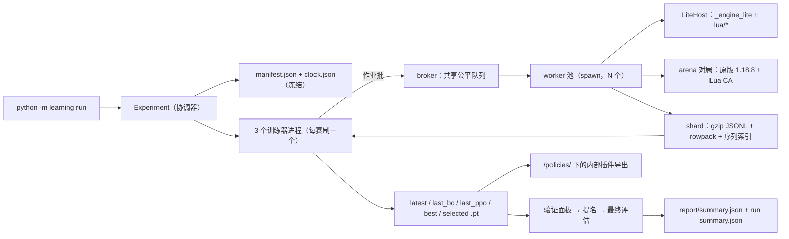

# WesnothLearning 架构

> 语言：[English](architecture.md) | 中文

更新日期：2026-10-29。本文件只描述当前实现。带日期的证据、失败运行与已被取代的决策留在 `verification/`；剩余验收工作见 [TEST_zh.md](TEST_zh.md)；运行与按指令调参见 [instructions_zh.md](instructions_zh.md)。

## 1. 范围与边界

项目为三种赛制训练同一套 Wesnoth 1.18.8 策略：`duel`（2 人）、`ffa4`（4 人，个人计分）、`team2v2`（4 人，队伍 `[1,2,1,2]`）。

两个规则后端共用同一观察／动作契约：

- **native** —— 通过 vendored WesnothArena SDK 与 Lua CA 插件驱动的真实 1.18.8 游戏。它是规则权威，也是参考评估的唯一后端。
- **lite** —— Rust 扩展 `engine_lite/`（`lite-0.2`），确定性设计，用于低成本采集、rollout 与内部面板。

学习流程为：从声明的教师做行为克隆（BC），随后由奖励控制器驱动的 PPO。交付物是带导出权重的 Lua AI 插件；训练不会把自己安装进游戏。

不声明：lite 与 native 规则等价、原版性能验收、棋力。

## 2. 仓库布局

| 路径 | 内容 |
| --- | --- |
| `learning/` | Python 协调层：训练器进程、适配器、数据管线、模型、奖励、评估、导出、打包与维护工具 |
| `engine_lite/` | Rust/PyO3 确定性引擎、内嵌 Lua 5.4 宿主、规则采集/审计工具（`audit`、`capture`、`freeze`、`inventory`、`differential`） |
| `lua/` | 原版部署与 lite 宿主共用的插件 Lua：observation、candidates、spatial/relational 网络、routing、rewards、teacher、stock-RCA 采集 |
| `vendor/arena/` | vendored WesnothArena 原版 SDK（runtime、对局运行器、bot、阵营/领袖/招募档案） |
| `data/rules/` | 冻结规则：`1.18.8-training`（默认，587 单位 / 438 地形）与历史 `1.18.8` |
| `data/` | 采集输入：`humanData/`、`humanData_curated/`、`datasets/`、`opponents/gpt6astra.zip`（旧版教师） |
| `tests/` | `tests/v5/` 契约套件、旧版单元套件、手工烟测脚本，共享夹具在 `tests/v5/helpers.py` |
| `benchmarks/` | 冻结的引擎负载契约（`contract.json`）及其运行器 |
| `runs/<run>/` | 每次运行的 manifest、各赛制状态、调度与检查点（不入库） |
| `verification/` | 带日期的验收与诊断报告；冻结证据，不得追溯修改 |
| `delivery/` | 显式导出的模型包 |
| `docs/` | 本组维护文档，每份都有 `_zh` 镜像 |

## 3. 进程与数据流

- `Experiment`（`learning/coordinator.py`）冻结 `manifest.json` 与 `clock.json`，然后为每个请求赛制启动一个训练器进程。`FormatExperiment`（`learning/experiment.py`）只拥有一个赛制的模型、优化器、奖励控制器、RNG 流与历史。
- 训练器把作业批提交给 broker。broker 用一个固定大小的 worker 池（`ProcessPoolExecutor`，spawn）服务全部赛制，将超过截止时间的作业标为 `budget_interrupted`，把每个结果写入 `<run>/<format>/jobs.jsonl`，再把整批返回给所属训练器。
- worker 通过 `sample.play_job` 运行一局：lite 对局由 `LiteHost` 在进程内完成；原版对局由 arena 对局运行器驱动一个常驻 Wesnoth 进程（独立 user/add-on 目录，文件式 Lua RPC，见 `native_transport`）。
- worker 异常返回 `infrastructure_error` 并使所属批失败；训练器退出码被记录，任何赛制都不会重试其他赛制的对局。

## 4. 规则与引擎

`data/rules/1.18.8-training` 是默认冻结清单（`rules.json` sha256 `d6fceafe7d0c9c67c750551b9901dbfb2b22290992a8daa1616a460e11826dca`，source hash `c08f8a08…`，规则版本 `lite-0.1-c08f8a08d6fb802d`）。`catalog-summary.json` 记录 587 单位、438 地形、覆盖 0 exact / 470 approximate / 117 unsupported scripts，且 `training_acceptance.native_semantics_accepted = false`、`performance_accepted = false`。

- `rules_catalog.load()` 校验文件哈希、source hash 与版本；训练范围接受已记录的近似。启动还要求存在六阵营训练闭包（领袖、招募以及所有可达的升级/瘟疫链），否则拒绝启动。
- `LiteAdapter` 在使用前校验扩展构建三元组（`ENGINE_VERSION='lite-0.2'`、`RNG_VERSION='deterministic-expected_damage_v1'`、`COMBAT_VERSION='expected_damage_v1'`）与声明身份一致。
- 确定性战斗：每次攻击结算为 `ceil(damage × chance × 1.10)`；slow 在命中率之前把伤害乘 `ceil(3/4)`；poison 在该单位自己的回合扣 6 HP；无战斗 RNG、无命中注入。`forecast()` 是点质量，只为兼容接收 `samples`。
- lite 已实现机制：按地形代价移动、可见敌军 ZOC、友军通行、连通的城堡招募/经济、村庄占领、fog/shroud/历史地形、盟友共享、行动顺序轮转、领袖击杀与队伍终局、逐次攻击的死亡/反击/经验升级、slow、poison、drain、firststrike、marksman、magical、charge、berserk、基础 plague、治疗/休息、concealment/nightstalk/teleport、确定性攻击结算。
- lite 近似路径：相邻领导力、illumination、backstab、steadfast、反击触发 plague、单步 teleport 代价。已知缺口：复合修正取整、完整的武器声明过滤、变体实例、随机特质、AMLA 选择、状态清除精确时机、视距代价/jamming、远程寻路 ZOC、战役事件。未知能力/脚本会阻断招募链，而不是静默降级。
- `lua/` 是唯一的合法性/观察实现：原版 Wesnoth 以插件方式加载它，`LiteHost` 把同一批模块加载进内嵌 Lua VM。`lua/stock_rca_capture/` 把原版引擎事件转换为公开的动作前帧。

## 5. 观察、候选与行

`learning/features.py`（`VERSION = 5`）是输入契约。`schema()` 固定每个有序特征名与缩放，并原样导出为 `features.lua`，因此训练器与 Lua 消费完全相同的输入。

| 组 | 内容 |
| --- | --- |
| global | 20 个基础标量（人数、棋盘尺寸、金币/收入、单位/HP 总量、领袖 HP、回合、敌军、村庄、盟友）+ 己方/敌方构成（等级、快速、受伤、伤害类型）+ 剩余移动、上回合结束次数、重复移动 |
| opponent | 8 个基础标量 + 构成 |
| action | 24 个基础标量（类型、HP/造价、移动、接近、村庄、治疗、防御、威胁、预期伤害、击杀/阵亡概率、领袖标记、预测战斗）+ 最大 HP/移动/等级、阵营倾向、抗性、逐地形代价/防御、三个武器摘要、村庄归属、目标进度、重复移动 |
| entity | 18 个基础标量（位置、HP、移动、剩余攻击、经验、等级、领袖、关系、状态、时长）+ 动作特征子集 + `next_round` |
| geometry | 16 个标量（行动者/目标/候选的 x/y 与归一化差值、六边形距离、完整攻击范围） |
| spatial | 16×16 棋盘上的 10 个通道，外加 19 邻域局部块 |

数值除以声明缩放并裁剪到 ±4；`unit_type_index` 不缩放。候选顺序被严格保留；策略对 `lua/candidates.lua` 在预算 id `fixed-20000-v3` 下生成的、上限 128 个的固定集合打分。

行是训练契约：schema 6，由 `rowpack` v2 编码（JSON 元数据加每行一个 base64 float32 块），装在 gzip JSONL shard 中。每行携带引擎/规则/RNG/战斗/候选/奖励版本、奖励公式、场景族、split 规则、对局族、教师身份与来源（`astra`、`stock_rca`、`human`、`policy`）。`data.validate_record` 拒绝任何出处、宽度、有限性、意图字段或奖励配置与冻结运行不一致的行。

行动者输入永不含裁判真相：奖励标量、教师动作、未观察单位、未探索地形与 RNG 状态在策略看到决策之前被剥离。

教师能力是声明的，不是假设的：

- `wesnoth_default_rca` —— 原版 AI。只能观察原版引擎事件；没有按决策查询，因此不支持 DAgger。
- `gpt6astra` —— 旧版按决策查询的 Lua 教师（`learning/teachers/`，派生源码；冻结的 `data/opponents/gpt6astra.zip` 仅作血脉）。

新 manifest 冻结 stock RCA 教师并要求原版参考评估。`LiteHost` 拒绝 stock 教师作业，并只在 manifest 声明 `gpt6astra` 时接受 Astra 座位。

## 6. 策略网络

架构 id `relational_v5`，每个赛制一个独立模型（约 0.77 M 参数；精确值冻结在各自 manifest 中）。

| 组件 | 形状 |
| --- | --- |
| 单位嵌入 | 588 × 16 |
| 对手编码 | 16 |
| 实体注意力 | 2 层，4 头 × 16，FFN 128，残差 |
| 棋盘卷积 | 两个 3×3 卷积，16 通道 |
| 局部块 | 19 × 10 → 32 |
| 场景编码 | `[global, 对手 mean/max, 实体池化, 棋盘均值]` → GRU 128 |
| 记忆 | 32 槽 × 64，带时长衰减的 query/key/value 读取 |
| 动作打分 | context + action + geometry → 512 → 256 → 128 → 1 |
| 价值头 | context → 128 → 1 |

`context()` 重放每方最近 8 个己方回合行，只对活跃行求导，前缀 GRU 在无梯度下运行并按边界缓存，使 minibatch 复用历史。`lua/network.lua` + `lua/relational.lua` 是部署孪生实现；导出时在真实候选序列上验证 Python/Lua 一致性 ≤1e-5。

## 7. 奖励与在线控制

奖励公式 `v5-potential-1`（`learning/rewards.py`）：

- 终局：duel 与 team2v2 为 ±1 / 0；ffa4 为居中名次点按最大偏差归一化；
- 经济势函数：金币 + 军队造价·HP 比例 + 20·村庄，按队伍平均，并用 `200 + Σ|potential|` 归一化；
- 逐行转移：势函数差乘 `γ^Δturn`，显式截断 bootstrap，以及对可见可达地形首次访问的探索账本。

`RewardController`（`learning/control.py`）为每个赛制维护只追加的事件链（序号、前序校验和、校验和）。它在匹配地图/阵营分层、带 Astra 参考的完整 12 block 验证窗口上推进，每次只改一个系数且幅度 ≤±10%，并保持在 `economy 0.05–0.20`、`control 0.02–0.15`、`explore 0–0.15` 之内。自适应提议需两个可比窗口；holdout/final/test 分区永不调奖励；待处理命令在批边界生效。

## 8. 训练管线

一次运行是 `<run>/<format>/`，包含 `state.json`、原子检查点（`latest.pt`、`last_bc.pt`、`last_ppo.pt`、`best.pt`、`selected.pt`、`selection.json`、`bc_gate.json`）、`schedules/`、`jobs.jsonl`、`validation/`、`policies/` 与 `report/`。

阶段按序执行：`calibration` → `bc` → `ppo` → `final`。

1. **Calibration** 在验证地图上采集三个 block 的固定参考对局，写入 `controls.json` 并转入 BC。只有单一固定参考时跳过采集。
2. **BC** 按来源/引擎/族配额采样教师行，训练等权序列窗口，报告 loss、相对均匀分布的 CE 与逐类准确率。门禁：总覆盖 ≥90% 且每类 ≥80%；模仿有效（每类 ≥32 样本、CE < 均匀分布的 85%、准确率达阈值）；语料/审计检查；≥2 局完整对局的开局探针；至少 12 个不同场景族。四项全过才进入 PPO，否则只能用 `--phase ppo --force <reason>`，且保持 `effective = false`。
3. **PPO** 训练刚为当前策略快照采集的那一批（同一奖励/引擎/教师身份的 rollout shard），教师与人类行另作 BC rehearsal 集读取。批准备执行 `scenario-v2/no-drop-v1` 契约：先分区再提交身份，任何被排除行都会报错而不是被丢弃。更新使用确定性的逐 epoch 窗口计划、逻辑批 KL（拒绝阈值 0.02，在优化器步进前检查）与逐步计数器，使恢复的边界能复现未中断的未来。
4. **Validation** 每 10 个版本对比教师与冠军，使用完整座位轮转；趋势面板需 3 个不同场景族，晋升面板（版本号 %100）需 12 block、≥12 个不同族，并在同一批 block 上重评冠军。
5. **Selection** 至多用已记录的可比面板从最新完整候选中提名一个对抗 `best.pt`；最终评估在触碰 holdout 地图之前冻结 `selected.pt`，并报告 30 block、≥12 个不同族。

时钟把 `hours` 的 10/12 留给更新、2/12 留给冻结评估；`final_holdout_hours` 从评估窗口中划出。

检查点在 `state.json` 旁原子写入；恢复时校验 manifest 哈希、schema、权重与优化器状态。`--branch-from` 把完整 `latest.pt` 复制成新运行，记录父身份、新时钟与种子，并保留或重置优化器。

## 9. 评估与选择

`learning/evaluate.py` 按官方结果给对局计分（2 人/队伍胜 1、平 1/3、负 0；ffa4 为居中名次点），并在完整轮转 block 上按赛制比较策略与控制方。差值按场景族聚类做 cluster bootstrap（5,000 次重采样，2.5/97.5 分位），因此重复的相同布局无法夸大证据。

比较状态优先级：`infrastructure_error` → `inconclusive`（缺块/块数不足）→ `insufficient_design`（不同族少于要求）→ `passed`（区间下界 > 0）→ `not_passed`（区间上界 ≤ 0）→ `inconclusive`。

`selection.py` 只复用完整且可比对的 12 block 面板，只有候选既通过又得分更高时才替换冠军。报告为机器可读 JSON 加简短 Markdown profile；每个面板都记录调度、种子、控制方与引擎身份。

## 10. 交付

- `ensure_export()` 在 `<format>/policies/<folder>/` 下写内部插件，含 `features.lua`、`weights_<format>.lua`、`config.lua` 与 `export.json`；它们不是 SDK 提交，恢复时也不受大小上限约束。
- `python -m learning export` 写出可部署插件（三种赛制、`arena.json` schema 2、vendored runtime、数值一致性记录），`python -m learning package` 把它打包为 `delivery/NeuralArena.zip`。导出要求引擎/教师身份匹配、权重已训练、审计与当前 schema 一致。
- `python -m learning bundle` 构建可直接解压的 Ubuntu 24.04 训练归档（`BUNDLE_MANIFEST.json`、`SHA256SUMS`、固定成员权限，排除运行状态与证据）；`verify-bundle` 对其做静态复检。

## 11. 工具

| 命令 | 用途 |
| --- | --- |
| `run` / `phase` | 启动、恢复或分叉实验；在批边界请求 BC/PPO/评估 |
| `collect` / `train` / `evaluate` / `report` | 独立作业采集、单次 BC/PPO 更新、作业计分、报告 |
| `export` / `package` / `bundle` / `verify-bundle` | 插件导出、交付 zip、训练归档、静态复检 |
| `audit bc` / `audit fit` | 全量 BC 表示诊断；显式调用的小规模拟合探针 |
| `benchmark engines` | 实测 native/lite 负载对比（从不推断未测资源） |
| `rules` / `freeze-map` | 冻结原版规则采集；补充冻结地图身份 |
| `import-human` / `replay_curate` | 经验证的人类录像导入与录像清单整理 |
| `control show` / `control set` | 查看或排队奖励控制变更 |

差分工具：`python -m engine_lite.differential` 在有限真实对局上审计 lite 与原版；`engine_lite.audit`/`inventory`/`capture`/`freeze` 处理规则证据而不启动训练。

## 12. 默认参数

| 参数 | 默认值 |
| --- | --- |
| 赛制 / 引擎 / 评估引擎 | 三种 / `lite` / `native` |
| 小时 / worker / 设备 / 训练器线程 | 12 / 8 / `cpu`（训练器）/ 1 |
| 种子 | 配置内 20261018；`run` 默认传入 20261017 |
| BC 教师对局目标 | duel 300、ffa4 600、team2v2 400 |
| 原版 BC 对局 | native 引擎取教师目标，lite 为 0 |
| 每次验证对局数 | duel 6、ffa4 4、team2v2 8（完整轮转） |
| 验证间隔 / final block | 10 个版本 / 30 block |
| 最少不同场景族 | 趋势 3；晋升、final、门禁 12 |
| BC 批对局 / 记录 | 8 / 2048 CPU（CUDA 8192） |
| BC 验证记录 | 1024 / 4096 |
| BC 准确率下限 | 总 0.40、招募 0.60、移动 0.35、攻击 0.35 |
| epoch / minibatch / micro | 4 / 256 / min(256, CPU 32 或 CUDA 64) |
| BC 学习率 / PPO 学习率 | 3e-4 / 1e-4 |
| PPO clip / value / entropy / BC 辅助 / 梯度裁剪 | 0.2 / 0.5 / 0.01 / 0.10 / 0.5 |
| KL 上限 / 计划版本 | 0.02 / 2 |
| 奖励模式 / 取值范围 | adaptive / economy 0.05–0.20、control 0.02–0.15、explore 0–0.15 |
| 回合上限 | 30（训练、校准、面板） |
| shard 预算 | 压缩 96 MiB，保留估计 768 MiB |
| final holdout 小时 | 0 |

`validate_config` 强制硬下限（全局 1–16 worker、≥30 final block、rollout 为 4 的倍数、轮转覆盖全部赛制、2v2 验证为 8 的倍数、`native_bc_games` ≤ 教师目标）。

## 13. 限制与未闭合缺口

- lite 规则是近似的（587 单位中 470 个），且明确未经原版语义验收；整包性能未验收。
- lite 战斗是确定性的，原版战斗是随机的；不声明跨引擎数值相等。
- stock RCA 教师无法回答按决策查询，因此该教师下 DAgger 不支持；Astra 仅作旧版教师来源。
- 官方 baseline 仅限原版；lite 运行无法对它评估。
- 外部推理（D1）未实现；原版终局采集（N1）已实现但未验收。
- 任何运行都没有收敛或棋力结论。

## 14. 文档地图

| 文档 | 职责 |
| --- | --- |
| `README.md` / `docs/README_zh.md` | 仓库入口 |
| `docs/architecture.md` | 本文件：结构、契约、参数 |
| `docs/instructions.md` | 操作步骤与按指令调参 |
| `docs/TEST.md` | 仅剩的验收事项 |
| `docs/bundle.md` | 训练归档契约 |
| `docs/THIRD_PARTY.md` | 许可 |
| `engine_lite/README.md`、`learning/*_TEST_SCOPE.md` | 模块范围 |
| `verification/<date>/REPORT.md` | 带日期的命令、身份与结果 |

维护规则见根目录 `AGENTS.md`；证据不得追溯修改，已验收事项整项离开 `TEST.md`。
