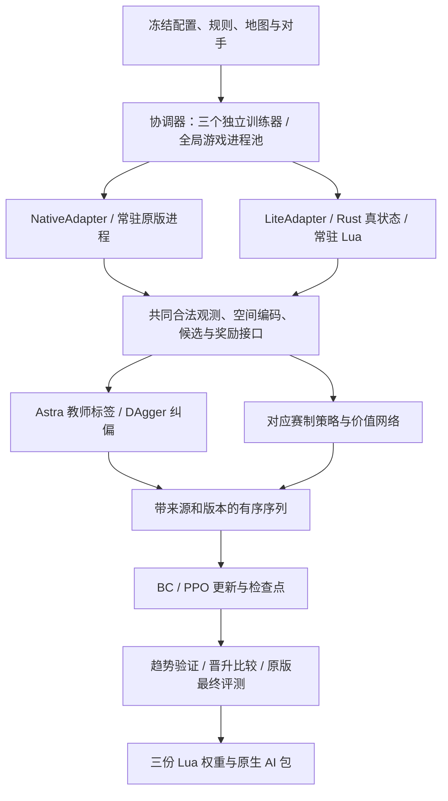

# WesnothLearning V5 架构与实现状态

> 语言：[English](architecture.md) | 中文

更新日期：2026-10-24。本文件取代根目录 PLAN.md，作为后续唯一维护的架构、参数与实施状态文档。已实现但未验收的事项及其最小测试方案归入 [TEST_zh.md](TEST_zh.md)（原版新增终态采集仍待验收），接手运行、维护与按指令调参见 [instructions_zh.md](instructions_zh.md)；[历史验收报告](../verification/archive/TEST_before_cleanup_20261022.md)及原始结果留在 `verification/`，实验和权重留在 `runs/`、`delivery/`，不复制到 docs。

状态含义：**已实现**表示存在可用代码和对应入口；**部分实现**表示仍有明确缺口或证据只覆盖有限场景；**未实现/未执行**分别表示缺少实现或尚未开展实际运行。实现、最小测试通过、整体验收通过、训练强度提升是四件不同的事。

## 1. 目标与边界

- 训练三套独立模型：`duel`、`ffa4`、`team2v2`。参数、优化器、随机状态、记忆、奖励控制器、数据与历史策略池按赛制隔离。
- 高频采样目标采用自主 Rust 精简引擎，原版 Wesnoth **1.18.8**保留迁移审计、原版棋力评测和最终部署入口；本轮正式实验按用户要求全部使用 lite。
- 最终游戏 AI 使用纯 Lua 推理与三份独立权重，运行时不依赖 Python、Rust、CUDA 或外部推理进程。
- 优先级：合法部署与无隐藏信息泄露 → 单局时间和 CPU 效率 → 核心对战语义 → 次要机制的完整复现。允许有记录的近似，不删除兵种/地形来伪造覆盖，不把脚本能力当普通攻击。
- 唯一自写教师/固定自写对手为 Astra。官方 RCA baseline 仅在原版可用；lite 使用 Astra、同赛制历史策略和当前策略，不另造廉价 baseline。
- 任意战役 WML/Lua 解释器、第三方时代、GUI、动画、音频、联网与回放渲染不属于 lite 的通用运行范围。
- Ubuntu CPU 服务器是主要验收环境；Windows 只供参考。V4 权重、已安装 AI 和历史实验保留。2026-10-21/22 的 OOM、停止与重放优化记录见归档报告；T1–T4 已于 2026-10-22 通过受限验收。

2026-10-23 按用户要求归档清理服务器旧训练：只保留 `v5_lite20h_20261022_210712`、`v5_lite6000_replay_20261022_012336` 两次正式实验的原始目录与日志。更早 5 次正式实验（含 V4 权重）及 1 次回环已压缩至 `/home/tongshu/myDev/wesnothLearning/training_archives/20261023_212221/`，逐项比对通过后删除原目录，原日期、冻结源码、规则身份与产物保留在归档内。已安装 AI、规则、源码与最近隔离验收目录保持原样；索引与恢复说明见 [归档记录](../verification/training_archive_20261023/REPORT.md)。

最近正式实验 `runs/v5_lite20h_20261022_210712` 使用冻结 schema 4/v2、300/600/400 纯 lite、8 workers、CPU，已因 v100 控制度量的 `KeyError('astra_coverage5')` 失败结束。三训练器异常时间分别为 2026-10-23 03:42:59、07:05:52、约 07:55，主进程于 08:10 退出；均停在 v100、只有 BC，教师有效局 332/624/440，真实 BC 资格均未过。09:00 的旧强转任务未执行，也未改检查点。原报告的重放混入参考局，精确冻结面板重放应为 4/0/0 个控制块；层数为 6/6/12，每次参考采集上限 12，不是整个实验只能采 12。详见 [失败复核](../verification/training_failure_review_20261023/REPORT.md)，原始汇报保留原日期与内容。

用户随后授权修复和 Ubuntu 最小测试：保留 `ref[name]` 修复，补齐有界参考补采、真实终态统计、学习方开局门、故障阶段及 schema 5 索引回归，并新增独立阶段入口。当前没有正式训练运行；schema 4 旧实验不能用 schema 5 源码直接恢复。Ubuntu 隔离目录三赛制真实 BC→显式强转 PPO→两轮 PPO→最终评测链路已通过，仍保留真实未过的 BC 门与不完整最终面板。验收范围与命令见 [修复报告](../verification/training_repair_20261023/REPORT.md)。

## 2. 总体结构与责任



| 责任 | 入口 | 状态 |
| --- | --- | --- |
| 规则捕获、冻结、声明审计 | `engine_lite/capture.py`、`freeze.py`、`audit.py` | 已实现，覆盖边界见第 3 节 |
| Rust 唯一真状态、规则结算与 PyO3 批量 API | `engine_lite/src/{model,state,combat,lib}.rs` | 已实现，仍有公开近似 |
| Native/lite 适配、Lua 宿主与 Astra 查询 | `learning/adapters.py`、`native_transport.py`、`lite_host.py`、`engine_lite/lua/host.lua` | 已接通三赛制 Astra；有限验证范围见第 8 节 |
| 共同观测、候选、空间与路由 | `lua/{observation,candidates,spatial,routing}.lua` | 已实现；学生候选先于教师查询生成 |
| 模型、序列、监督与强化训练 | `learning/{model,sequences,data,train}.py` | 已实现，已做有限真实更新 |
| 三训练器协调与共享 worker 池 | `learning/coordinator.py`、`experiment.py`、`schedule.py` | 已实现，默认 lite；按六阵营训练闭包检查启动 |
| 奖励公式、度量、批次控制 | `learning/{rewards,reward_metrics,control}.py`、`lua/rewards.lua` | 已实现，非梯度学习奖励系数 |
| 基准、原版差分、BC 诊断与导出 | `learning/{benchmark,benchmark_runner,audit,export}.py`、`engine_lite/differential.py` | 入口已实现，完整验收和强度实验未完成 |

共同接口覆盖 `reset`、`observe`、`legal_actions`、`step`、`snapshot/restore`、`close`，并提供批量观测/路径/预测与 Lua 决策调用。Python `pos/to` 为零起始行优先索引，Lua 为一基六角坐标；Python 武器索引从 0 起，Lua 从 1 起。`snapshot` 为裁判真状态，策略只能获取玩家合法视图。

lite 决策新增 `generate_candidates`（默认 true）：采样循环只对未采集的 Astra 座位关闭完整学生候选生成，保留其合法观测、Astra 规划、执行和记忆更新；教师采集座位、学生推理、DAgger 与 bootstrap 保留完整候选。2026-10-22 通过 T2 验收：未采集座位 `C.generate` 调用 0 次、候选仅 1 个 `end_turn`，两条路径的教师动作与执行后状态一致；此前临时探针的约 39–40% 循环耗时下降仍是非验收数据。

## 3. 规则数据、运行语义与隔离

### 3.1 当前冻结数据

默认规则包：`rules/1.18.8-training/`，从 Ubuntu 的 `verification/v5_lite_default_20261021/capture-maps/frozen/` 原样提升；旧 `rules/1.18.8/` 和带日期的证据保留。

| 项目 | 当前结果 |
| --- | --- |
| 原版作用域 | 20/20，缺失 0 |
| 数据 | 587 单位、438 地形，完整保留原始 WML、来源和作用域；含 10 张正式地图的复合地形 |
| 单位覆盖标签 | 0 exact、470 approximate、117 unsupported_script |
| core | 308 单位中 303 可运行；5 个保留单位事件限制 |
| 实际六阵营闭包 | 158 个不同单位；领袖/招募 → 全部升级/瘟疫类型，无缺失和未支持声明 |
| 规则 SHA-256 | `d6fceafe7d0c9c67c750551b9901dbfb2b22290992a8daa1616a460e11826dca` |
| 整包标志 | `complete=false`、`native_accepted=false`、`performance_accepted=false` |

用户已认可目前训练范围内的规则覆盖。158 单位闭包通过不表示所有 587 个类型的战役行为被实现，也不表示所有语义为 exact。core 的事件限制类型是 Fire Ant Egg、Fog Clearer、Giant Ant Egg、Giant Scorpion、Sand Scuttler。

### 3.2 已实现

- 原版隔离捕获、战役 define/难度上下文、跨作用域地形统一、冲突类型 ID 命名空间、升级与瘟疫引用重写、来源哈希及损坏 WML 拒绝。
- 六角移动、地形代价、阻挡、ZOC/游击、连接城堡招募、村庄经济、逐击攻击/反击、死亡中断、经验与默认升级路径。
- 时间/阵营/抗性修正，中毒、减速、吸血、先攻、魔法、精准、冲锋、狂暴、swarm、基础瘟疫、背刺、steadfast。
- 标准治疗/治毒/休息、feeding、传送、声明隐匿/夜隐；补齐沼泽/满移动掘地隐匿、stun/ZOC、absorb、deflect、diversion、参数化吸血、shock/swift、distract、inspire、vanguard、initiative、参数化/地形限定再生、暗化与 Quenoth 条件治疗。
- 独立可复现的对战/招募 RNG，快引擎不要求与原版同 seed 同结果；可注入逐击命中用于差分。候选、教师和预测不得推进真实对战随机流。
- 每方独立 fog/shroud、已探索地形、最后合法敌情及年龄、村庄记忆；按配置共享地图/视野，支持四方轮转、淘汰和团队胜负。

### 3.3 明确近似与未实现项

复合修正舍入、反击武器选择、完整原版声明过滤条件等仍有近似。随机 traits 生成与跨升级保留、AMLA/升级选择、独立 `vision_costs/jamming`、运行时变体尚不完整。剩余 117 个类型主要依赖战役事件、dummy、脚本瘟疫、WML 变量/多次攻击/歌曲状态等；运行入口拒绝使用含未实现声明的初始单位、招募、升级或瘟疫链。

原计划中的增量视野/寻路缓存、邻接预计算、跨游戏规则共享和更紧凑的轨迹 I/O 尚未全部落地；当前仍有完整视野重算、JSON 边界传输及预测状态复制。批量 API 已实现不等于整个训练器已经采用批量推理或消除了这些成本。

规则真状态仅供裁判、结算、差分及明确的奖励标签。策略、Astra、候选与预测不能通过对象引用、共享缓存、隐藏友敌信息或未知地图绕过视野。正常伏击/接敌造成移动中断后重新观察，不记为策略故障。

### 3.4 默认入口与训练范围验收

新实验默认采用 lite 和已记录的规则近似，不自动回退 native。规则选择顺序为显式 `--rules-dir` → `WESNOTH_RULES_DIR` → `rules/1.18.8-training/`。CLI 在导入特征/模型前绑定目录，程序创建实验在构造模型前绑定；同一目录传入任务和适配器，并在 manifest 冻结目录、规则哈希、来源和训练闭包。恢复使用原 manifest 的规则目录，拒绝冲突参数。地图仍使用现有冻结地图入口。

默认受检加载读取小型 `catalog-summary.json`，验证 rules.json 哈希、来源与 1.18.8 版本，再按实际六阵营配置现场检查完整招募/领袖/升级/瘟疫闭包。未支持或缺失引用仍阻止启动，外围战役脚本不阻止标准训练。运行时不解析/保留约 50 MB 的完整 catalog；缺少 summary 的历史包保留兼容加载。`training_acceptance` 记录范围和 profile 哈希，表示实现覆盖已就绪，不表示原版全部语义或性能达标；`acceptance_scope='full'` 保留原整包三标志门禁，原标志保持 false。

10 张训练/验证/保留原版地图已按发行包来源冻结到 `rules/1.18.8/maps/`。捕获入口默认读取这些地图，另支持 `--maps-dir`，将复合地形交给原版查询实际单位移动/防御数值；不通过猜测 alias 或替换地形补表。由原 291 地形扩至 438，规则身份和特征 schema 随之改变，旧检查点不能直接按新词表恢复。

## 4. 模型：三个实例、六个组成部分

架构标识 `relational_v5`。当前实现为 **schema 5、每套 776,178 参数**（587 单位词表），增加战术动作特征与实体相对出手轮次；网络主体不变。Ubuntu 隔离接入、实际更新、检查点恢复和 Python/Lua 数值已验收。受限六阵营 BC 移动输入验收已通过；正式 BC 全部质量门仍独立执行且尚未全过。已失败的旧实验冻结 schema 4、772,530 参数；旧 schema 3/4 数据、权重和优化器不补零迁移。

| 部分 | 已实现结构 |
| --- | --- |
| 单位与关系 | 类型嵌入 16，单位投影 64，2 层 4 头实体注意力，FFN 128；行动者和目标使用完整表示 |
| 空间 | 16×16 公共棋盘，2 层 3×3、16 通道卷积；候选落点周围半径 2 的 19 格投影至 32 维 |
| 短期记忆 | GRU 128，每方每个自身回合提交一次更新 |
| 长期记忆 | 最多 32 个、每个 64 维回合摘要，附年龄，注意力读取、FIFO 写入 |
| 动作头 | 场景/记忆、行动者/目标、动作特征、局部地形和几何关系 → 512 → 256 → 128 → 1 |
| 价值头 | 同一合法观测上下文 → 隐藏 128 → 标量价值 |

对手编码为 16 维，按均值/最大值汇总。最多 128 个实体参加注意力，候选相关单位和领袖优先，溢出单位仍进入空间汇总，未入注意力的行动实体单独投影；最多 128 个动作候选、16 次高成本战斗预测。工作量预算、排序和 tie-break 应在两个引擎一致，原版动作时限作为外层保护。

旧正式实验冻结的候选规则为 `fixed-20000-v2`，以下为其已验收行为（v3 保留）：复用公开信息评分，先保留每单位主要合法完整移动，再按单位/类型轮转填充剩余位置；2v2 保留友军占据村庄的战略目标，实际落点仍排除占用格。lite 向 Astra 传递村庄记忆时使用教师要求的 `x*1000+y` 键，快照负责 JSON 键转换。此批针对 duel/2v2 移动覆盖的修改已于 2026-10-22 通过 T3 验收：固定状态语义覆盖键/视野/快照/友军村/受伤分支/128 上限与 16 次预测，真实样本 duel 移动 84/84、team2v2 移动 135/135，`audit_bc` coverage 0.983 且 `coverage_pass` true；旧移动覆盖 88.45%/65.79% 作为历史数据保留，不改写为新结论。

2026-10-23 本地新增候选 `fixed-20000-v3`：将已计算的公开战术落点评分、相对原地收益、风险及风险变化、守家距离、己方支援和首选移动标记传入动作头；实体补充敌方下一次出手是否跨轮。原地评分复用已有威胁图，不新增战斗预测、教师调用或隐藏信息。覆盖用的候选集合不因这些输入被裁掉，候选/预测上限不变。本地同数据、同初始化、各 120 次全网络更新的三对局族留出对照：FF4 移动 10/73→37/73（13.70%→50.68%），2v2 19/90→46/90（21.11%→51.11%），duel 25/80→46/80（31.25%→57.50%）；这是输入消融对照，不是现有远程检查点对比。169 项相关回归通过。证据见 `verification/bc_move_fix_20261023/REPORT.md`；冻结权重再做另外 8 个短局验证，联合六阵营留出移动为 FF4 28/223→98/223（12.56%→43.95%）、2v2 34/237→111/237（14.35%→46.84%），没有额外优化更新；FF4 亡灵挑战单项仍为 15/49（30.61%）。Windows 仅作参考，训练采集方仅三阵营且短局；本次还修正了 v3 插入字段后 repeated_move 误读 move_primary 的回归，历史对照保留原身份，不能自动代表修正后的新轨迹质量。Ubuntu 接入/阶段链路和真实权重数值已通过；后续 [Ubuntu 排查](../verification/bc_rootcause_20261023_2318/REPORT.md) 使用四个 FF4 训练族，验收了修正后的移动收益。该小样本的招募/攻击与整体 BC 门尚未全部通过。

新游戏重置记忆，淘汰/队友死亡不重置；重复 evaluation、教师只读查询和 bootstrap 不提交记忆。训练按 8 个自身回合截断反传，使用当前权重重算前缀，不跨参数更新复用旧隐藏状态。同一次 forward 批量编码唯一历史观测，并按共享前缀复用状态；GRU 图只在截断边界相同的样本间共享，老前缀无梯度，32 槽长期记忆保持不变。张量按字段批量构建。冻结 lite 学生在单局、单 side 内按历史长度和当前回合缓存历史编码，历史或回合改变立即重算，bootstrap 不提交记忆。纯 Lua 与 PyTorch 对应实现、序列重放和数值核验入口均已实现；正式长训练权重的连续序列部署验收尚未执行。

## 5. 数据与训练流程

### 5.1 采集目标（2026-10-22 用户调整）

| 赛制 | 原版有效教师局 | 追加 lite 教师局 | 合计 |
| --- | ---: | ---: | ---: |
| duel | 0 | 300 | 300 |
| ffa4 | 0 | 600 | 600 |
| team2v2 | 0 | 400 | 400 |
| 总计 | 0 | 1300 | 1300 |

默认配置、CLI 和程序创建实验统一为单挑/FF4/2v2 300/600/400 个有效 lite 教师局，原版锚点为 0，保留 Astra 教师；失败局不计入目标，批次按剩余额度截断。默认采样与最终比较均用 lite，最终比较只对冻结 Astra，不宣称原版棋力。显式选择 native 时总目标同为 300/600/400，原版下限默认等于对应总目标。CLI 的 --native-bc-games 与 --evaluation-engine 保留显式覆盖能力；已有冻结实验恢复使用其原配置。本次仅修改默认值，未授权新一轮启动，旧 18000 局/18 h 实验保持停止。

### 5.2 BC → 学生 rollout / DAgger → PPO

1. 冻结规则、地图、对手、源码、配置与预算；三个训练器共享全局游戏进程池。
2. Astra 教师采样与 BC 更新交替执行，每赛制每批默认新增 8 局。保留精确动作交叉熵，同时监督行动类型、行动单位、目标/落点；正常路径中断保留原始合法意图和实际执行结果。
3. BC 同时满足语料量、候选覆盖、模仿质量和开局行为才切到 PPO。连续 10 次 BC 质量记录未改善时追加教师局和学生纠偏，之后再降低 BC 学习率，不自动放宽门槛。
4. 学生 rollout 中查询 Astra，当前 lite 按每四次学习方决策一次、每局最多 32 次执行。教师有独立合法历史，只规划；未覆盖/失败的标签记录诊断，不冒充学生 on-policy 行为。按高熵、重复移动等困难程度优先查询仍是后续优化方向。
5. PPO 每赛制每批默认 4 局，消费同一冻结策略/奖励/引擎版本的学生轨迹，同时做同赛制 BC rehearsal。BC 与 DAgger 数据均存在时各取 50%；原始池若有合格人类数据，Astra/人类为 75%/25%；原版/lite 均存在时训练抽样各取 50%。这些训练重采样权重不等于采集局数比例。

2026-10-23 用户要求新增分阶段入口：默认 auto 保持上述自动资格门；`run --phase bc` 只跑 BC，`phase ppo`/`phase evaluate` 请求下一个独立阶段，运行中在批次边界生效，停止后需 resume。BC/PPO 分别以 `bc_complete`/`ppo_complete` 保存，不隐式执行后续阶段。`phase ppo --force --reason` 是显式跳过 BC 资格的入口，保留真实 effective/门结果并记录原因与命令 ID；不改写检查点资格位。阶段请求可用 `--hours` 明确增加该阶段预算，保存独立 phase_deadline，不改原 clock/manifest。最终评测开始后不允许在原目录返回训练。最终选择优先已有晋升 best，其次 last_ppo、last_bc、latest，避免有 PPO 更新却退回旧 BC。实现与最小验收证据见本轮 verification 报告；当前未授权启动正式训练。

人类回放还原、兼容性检查和导入入口已实现；正式可用人类语料与其预训练收益尚无完成证据，不能把候选回放数当训练样本数。每个样本保存赛制、schema/架构、引擎/规则/RNG、策略/奖励版本、来源、教师、队友上下文、对局族与截断 bootstrap。`game_family` 按约 80%/20% 分训练/验证，同族不能跨区，按对局等权再抽决策。

有序序列、压缩 SQLite 索引块、完整前缀、窗口抽样与分块验证均已实现。分片行按「元数据 + 定长 float32 数值块」写入（`learning/rowpack.py`），读取逐局流式：按 gz 字节（96 MiB）与保留字节（768 MiB）双重预算只留被抽中的窗口，整局不再跨更新缓存；验证读取受 `bc_validation_records` 限制并用固定 seed。每批把分片数、gz 字节、保留字节、行数与峰值 RSS 记进 `state.history`，训练器另有 `RLIMIT_AS` 兜底，非零退出落盘 `trainer_exit.log`。指标分别记录环境局数、采集批次、优化步数、不同对局族、决策数、有效数据遍历量，避免用一个“轮数”混淆。

### 5.3 训练默认参数

| 参数 | CPU | CUDA / 共同规则 |
| --- | --- | --- |
| 全局游戏 worker | 8 | 8；2026-10-22 通过 T1 配置与 T4 8 worker 真实链路（峰值 PSS 4.02 GiB）验收 |
| 每训练器线程 | 1 | 1 |
| 每次 BC 读取决策上限 | 2048 | 8192，按版本轮换，不是总语料上限 |
| 序列/微批 | 4 条 / 32 决策 | 8 条 / 64 决策，8 自身回合窗口 |
| 更新 | 4 epochs | BC 学习率 3e-4；PPO 1e-4 |
| PPO | clip 0.2，价值损失 0.5，梯度裁剪 0.5 | 熵 0.01、BC 辅助 0.10，近似 KL >0.02 停止当前批次后续更新 |
| 回合上限 | 训练 60 | 常规原版对照 30，分别报告截断率 |
| 预算 | 默认 12 小时 | 前 10/12 允许更新，后 2/12 冻结评测，恢复不重置截止时间 |

BC 门槛：候选总体覆盖 ≥90%、招募/移动/攻击各 ≥80%；精确一致率总体 ≥40%、招募 ≥60%、移动/攻击各 ≥35%，每类至少 32 条，交叉熵低于均匀策略的 85%；开局需出城、占村和合理结束回合。64 决策小集拟合、完整留出输入混淆和学生状态上的教师纠偏有独立诊断入口，正式全语料诊断与训练结果尚未完成。

### 5.4 教师与对手

原版三赛制可用 Astra 教师，原版 2v2 保留 baseline 队友。lite 宿主提供真实 Astra 四人脚本实际需要的只读 WML/unit/helper 接口，含 `wml.get_child`、治疗/武器声明；使用实验冻结的 Astra ZIP，不修改教师策略。三赛制教师 BC、学生 DAgger/PPO 的历史最小回环结果见上述归档报告；当前采集目标已调整为合计 1300 局纯 lite，该规格的 20 小时正式实验已失败结束，本轮未重启正式训练；原 18000/38400 方案保留历史记录。

PPO 原版对手池按固定/历史/当前 50%/25%/25%，2v2 队友分上下文；lite 固定对手只含 Astra，baseline 队友位置使用 Astra，并独立标记 `astra_partner`，不混作原版 baseline 结果。

## 6. 奖励与在线控制

已实现的训练奖励：终局 + 经济/控制潜势差分 + 首次探索增量。

```text
r = r_terminal
  + w_economy * (gamma^delta_turn * Phi_economy_next - Phi_economy_now)
  + w_control * (gamma^delta_turn * Phi_control_next - Phi_control_now)
  + w_explore * first_exploration_delta
```

单挑/团队胜 +1、平 0、负 -1；FFA 按本局名次居中并缩放到 [-1,1]。gamma=1、GAE lambda=0.95，按自身回合跨度处理；正常终局势能归零，截断保留合法末状态的价值/势能 bootstrap，故障局不训练。原版棋力评测看原版胜负/名次；本轮 lite 比较只报告 lite 胜负/名次，不按 shaping 总分选模，也不据此声称原版强度。

经济量含 gold、按 HP 折算兵力价值和每村 20，团队取成员平均，相对其他对抗方归一化，避免招募凭空加分。地图控制使用合法己方/可见盟军/带年龄 last-seen 信息、多源有界路径与按回合缓存；战略格权重村庄/要塞/通路采样为 4/2/1。探索按每局首次合法观察去重，扣除初始已知区域，队友共享不重复计分，关 fog 时默认关闭。裁判可导出奖励标量，隐藏单位/地图字段不进入 actor 或公共价值输入。

| 系数 | 初值 | 自动范围 |
| --- | ---: | --- |
| 终局 | 1.0 | 固定 |
| economy | 0.15 | 0.05–0.20 |
| control | 0.10 | 0.02–0.15 |
| explore（整局上限） | 0.10 | 0–0.15 |

每个赛制的 `RewardController` 支持 fixed/scheduled/adaptive，默认 adaptive；依据实际行为、奖励和验证度量作有界调整，属于规则控制器，不是优化器学习系数。人工和自动更新走同一原子队列，仅在批次边界生效并递增 `reward_version`；一局和一次 PPO 更新使用同一冻结配置。事件日志和检查点记录旧/新配置、来源、原因、序号与校验和，恢复重放而不重置状态。长期自动调参是否改善棋力尚未通过长实验验证。

## 7. 地图、验证、性能与部署

2026-10-23 修复决定（lite 最小验收见修复报告，原版新增采集待 TEST 验收）：控制指标使用独立初始/淘汰/终局观测，正常淘汰和提前获胜均纳入统计；第 5/10 回合前进入终态时，后续 horizon 使用明确的吸收态。淘汰侧控制/领袖生存为零，探索保留最后合法累计量，HP 损失由真实己方终态与已有观测计算；胜方保留真实终态。预算截断和故障不补终态，不把缺失数据补零；这些快照不进入 actor、BC/PPO 数据或记忆。指标版本 `terminal-horizons-v2` 与旧统计不混用。开局只检查学习方，结束回合看有合法落点的非领袖剩余移动量（仍为 ≤4），不惩罚留守领袖或无法移动的单位。任意指标故障记录并冻结 adaptive 自动调参，真正的训练故障以 failed 阶段非零退出，保留 pending 数据，不自动执行最终留出评测。参考不足显式 inconclusive；每次补采最多 12，后续验证按缺口继续，已尝试失败编号也不复用。晋升必须实际达到 12 完整块；最终不足 30 块保持 inconclusive。内部策略恢复核验 schema/权重哈希，不对内部目录施加 SDK 提交包大小限制，正式提交限制仍保留。

### 7.1 地图和模型选择

| 赛制 | 训练地图（另有 50% Arena） | 验证 | 最终留出 |
| --- | --- | --- | --- |
| duel | The Freelands、Weldyn Channel、Sablestone Delta | Hamlets | Caves of the Basilisk、Ruined Passage |
| ffa4 / team2v2 | Clash、Isar's Cross | Loris River | Morituri |

地图冻结记录原版版本、哈希、地形/起点和统一规则，不宣称完整 Ladder 场景语义。留出地图不参加奖励调参、困难采样或选模。

趋势验证默认每 10 个更新批次执行，局数 6/4/8；每 100 个更新批次用晋升面板替代趋势面板，对 Astra 及已有冠军各至少 12 个完整轮换块，2v2 分队友上下文。这些调度与报告代码已实现，但正式候选晋升和棋力结论未执行。最终原版评测至少 30 个完整轮换块/对手，报告胜平负/名次及按块 bootstrap 区间。运行中受预算约束的原版审计队列、约 5% 审计成本及完整 mixed pipeline 尚未形成实际证据。

### 7.2 性能目标与已有证据

目标是同等工作量下 native/lite wall 和总 CPU 核秒各 ≥5；当前内存验收口径为 native/lite 峰值 PSS 比 ≥1.3，原 PLAN 的 5 倍内存目标已废止。比值 1.3 对应 lite PSS 约为 native 的 76.9%，不是“降低 30%”。冷启动/常驻热态分开，包含进程树 CPU 和采样 PSS，不能靠增加并发、提前结束、换较少动作宣称加速。

已有旧冻结包的 regular、单 worker、30 完整轮换块基准：duel 冷/热 wall 约 5.44/11.88 倍，FFA4 约 5.88/22.30 倍，2v2 约 5.94/22.36 倍，PSS 比约 1.65–1.69。**这些只覆盖 observe/legal_actions/end_turn，不含完整候选、教师和学生推理，也不是新规则包的重新验收。** 端到端原版/lite 终止原因和动作数不同，已明确判为不可比较。dense、4/8 worker 吞吐、混合审计流水线及完整决策的端到端性能仍缺证据，后续按实际改动做最小验证，不为补文档重复跑矩阵。

### 7.3 原版交付

PyTorch → 纯 Lua 导出、三赛制路由、检查点加载和连续序列数值审计入口已实现。分别输出 `weights_duel.lua`、`weights_ffa4.lua`、`weights_team2v2.lua`，开局选择并缓存对应权重，其他人数 FFA 可复用 ffa4 而不承诺强度，其他团队关系需明确处理。小闭环检查点已有 Python/Lua 最大误差约 2.3e-8，正式长训练权重的 128 候选/连续记忆审计仍待执行。

最终包当前超过原 SDK 16 MiB 限制。用户暂时忽略该包限制和严格 1pp/0.5 HP 统计门槛，不作为当前推进阻塞；忽略不表示已解决，也不应偷偷放宽原版生产 SDK。尚无最终模型包、正式 native 强度结论或新 AI 安装替换。

参考项目仅供设计对照；未明确许可的代码不复制。原版语义以固定 1.18.8 构建/数据为准；实际移植 GPL 代码时保留适用版权、许可和对应源码，不能把整个交付笼统标为项目自有 MIT。

## 8. 已有验证与未完成项

本节是状态摘要；已通过验收的范围与证据见[历史验收报告](../verification/archive/TEST_before_cleanup_20261022.md)及 2026-10-22 的 `verification/pretrain_acceptance_20261022/`，当前已实现但未验收的事项见 [TEST_zh.md](TEST_zh.md)（仅列尚缺证据的范围）。

| 范围 | 状态与证据边界 |
| --- | --- |
| 新规则覆盖 | 已完成本轮实现：25 个类型新增支持，158 单位训练闭包清零；Ubuntu 新增 23 项最小用例与 2 个新原版逐击场景通过 |
| 代表原版差分 | 历史旧规则包 13/13 通过；不能据此自动把新规则包或全部能力标 exact |
| 配额与并发调整 | 2026-10-22 Ubuntu 验收通过（T1）：单挑/FF4/2v2 为 300/600/400 lite、0 原版，总 1300，全局 8 workers、每 trainer 1 线程；CLI 省略参数与程序默认一致，显式 `--bc-games`/`--workers` 生效，恢复保留冻结目标与截止时间，末批按剩余额度截断且失败局不计额。证据 `verification/pretrain_acceptance_20261022/T1_ubuntu.txt` |
| 按座位生成候选 | 2026-10-22 Ubuntu 验收通过（T2）：未采集 Astra 座位完整候选调用数为 0（仅 1 个 `end_turn` 候选）；采集座位、学生策略、DAgger 与截断 bootstrap 仍生成完整候选，两条路径的教师动作、状态与采集标签一致。证据 `verification/pretrain_acceptance_20261022/T123_affected_suite.txt` |
| duel/2v2 移动覆盖 | 2026-10-22 Ubuntu 验收通过（T3）：教师村庄记忆键 `x*1000+y` 及失视野保留、side 隔离与快照往返；2v2 友军占村只影响战略目标且不可落脚；单挑受伤分支；候选池 128 上限、主要完整移动保留、战斗预测 16。真实样本 duel move 84/84、team2v2 135/135，`audit_bc` coverage 0.983 且 `coverage_pass` true，来源 v2。证据 `verification/pretrain_acceptance_20261022/t3_coverage.json` |
| 原版真实小回环 | 已执行 7 局、4 worker，三赛制各有限 BC/PPO 更新，检查点和数值审计通过 |
| 历史原版锚点验证 | 额外 1 局 native 2v2 / Clash / 1 回合通过，6/6 教师动作匹配；验证新规则绑定、实际调度与有效分片 |
| lite 真实小回环 | 最终 438 地形包上 6 局、3 worker：三赛制各真实 Astra 教师/BC、学生/DAgger/PPO，检查点与数值核验通过，最大误差约 2.38e-8 |
| 8 worker 受限真实链路 | 2026-10-22 Ubuntu 验收通过（T4）：9 局教师（≤10 回合，含 duel `the_freelands`、ffa4/team2v2 `clash` 原生图）+ 3 局 lite rollout，broker 峰值 8、scheduler 活跃峰值 8，三个 trainer 退出码 0；BC/PPO 各 1 批更新与版本 1/2 检查点回读，DAgger 查询 1/4/1 且 bootstrap 有效；峰值 PSS 4.02 GiB（上限 12）、最低 available 10.46 GiB、swap 增长 0、无残留进程。证据 `verification/pretrain_acceptance_20261022/T4_summary.json` |
| 2026-10-23 阶段与故障修复 | Ubuntu 71 项相关检查及 7 项后续受影响检查通过；三赛制每族 1 次真实 BC + 2 次 PPO 更新，真实恢复与最终选中 v102 PPO；开局每族两局真实 Astra、学习方归属及留守领袖口径通过；连续两回合/128 候选的 Python/Lua 误差 <1.6e-8。小面板 1/30 块仍 inconclusive，不证明收敛或棋力。见 `verification/training_repair_20261023/REPORT.md` |
| 冻结包测试适配 | 已修；容量随实际词表断言、真实 smoke 使用当前特征目录，Ubuntu 对应最小项通过 |
| 修正后 schema 5 BC 移动质量（T5） | Ubuntu 六阵营受限移动收益已验收：复用 2v2 的 257/507（50.69%），置零 79/507（15.58%）；FF4 使用四个训练族、相同 120 次更新，在预先冻结的新留出达到 126/257（49.03%），置零 28/257（10.89%）。两族数据过拟合/轨迹多样性不足是重要因素；未采用模型/损失/默认参数改动。正式招募/攻击/整体门仍未全过。[后续证据](../verification/bc_rootcause_20261023_2318/REPORT.md)；原失败结果保留。 |
| lite 教师状态复用 | 已修复恢复后 JSON 数组受保护元表的拷贝错误，以及 adapter.reset 重复安装 Lua 宿主。两个新增真实 Rust/Lua 回归在修复前失败，Ubuntu release 重编后通过；另一个真实对局恢复后教师查询也无绕过通过。正常策略/模型/候选合同不变。[证据](../verification/bc_rootcause_20261023_2318/REPORT.md) |
| 默认启动/内存路径 | 已完成；默认 lite、统一规则绑定、训练闭包门禁与轻量受检加载；普通协调器和三训练器初始化通过 |
| 四人 lite 教师 | 已接通真实冻结 Astra；补 WML 只读投影及 2v2 稀疏 side 记忆快照往返，最小用例和四人真实小回环通过 |
| 正式地图 | 已补 10 张原版冻结地图及缺失的 147 个复合地形；全部地图地形覆盖和赛制检查通过 |
| 全流水线性能 | 未完成：端到端等价工作、dense、并发和含审计成本尚缺证据 |
| 生产语料与长训练 | 读取内存缺口已修复，历史 42 min 回环峰值 PSS 6.4 GiB；历史重放与批张量优化已通过 10 项最小测试、三赛制真实微批输出/梯度比较及 BC 更新/检查点回读。旧 18000 局纯 lite / 18 h 实验已停止；1300 局规格的正式实验已在 schema 4 失败结束，schema 5 的正式训练和收敛未完成 |
| 最终原版评测/交付 | 未执行；包体限制暂忽略，未声称胜过 Astra 或人类强者 |

普通训练接入和短局链路已完成；正式运行暴露的高内存问题已修复并通过真实回环验收，证据见上述归档报告；最新纯 lite 正式实验已失败结束，具体状态见第 1 节。全流水线性能与正式强度仍需实际实验积累证据；外围战役和高成本完整语义保留明确限制，不默认扩张为通用 WML 引擎。

## 9. 文件布局与维护

```text
README.md                  仓库入口（英文）；中文镜像 docs/README_zh.md
docs/architecture.md       架构、当前参数、已实现/未实现状态（本文件）
docs/instructions.md       Agent 启动/恢复、维护训练与按指令调参
docs/TEST.md               已实现但未验收的事项及通向正式训练的最小测试方案
docs/THIRD_PARTY.md        第三方代码、参考对手包与官方授权
AGENTS.md                  代理工作与文档维护规则（仅英文）
engine_lite/               Rust、PyO3、原版捕获/冻结/审计、直接 Lua 宿主
learning/                  协调器、适配器、模型、序列、训练、奖励、评测与导出
lua/                       原版部署与两引擎共用的合法观测/候选/记忆/奖励
rules/1.18.8-training/     默认 587 单位规则包，可随开发工程分发
rules/1.18.8/              历史旧规则包及原版冻结地图，保留原实验身份
datasets/                  人类与教师数据、序列索引
runs/<run>/<format>/       独立训练状态、权重、调度与策略历史
runs/<run>/control/        批次边界配置和追加式控制事件
verification/              带日期/规则哈希的原始证据；源码开发包默认不包含
delivery/                  明确导出的模型包与清单；历史实验保持原状
```

每份英文文档旁都有 `_zh` 镜像（`docs/architecture_zh.md`、`engine_lite/README_zh.md` 等模块文档），修改时在同一次变更内成对更新。新增功能、修改参数或完成验收时，更新本文件对应责任行、状态和证据链接；TEST.md 只维护已实现但未验收的事项及最小方案。实际命令、结果、版本/规则哈希写入带日期的 verification 报告，验收通过后从 TEST.md 删除整项，具体维护准则见根目录 AGENTS.md。运行入口或维护流程变化时同步 instructions.md。只运行本次改动必需且尚未通过的最小检查；已通过项仅在对应源码/数据变化或新失败确有影响时重测。历史报告保留其原时间和哈希，不把旧证据改写为新验收。docs 只保留这些维护入口，详细日志/研究数据归入对应代码或 verification，避免再增加平行计划和状态文件。
