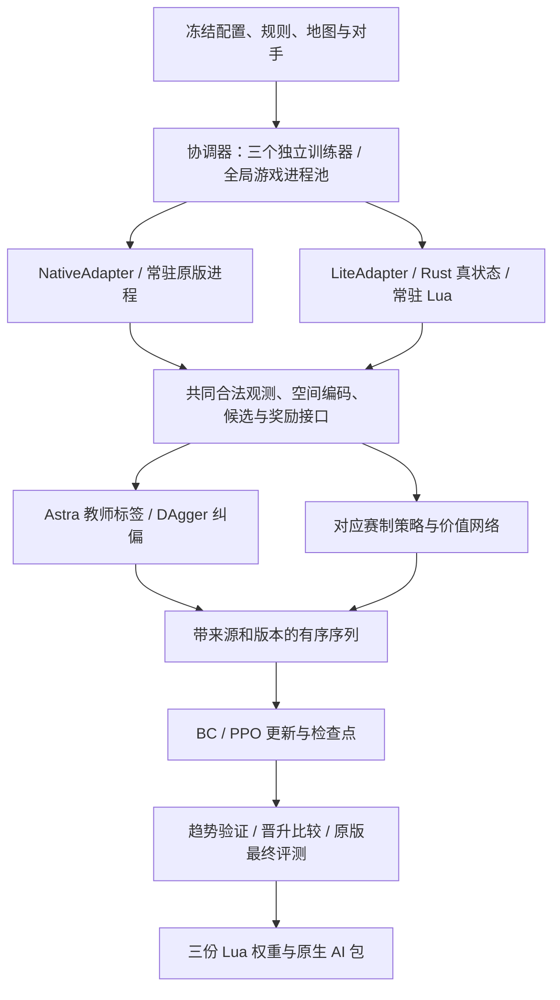
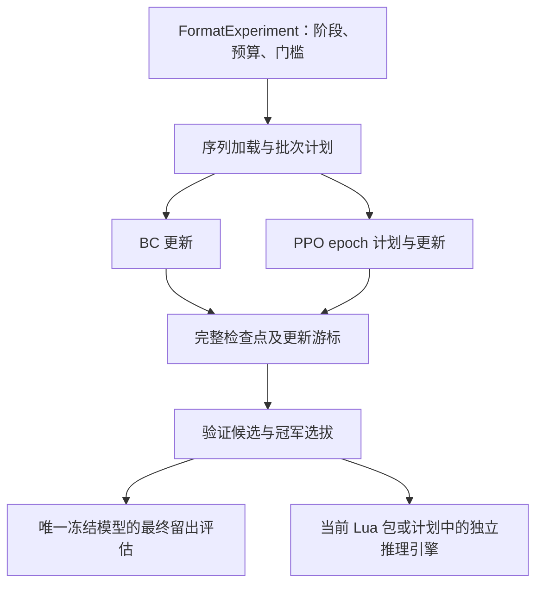

# WesnothLearning V5 架构与实现状态

> 语言：[English](architecture.md) | 中文

更新日期：2026-10-24。本文件取代根目录 PLAN.md，作为后续唯一维护的架构、参数与实施状态文档。已实现但未验收的事项及其最小测试方案归入 [TEST_zh.md](TEST_zh.md)（原版新增终态采集仍待验收），接手运行、维护与按指令调参见 [instructions_zh.md](instructions_zh.md)；[历史验收报告](../verification/archive/TEST_before_cleanup_20261022.md)及原始结果留在 `verification/`，实验和权重留在 `runs/`、`delivery/`，不复制到 docs。

状态含义：**已实现**表示存在可用代码和对应入口；**部分实现**表示仍有明确缺口或证据只覆盖有限场景；**未实现/未执行**分别表示缺少实现或尚未开展实际运行。实现、最小测试通过、整体验收通过、训练强度提升是四件不同的事。

## 1. 目标与边界

- 训练三套独立模型：`duel`、`ffa4`、`team2v2`。参数、优化器、随机状态、记忆、奖励控制器、数据与历史策略池按赛制隔离。
- 高频采样目标采用自主 Rust 精简引擎，原版 Wesnoth **1.18.8**保留迁移审计、原版棋力评测和最终部署入口；本轮正式实验按用户要求全部使用 lite。
- 当前已安装 AI 使用纯 Lua 推理与三份独立权重。用户也接受独立推理引擎、Lua 负责游戏转接，因此纯 Lua 不再是交付硬约束。外部推理路线仍属计划，尚未实现或验收；协议只能传递合法公开观测与候选动作，详见第 10 节。
- 优先级：合法部署与无隐藏信息泄露 → 单局时间和 CPU 效率 → 核心对战语义 → 次要机制的完整复现。允许有记录的近似，不删除兵种/地形来伪造覆盖，不把脚本能力当普通攻击。
- 唯一自写教师/固定自写对手为 Astra。官方 RCA baseline 仅在原版可用；lite 使用 Astra、同赛制历史策略和当前策略，不另造廉价 baseline。
- 任意战役 WML/Lua 解释器、第三方时代、GUI、动画、音频、联网与回放渲染不属于 lite 的通用运行范围。
- Ubuntu CPU 服务器是主要验收环境；Windows 只供参考。V4 权重、已安装 AI 和历史实验保留。2026-10-21/22 的 OOM、停止与重放优化记录见归档报告；T1–T4 已于 2026-10-22 通过受限验收。

2026-10-23 按用户要求归档清理服务器旧训练：只保留 `v5_lite20h_20261022_210712`、`v5_lite6000_replay_20261022_012336` 两次正式实验的原始目录与日志。更早 5 次正式实验（含 V4 权重）及 1 次回环已压缩至 `/home/tongshu/myDev/wesnothLearning/training_archives/20261023_212221/`，逐项比对通过后删除原目录，原日期、冻结源码、规则身份与产物保留在归档内。已安装 AI、规则、源码与最近隔离验收目录保持原样；索引与恢复说明见 [归档记录](../verification/training_archive_20261023/REPORT.md)。

最近正式实验 `runs/v5_lite20h_20261022_210712` 使用冻结 schema 4/v2、300/600/400 纯 lite、8 workers、CPU，已因 v100 控制度量的 `KeyError('astra_coverage5')` 失败结束。三训练器异常时间分别为 2026-10-23 03:42:59、07:05:52、约 07:55，主进程于 08:10 退出；均停在 v100、只有 BC，教师有效局 332/624/440，真实 BC 资格均未过。09:00 的旧强转任务未执行，也未改检查点。原报告的重放混入参考局，精确冻结面板重放应为 4/0/0 个控制块；层数为 6/6/12，每次参考采集上限 12，不是整个实验只能采 12。详见 [失败复核](../verification/training_failure_review_20261023/REPORT.md)，原始汇报保留原日期与内容。

用户随后授权修复和 Ubuntu 最小测试：保留 `ref[name]` 修复，补齐有界参考补采、真实终态统计、学习方开局门、故障阶段及 schema 5 索引回归，并新增独立阶段入口。当时验收完成后正式训练保持停止；schema 4 旧实验不能用 schema 5 源码直接恢复。Ubuntu 隔离目录三赛制真实 BC→显式强转 PPO→两轮 PPO→最终评测链路已通过，仍保留真实未过的 BC 门与不完整最终面板。验收范围与命令见 [修复报告](../verification/training_repair_20261023/REPORT.md)。

后续 schema 5 正式实验 `runs/v5_lite18h_20261024_003512` 在 Ubuntu 隔离目录于 2026-10-24 10:07–10:08 的 PPO 采样阶段发生整机 OOM，约 12:58 按用户要求停止。duel/FF4/2v2 最新检查点版本为 212/88/50，均已实际加载成功，训练保持停止。采样端整局轨迹不受训练器读盘预算约束，共享进程池失败后还残留等待的主进程与训练器。内存证据、尚未确定的具体分配点及未实施的修复方向见 [OOM 调查](../verification/bc_oom_20261024/REPORT.md)；本次没有恢复训练、迁移源码或调整参数。

采样端 OOM 修复已通过 Ubuntu 有界压力回放：完整原精度轨迹和 DAgger 记录暂存到私有临时缓冲，覆盖统计使用小型计数器，度量只读取所需合法字段，shard/索引写出不再重建整局记录列表或 JSON 字符串。8 个并发的 1,621 决策长局回放加 3 个驻留训练器回放池已完成，整组峰值 PSS 5.40 GiB、最低可用内存 9.14 GiB，完整序列哈希与旧基线一致。这不是 8 个实时引擎对局、最坏训练激活或正式吞吐量测试。旧训练仍停止，本次未迁移冻结源码，也未修改 BC 读取配额分配。详见 [采样内存验收](../verification/bc_memory_repair_20261024_1321/REPORT.md)。

共享进程池异常退出也已验收：协调器发生异常时，先终止本实验剩余训练器再 join，避免 worker 丢失后训练器永久等待回包。真实 spawn worker 退出注入已完成，活动子进程为零；失败仍明确报出，不自动重试或隐藏。详见 [进程池退出验收](../verification/bc_pool_exit_20261024/REPORT.md)。原正式实验没有迁移或恢复。

2026-10-24 14:20 按用户指令在 `/home/tongshu/myDev/wesnothLearning/validation_memory_repair_20261024_1321` 启动续训目录 `runs/v5_lite_resume_20261024_1420`。受控迁移保留原实验、manifest 和检查点，新目录冻结已验收的内存及异常退出修复，从 duel/FF4/2v2 v212/v88/v50 恢复，模型、优化器、随机状态、计数及真实资格保持一致；FF4/2v2 保留原先强转 PPO 的来源和未过 BC 门。只延长总预算：保留原启动时间，总截止为 **2026-10-24 22:30 中国时间**，按原 10/12 比例于 **18:50:52** 停止更新。三赛制先执行独立 PPO，完成后由续训脚本明确请求最终评测，沿用剩余共享预算。CPU、全局 8 workers、训练器 1 线程及训练/奖励配置保持冻结。原目录仍是必需的只读语料和历史策略来源。恢复断言及真实进度见 [续训报告](../verification/training_resume_20261024_1415/REPORT.md)。

14:33:55 已确认三赛制均保存新的 PPO 更新：duel v219 / 优化器 2198 步，FF4 v91 / 1786 步，2v2 v51 / 698 步，均无新错误。详见 [恢复最终核对](../verification/training_resume_20261024_1415/HANDOFF_1434.md)；此结论只证明续训推进，不代表后续收敛或最终评测已完成。

2026-10-24 15:47–15:53 的只读质量调查确认 PPO 仍在推进（v261/v107/v57），但验证面板较小、波动明显，每批采样后的优化步数有限，奖励配置均仍为版本 0。Ubuntu 已复现自动奖励窗口累积到三个后不再刷新、Duel 后续 58 个完整块滞留的缺陷；FF4/2v2 则尚未攒够两个窗口。KL 提前结束分支还遗漏样本暴露计数，旧 BC 准确率和这些计数不能用于判断 PPO 停滞。本次没有修代码；离线刷新 Duel 窗口后，现有规则依旧不建议调整奖励系数。测量边界和后续最小检查见 [质量调查](../verification/training_stall_20261024_1544/REPORT.md)，当前训练和奖励保持原样。

2026-10-24 自动奖励滑动窗口修复已验收：每攒够 12 个完整块就继续处理，历史只保留最新三个窗口，不足 12 块的尾部继续等待。新增三项回归在旧代码上失败、修复后通过；Ubuntu 相关 14 项检查及真实捕获的 55 块积压回放通过。回放后剩余 7 块、窗口更新为最新三个，未建议修改奖励系数。触发门槛、奖励规则、事件/版本处理及 PPO 均保持原样。本次仅验收源码，正在运行的续训仍使用原冻结实现，需明确授权迁移或新实验才会生效。详见 [窗口修复验收](../verification/reward_window_fix_20261024_1607/REPORT.md)。

用户随后要求暂停并部署修复。上一轮续训已于 16:21:48 停止，滑动窗口修复部署到新的冻结源码目录 `/home/tongshu/myDev/wesnothLearning/validation_window_fix_20261024_1630`，派生续训 `runs/v5_lite_windowfix_20261024_1630` 于 16:31:29 启动。Duel/FF4 使用保留的最佳完整 PPO 检查点 v100/v100；2v2 没有晋级最佳模型，明确以最近合法 v60 作为备选。所选模型、优化器及随机状态保持一致，v100 已完成验证仅复用旧结果，不新增对局。原实验和检查点保留。配置只将总截止延长至 **2026-10-25 00:00（北京时间）**；保留原启动时间及 10/12 比例，因此 **10 月 24 日 20:05:52** 截止 PPO 更新，随后脚本在剩余预算内进入最终验收。CPU、8 workers、训练器 1 线程、奖励系数、真实 BC 资格和已有强转 PPO 来源均保持原样。部署、选择依据及实际进度见 [部署交接](../verification/window_deploy_20261024_1620/REPORT.md)。

16:41:14 已确认部署后所有赛制都提交了新 PPO 更新：Duel v105 / 优化器 1795 步，FF4 v103 / 1828 步，2v2 v61 / 756 步，错误均为空。详见 [部署完成核对](../verification/window_deploy_20261024_1620/HANDOFF_1642.md)。

续训已于 **2026-10-24 20:42:45** 正常结束，退出码 0，三个赛制各完成 30 个最终评估块。最新训练版本为 Duel/FFA4/2v2 **211/143/80**，最终入选 **100/100/80**；lite Astra 对照均为 **not_passed**，评分差 -1.55/-.11528/-1.175，95% 区间均低于零。最终模型已下载到 `delivery/lite_final_20261024/`，并以独立本地附加组件 **NeuralArena20261024** 安装，旧模型保留。三个真实双回合导出审计通过现有 1e-5 Python/Lua 误差门槛，原版 1.18.8 注册预处理成功；原版棋力仍未验收。[实力复盘](../verification/model_strength_20261024_2120/REPORT.md) 记录了 FFA4/2v2 BC 未完整通过、受限读取欠填、频繁微块 KL 停止，以及回滚后 Duel v110/v200 与旧权重完全相同。本次研究没有修改训练实现或奖励；T6 仍待验收。上面的历史启动快照不表示仍有训练进程运行。

**训练重构建议，尚未实施：**[GitHub 源码调研](../verification/github_refactor_research_20261024/REPORT.md) 建议保留 lite 引擎、公开观测、三个网络和 Lua 部署，分清有界序列读取、BC/PPO 更新循环与检查点用途。借鉴 imitation 的逻辑批次/微批次分离、robomimic 的索引序列访问，以及 SB3-Contrib/CleanRL 的有序 PPO 遍历。保留当前权重原始前缀重放、窗口权重和验收门槛；上游也使用 minibatch KL 早停，不能仅凭该机制判定有错。保持行为的模块拆分、BC 欠填修复、PPO 覆盖/KL 变更分别落地，每项只补已有记录上的受影响最小检查。研究不授权实现或训练，未实施前不增加 TEST.md 项目。

## 2. 总体结构与责任



| 责任 | 入口 | 状态 |
| --- | --- | --- |
| 规则捕获、冻结、声明审计 | `engine_lite/capture.py`、`freeze.py`、`audit.py` | 已实现，覆盖边界见第 3 节 |
| Rust 唯一真状态、规则结算与 PyO3 批量 API | `engine_lite/src/{model,state,combat,lib}.rs` | 已实现，仍有公开近似 |
| Native/lite 适配、Lua 宿主与 Astra 查询 | `learning/adapters.py`、`native_transport.py`、`lite_host.py`、`engine_lite/lua/host.lua` | 已接通三赛制 Astra；有限验证范围见第 8 节 |
| 共同观测、候选、空间与路由 | `lua/{observation,candidates,spatial,routing}.lua` | 已实现；学生候选先于教师查询生成 |
| 模型、序列、监督与强化训练 | `learning/{model,sequences,data,train}.py` | 已实现，已做有限真实更新 |
| 三训练器协调与共享 worker 池 | `learning/coordinator.py`、`experiment.py`、`schedule.py` | 已实现，默认 lite；按六阵营训练闭包检查启动 |
| 奖励公式、度量、批次控制 | `learning/{rewards,reward_metrics,control}.py`、`lua/rewards.lua` | 已实现，非梯度学习奖励系数 |
| 基准、原版差分、BC 诊断与导出 | `learning/{benchmark,benchmark_runner,audit,export}.py`、`engine_lite/differential.py` | 入口已实现，完整验收和强度实验未完成 |

共同接口覆盖 `reset`、`observe`、`legal_actions`、`step`、`snapshot/restore`、`close`，并提供批量观测/路径/预测与 Lua 决策调用。Python `pos/to` 为零起始行优先索引，Lua 为一基六角坐标；Python 武器索引从 0 起，Lua 从 1 起。`snapshot` 为裁判真状态，策略只能获取玩家合法视图。

lite 决策新增 `generate_candidates`（默认 true）：采样循环只对未采集的 Astra 座位关闭完整学生候选生成，保留其合法观测、Astra 规划、执行和记忆更新；教师采集座位、学生推理、DAgger 与 bootstrap 保留完整候选。2026-10-22 通过 T2 验收：未采集座位 `C.generate` 调用 0 次、候选仅 1 个 `end_turn`，两条路径的教师动作与执行后状态一致；此前临时探针的约 39–40% 循环耗时下降仍是非验收数据。

## 3. 规则数据、运行语义与隔离

### 3.1 当前冻结数据

默认规则包：`data/rules/1.18.8-training/`，从 Ubuntu 的 `verification/v5_lite_default_20261021/capture-maps/frozen/` 原样提升；旧 `data/rules/1.18.8/` 和带日期的证据保留。

| 项目 | 当前结果 |
| --- | --- |
| 原版作用域 | 20/20，缺失 0 |
| 数据 | 587 单位、438 地形，完整保留原始 WML、来源和作用域；含 10 张正式地图的复合地形 |
| 单位覆盖标签 | 0 exact、470 approximate、117 unsupported_script |
| core | 308 单位中 303 可运行；5 个保留单位事件限制 |
| 实际六阵营闭包 | 158 个不同单位；领袖/招募 → 全部升级/瘟疫类型，无缺失和未支持声明 |
| 规则 SHA-256 | `d6fceafe7d0c9c67c750551b9901dbfb2b22290992a8daa1616a460e11826dca` |
| 整包标志 | `complete=false`、`native_accepted=false`、`performance_accepted=false` |

用户已认可目前训练范围内的规则覆盖。158 单位闭包通过不表示所有 587 个类型的战役行为被实现，也不表示所有语义为 exact。core 的事件限制类型是 Fire Ant Egg、Fog Clearer、Giant Ant Egg、Giant Scorpion、Sand Scuttler。

### 3.2 已实现

- 原版隔离捕获、战役 define/难度上下文、跨作用域地形统一、冲突类型 ID 命名空间、升级与瘟疫引用重写、来源哈希及损坏 WML 拒绝。
- 六角移动、地形代价、阻挡、ZOC/游击、连接城堡招募、村庄经济、逐击攻击/反击、死亡中断、经验与默认升级路径。
- 时间/阵营/抗性修正，中毒、减速、吸血、先攻、魔法、精准、冲锋、狂暴、swarm、基础瘟疫、背刺、steadfast。
- 标准治疗/治毒/休息、feeding、传送、声明隐匿/夜隐；补齐沼泽/满移动掘地隐匿、stun/ZOC、absorb、deflect、diversion、参数化吸血、shock/swift、distract、inspire、vanguard、initiative、参数化/地形限定再生、暗化与 Quenoth 条件治疗。
- 独立可复现的对战/招募 RNG，快引擎不要求与原版同 seed 同结果；可注入逐击命中用于差分。候选、教师和预测不得推进真实对战随机流。
- 每方独立 fog/shroud、已探索地形、最后合法敌情及年龄、村庄记忆；按配置共享地图/视野，支持四方轮转、淘汰和团队胜负。

### 3.3 明确近似与未实现项

复合修正舍入、反击武器选择、完整原版声明过滤条件等仍有近似。随机 traits 生成与跨升级保留、AMLA/升级选择、独立 `vision_costs/jamming`、运行时变体尚不完整。剩余 117 个类型主要依赖战役事件、dummy、脚本瘟疫、WML 变量/多次攻击/歌曲状态等；运行入口拒绝使用含未实现声明的初始单位、招募、升级或瘟疫链。

原计划中的增量视野/寻路缓存、邻接预计算、跨游戏规则共享和更紧凑的轨迹 I/O 尚未全部落地；当前仍有完整视野重算、JSON 边界传输及预测状态复制。批量 API 已实现不等于整个训练器已经采用批量推理或消除了这些成本。

规则真状态仅供裁判、结算、差分及明确的奖励标签。策略、Astra、候选与预测不能通过对象引用、共享缓存、隐藏友敌信息或未知地图绕过视野。正常伏击/接敌造成移动中断后重新观察，不记为策略故障。

### 3.4 默认入口与训练范围验收

新实验默认采用 lite 和已记录的规则近似，不自动回退 native。规则选择顺序为显式 `--rules-dir` → `WESNOTH_RULES_DIR` → `data/rules/1.18.8-training/`。CLI 在导入特征/模型前绑定目录，程序创建实验在构造模型前绑定；同一目录传入任务和适配器，并在 manifest 冻结目录、规则哈希、来源和训练闭包。恢复使用原 manifest 的规则目录，拒绝冲突参数。地图仍使用现有冻结地图入口。

默认受检加载读取小型 `catalog-summary.json`，验证 rules.json 哈希、来源与 1.18.8 版本，再按实际六阵营配置现场检查完整招募/领袖/升级/瘟疫闭包。未支持或缺失引用仍阻止启动，外围战役脚本不阻止标准训练。运行时不解析/保留约 50 MB 的完整 catalog；缺少 summary 的历史包保留兼容加载。`training_acceptance` 记录范围和 profile 哈希，表示实现覆盖已就绪，不表示原版全部语义或性能达标；`acceptance_scope='full'` 保留原整包三标志门禁，原标志保持 false。

10 张训练/验证/保留原版地图已按发行包来源冻结到 `data/rules/1.18.8/maps/`。捕获入口默认读取这些地图，另支持 `--maps-dir`，将复合地形交给原版查询实际单位移动/防御数值；不通过猜测 alias 或替换地形补表。由原 291 地形扩至 438，规则身份和特征 schema 随之改变，旧检查点不能直接按新词表恢复。

## 4. 模型：三个实例、六个组成部分

架构标识 `relational_v5`。当前实现为 **schema 5、每套 776,178 参数**（587 单位词表），增加战术动作特征与实体相对出手轮次；网络主体不变。Ubuntu 隔离接入、实际更新、检查点恢复和 Python/Lua 数值已验收。受限六阵营 BC 移动输入验收已通过；正式 BC 全部质量门仍独立执行且尚未全过。已失败的旧实验冻结 schema 4、772,530 参数；旧 schema 3/4 数据、权重和优化器不补零迁移。

| 部分 | 已实现结构 |
| --- | --- |
| 单位与关系 | 类型嵌入 16，单位投影 64，2 层 4 头实体注意力，FFN 128；行动者和目标使用完整表示 |
| 空间 | 16×16 公共棋盘，2 层 3×3、16 通道卷积；候选落点周围半径 2 的 19 格投影至 32 维 |
| 短期记忆 | GRU 128，每方每个自身回合提交一次更新 |
| 长期记忆 | 最多 32 个、每个 64 维回合摘要，附年龄，注意力读取、FIFO 写入 |
| 动作头 | 场景/记忆、行动者/目标、动作特征、局部地形和几何关系 → 512 → 256 → 128 → 1 |
| 价值头 | 同一合法观测上下文 → 隐藏 128 → 标量价值 |

对手编码为 16 维，按均值/最大值汇总。最多 128 个实体参加注意力，候选相关单位和领袖优先，溢出单位仍进入空间汇总，未入注意力的行动实体单独投影；最多 128 个动作候选、16 次高成本战斗预测。工作量预算、排序和 tie-break 应在两个引擎一致，原版动作时限作为外层保护。

旧正式实验冻结的候选规则为 `fixed-20000-v2`，以下为其已验收行为（v3 保留）：复用公开信息评分，先保留每单位主要合法完整移动，再按单位/类型轮转填充剩余位置；2v2 保留友军占据村庄的战略目标，实际落点仍排除占用格。lite 向 Astra 传递村庄记忆时使用教师要求的 `x*1000+y` 键，快照负责 JSON 键转换。此批针对 duel/2v2 移动覆盖的修改已于 2026-10-22 通过 T3 验收：固定状态语义覆盖键/视野/快照/友军村/受伤分支/128 上限与 16 次预测，真实样本 duel 移动 84/84、team2v2 移动 135/135，`audit_bc` coverage 0.983 且 `coverage_pass` true；旧移动覆盖 88.45%/65.79% 作为历史数据保留，不改写为新结论。

2026-10-23 本地新增候选 `fixed-20000-v3`：将已计算的公开战术落点评分、相对原地收益、风险及风险变化、守家距离、己方支援和首选移动标记传入动作头；实体补充敌方下一次出手是否跨轮。原地评分复用已有威胁图，不新增战斗预测、教师调用或隐藏信息。覆盖用的候选集合不因这些输入被裁掉，候选/预测上限不变。本地同数据、同初始化、各 120 次全网络更新的三对局族留出对照：FF4 移动 10/73→37/73（13.70%→50.68%），2v2 19/90→46/90（21.11%→51.11%），duel 25/80→46/80（31.25%→57.50%）；这是输入消融对照，不是现有远程检查点对比。169 项相关回归通过。证据见 `verification/bc_move_fix_20261023/REPORT.md`；冻结权重再做另外 8 个短局验证，联合六阵营留出移动为 FF4 28/223→98/223（12.56%→43.95%）、2v2 34/237→111/237（14.35%→46.84%），没有额外优化更新；FF4 亡灵挑战单项仍为 15/49（30.61%）。Windows 仅作参考，训练采集方仅三阵营且短局；本次还修正了 v3 插入字段后 repeated_move 误读 move_primary 的回归，历史对照保留原身份，不能自动代表修正后的新轨迹质量。Ubuntu 接入/阶段链路和真实权重数值已通过；后续 [Ubuntu 排查](../verification/bc_rootcause_20261023_2318/REPORT.md) 使用四个 FF4 训练族，验收了修正后的移动收益。该小样本的招募/攻击与整体 BC 门尚未全部通过。

新游戏重置记忆，淘汰/队友死亡不重置；重复 evaluation、教师只读查询和 bootstrap 不提交记忆。训练按 8 个自身回合截断反传，使用当前权重重算前缀，不跨参数更新复用旧隐藏状态。同一次 forward 批量编码唯一历史观测，并按共享前缀复用状态；GRU 图只在截断边界相同的样本间共享，老前缀无梯度，32 槽长期记忆保持不变。张量按字段批量构建。冻结 lite 学生在单局、单 side 内按历史长度和当前回合缓存历史编码，历史或回合改变立即重算，bootstrap 不提交记忆。纯 Lua 与 PyTorch 对应实现、序列重放和数值核验入口均已实现；正式长训练权重的连续序列部署验收尚未执行。

## 5. 数据与训练流程

### 5.1 采集目标（2026-10-22 用户调整）

| 赛制 | 原版有效教师局 | 追加 lite 教师局 | 合计 |
| --- | ---: | ---: | ---: |
| duel | 0 | 300 | 300 |
| ffa4 | 0 | 600 | 600 |
| team2v2 | 0 | 400 | 400 |
| 总计 | 0 | 1300 | 1300 |

默认配置、CLI 和程序创建实验统一为单挑/FF4/2v2 300/600/400 个有效 lite 教师局，原版锚点为 0，保留 Astra 教师；失败局不计入目标，批次按剩余额度截断。默认采样与最终比较均用 lite，最终比较只对冻结 Astra，不宣称原版棋力。显式选择 native 时总目标同为 300/600/400，原版下限默认等于对应总目标。CLI 的 --native-bc-games 与 --evaluation-engine 保留显式覆盖能力；已有冻结实验恢复使用其原配置。本次仅修改默认值，未授权新一轮启动，旧 18000 局/18 h 实验保持停止。

### 5.2 BC → 学生 rollout / DAgger → PPO

1. 冻结规则、地图、对手、源码、配置与预算；三个训练器共享全局游戏进程池。
2. Astra 教师采样与 BC 更新交替执行，每赛制每批默认新增 8 局。保留精确动作交叉熵，同时监督行动类型、行动单位、目标/落点；正常路径中断保留原始合法意图和实际执行结果。
3. BC 同时满足语料量、候选覆盖、模仿质量和开局行为才切到 PPO。连续 10 次 BC 质量记录未改善时追加教师局和学生纠偏，之后再降低 BC 学习率，不自动放宽门槛。
4. 学生 rollout 中查询 Astra，当前 lite 按每四次学习方决策一次、每局最多 32 次执行。教师有独立合法历史，只规划；未覆盖/失败的标签记录诊断，不冒充学生 on-policy 行为。按高熵、重复移动等困难程度优先查询仍是后续优化方向。
5. PPO 每赛制每批默认 4 局，消费同一冻结策略/奖励/引擎版本的学生轨迹，同时做同赛制 BC rehearsal。BC 与 DAgger 数据均存在时各取 50%；原始池若有合格人类数据，Astra/人类为 75%/25%；原版/lite 均存在时训练抽样各取 50%。这些训练重采样权重不等于采集局数比例。

2026-10-23 用户要求新增分阶段入口：默认 auto 保持上述自动资格门；`run --phase bc` 只跑 BC，`phase ppo`/`phase evaluate` 请求下一个独立阶段，运行中在批次边界生效，停止后需 resume。BC/PPO 分别以 `bc_complete`/`ppo_complete` 保存，不隐式执行后续阶段。`phase ppo --force --reason` 是显式跳过 BC 资格的入口，保留真实 effective/门结果并记录原因与命令 ID；不改写检查点资格位。阶段请求可用 `--hours` 明确增加该阶段预算，保存独立 phase_deadline，不改原 clock/manifest。最终评测开始后不允许在原目录返回训练。最终选择优先已有晋升 best，其次 last_ppo、last_bc、latest，避免有 PPO 更新却退回旧 BC。实现与最小验收证据见本轮 verification 报告；当前未授权启动正式训练。

人类回放还原、兼容性检查和导入入口已实现；正式可用人类语料与其预训练收益尚无完成证据，不能把候选回放数当训练样本数。每个样本保存赛制、schema/架构、引擎/规则/RNG、策略/奖励版本、来源、教师、队友上下文、对局族与截断 bootstrap。`game_family` 按约 80%/20% 分训练/验证，同族不能跨区，按对局等权再抽决策。

有序序列、压缩 SQLite 索引块、完整前缀、窗口抽样与分块验证均已实现。分片行按「元数据 + 定长 float32 数值块」写入（`learning/rowpack.py`），读取逐局流式：按 gz 字节（96 MiB）与保留字节（768 MiB）双重预算只留被抽中的窗口，整局不再跨更新缓存；验证读取受 `bc_validation_records` 限制并用固定 seed。每批把分片数、gz 字节、保留字节、行数与峰值 RSS 记进 `state.history`，训练器另有 `RLIMIT_AS` 兜底，非零退出落盘 `trainer_exit.log`。指标分别记录环境局数、采集批次、优化步数、不同对局族、决策数、有效数据遍历量，避免用一个“轮数”混淆。

### 5.3 训练默认参数

| 参数 | CPU | CUDA / 共同规则 |
| --- | --- | --- |
| 全局游戏 worker | 8 | 8；2026-10-22 通过 T1 配置与 T4 8 worker 真实链路（峰值 PSS 4.02 GiB）验收 |
| 每训练器线程 | 1 | 1 |
| 每次 BC 读取决策上限 | 2048 | 8192，按版本轮换，不是总语料上限 |
| 序列/微批 | 4 条 / 32 决策 | 8 条 / 64 决策，8 自身回合窗口 |
| 更新 | 4 epochs | BC 学习率 3e-4；PPO 1e-4 |
| PPO | clip 0.2，价值损失 0.5，梯度裁剪 0.5 | 熵 0.01、BC 辅助 0.10，近似 KL >0.02 停止当前批次后续更新 |
| 回合上限 | 训练 60 | 常规原版对照 30，分别报告截断率 |
| 预算 | 默认 12 小时 | 前 10/12 允许更新，后 2/12 冻结评测，恢复不重置截止时间 |

BC 门槛：候选总体覆盖 ≥90%、招募/移动/攻击各 ≥80%；精确一致率总体 ≥40%、招募 ≥60%、移动/攻击各 ≥35%，每类至少 32 条，交叉熵低于均匀策略的 85%；开局需出城、占村和合理结束回合。64 决策小集拟合、完整留出输入混淆和学生状态上的教师纠偏有独立诊断入口，正式全语料诊断与训练结果尚未完成。

### 5.4 教师与对手

原版三赛制可用 Astra 教师，原版 2v2 保留 baseline 队友。lite 宿主提供真实 Astra 四人脚本实际需要的只读 WML/unit/helper 接口，含 `wml.get_child`、治疗/武器声明；使用实验冻结的 Astra ZIP，不修改教师策略。三赛制教师 BC、学生 DAgger/PPO 的历史最小回环结果见上述归档报告；当前采集目标已调整为合计 1300 局纯 lite，该规格的 20 小时正式实验已失败结束，本轮未重启正式训练；原 18000/38400 方案保留历史记录。

PPO 原版对手池按固定/历史/当前 50%/25%/25%，2v2 队友分上下文；lite 固定对手只含 Astra，baseline 队友位置使用 Astra，并独立标记 `astra_partner`，不混作原版 baseline 结果。

## 6. 奖励与在线控制

已实现的训练奖励：终局 + 经济/控制潜势差分 + 首次探索增量。

```text
r = r_terminal
  + w_economy * (gamma^delta_turn * Phi_economy_next - Phi_economy_now)
  + w_control * (gamma^delta_turn * Phi_control_next - Phi_control_now)
  + w_explore * first_exploration_delta
```

单挑/团队胜 +1、平 0、负 -1；FFA 按本局名次居中并缩放到 [-1,1]。gamma=1、GAE lambda=0.95，按自身回合跨度处理；正常终局势能归零，截断保留合法末状态的价值/势能 bootstrap，故障局不训练。原版棋力评测看原版胜负/名次；本轮 lite 比较只报告 lite 胜负/名次，不按 shaping 总分选模，也不据此声称原版强度。

经济量含 gold、按 HP 折算兵力价值和每村 20，团队取成员平均，相对其他对抗方归一化，避免招募凭空加分。地图控制使用合法己方/可见盟军/带年龄 last-seen 信息、多源有界路径与按回合缓存；战略格权重村庄/要塞/通路采样为 4/2/1。探索按每局首次合法观察去重，扣除初始已知区域，队友共享不重复计分，关 fog 时默认关闭。裁判可导出奖励标量，隐藏单位/地图字段不进入 actor 或公共价值输入。

| 系数 | 初值 | 自动范围 |
| --- | ---: | --- |
| 终局 | 1.0 | 固定 |
| economy | 0.15 | 0.05–0.20 |
| control | 0.10 | 0.02–0.15 |
| explore（整局上限） | 0.10 | 0–0.15 |

每个赛制的 `RewardController` 支持 fixed/scheduled/adaptive，默认 adaptive；依据实际行为、奖励和验证度量作有界调整，属于规则控制器，不是优化器学习系数。人工和自动更新走同一原子队列，仅在批次边界生效并递增 `reward_version`；一局和一次 PPO 更新使用同一冻结配置。事件日志和检查点记录旧/新配置、来源、原因、序号与校验和，恢复重放而不重置状态。长期自动调参是否改善棋力尚未通过长实验验证。

## 7. 地图、验证、性能与部署

2026-10-23 修复决定（lite 最小验收见修复报告，原版新增采集待 TEST 验收）：控制指标使用独立初始/淘汰/终局观测，正常淘汰和提前获胜均纳入统计；第 5/10 回合前进入终态时，后续 horizon 使用明确的吸收态。淘汰侧控制/领袖生存为零，探索保留最后合法累计量，HP 损失由真实己方终态与已有观测计算；胜方保留真实终态。预算截断和故障不补终态，不把缺失数据补零；这些快照不进入 actor、BC/PPO 数据或记忆。指标版本 `terminal-horizons-v2` 与旧统计不混用。开局只检查学习方，结束回合看有合法落点的非领袖剩余移动量（仍为 ≤4），不惩罚留守领袖或无法移动的单位。任意指标故障记录并冻结 adaptive 自动调参，真正的训练故障以 failed 阶段非零退出，保留 pending 数据，不自动执行最终留出评测。参考不足显式 inconclusive；每次补采最多 12，后续验证按缺口继续，已尝试失败编号也不复用。晋升必须实际达到 12 完整块；最终不足 30 块保持 inconclusive。内部策略恢复核验 schema/权重哈希，不对内部目录施加 SDK 提交包大小限制，正式提交限制仍保留。

### 7.1 地图和模型选择

| 赛制 | 训练地图（另有 50% Arena） | 验证 | 最终留出 |
| --- | --- | --- | --- |
| duel | The Freelands、Weldyn Channel、Sablestone Delta | Hamlets | Caves of the Basilisk、Ruined Passage |
| ffa4 / team2v2 | Clash、Isar's Cross | Loris River | Morituri |

地图冻结记录原版版本、哈希、地形/起点和统一规则，不宣称完整 Ladder 场景语义。留出地图不参加奖励调参、困难采样或选模。

趋势验证默认每 10 个更新批次执行，局数 6/4/8；每 100 个更新批次用晋升面板替代趋势面板，对 Astra 及已有冠军各至少 12 个完整轮换块，2v2 分队友上下文。这些调度与报告代码已实现，但正式候选晋升和棋力结论未执行。最终原版评测至少 30 个完整轮换块/对手，报告胜平负/名次及按块 bootstrap 区间。运行中受预算约束的原版审计队列、约 5% 审计成本及完整 mixed pipeline 尚未形成实际证据。

### 7.2 性能目标与已有证据

目标是同等工作量下 native/lite wall 和总 CPU 核秒各 ≥5；当前内存验收口径为 native/lite 峰值 PSS 比 ≥1.3，原 PLAN 的 5 倍内存目标已废止。比值 1.3 对应 lite PSS 约为 native 的 76.9%，不是“降低 30%”。冷启动/常驻热态分开，包含进程树 CPU 和采样 PSS，不能靠增加并发、提前结束、换较少动作宣称加速。

已有旧冻结包的 regular、单 worker、30 完整轮换块基准：duel 冷/热 wall 约 5.44/11.88 倍，FFA4 约 5.88/22.30 倍，2v2 约 5.94/22.36 倍，PSS 比约 1.65–1.69。**这些只覆盖 observe/legal_actions/end_turn，不含完整候选、教师和学生推理，也不是新规则包的重新验收。** 端到端原版/lite 终止原因和动作数不同，已明确判为不可比较。dense、4/8 worker 吞吐、混合审计流水线及完整决策的端到端性能仍缺证据，后续按实际改动做最小验证，不为补文档重复跑矩阵。

### 7.3 原版交付

PyTorch → 纯 Lua 导出、三赛制路由、检查点加载和连续序列数值审计入口已实现。分别输出 `weights_duel.lua`、`weights_ffa4.lua`、`weights_team2v2.lua`，开局选择并缓存对应权重，其他人数 FFA 可复用 ffa4 而不承诺强度，其他团队关系需明确处理。小闭环检查点已有 Python/Lua 最大误差约 2.3e-8。2026-10-24 最终权重已通过真实双回合、128 候选的最小审计（<1e-5），不是长原版对局部署验收，见 [安装记录](../verification/model_strength_20261024_2120/REPORT.md)。独立推理引擎加 Lua 转接已获用户接受为设计选项，实现及验收计划见第 10 节。

三模型本地附加组件超过原 SDK 16 MiB 限制，已于 2026-10-24 作为独立本地包安装，旧安装模型保留；它不是已通过验收的比赛提交包。用户暂时忽略包体和严格 1pp/0.5 HP 统计门槛作为当前阻塞，原 SDK 保持不变。尚无正式 native 棋力结论。独立推理交付的本地包契约见第 10 节，不能据此声称符合 SDK 比赛要求。

参考项目仅供设计对照；未明确许可的代码不复制。原版语义以固定 1.18.8 构建/数据为准；实际移植 GPL 代码时保留适用版权、许可和对应源码，不能把整个交付笼统标为项目自有 MIT。

## 8. 已有验证与未完成项

本节是状态摘要；已通过验收的范围与证据见[历史验收报告](../verification/archive/TEST_before_cleanup_20261022.md)及 2026-10-22 的 `verification/pretrain_acceptance_20261022/`，当前已实现但未验收的事项见 [TEST_zh.md](TEST_zh.md)（仅列尚缺证据的范围）。

| 范围 | 状态与证据边界 |
| --- | --- |
| 新规则覆盖 | 已完成本轮实现：25 个类型新增支持，158 单位训练闭包清零；Ubuntu 新增 23 项最小用例与 2 个新原版逐击场景通过 |
| 代表原版差分 | 历史旧规则包 13/13 通过；不能据此自动把新规则包或全部能力标 exact |
| 配额与并发调整 | 2026-10-22 Ubuntu 验收通过（T1）：单挑/FF4/2v2 为 300/600/400 lite、0 原版，总 1300，全局 8 workers、每 trainer 1 线程；CLI 省略参数与程序默认一致，显式 `--bc-games`/`--workers` 生效，恢复保留冻结目标与截止时间，末批按剩余额度截断且失败局不计额。证据 `verification/pretrain_acceptance_20261022/T1_ubuntu.txt` |
| 按座位生成候选 | 2026-10-22 Ubuntu 验收通过（T2）：未采集 Astra 座位完整候选调用数为 0（仅 1 个 `end_turn` 候选）；采集座位、学生策略、DAgger 与截断 bootstrap 仍生成完整候选，两条路径的教师动作、状态与采集标签一致。证据 `verification/pretrain_acceptance_20261022/T123_affected_suite.txt` |
| duel/2v2 移动覆盖 | 2026-10-22 Ubuntu 验收通过（T3）：教师村庄记忆键 `x*1000+y` 及失视野保留、side 隔离与快照往返；2v2 友军占村只影响战略目标且不可落脚；单挑受伤分支；候选池 128 上限、主要完整移动保留、战斗预测 16。真实样本 duel move 84/84、team2v2 135/135，`audit_bc` coverage 0.983 且 `coverage_pass` true，来源 v2。证据 `verification/pretrain_acceptance_20261022/t3_coverage.json` |
| 原版真实小回环 | 已执行 7 局、4 worker，三赛制各有限 BC/PPO 更新，检查点和数值审计通过 |
| 历史原版锚点验证 | 额外 1 局 native 2v2 / Clash / 1 回合通过，6/6 教师动作匹配；验证新规则绑定、实际调度与有效分片 |
| lite 真实小回环 | 最终 438 地形包上 6 局、3 worker：三赛制各真实 Astra 教师/BC、学生/DAgger/PPO，检查点与数值核验通过，最大误差约 2.38e-8 |
| 8 worker 受限真实链路 | 2026-10-22 Ubuntu 验收通过（T4）：9 局教师（≤10 回合，含 duel `the_freelands`、ffa4/team2v2 `clash` 原生图）+ 3 局 lite rollout，broker 峰值 8、scheduler 活跃峰值 8，三个 trainer 退出码 0；BC/PPO 各 1 批更新与版本 1/2 检查点回读，DAgger 查询 1/4/1 且 bootstrap 有效；峰值 PSS 4.02 GiB（上限 12）、最低 available 10.46 GiB、swap 增长 0、无残留进程。证据 `verification/pretrain_acceptance_20261022/T4_summary.json` |
| 2026-10-23 阶段与故障修复 | Ubuntu 71 项相关检查及 7 项后续受影响检查通过；三赛制每族 1 次真实 BC + 2 次 PPO 更新，真实恢复与最终选中 v102 PPO；开局每族两局真实 Astra、学习方归属及留守领袖口径通过；连续两回合/128 候选的 Python/Lua 误差 <1.6e-8。小面板 1/30 块仍 inconclusive，不证明收敛或棋力。见 `verification/training_repair_20261023/REPORT.md` |
| 冻结包测试适配 | 已修；容量随实际词表断言、真实 smoke 使用当前特征目录，Ubuntu 对应最小项通过 |
| 修正后 schema 5 BC 移动质量（T5） | Ubuntu 六阵营受限移动收益已验收：复用 2v2 的 257/507（50.69%），置零 79/507（15.58%）；FF4 使用四个训练族、相同 120 次更新，在预先冻结的新留出达到 126/257（49.03%），置零 28/257（10.89%）。两族数据过拟合/轨迹多样性不足是重要因素；未采用模型/损失/默认参数改动。正式招募/攻击/整体门仍未全过。[后续证据](../verification/bc_rootcause_20261023_2318/REPORT.md)；原失败结果保留。 |
| lite 教师状态复用 | 已修复恢复后 JSON 数组受保护元表的拷贝错误，以及 adapter.reset 重复安装 Lua 宿主。两个新增真实 Rust/Lua 回归在修复前失败，Ubuntu release 重编后通过；另一个真实对局恢复后教师查询也无绕过通过。正常策略/模型/候选合同不变。[证据](../verification/bc_rootcause_20261023_2318/REPORT.md) |
| 默认启动/内存路径 | 已完成；默认 lite、统一规则绑定、训练闭包门禁与轻量受检加载；普通协调器和三训练器初始化通过 |
| 四人 lite 教师 | 已接通真实冻结 Astra；补 WML 只读投影及 2v2 稀疏 side 记忆快照往返，最小用例和四人真实小回环通过 |
| 正式地图 | 已补 10 张原版冻结地图及缺失的 147 个复合地形；全部地图地形覆盖和赛制检查通过 |
| 全流水线性能 | 未完成：端到端等价工作、dense、并发和含审计成本尚缺证据 |
| 生产语料与长训练 | 读取内存缺口已修复，历史 42 min 回环峰值 PSS 6.4 GiB；历史重放与批张量优化已通过 10 项最小测试、三赛制真实微批输出/梯度比较及 BC 更新/检查点回读。旧 18000 局纯 lite / 18 h 实验已停止；1300 局规格的正式实验已在 schema 4 失败结束，schema 5 的正式训练和收敛未完成 |
| 最终原版评测/交付 | 原版棋力未评估；最终 lite 模型已于 2026-10-24 本地安装，通过受限数值/注册检查。独立推理交付仅有计划；未声称胜过 Astra 或人类强者 |

普通训练接入和短局链路已完成；正式运行暴露的高内存问题已修复并通过真实回环验收，证据见上述归档报告；最新纯 lite 正式实验已失败结束，具体状态见第 1 节。全流水线性能与正式强度仍需实际实验积累证据；外围战役和高成本完整语义保留明确限制，不默认扩张为通用 WML 引擎。

## 9. 文件布局与维护

```text
README.md                  仓库入口（英文）；中文镜像 docs/README_zh.md
docs/architecture.md       架构、当前参数、已实现/未实现状态（本文件）
docs/instructions.md       Agent 启动/恢复、维护训练与按指令调参
docs/TEST.md               已实现但未验收的事项及通向正式训练的最小测试方案
docs/THIRD_PARTY.md        第三方代码、参考对手包与官方授权
AGENTS.md                  代理工作与文档维护规则（仅英文）
engine_lite/               Rust、PyO3、原版捕获/冻结/审计、直接 Lua 宿主
learning/                  协调器、适配器、模型、序列、训练、奖励、评测与导出
lua/                       原版部署与两引擎共用的合法观测/候选/记忆/奖励
tests/                     按行为族划分的测试；共享夹具在 tests/v5/helpers.py
benchmarks/                引擎基准契约
vendor/arena/              内置的 WesnothArena native v2 SDK
data/                      采集输入，非源码；由流程供给，不手工编辑
data/rules/1.18.8-training/ 默认 587 单位规则包，可随开发工程分发
data/rules/1.18.8/         历史旧规则包及原版冻结地图，保留原实验身份
data/datasets/             人类与教师数据、序列索引
data/humanData/            从游戏安装目录拉取的原始回放
data/humanData_curated/    用于 BC 的 1.18.8 精选回放
data/opponents/            冻结的参考对手包
data/references/           第三方源码摘录，不入库
runs/<run>/<format>/       独立训练状态、权重、调度与策略历史
runs/<run>/control/        批次边界配置和追加式控制事件
verification/              带日期/规则哈希的原始证据；源码开发包默认不包含
delivery/                  明确导出的模型包与清单；历史实验保持原状
tmp/                       临时空间，不作为证据
```

`data/` 汇总所有采集输入，使源码树只有一个可重新供给的目录。2026-10-24 的迁移把 `rules/`、`datasets/`、`humanData*`、`opponents/`、`references/` 移入其中，默认值、CLI 帮助、测试与操作手册均按此布局。`verification/`、`delivery/`、`runs/`、`tmp/` 保留在根目录：冻结报告、运行清单与哈希记录的就是这些路径，移动会破坏审计链。

每份英文文档旁都有 `_zh` 镜像（`docs/architecture_zh.md`、`engine_lite/README_zh.md` 等模块文档），修改时在同一次变更内成对更新。新增功能、修改参数或完成验收时，更新本文件对应责任行、状态和证据链接；TEST.md 只维护已实现但未验收的事项及最小方案。实际命令、结果、版本/规则哈希写入带日期的 verification 报告，验收通过后从 TEST.md 删除整项，具体维护准则见根目录 AGENTS.md。运行入口或维护流程变化时同步 instructions.md。只运行本次改动必需且尚未通过的最小检查；已通过项仅在对应源码/数据变化或新失败确有影响时重测。历史报告保留其原时间和哈希，不把旧证据改写为新验收。docs 只保留这些维护入口，详细日志/研究数据归入对应代码或 verification，避免再增加平行计划和状态文件。

## 10. 训练与交付详细重构计划——尚未实施

### 10.1 决策、授权与预期结果

本节是后续实施的维护计划，实施决策以本节取代第 1 节的简短研究建议。用户已明确叫停实施，要求先写详细文档。**本次只修改文档，P1–P6 均未开始。** 写入计划不授权实现、SSH、采样、优化实验或正式训练。现有源码、已安装模型和冻结实验保持 `a869e95d79faf267362af2374ae1c794777f2a13` 时的状态。

用户同时接受 **独立推理引擎＋Lua 游戏转接层**。纯 Lua 是当前可用交付方式，不再是未来所有网络的硬性目标。外部推理的可行性及打包独立推进，不阻塞 BC/PPO 修正；不能因设计选项获接受就声称后端、通信协议或新网络已实现。

本次计划要求实现的结果：

1. 调用者能知道 BC 真正用了多少有效教师数据，以及请求批次为什么欠填。
2. PPO 每个 epoch 有可检查的窗口计划；访问样本、实际更新、KL 拒绝和截止取消分别计数。
3. 计算微块大小主要控制内存，不再悄悄决定统计批次或改变停止语义。
4. 恢复继续已保存的原实验；新分支显式改变未来计划；最终评估只测试一个已冻结的入选模型。
5. 若普通 Wesnoth 1.18.8 的 Lua 转接能力可行，训练和交付可以复用同一张量模型，不必重复手写 Lua 神经网络。

这些是结构和正确性目标，不预先承诺收敛提升、速度倍数或战胜 Astra。棋力结论仍需原定完整对照面板。

### 10.2 基线、保持的契约与排除范围

固定基线使用 [最终训练复盘](../verification/model_strength_20261024_2120/REPORT.md)，不重新采样一套语料：最终入选 100/100/80、相对 Astra 得分为负；2v2 BC 攻击为 12/85；BC 复习读取中位数约 550/2048；频繁 KL 停止；从 v100 恢复后 Duel v110/v200 与旧权重相同。这些是不同现象，不能先合并成一个已确定根因。

P1–P5 保持以下契约：

- Lite 规则及其哈希；合法公开观测；候选顺序、动作语义和 128 候选上限；真实教师身份；特征 schema 5 和当前网络架构。
- 三赛制模型、优化器、随机状态、记忆及控制器独立；共享全局 8 workers，每 trainer 1 线程。不增加第二套游戏进程池或常驻数据加载 worker。
- 300/600/400 有效教师局、0 原版锚点、4 个更新 epoch、BC/PPO 学习率 3e-4/1e-4、PPO clip .2、梯度裁剪 .5、现有奖励系数和 BC 门槛。新参数名可以说明实际数量，但不能在 resume 时偷偷引入新默认行为。
- 完整原始合法前缀、每己方回合首次成功提交的记忆写入、只读教师查询、真实终局与截断区分、合法 bootstrap、按对局族隔离训练与验证。
- 冻结 manifest/源码检查、数据来源、完整评估块和置信区间冠军规则。不能通过降低门槛把失败或缺证据变成通过。

本轮不改规则语义、不加奖励、不扩大教师局数、不扩网络、不换 RL 算法、不全库重编码、不建立通用插件系统，也不重跑宽泛基准矩阵。放宽 Lua 交付约束后的新模型研究，另提独立实验。

### 10.3 目标职责与接口



| 职责 | 当前所属 | 计划所属及小接口 |
| --- | --- | --- |
| 兼容入口 | `learning/train.py` | 保留 `train`、`checkpoint`、`restore_rng`、模仿质量/辅助损失等现有导入，内部转交所属模块 |
| BC 目标与更新 | `train.py` 内 BC 分支 | `learning/bc.py`：执行一次已计划 BC 输入，返回更新结果 |
| PPO 目标与更新 | `train.py` 内 PPO 分支 | `learning/ppo.py`：按明确 epoch 计划更新冻结 on-policy rollout |
| 共用更新机制 | 混在 `train.py` | 小型私有加权累积/统计函数；确有两个使用方时才新增共用模块 |
| 原始序列存储与重放 | `learning/sequences.py` | 保留原始前缀/索引职责；有界批次计划形成清晰接口后再按职责拆出 |
| 恢复状态 | `train.py`、`experiment.py` 和外部续训脚本 | `learning/checkpoints.py` 管序列化/恢复不变量；阶段和截止仍归协调逻辑 |
| 晋级与最终提名 | `FormatExperiment.validate_model/final_evaluation` | 集中的选择函数/模块；调度仍复用 `FormatExperiment` 和原 collector |
| 可选外部推理 | 尚无生产交付实现 | P6a 可行后再建立 `learning/inference/` 和小型 Lua 转接 |

这些名称是拟定实现落点，不要求提前创建空类。每个修改后的源码保持小于 1000 行；避开两份超长历史测试，新增小型专题测试并复用已有 helpers。先搬代码，再以独立 PR 改行为。

下列是数据接口草案，**不是现成命令或已实现类型**：

| 数据值 | 必须包含的内容及含义 |
| --- | --- |
| 批次请求 | 赛制、分区、来源/引擎配额、目标监督行数、己方回合窗口长度、seed/游标、压缩读取与保留内存预算 |
| 窗口引用 | 稳定的序列/对局族/side 身份、监督目标区间、原始前缀引用和原始来源；不能是缓存的策略隐藏向量 |
| 已加载批次 | 目标行、共享原始前缀、实际来源/家族/动作数量、准入字节及明确欠填原因 |
| Epoch 计划 | Rollout/模型身份、各 epoch 有序合法窗口引用、下一个未应用逻辑批次位置和采样器状态 |
| 更新结果 | 停止原因、已应用优化步、已提交决策暴露、访问但未优化的决策、唯一窗口/决策、加权损失/KL、clip fraction 和可恢复游标 |
| 选拔结果 | 候选/冠军哈希、验证计划身份、完整对照结论、所选哈希/版本/理由；不能包含在最终留出集上调参的选择 |

### 10.4 序列读取与 BC 欠填

**问题：** 当前 `read_shards` 在知道 96 MiB gz 预算能读多少个对局族之前，先按所有选定家族分摊监督数量。长局使预算很快耗尽，已解码局里还有可用样本，返回批次却未补足。

计划流程：

1. 大载荷前先读取元数据：赛制、来源、引擎、分区、对局族、序列长度和压缩大小。内容身份可验证时复用现有 SQLite 元数据；旧分片仍应有可读路径。
2. 保留现有来源桶和对局族权重。先按压缩读取预算制定确定性准入计划，分别记录选中与可读家族数；不给无法准入的家族预留无法兑现的样本份额。
3. 一次只解码一个准入家族，完整原始历史只挂接一次，再选监督窗口。先公平分配一轮，再在保留内存允许时，用已准入家族的其他窗口回填空余。第二次分配不能重复读取同一 gz，也不能把回填伪装成更多家族。
4. 优先在原配额桶内回填。某桶合法样本或预算不足时明确返回缺口，不能悄悄挤占 native/human/DAgger 的比例保证。BC 的原始/DAgger、来源及家族采样规则保持可见。
5. 同一保留序列的共享前缀只计一次内存，监督目标另外计费。为满足行数上限，可以缩短监督目标，但不能截去其真实已提交历史。未覆盖教师意图仍是前缀上下文，不补造监督标签。
6. 释放未保留窗口，不跨更新常驻整库解码结果。欠填分别报告 `gz_budget`、`retain_budget`、`insufficient_data`、`window_limit` 等原因，不再只返回一个解释不清的小批次。

初期保持 96 MiB 压缩准入和 768 MiB 估算保留内存默认值。这些是输入/保留预算，**不是已证明的整进程 RSS 上限**：解码峰值、张量和优化器激活另占内存。单一家族超过准入预算要明确报告，不能给第一个游戏不记录的无限豁免。保留 trainer 内存保护和采样侧流式写盘。

统计至少包含：请求/返回监督行数、解码/准入/保留家族数、唯一监督窗口、压缩字节、保留内存估算、来源/引擎/家族与招募/移动/攻击/结束回合数量、欠填原因。保留了多少样本不等于实际优化过多少，后者由 learner 独立统计。

第一版沿用 gzip 与 SQLite。当前 SQLite 每个 payload 仍是一整条压缩序列，gzip 不能廉价随机读取任意窗口。只有修复后仍测得解码主导，才另做分块窗口索引；不先换 HDF5、mmap 或整库常驻缓存。

### 10.5 BC 更新与验证语义

将 BC 从 PPO 分支中拆出，但不改变目标：准确教师动作的交叉熵、现有分组辅助监督和合法价值标签损失保持原权重。保留原始/DAgger、来源/引擎/家族采样规则。不因 2v2 攻击差就在拆分中偷偷增加动作类别损失权重。

三个数量分别公开：输入池目标（当前 CPU 2048）、一次优化步参与的窗口（当前 CPU 4 个）、一次前向/反向的决策微块（当前至多 32 条）。兼容替代入口明确落地前，文档必须说明原 `minibatch` 选项实际只是微块 cap；恢复旧 manifest 不引入新的有效默认值。

保留窗口等权：每个窗口权重为 `1 / 本步窗口数`，窗口内每条决策权重为 `1 / 本窗口监督决策数`。微块累积必须还原这个目标，包括最后一个短微块。CPU/GPU 的切换不能因 padding 或切块边界悄悄改变样本含义。

验证家族保持隔离且选择确定。每项准确率同时报告样本数；任一必需类别不足 32 条就是证据不足，不能记作零准确率或判门槛通过。有效教师局、模仿、覆盖与开局检查仍是自动转 PPO 的真实前置条件。显式强转仍记录未过门和原因，不能改写为 BC 成功。

### 10.6 PPO 遍历、KL 与有效学习量

**P3 先处理覆盖。** 对冻结 rollout 建立稳定的合法 on-policy 目标窗口列表。每个 epoch 只打乱一次引用，然后无放回遍历，窗口内保留时间顺序。记忆前缀重叠是正常现象，但同一计划中的监督目标区间应互不重叠；以后若有意重复目标，必须单独计数。KL 停止允许 epoch 未完成，不能重抽已访问窗口来填高覆盖数字。

**P4 再区分统计批次与计算微块。** 若干计划窗口构成一个逻辑优化批次，本批所有微块均使用同一份 step 前参数。逐微块反向以约束激活内存，同时按原损失的窗口/决策权重累积 KL：

```text
逻辑批次 KL = 对窗口求平均(对真实监督决策求平均(exp(logp-old_logp)-1-(logp-old_logp)))
```

逻辑批次完成后、optimizer.step 前检查聚合 KL。超过保持不变的 .02 时，丢弃本逻辑批次梯度，记录已检查目标，以 `kl_stop` 结束本次更新。不能平均不同参数更新之后的 KL。PPO clip .2、熵/BC 辅助系数和梯度裁剪保持不变。采用该行为变更前，要用同一冻结输入对比原微块停止；上游也用 minibatch 早停，不能仅据此判定当前实现有缺陷。

所有退出返回相同的结果结构：

- `completed`：计划 epoch/批次全部应用；最后不足额批次按真实窗口数量归一化。
- `kl_stop`：部分计划被拒绝；记录 step 前 KL、拒绝位置、已应用和只检查的工作量。
- `deadline`：不应用半个累积步；保留下一个未应用批次及能重现其采样的状态。
- 真异常继续走原 traceback/failed-stage 路径，不能转换成成功停止。

只有 optimizer.step 后才累计已提交决策暴露；访问量另记，包括唯一目标 ID、BC 复习来源暴露，并标明诊断属于 step 前还是后。初期保留既有 `version` 的“完成更新批次”口径；完成了一个零优化步批次，也必须明确报告权重变化步数为零，不能暗示模型改善。

PPO 仍拒绝混合 behavior 版本/奖励配置和非法 bootstrap；BC 复习不算 on-policy 轨迹。保留当前权重原始前缀重放及梯度截断契约，不替换成旧策略隐藏状态。跨权重更新的缓存须失效；固定权重的部署会话可以保留自身增量记忆。

### 10.7 恢复、分支与最终选拔

一次原子检查点同时保存模型、优化器、所属随机源、奖励控制器、rollout 身份、epoch 排列和下一个未应用逻辑批次。权重来自一步、游标来自另一步的组合无效。批次中途因 deadline 取消时，丢弃梯度并恢复该批次开始前的采样随机状态，使 BC 复习抽样也可重现。保存频率是明确策略；崩溃恢复到最近原子保存点，不承诺保留未保存的最后一条指令。

区分三个操作：

| 操作 | 恢复/改变的状态 | 允许的效果 |
| --- | --- | --- |
| 恢复原实验 | 最近合法完整检查点、优化器/RNG/游标/配置/时钟 | 继续已保存未来计划；不隐式增加时长或改 seed |
| 从检查点开分支 | 显式来源检查点、新未来 seed/计划/配置及谱系 | 新 run/manifest；明确保留或重置优化器，建议默认保留 |
| 评估/导出入选模型 | 冻结权重及身份 | 不改训练状态、不打乱随机状态、不创建新优化器 |

普通加载器已经读取 latest.pt。Duel 重复路径来自明确使用 best-v100 的派生迁移，不能靠破坏精确恢复来掩盖这个选择。缺少新 epoch 计划的旧检查点仍使用匹配旧源码，或者在一个完整更新边界进行有记录迁移；不能伪造旧式随机批次中途的精确续训。

最终选拔最多提名一个最近完整候选，与保留冠军在既定验证图比较。只有权重、源码/规则身份和调度计划一致，才复用已完成面板。非整百版本提名也要有完整 12 块晋级/Astra 证据和原冠军对照规则，不能用一个趋势块直接晋级。

未来新实验的最终预算需明确包含“选拔验证→未触碰的 30 块最终留出评估”。总截止不自动延长；启动前在新 manifest 冻结预留时间。选拔来不及时保留已有合格冠军或明确未晋级的 fallback，说明原因；最终面板来不及时保持 inconclusive。进入 holdout 前冻结唯一入选者，不能在最终留出上比较多个候选再挑赢家。这是未来调度改动，不修改任何已有 run 的 clock。

选拔检查点应代表已完成的簿记状态，不能新保存的 best 又显示它自己的验证仍 pending。selected-kind/版本/理由从真实所选检查点取得，不套用另一个当前 runner 状态。候选失败或结果不确定时，原权重和证据保留。

### 10.8 独立推理引擎与 Lua 转接

**建议第一个后端：**常驻本机 CPU 进程，复用当前 PyTorch Policy 和检查点加载器。先共用训练特征编码和推理实现，再考虑 TorchScript/ONNX/C++ 或不同网络。未来新模型不再必须另写 Lua 张量算子；这不自动授权扩网络或增加 CUDA 运行依赖。

职责如下：

| Lua/游戏侧 | 推理引擎侧 |
| --- | --- |
| 采集玩家合法视野、生成合法有序候选、按公开开局座位判断赛制 | 只加载匹配赛制的冻结权重，对传入公开特征编码并评分 |
| 在 Wesnoth 执行返回候选，报告真实 changed/committed 结果 | 按游戏/side 隔离循环状态与待确认预测，只根据实际提交通知写记忆 |
| 提供动作后的公开 memory-write 观测；结束回合只提交一次 | 确认后才 commit；查询、bootstrap、重复 evaluation 都不推进记忆 |
| 负责游戏动作合法性与取消 | 返回索引/log-probability/value 和身份；不能运行裁判仿真去发现隐藏状态 |

协议草案中，协议版本与特征 schema 分开。明确 UTF-8 分帧、有限数值和 schema 的坐标/特征约定，先固定一种往返表示，再考虑二进制优化。Predict 只传当前公开观测行，Commit 传公开记忆写入，不每个动作重传完整对局历史：

- 会话：协议/特征/模型/规则身份、支持赛制、game ID 和 side。单局固定一个权重版本，评估局不热换模型。
- Predict：会话 ID、单调请求 ID、己方回合、观测/候选身份、公开 global/opponent/spatial/action 特征、用途（`act` 或只读 `bootstrap`）。不传 referee snapshot、RNG 抽样、reward_raw、隐藏单位或对手权重。
- Response：相同 ID/身份、**从零开始**的候选索引、value/log-probability 和待提交记忆 token。Lua 只转换一次为从一开始的数组索引，核对仍属于当前候选列表，再执行列表里的动作。
- Commit：匹配的 pending token、真实提交标志和公开 memory-write 观测。重复确认不重复提交，旧响应不能在更新后的观测上执行。
- Reset/close：指定游戏/side；新局不继承旧局记忆。重试不能重复动作或记忆写入。

Bootstrap 同时保持已提交状态和未完成动作的 pending token 不变。引擎退出、超时或模型/会话不匹配时明确报告推理失败，不静默替换成其他策略，也不执行过期选择。首版外部交付若仅支持新开局必须明示；读档或进程重连需要绑定版本的记忆快照或合法前缀重建及对应最小检查，不能无提示从零记忆继续。

训练/裁判 RPC 不能直接作为策略入口。现有 `native_transport.py` / `native_rpc.lua` 只证明了**由控制器启动的训练/差分通信**，并非已验收的普通游戏推理插件；其中具有裁判能力的载荷不能直接转给模型。

**P6a 必须先验证通信可行性。** 检查普通多人游戏附加组件中，stock Wesnoth 1.18.8 在 Ubuntu 真正允许的通信操作；通过受支持路径做一个请求/响应及一次确认提交，再决定 socket、启动器转接 stdio 或已有命令文件模式。现有命令文件路径驱动的是自定义训练场景；普通游戏、阻塞行为和 reload 语义尚未验证。不能假定 LuaSocket 或任意 native extension 默认可用。

若需要启动器，交付明确说明。启动器为一局管理一个推理进程、持久通道和退出；不每动作启动 Python 或重新加载权重。使用已验证的最小本地通信方式，不另建 HTTP/gRPC 服务。Windows 打包在 Ubuntu 可行后作为独立参考目标，不阻塞训练内核重构。桥接可行也不等于获得多人服务器侧功能许可。

计划中的本地交付包含：模型及其 manifest、推理可执行文件/运行时启动器、Lua 附加组件、后端/协议版本、依赖许可、安装和启动说明。外部路线通过自身验收前，现有纯 Lua 包仍可使用。包大小测量并如实记录，两条路线均不自动获得 SDK 比赛兼容结论。

最小推理验收使用与参考张量模型完全相同的真实冻结观测：覆盖三赛制、连续己方回合记忆、128 候选、交错 side、只查询不提交、重复 evaluation 和新局 reset。logits/value 与声明的参考容差比较（初期 1e-5），同时核对确定性动作；近似并列导致的动作差异单独查清。之后才运行一个短原版集成场景，证明合法动作确实执行且进程能退出。在同一有界输入上测模型加载/冷启动、稳定推理及通信往返；较大部署前根据真实基线确定时延门，不编造加速倍数。

### 10.9 阶段、PR 职责与完成条件

以下 P1–P6 实施阶段均为 **未开始**，P0 是本次纯计划交付。每个 PR 只改变一个行为，纯搬动与采样、目标或调度变化分开。主审逐个核对精确 head 和证据，再合入 master 并推送。独立任务可用不同分支，但依赖 PR 不假定别人的未合并接口已经存在。

| 阶段 | 所属改动及拟涉及文件 | 完成条件与排除内容 |
| --- | --- | --- |
| P0：本计划 | `docs/architecture.md` 及 `_zh` | 中英文详细计划、更新交付选项；不改生产源码，不执行测试 |
| P1：拆分 learner | `learning/train.py`、`bc.py`、`ppo.py`，必要的小共用函数 | 公开导入/签名、原数值/更新行为保持一致；不换 sampler、不改 KL 或系数 |
| P2：有界 BC 回填 | `learning/sequences.py` 或所属加载模块、`experiment.py` 读取统计 | 确定性公平分配/回填、完整前缀、真实内存/来源计数；不扩大预算、不重写语料 |
| P3：PPO 遍历/恢复 | `ppo.py`、小型 epoch-plan helper、检查点游标接入 | 无放回目标覆盖和可恢复计划一致；不同时改变 KL 估计 |
| P4：逻辑批次停止/统计 | `ppo.py` 及所属结果/计数接入 | 微块尺寸变化不改变加权目标；step 前 KL 拒绝，各退出完整统计；.02/clip/奖励不变 |
| P5a：检查点操作 | `checkpoints.py`、既有 run/phase 入口所属文件 | 原恢复/显式新分支语义、原子游标/RNG 恢复；不隐式改 seed 或 deadline |
| P5b：最终提名 | 现有验证/最终选拔所属文件 | 允许一个非整百候选在验证集被考虑，随后唯一冻结 holdout；保留完整面板与冠军规则 |
| P6a/P6b：外部推理 | 后续 inference 包/Lua 转接，再做打包 | 先普通游戏 IPC 可行性，再真实模型/会话一致性和最小原版执行；训练改动不等待这条可选交付路线 |

P1 在 P3/P4 前。P2 在理解数据接口后可独立实施。P3 引入新遍历游标时就必须一并支持恢复，不能拖到 P5a 才补；P5a 负责随后统一完整恢复/分支操作。P5b 依赖可靠的完整检查点身份。P6a 获独立指令后可调查，不改变 learner。模型/特征数值变化另做后续独立验收实验。

### 10.10 最小验证方案——尚未执行

使用 `tests/v5/helpers.py` 和小型新增专题测试，不大改两份超长历史文件。规则、教师、引擎已通过证据在对应源不变时复用。每个新增行为必须有撤销该改动会失败的断言。以下拟定测试是规格，**不是已经存在或跑过的测试**。

| 改动 | 最小区分性检查 | 必须成立的断言 |
| --- | --- | --- |
| P1 | 固定小型 BC/PPO 输入、同权重/优化器/RNG，拆分前后对比 | 损失、参数/优化器变化、调用及旧返回契约在既有数值容差内一致 |
| P2 | 两个有很多窗口的准入家族，第三个超出小 gz 预算 | 用已解码家族增加返回行而不额外读 gz，桶和前缀身份不变；保留内存不足则明确欠填，不伪称补满 |
| P3 | 少量不等长、目标不重叠窗口，两个 epoch | 每个完整 epoch 每窗口恰一次、时间顺序正确；中断恢复的后续索引和最终参数与同计划不中断参考一致 |
| P4 | 一个固定逻辑批次，分别按 micro=8/32 切分 | 加权损失/KL/梯度与停止决定一致；拒绝批次不改参数；正常/KL/截止只把已应用工作记作提交 |
| P5a | 模型/RNG/游标身份不同的两个完整检查点 | Resume 完整读取 latest，fork 记录来源和新计划；不混优化器/RNG；不静默接受不兼容旧中途状态 |
| P5b | 用已记录调度/结果替换 collector | 合格非整百候选可入选；不完整/不确定证据不晋级；所选身份冻结后才创建 holdout，holdout 不负责挑候选 |
| P6 | 公开记录序列，之后一个获授权的短原版场景 | 隐藏字段不越过转接；side 记忆/提交次序与参考一致；动作对应当前列表；推理进程常驻并能退出 |

本地受影响检查后，计划中的 Ubuntu 验收只读复用 `verification/model_strength_20261024_2120/` 已下载的真实教师/on-policy 记录。每个受影响赛制一个输入足以检查解析与当前网络重放，不另采教师语料。P2 可复用长 2v2 记录一次检查真实补齐和内存，不重跑 8-worker 压力矩阵。

相关职责改变后必须覆盖关键节点：BC 完成/BC 门失败→PPO 请求；PPO 前两次更新及检查点回读；pending update 中断恢复；PPO 完成→候选冻结→最终 evaluator。先用已记录 collector 检查协调逻辑，不新增游戏。后续获明确授权再做最小真实 Ubuntu 链路；其缩小面板仍为 inconclusive，不能替代 30 块棋力验收。原版终态采集 T6 保持为独立已有事项。

这张表不触发测试套件、梯度实验、游戏或服务器命令。缺少数据/运行时的检查记为未跑，并说明缺少的输入。

### 10.11 兼容、回滚与交付记录

- **原始数据：**保留 schema-5 捕获行及原哈希。新调度元数据使用自己的执行格式版本；拆 learner 本身不构成修改观测 schema 的理由。确需存储转换时写新派生索引，不编辑原分片。
- **检查点：**旧 run 保留原源码、环境和时钟。新源码可在显式初始化中读匹配权重；精确恢复优化器/游标需要声明兼容的执行版本。迁移明确发生在完整边界，记录模型/优化器/RNG 身份和来源父实验。
- **回滚：**在分支上撤销所属 PR，仅恢复与该源码兼容的检查点。原 run 和派生 run 都保留；不能重写 manifest、重排历史或覆盖已装模型来模拟回滚。
- **证据：**每阶段在新的带日期 `verification/` 报告中记录命令、commit/规则/模型/数据身份、修复前失败和修复后结果及限制。不修改旧研究/实力报告来描述将来的成功。
- **维护文档：**实际推进后更新本节阶段状态；入口真正可运行后才更新 `instructions.md` 及镜像。TEST.md 只新增已实现但未验收的项，并给最小 Ubuntu 方案；本次纯计划不新增项。验收后归档证据并删除整项。
- **交付：**保留真实未通过/已通过标签。结构检查通过或导出文件存在，不会把失败的 Astra 对照变成通过。

### 10.12 仍需证据才能确定的决策

| 决策 | 用什么证据确定 | 阻塞范围 |
| --- | --- | --- |
| 已准入家族回填是否足够，是否还需要分块序列索引 | P2 后已有长 2v2 记录的实际填充、解码代价、瞬时内存 | 仅阻塞进一步存储优化 |
| 逻辑批次 KL 是否在安全步长下提高有效暴露 | P3 后一个固定批次对照，之后另获授权的小训练证据 | 阻塞采用 P4 行为，不阻塞 learner 拆分 |
| 总预算不变时给最终提名预留多久 | 已有面板耗时及下一 run 预先声明的调度/manifest | 阻塞采用 P5b 调度的新训练启动 |
| 普通游戏里哪种 Lua 通信方式无需假定额外设施 | P6a 在原版 Ubuntu 1.18.8 的一请求/提交原型 | 仅阻塞外部推理交付 |
| CPU eager PyTorch 是否需要打包/编译后端 | 同输入数值一致性、进程/模型加载成本、真实往返时延 | 仅阻塞编译后端选择 |
| 当前网络或奖励是否需要改 | 修正后的真实训练暴露、可比验证及行为证据 | 阻塞后续模型/奖励实验 |

这些决策不能用猜测速度或降低门槛补齐。下一步仍是审阅计划；实际实施与训练等待用户后续指令。
