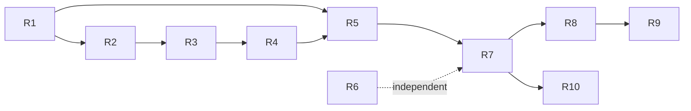

# PPO rebuild plan: proven defects, target structure, stock RCA replacement

Status: **implementation in progress**. R1–R6 passed bounded Ubuntu acceptance on 2026-10-27; R7–R10 remain unimplemented. R3 follows the user-approved semantics revision below. [R1 evidence](../verification/ppo_refactor_r1_20261027/REPORT.md), [R2 evidence](../verification/ppo_refactor_r2_20261027/REPORT.md), [R3 evidence](../verification/ppo_refactor_r3_20261027/REPORT.md).
Evidence: [verification/ppo_rootcause_20261026/REPORT.md](../verification/ppo_rootcause_20261026/REPORT.md) (eleven read-only probes, exit 0, frozen run `v5_lite30h_20261025`).
Scope of the evidence: one completed 30-hour CPU lite run; no training, no native game, no corpus, no checkpoint touched.

Read together with [architecture.md](architecture.md) §10.18 (decisions recorded there) and the superseded [ppo_diagnosis_plan.md](ppo_diagnosis_plan.md) (hypotheses H1–H5, now resolved or narrowed).

## 1. Answers in one page

### 1.1 Where the weakness comes from

| # | Cause | Class | Grade | Anchor |
| --- | --- | --- | --- | --- |
| F1 | The PPO batch loses 31 % of its rows at update time because the split is applied *after* the batch was frozen and its identity committed | implementation defect | **proven** | `learning/updates.py prepare()`, `learning/data.py split()`; 130/421 rows on duel v99 |
| F2 | The train/validation split is keyed on a family hash that *contains the seed*, so physically identical scenarios sit on both sides | data / domain | **proven** | `learning/maps.py decorate()`, `learning/data.py:12`; 5/6 duel scenarios on both splits |
| F3 | The 30-block final gate is 3–6 deterministic games repeated 5–10×; the bootstrap treats repetitions as independent samples | evaluation | **proven** | `learning/maps.py SPLITS`, `learning/schedule.py factions()`, `learning/evaluate.py comparisons()`; duel 2 signatures ×15, ffa4 1 ×30 |
| F4 | The KL gate returns out of the epoch loop and the unvisited windows of the frozen batch are never revisited | implementation defect (accounting) | **proven** | `learning/ppo.py update()`, `learning/experiment.py finish_train()`; 3.86 of ~8 planned steps per duel batch, 387/430 batches stop by KL |
| F5 | PPO's imitation term is 10 % cross-entropy against the *same* policy that the evaluation panel scores the learner against | learning mechanism | **supported, not proven** | `learning/ppo.py` rehearsal term, `learning/experiment.py:381 control=self.teachers[0]`; cos(PG, rehearsal) +0.1006, grad norm 2.46 vs 10.44 |
| F6 | The BC gate is in-distribution imitation of the teacher (duel 99.19 %) and cannot see the on-policy state distribution where the policy loses every panel; its artifact also reports game counts without the number of distinct scenarios behind them | evaluation | **proven** (that it measures this, and that it reports no scenario count) / **supported** (that it matters) | `learning/experiment.py finish_train()` gate block vs `g_trend`; `bc_gate.json` keys are `imitation`/`coverage`/`corpus`/`opening`/`passed` only. Gate evidence design is owned by R4 |
| F7 | The learner's only durable signal is a terminal ±1 per game; potential shaping telescopes at γ=1 and the exploration bonus sums to ≈0.042 | learning mechanism (by design) | **proven as designed**, impact **undetermined** | `learning/rewards.py`, `learning/data.py advantages()`; hand oracle exact |
| F8 | All collection and evaluation is on the deterministic lite engine with `expected_damage_v1`; a lost opening is unrecoverable and panels are near-constant functions of the opening | training domain | **proven** (identity) / **undetermined** (strength impact) | every job in the run: `engine lite-0.2`, `native_timings: []` |
| F9 | Half the collection games are on vendored arena boards while validation/holdout use real maps | data | **proven** (schedule), impact **undetermined** | `learning/maps.py decorate()`, `learning/schedule.py base_job()` |
| F10 | The policy does move (KL ≈1.75 nats from v10, 33 % of argmax decisions changed) while no panel improves; entropy rises 0.43 → 1.33 | learning mechanism | **proven** (measurement) | `i_drift` probe on 291 frozen rows |
| F11 | Astra still supplies teacher actions in native and is substituted for the official baseline in lite | capability gap | **proven** | `learning/experiment.py:275`, `learning/native_rpc.lua teacher()`, `learning/lite_host.py:126` |
| F12 | 11 of the 19 stock RCA candidate actions are C++ (`combat_phase`, `default_recruitment`, …), so a Lua action wrapper cannot observe attacks or recruitment | capability gap | **proven** | `data/core/macros/ai_candidate_actions.cfg`; only 9 `engine=lua` locations |

Ruled out as causes, with evidence: behaviour/update input contract (candidate order, mask, index, per-turn memory commit, `log_probability`, `value`) — all 421 frozen rows reproduce to 1.1e-05; batched vs single-row forward; `train()`/`eval()` divergence (no dropout in `learning/model.py`); GAE, own-turn deltas, potential shaping, truncation bootstrap, terminal handling (hand oracle exact); "PPO is not updating"; Lua export numeric error (lite inference is PyTorch); the already-repaired KL traversal, counter settlement, BC cancellation RNG, final nomination and reward rolling window (§10.15), which this plan does not reopen.

Undeterminable from the frozen run: whether F5, F7, F8 or F9 individually cost strength, and how much a corrected loop would recover. Those need the new-run evidence defined below, not more analysis of the old one.

### 1.2 What the rebuild has to change

Three properties, in this order, and nothing else:

1. **Every collected decision is admitted without silent split loss, and planned work is explicitly committed, interrupted or stopped by KL, under a design independent of what it is judged by** (F1, F2, F3; R3 revision approved 2026-10-27).
2. **The update's objective is the measured objective** — no standing pull toward the panel opponent, no abandoned planned work, and reward semantics that a reader cannot misread (F4, F5, F6, F7).
3. **Every competitive role is the stock 1.18.8 RCA**, with the capture and identity that makes its labels auditable, and no silent Astra path left (F11, F12).

Style-only cleanups, renaming sweeps and new abstraction layers are explicitly out of scope. Reward coefficients, KL limit, network size, panel sizes as tuning knobs are out of scope; this plan changes *what is measured and what is trained on*, not how hard.

### 1.3 Stock RCA replacement

The replacement is **native-only** and splits the roles:

- Roles that must run *inside a game against the student* (fixed opponents, FFA fillers, 2v2 teammates and opponents, reward calibration, trend/promotion/champion/final panels) become `--controller <side>:ai` with no `--ai-config`: the built-in default RCA of the installed 1.18.8.
- The **teacher** cannot be queried per decision, because its attack and recruitment stages are C++. Labels come from **event capture over full games**, matched offline against the shared candidate generator. DAgger, as a per-decision query, is **retired** for the stock teacher; its replacement is a turn-level takeover that is only added if the fixture proves the engine supports it.
- The **lite engine cannot host the official baseline at all** (`learning/lite_host.py:126`). Therefore lite batches are self-play and history only; any batch containing an external opponent or reference panel is native. The existing single-`engine_id`/single-`rules_version` batch check already forbids mixing, so this is a scheduling decision, not a new invariant.

Consequence to state plainly: the PPO repair (Phase A/B) and the teacher/engine change (Phase C) are separate, and the first training run after Phase C will not attribute its result to PPO alone. §6 defines the run sequence that keeps the two separable.

## 2. Current flow, with the defect sites

```mermaid
flowchart LR
  subgraph collect["collection (learning/schedule.py, lite_host.py, sample.py)"]
    J["jobs: rollout / teacher / validation / reward_reference"]
    G["game: lite-0.2, expected_damage_v1"]
    R["rows: candidates, choice, intent, actual, memory_write, log_probability, value"]
  end
  subgraph data["data (sequences.py, data.py, updates.py)"]
    P["attach_histories: per own turn"]
    S["split(game_family) sha256%5"]
    D["prepare(): drops non-train rows"]
    W["training_windows: 8 own turns"]
  end
  subgraph upd["update (ppo.py, rewards.py, model.py)"]
    A["advantages: GAE 0.95, γ1, potential shaping"]
    L["loss: clipped PG + 0.5 MSE − 0.01 H + 0.10 CE(rehearsal)"]
    K["pre-step KL > 0.02 → return, unvisited windows lost"]
  end
  subgraph eval["evaluation & selection (experiment.py, evaluate.py)"]
    V["validation: 1–3 blocks"]
    F["final: 30 blocks = 3–6 distinct games"]
    C["selection_key, champion"]
  end
  J --> G --> R --> P --> S --> D --> W --> A --> L --> K
  K --> E["checkpoint last_ppo → history"]
  E --> V
  E --> F
  F --> C
  C --> X["export + bundle"]
```



Defect sites: `S`+`D` (F1/F2 — split computed from a seed-bearing family and applied after the batch is frozen), `K` (F4 — planned windows abandoned), `L` (F5 — rehearsal identity equals the panel control), `F` (F3 — repeated deterministic games counted as independent blocks), `V` (F3 at trend scale).

Responsibilities and coupling as they are today:

| Module | Holds | Coupled to |
| --- | --- | --- |
| `learning/schedule.py` | job construction, block/faction/seed arithmetic, teacher gate (`only Astra may provide teacher actions`) | Astra identity, `maps.SPLITS`, `factions()` period |
| `learning/maps.py` | map choice by `index % len(names)`, `game_family` hash including seed | split rule (via family), evaluation design |
| `learning/lite_host.py` | per-side RNG, memory commit, DAgger trigger, Astra provenance | refuses `baseline`; Astra addon |
| `learning/lite_policy.py` | frozen-policy inference (argmax/sample), memory context cache | checkpoint layout, `is_astra` |
| `learning/data.py` | row validation, split, BC sampler, GAE | provenance contract, teacher identity |
| `learning/sequences.py` | history attachment, window building, gzip read budget | per-turn memory convention |
| `learning/updates.py` | `prepare()` split filter, plan shape (windows/sequence_count/micro) | split rule, batch identity |
| `learning/ppo.py` | loss, KL gate, plan cursor, accounting | reward config, rehearsal pool, checkpoint |
| `learning/rewards.py` | potential shaping, terminal rewards, adaptive coefficients | referee result dicts |
| `learning/evaluate.py` | block aggregation, bootstrap, status, selection key | block arithmetic of `schedule` |
| `learning/experiment.py` | stage machine, Astra substitution, panels, final selection, holdout | everything above |
| `learning/manifest.py` | frozen config/identity, `only gpt6astra` teacher check | addon packaging |
| `learning/native_rpc.lua` | native observation/candidates/legal/teacher(obs) | Astra addon for `teacher()` |

## 3. Target structure

### 3.1 Responsibility changes

| Module | Target responsibility | Interface change |
| --- | --- | --- |
| `learning/maps.py` | own *scenario identity* separately from *run identity* | `scenario_identity(job)->dict`, `scenario_family(job)->str`, `run_family(job)->str`; `decorate()` writes both; `SPLITS` gains an explicit scenario list per split |
| `learning/data.py` | partition by scenario; validate `split_rule`; sampler cannot use the evaluation control | `split(scenario_family)` unchanged mechanically; `validate_record` accepts `split_rule ∈ {'family-seed-v1','scenario-v2'}`; `BCSampler(pool, *, exclude_teacher_impl=None, exclude_teacher_sha=None)` |
| `learning/updates.py` | refuse to silently drop; report exclusions | `prepare(model, records, bc_records=None, *, allow_drop=False)`; raises `ValueError('batch row excluded by split: N of M')` |
| `learning/ppo.py` | account for planned/committed/KL-stopped work; defer only interruptions | `planned_steps`, `committed_steps`, `stopped_by_kl_steps`, `deferred_steps`, window-visit counts; cursor gains `scope` |
| `learning/experiment.py` | no substitution of the official baseline; explicit panel design; settle KL work once and keep interruptions pending; every verdict reports scenario evidence | removes `[self.teachers[0] if bot=='baseline' …]`; `finish_train` settles batch work counts and writes `bc_gate.json`'s `distinct_scenarios`/`scope`; `validate_model(..., min_distinct=…)` |
| `learning/schedule.py` | enumerate scenarios once per panel design; teacher capability not identity | `evaluation_jobs(..., scenarios=[...], repeats=int, min_distinct=int)`; `teacher_jobs` accepts any registered teacher whose `query != 'none'` |
| `learning/evaluate.py` | cluster bootstrap over *distinct scenarios*; `insufficient_design` status | `comparisons(jobs, results, *, min_blocks, min_distinct, team_contexts)`; result adds `distinct_scenarios` |
| `learning/manifest.py` | teacher identity record, not a name check | `teacher_identity(kind)->dict`; `active_teacher(manifest)`; `freeze()` records kind/version/query/action_source/rules sha |
| new `learning/stock_rca.py` | stock-RCA label pipeline: event frames → candidate-matched labels | `frames_to_labels(frames, *, side, candidates_fn) -> (rows, coverage)` |
| new `lua/stock_rca_capture/main.lua` | observe every side's `moveto/recruit/recall/attack/post advance` with visibility flags | emits `LEARN` frames through the existing sink |
| `learning/native_rpc.lua` | `teacher_turn(obs)` replacing `teacher(obs)`; Astra kept only behind an explicit `impl=gpt6astra` replay path | `teacher_turn` returns `{actions, provenance}`; `query='none'` is legal |
| `learning/bundle.py`, `learning/reward_metrics.py`, `learning/benchmark*.py` | read identities from the manifest; stop bundling Astra for an active run | bundle manifest lists `teacher.kind` |

### 3.2 Identity flow

Three keys, nested, never collapsed:

```
scenario_family = sha256(format, board identity, factions, teams, starts, engine_id, combat_version, rules_version)
game_family     = sha256(scenario_family, seed)                 # a run; unchanged value for old rows
split           = 'validation' if int(sha256(scenario_family)[:8],16) % 5 == 0 else 'train'
```

`scenario_family` is what the split and every panel design key on. `game_family` keeps its current meaning so recorded shards, checkpoint identities and `data.py` de-duplication stay valid. Rows carry `split_rule` so a mixed batch is impossible; the check is per batch, alongside the existing single-`version`/`engine_id`/`rules_version`/`teacher_profile` checks.

Teacher identity is a record, not a path stem:

```python
{'kind': 'wesnoth_default_rca' | 'gpt6astra',
 'version': '1.18.8',
 'rules_sha256': ...,
 'query': 'none' | 'per_turn' | 'per_decision',
 'action_source': 'engine_events' | 'lua_wrapper',
 'capture_sha256': ... }
```

A batch may contain labels from exactly one teacher record. Astra rows keep `kind='gpt6astra'` forever and are never relabelled.

### 3.3 Who holds which state

| State | Owner after the rebuild |
| --- | --- |
| teacher identity, rules identity, split rule, panel design | run manifest (frozen before launch) |
| per-format versions, counters (planned/committed/deferred), pending batch scope, champion, selection | `state.json` per format |
| scenario vs run identity, split | data rows + `maps.py` |
| panel scenario set, distinct count, cluster bootstrap | `evaluate.py` result, copied into `validation/v*.json` and the final report |
| student memory, per-side RNG | `lite_host.py` / `learning/sample.py` game loop |
| referee truth (snapshots, RNG, hidden units) | referee only; never in policy input, never in captured labels |

## 4. Phases

One PR per behaviour. Every phase names its own revert-detecting assertion. Line estimates exclude tests and fixtures. All work goes on a branch with a pull request against `master`; no phase is merged by the implementing branch itself.

### Phase A — data and measurement integrity

#### R1. Scenario-keyed identity and split

**Accepted 2026-10-27:** implementation `be0a1ca`, 27 focused Ubuntu tests, deliberate revert fails and restoration passes; [report](../verification/ppo_refactor_r1_20261027/REPORT.md). No games or training.

- **Behaviour:** a training game and a validation game can no longer be the same physical scenario.
- **Evidence:** F2 (5/6, 7/9, 4/9 scenarios on both splits); `learning/maps.py` puts `seed` into the hashed family.
- **Modules:** `learning/maps.py` (`decorate`, `scenario_identity`, `scenario_family`, `run_family`, `SPLITS`), `learning/data.py` (`split` caller, `validate_record`), writers `learning/sample.py` / `learning/lite_host.py` shard header.
- **Interface:** `decorate()` writes `job['scenario_family']` next to `job['game_family']`; rows carry `scenario_family` and `split_rule='scenario-v2'`; `validate_record` requires `r['split'] == split(r['scenario_family'])` for v2 rows and keeps the old rule for `family-seed-v1`.
- **Depends on:** nothing.
- **Compatibility:** old shards stay readable and are marked `family-seed-v1`; they may not enter a v2 batch. Old checkpoints load unchanged. Corpus reuse for a new run is impossible without re-collecting, which is stated, not hidden.
- **Contracts kept:** families still never cross the split; holdout maps remain holdout; per-game equal weighting.
- **Local check:** unit test that two jobs differing only by `seed` share `scenario_family` and land on the same split; test that a scenario found in train is absent from validation over a 200-job schedule.
- **Ubuntu check:** `pytest tests/v5/test_scenario_identity.py` (new file; the grandfathered `tests/v5/test_pipeline_contract.py` is not grown) plus `tests/v5/test_rollout_content_identity.py` unchanged.
- **Fails when reverted:** `test_seed_does_not_move_the_scenario_between_splits` — with `split(game_family)` restored, the two same-scenario jobs land on different sides and the test fails.
- **Rollback:** revert the commit; rows written with `scenario_family` are still valid under the old validator (unknown field), so no data loss.
- **Done when:** a 300/600/400-game schedule has zero scenarios spanning splits and zero families spanning splits.

#### R2. Batch eligibility and no silent drops

**Accepted 2026-10-27:** implementation `3a92436`, 20 focused Ubuntu tests plus one FFA4/2v2 update test; deliberate revert fails and restoration passes. [Report](../verification/ppo_refactor_r2_20261027/REPORT.md). No real games or formal training.

- **Behaviour:** a frozen batch contains only trainable rows, or the run fails loudly.
- **Evidence:** F1, 130/421 rows (30.9 %) dropped after identity commit.
- **Modules:** `learning/schedule.py rollout_jobs` (compose from train scenarios, record deterministic swaps), `learning/updates.py prepare`, `learning/experiment.py finish_train` (metrics), `learning/ppo.py result()`.
- **Interface:** `prepare(..., allow_drop=False)` raises `ValueError('batch row excluded by split: {n} of {total}')`; metrics add `excluded_decisions`, `excluded_games`, `eligible_decisions`; `history` entries expose them.
- **Depends on:** R1.
- **Compatibility:** `state.json` pending batches from an older run cannot be resumed by the new code (they contain validation rows) — by design, and stated in the manifest guard.
- **Contracts kept:** equal per-game weighting; the identity check `rollout_identity(rows)` still binds the exact rows trained on (now all of them).
- **Local check:** synthetic 10-row batch with 3 validation rows raises; 10 train rows yield `eligible_decisions == 10`.
- **Ubuntu check:** `pytest tests/v5/test_batch_eligibility.py` + `tests/v5/test_ppo_resume_counters.py` (unchanged semantics).
- **Fails when reverted:** `test_validation_row_in_batch_raises` — with the silent filter restored, the call returns and the test fails.
- **Rollback:** revert; the filter returns, and the metrics fields become absent (callers use `.get`).
- **Done when:** duel/four-player batches report `excluded_decisions == 0` in a short chain.

#### R3. KL gate accounting: explicit stopped work and resumable interruptions

**Accepted 2026-10-27:** implementation `3983cd0`, 14 focused Ubuntu checks, deliberate revert fails and restoration passes; [report](../verification/ppo_refactor_r3_20261027/REPORT.md). No real games or formal training.

**User-approved revision, 2026-10-27:** the [minimal probe](../verification/ppo_refactor_r3_probe_20261027/probe.py) commits one step, then rejects the next at KL 0.900721. Two resumes with the same weights and frozen rows reject at the identical KL without any new step. Therefore the original promise that all KL-deferred windows later train is withdrawn; it cannot coexist with the fixed pre-step gate and frozen behavior probabilities.

- **Behaviour:** KL ends the collected batch and explicitly accounts for all remaining work as `stopped_by_kl`; only deadline/interruption keeps the same paths/identity/cursor pending.
- **Evidence:** F4's missing work accounting; the probe above distinguishes intended KL stopping from recoverable interruption.
- **Modules:** `learning/ppo.py` result/cursor; `learning/experiment.py finish_train` counters/history.
- **Interface:** `planned_steps`, `committed_steps`, `stopped_by_kl_steps`, `deferred_steps`; corresponding window-visit totals; `scope='deferred'` only for interruption, otherwise `'batch'`.
- **Depends on:** R2.
- **Compatibility:** old cursors need no new fields; old cumulative counters default to zero for the newly recorded work totals, without inventing historical counts. Existing plan-hash and rollout-identity checks remain.
- **Contracts kept:** KL limit 0.02 remains pre-step; rejection never applies gradients; zero-update KL does not increase version; a partially committed batch increases version once. Interrupted attempts do not settle global counters or create promotion candidates.
- **Local check:** zero-step and partial KL stops; deadline/resume/checkpoint; 20 tiny batches conserve planned = committed + KL-stopped + pending work.
- **Ubuntu check:** `tests/v5/test_kl_defer.py`, existing PPO plan and resume-counter checks; stdlib unittest runner where pytest is unavailable.
- **Fails when reverted:** `test_kl_rejection_accounts_for_all_remaining_work` loses explicit stopped-work counts.
- **Rollback:** revert the added accounting; model updates and KL rejection retain their existing arithmetic.
- **Done when:** work totals conserve over 20 batches; interruptions resume once, terminal KL batches have no pending retry, and no threshold or behavior probability changes.

#### R4. Evaluation design: distinct scenarios, cluster bootstrap, explicit insufficiency

**Accepted 2026-10-27:** implementation `a05533f`, 30 focused Ubuntu checks, both panel/gate revert assertions fail and restoration passes. [Report](../verification/ppo_refactor_r4_20261027/REPORT.md). Existing final design has only 6/3/3 distinct scenarios against floor 12 and remains insufficient; no games or corpus added.

- **Behaviour:** every verdict in this system — panel and BC gate alike — states its evidence as the number of distinct scenarios, not the number of repetitions, and a design with too few distinct scenarios cannot pass. The BC gate additionally declares its scope: it certifies imitation on teacher trajectories and is initialisation evidence only.
- **Evidence:** F3, duel 2 signatures ×15, ffa4 1 ×30, team2v2 3 ×10; `min_blocks=30` satisfied by repetition; `selection.json` reasons. F6: `bc_gate.json` carries `imitation`/`coverage`/`corpus`/`opening`/`passed` and no scenario count, while the duel corpus behind 99.19 % imitation is 300 games over **4 boards**, one of them 150 games (`k_gate_scope`, `verification/ppo_gate_scope_20261026/REPORT.md`).
- **Modules:** `learning/schedule.py evaluation_jobs` (explicit scenario enumeration + repeats), `learning/evaluate.py` (`scenario_of`, `comparisons(..., min_distinct)`, `_cluster_bootstrap`), `learning/experiment.py validate_model` (panel design, status propagation), `learning/experiment.py final_evaluation`, `learning/experiment.py finish_train` (gate block writes the scenario count and scope and enforces the floor).
- **Interface:** `comparisons(jobs, results, *, min_blocks, min_distinct, team_contexts)` returns `{'blocks','distinct_scenarios','differences','status','reason'}` with `status ∈ {passed, not_passed, inconclusive, insufficient_design}`; bootstrap resamples distinct scenarios and averages their block means; `min_distinct` is frozen in the manifest (12 for promotion/final, 3 for trend). `bc_gate.json` gains `distinct_scenarios` and `scope: 'initialisation_only'`, and the gate block returns `insufficient_design` when the corpus spans fewer than `min_distinct_gate` scenarios.
- **Depends on:** R1 (needs `scenario_family` on jobs).
- **Compatibility:** `validation/v*.json` gain `distinct_scenarios`; readers tolerate its absence. Old panels are re-read as `insufficient_design` only if recomputed — historical reports are not rewritten.
- **Contracts kept:** holdout maps never used for tuning or selection; `min_blocks` retained as a repetition floor; the pass rule (`interval[0] > 0`) unchanged; the gate keeps its existing per-kind denominators, it only gains a scenario count and a scope label; `passed` never becomes a proxy for on-policy strength in any report or selection path.
- **Local check:** 30 identical blocks must not produce `passed`; 12 distinct scenarios with a consistent positive difference do; a gate computed over 4 boards with `min_distinct_gate = 12` must return `insufficient_design`.
- **Ubuntu check:** `pytest tests/v5/test_evaluation_design.py`; `tests/test_validation_cadence.py` re-run for panel size/wiring.
- **Fails when reverted:** `test_repeated_identical_blocks_are_insufficient` — with `min_blocks`-only logic the panel reports `passed`/`inconclusive` instead of `insufficient_design`; `test_gate_reports_distinct_scenarios` — the gate artifact and the `insufficient_design` branch disappear.
- **Rollback:** revert; panels revert to repetition semantics.
- **Done when:** every promotion/final panel in a short chain reports `distinct_scenarios ≥ min_distinct` or `insufficient_design`, the final report prints both numbers, and `bc_gate.json` states the scenario count behind its verdict plus its initialisation-only scope.
- **Remaining limit:** the gate's floor is not reachable by the current corpus (duel: 4 boards). R4 makes that visible; widening the corpus or justifying a lower floor is a separate, separately authorised data decision, and until one lands the gate verdict is `insufficient_design` rather than a quality claim.
- **This phase blocks strength conclusions, not training.**

### Phase B — what the update optimises

#### R5. Rehearsal must not imitate the panel control

**Accepted 2026-10-27:** implementation `9fee653`, acceptance source `e7342e2`, 23 focused Ubuntu checks; disabling exclusion fails and restoration passes. [Report](../verification/ppo_refactor_r5_20261027/REPORT.md). A control-only pool fails at positive auxiliary weight; no coefficient or corpus change.

- **Behaviour:** PPO's auxiliary imitation term can never be sourced from the policy that the learner is scored against.
- **Evidence:** F5 (`control=self.teachers[0]`, rehearsal cos +0.1006 with PG, 10 % weight); F6 (the gate that was supposed to bound quality measures teacher-state imitation).
- **Modules:** `learning/data.py BCSampler`, `learning/ppo.py update(..., rehearsal_exclude=...)`, `learning/experiment.py finish_train` (pass the control identity), manifest (`bc_aux` policy per stage).
- **Interface:** `BCSampler(pool, *, exclude_teacher_impl=None, exclude_teacher_sha=None)`; `update(..., rehearsal_exclude=None)`; metrics `rehearsal_sources`, `rehearsal_rows_excluded`; an empty pool after exclusion raises `ValueError('no rehearsal data distinct from the evaluation control')`.
- **Depends on:** R1 (identity), R4 (the control is explicit).
- **Compatibility:** pools are selected at read time, so no shard rewrite; old actions remain valid.
- **Contracts kept:** `bc_aux` default 0.10 for ordinary rehearsal; the PPO-on-policy requirement; no gate weakened.
- **Design decision:** when the teacher *is* the control (which is exactly the situation after Phase C, since both are stock RCA), imitation is legitimate **as initialisation (BC stage) and illegitimate as a per-step PPO term**. So `bc_aux` applies to human/self/qualified data during PPO, and stock-RCA imitation happens in the BC stage only. Rationale recorded in §10.18.
- **Local check:** pool of only the control → raises; pool of control + human → samples human only when `bc_aux > 0`.
- **Ubuntu check:** `pytest tests/v5/test_rehearsal_source.py`.
- **Fails when reverted:** `test_control_policy_cannot_rehearse` — with the old sampler the control's rows are drawn and the test fails.
- **Rollback:** revert; behaviour returns to today's mix.
- **Done when:** a 20-batch chain reports `rehearsal_sources` free of the control identity.

#### R6. Reward row semantics

**Bounded acceptance 2026-10-27:** implementation `30cd046`, 37 focused Ubuntu checks and bitwise GAE/returns parity over 421 historical rows; revert fails, restoration passes. [Report](../verification/ppo_refactor_r6_20261027/REPORT.md) lists unresolved local fixture/extension checks. Feature schema remains 5, rowpack v2. Teacher/human rows lacking raw reward evidence carry reward_step=null; policy rows cannot use unknown steps.

- **Behaviour:** a row states its own step reward and the game's terminal reward under names that cannot be confused.
- **Evidence:** F7 and §9 of the report — `r['reward']` is the terminal reward on every row, with exactly one consumer (`learning/data.py:236`); no arithmetic error today, but the field is a trap for any future consumer, and the audit could not tell step from terminal without reading `advantages`.
- **Modules:** writers `learning/sample.py`, `learning/lite_host.py`; `learning/data.py` (`validate_record`, `advantages`, `transition_reward` caller); `learning/rowpack.py` schema constant; `learning/reward_metrics.py` readers.
- **Interface:** row keys `terminal_reward`, `reward_step` (the shaped per-decision reward), `reward_raw`, `reward_after`, `potential`; `schema: 6`; `validate_record` accepts 5 (derives `terminal_reward = reward`) and 6; `advantages` reads `terminal_reward` only at the terminal row and must assert `reward_step == transition_reward(...)` when both are present.
- **Depends on:** none.
- **Compatibility:** schema 5 rows remain trainable in a schema-5 batch; a batch never mixes schemas (extend the existing single-`version` check to `schema`). Rowpack `v:2` unchanged.
- **Contracts kept:** reward values are byte-identical; this is a naming and auditability change, not a reward change. Coefficients untouched.
- **Local check:** a hand-computed 5-step sequence asserts per-row `reward_step` and `terminal_reward`; a schema-5 row still trains.
- **Ubuntu check:** `pytest tests/v5/test_reward_row_schema.py`; `tests/v5/test_pipeline_contract.py` reward section (read-only, not grown).
- **Fails when reverted:** `test_row_reward_is_not_the_terminal_value` — with the old writer a non-terminal winning row carries +1.0 and the test fails.
- **Rollback:** revert; readers accept both schemas, so only the writer changes back.
- **Done when:** the reward oracle recomputes a game's `reward_step` sums to `terminal_reward + shaping(Φ_end − Φ_start)` to 1e-9.

### Phase C — stock RCA replacement

#### R7. Teacher identity and removal of the baseline substitution

- **Behaviour:** a run declares exactly one teacher *record*; the official baseline is never replaced by an addon; a lite game that asks for the baseline fails instead of silently playing Astra.
- **Evidence:** F11; `learning/experiment.py:275`, `learning/manifest.py:40-49`, `learning/lite_host.py:126`, `learning/schedule.py teacher_jobs` (`only Astra may provide teacher actions`).
- **Modules:** `learning/manifest.py`, `learning/schedule.py`, `learning/experiment.py`, `learning/lite_host.py`, `learning/data.py` (teacher checks generalised to the record), `learning/native_rpc.lua` (Astra require becomes conditional).
- **Interface:** `manifest['teacher'] = teacher_identity(...)`; `teacher_identity(kind)` supports `wesnoth_default_rca` with `query='none'`, `action_source='engine_events'`; `schedule.teacher_jobs` requires `teacher['query'] != 'none'` (so stock RCA is not a DAgger teacher) and accepts any registered teacher; `experiment.__init__` builds `self.reference_opponents` from the manifest and stops mapping `'baseline' → teacher[0]`; `lite_host.play` raises `ValueError('official baseline is native-only')` unchanged and additionally raises for a stock-RCA teacher request.
- **Depends on:** R1, R5 (identity-aware pools).
- **Compatibility:** manifest from an older run declares `teacher.kind='gpt6astra'` and stays resumable only under the old code; new runs get the new record. `data/opponents/gpt6astra.zip` stays on disk, unbundled.
- **Contracts kept:** one active teacher per run; cross-teacher rows still rejected; referee truth still excluded from teacher input.
- **Local check:** manifest with stock RCA freezes and reloads; a lite job requesting it raises; no code path maps `baseline` to an addon (assert on `experiment.execute` job dicts).
- **Ubuntu check:** `pytest tests/v5/test_teacher_identity.py`.
- **Fails when reverted:** `test_baseline_is_never_substituted` — restore the substitution and the test fails on a two-seat duel job.
- **Rollback:** revert; Astra substitution returns for old manifests only.
- **Done when:** a native job construction never references `gpt6astra` unless the manifest says `kind='gpt6astra'`.

#### R8. Stock RCA event capture and label pipeline

- **Behaviour:** a stock-RCA game yields per-action labels for the actions the engine actually executed, with visibility flags and an explicit unmatched count.
- **Evidence:** F12 (11/19 CAs are C++; attacks and recruitment unobservable by a Lua wrapper); `core/macros/deprecated-utils.cfg:164` shows a global addon can filter `moveto,recruit,recall,attack,post advance,side turn` by side; `vendor/arena/match.py` already captures `LEARN` frames and per-turn `SNAPSHOT`s.
- **Modules:** new `lua/stock_rca_capture/main.lua` (event handlers → `LEARN` frames), `vendor/arena/match.py` support-addon mounting (one line: mount the capture addon in `learning['support']`), new `learning/stock_rca.py` (`frames_to_labels(frames, *, side, candidates_fn)`), `learning/sample.py` (provenance `teacher_impl='wesnoth_default_rca'`, `action_source='engine_events'`, `capture_sha256`).
- **Interface:** frame `{'type':'ACTION','side','kind':'recruit|recall|moveto|attack|advance','unit','to','target','type_id','visible','turn'}`; `frames_to_labels` returns `(rows, coverage)` where `coverage` counts `matched`, `unmatched`, `ambiguous` per kind; ambiguous = several candidates consistent with the executed action, which are **excluded from exact-match accuracy** and marked `label_ambiguous`.
- **Depends on:** R7.
- **Compatibility:** new teacher kind, new rows; old Astra corpora untouched.
- **Contracts kept:** labels only for legal visible context — the capture addon filters by `unit.visible` for the student side and never reads referee state; matched candidates come from the shared `candidates.lua` at the snapshot, not from the engine's internal plan.
- **Local check:** a recorded frame list fixture produces the expected labels; an attack frame yields `kind='attack'`; an unseen action counts as `unmatched` rather than being dropped.
- **Ubuntu + native fixtures (≤3 scenarios × ≤5 turns, capability only):**
  - FX1: one duel arena map, stock RCA on both sides, capture addon mounted → events observed for recruit/move/attack, no `LEARN` line from the side controller, identical `RESULT`/turn count/unit positions with and without the addon loaded.
  - FX2: label pass over FX1's snapshots → `matched/unmatched` per kind reported; if unmatched is high, the plan's labelling claim is downgraded in the report rather than hidden.
  - FX3: turn-level takeover probe → determines whether `query='per_turn'` is achievable at all.
- **Fails when reverted:** `test_attack_event_becomes_a_label` — remove the event handler and the label is missing.
- **Rollback:** remove the addon and the label pipeline; native reference games revert to unlabelled panels (which is what they are today).
- **Done when:** FX2 reports label coverage per kind, and the report states which kinds are fully, partially or not covered.

#### R9. Teacher protocol v2 and retirement of per-decision DAgger

- **Behaviour:** a teacher is queried only through a capability that exists; DAgger is either turn-level or explicitly unsupported, never Astra by another name.
- **Evidence:** F12, `learning/native_rpc.lua teacher()` requires the Astra addon even for `engine=native`; `learning/lite_host.py` DAgger trigger; `vendor/arena/match.py` raises for a non-Astra `dagger_teacher`.
- **Modules:** `learning/native_rpc.lua` (`teacher_turn`, Astra behind `impl`), `learning/native_transport.py`, `learning/lite_host.py` (DAgger status), `learning/sample.py` (DAgger provenance), `learning/experiment.py` (`dagger_shards`, counters).
- **Interface:** `teacher_turn(obs) -> {'actions': [...], 'provenance': teacher_identity}`; the manifest's `teacher.query` decides the mode; `dagger_status ∈ {'active','unsupported_with_stock_rca'}` is recorded in `state.json` and the report whenever zero queries happen.
- **Depends on:** R7, R8, and the FX3 result.
- **Compatibility:** old DAgger shards stay Astra-labelled; a new run declares its teacher record so pools cannot mix.
- **Contracts kept:** no silent fallback; `dagger_shards` count is zero-with-reason, not missing.
- **Local check:** a teacher with `query='none'` raises on a per-decision query and records `dagger_status`.
- **Ubuntu + native:** FX3 decides: (a) takeover works → implement `per_turn` takeovers in a follow-up PR; (b) it does not → DAgger stays `unsupported_with_stock_rca` and BC uses full teacher games only.
- **Fails when reverted:** `test_stock_teacher_rejects_per_decision_query`.
- **Rollback:** revert; Astra `teacher()` returns behind the explicit impl.
- **Done when:** no code path can produce an Astra action unless the manifest names `kind='gpt6astra'`.

#### R10. Corpus, packaging and report identity

- **Behaviour:** every artefact names the teacher it came from, and an active run does not ship Astra.
- **Evidence:** `learning/bundle.py:51` bundles `data/opponents/gpt6astra.zip`; `learning/reward_metrics.py`, `learning/benchmark*.py` read Astra artefacts; `learning/data.py` teacher checks are Astra-literal today.
- **Modules:** `learning/bundle.py`, `learning/reward_metrics.py`, `learning/benchmark_protocol.py`/`benchmark_runner.py`, `learning/manifest.py`, `learning/data.py` pools, `docs/bundle.md`.
- **Interface:** `bundle` writes `identities.teacher`; pools carry `teacher_impl`/`corpus_id`; reports print `teacher kind/version/query`, `distinct_scenarios`, `split_rule`.
- **Depends on:** R7.
- **Compatibility:** historical bundles keep their manifests; nothing is relabelled.
- **Contracts kept:** SDK size gate; no retro-edit of past reports.
- **Local check:** bundle manifest contains the stock record and no Astra path for a stock run.
- **Ubuntu check:** `pytest tests/v5/test_bundle_identity.py`.
- **Fails when reverted:** `test_bundle_omits_unused_teacher`.
- **Rollback:** revert.
- **Done when:** a packaged stock-RCA run is self-describing from its manifest alone.

### 4.1 Order, dependency graph, sizing



| Phase | PR | Estimate (impl lines) | Blocks a new run? | Blocks a strength claim? |
| --- | --- | --- | --- | --- |
| A | R1 | ~250 | yes | yes |
| A | R2 | ~150 | yes | yes |
| A | R3 | ~220 | yes | yes |
| A | R4 | ~300 | no (evaluation only) | yes |
| B | R5 | ~160 | yes | yes |
| B | R6 | ~250 | yes (schema) | yes |
| C | R7 | ~350 | yes, for any stock-RCA run | yes |
| C | R8 | ~600 (Lua + Python + fixtures) | yes, for BC/teacher use | yes |
| C | R9 | ~200 | yes, if DAgger is expected | no |
| C | R10 | ~250 | no | no |

### 4.2 Not in this plan

Reward coefficient changes, KL limit changes, network or architecture changes, panel-size increases as a substitute for independence, engine determinism changes, corpus expansion, and any style-only restructuring. Each would be a separate proposal with its own evidence; none is required to fix F1–F4.

### 4.3 Test coverage map

Each phase ships exactly one new test file plus one assertion that fails when the behaviour is reverted. R1–R6 are implemented with bounded acceptance; R7–R10 test files remain unwritten. A row becomes `TEST.md` material only when implemented and awaiting acceptance.

| PR | Test | Revert-detecting assertion | Proves | Existing suites that must stay green |
| --- | --- | --- | --- | --- |
| R1 | `tests/v5/test_scenario_identity.py` | `test_seed_does_not_move_the_scenario_between_splits` | the same board with two seeds lands on one side of the split; `game_family` still contains the seed | `tests/v5/test_rollout_content_identity.py` |
| R2 | `tests/v5/test_batch_eligibility.py` | `test_validation_row_in_batch_raises` | an ineligible row fails the batch loudly instead of being filtered out silently | `tests/v5/test_ppo_resume_counters.py` |
| R3 | `tests/v5/test_kl_defer.py` | `test_kl_rejection_accounts_for_all_remaining_work` | planned work equals committed + KL-stopped + interrupted work; only interruption resumes | `tests/v5/test_ppo_resume_counters.py` |
| R4 | `tests/v5/test_evaluation_design.py` | `test_repeated_identical_blocks_are_insufficient`; `test_gate_reports_distinct_scenarios` | a panel and a BC gate both report distinct scenarios and both return `insufficient_design` below the floor | `tests/test_validation_cadence.py` |
| R5 | `tests/v5/test_rehearsal_source.py` | `test_control_policy_cannot_rehearse` | an imitation pool that is the evaluation control raises instead of training | — |
| R6 | `tests/v5/test_reward_row_schema.py` | `test_row_reward_is_not_the_terminal_value` | a row's step reward and terminal reward are separate fields with byte-identical arithmetic | `tests/v5/test_pipeline_contract.py` |
| R7 | `tests/v5/test_teacher_identity.py` | `test_baseline_is_never_substituted` | `baseline` survives to the runner as stock RCA and no code path swaps it for a teacher package | `tests/smoke_training_lite_8worker.py` |
| R8 | native fixtures FX1–FX3 (`tests/v5/test_native_capture.py`) | `test_attack_event_becomes_a_label` | a real stock-RCA attack observed through event capture becomes a labelled candidate row with legal visible inputs only | — |
| R9 | `tests/v5/test_stock_teacher.py` | `test_stock_teacher_rejects_per_decision_query` | the stock teacher path refuses a per-decision query rather than silently answering it another way | — |
| R10 | `tests/v5/test_bundle_identity.py` | `test_bundle_omits_unused_teacher` | a stock-RCA bundle names its teacher and ships no unused Astra package | — |

Test kinds, so a reviewer can see what each row is worth:

- **Unit with synthetic fixtures (R1, R2, R3, R5, R6, R9, R10):** the fixture is the smallest object that exercises the contract — a two-seed job pair, one ineligible row, one frozen window list, one rehearsal pool, one row pair, one query record, one manifest. They run in milliseconds and are deterministic.
- **Unit over recorded data (R4):** the panel fixture is the recorded `jobs.jsonl` block table of this run (2/1/3 signatures repeated to 30), so the assertion is about the real failure, not an invented one.
- **Integration over the frozen update path (R2, R3, R6 re-run on a recorded batch):** the batch of `rollout-00099-duel-g*.jsonl.gz` is the reference input; a change that alters PPO's arithmetic must show up as a diff there.
- **Native fixtures (R8, FX1–FX3):** ≤3 scenarios × ≤5 turns, wiring only. A pass proves capture and legality, never strength; a scenario that cannot demonstrate a capability is recorded as `not demonstrated` rather than weakened.

What deliberately gets no test: reward coefficients, the KL limit value, panel sizes and every other number in §4.2. Those are tuning, and a test that pins them would convert a measurement decision into a pinned implementation detail.

## 5. Stock RCA migration

### 5.1 Role-by-role replacement list

| Role | Today | After | Route |
| --- | --- | --- | --- |
| BC teacher games | `gpt6astra` zip in lite and native (`schedule.teacher_jobs`) | stock RCA in native, labels via event capture | native + R8 |
| DAgger queries | Astra `teacher(obs)` per decision, 1 in 4 decisions, ≤32/game | none, unless FX3 proves per-turn takeover | native + R9 |
| PPO BC rehearsal | `gpt6astra` shards | human/self/qualified only during PPO; stock RCA only in the BC stage | data + R5 |
| Fixed opponent slots | `gpt6astra` zip | `baseline` (stock RCA) | native |
| FFA4 fillers | `gpt6astra` zip | `baseline` | native |
| 2v2 teammate and opponent | `astra_partner` / `gpt6astra` | `baseline` | native |
| Opening probe | run through `lite_host` with Astra bots | native stock RCA, or dropped if it cannot run natively | native |
| Reward calibration / control metrics | `reward_reference` games vs Astra | vs stock RCA | native |
| Trend / promotion / champion / final panels | Astra control (`self.teachers[0]`) | stock RCA control | native |
| Default config, manifest | `only gpt6astra` check, Astra bundle | teacher record `wesnoth_default_rca` | R7/R10 |
| Sample validation and pooling | Astra-literal checks | identity-record checks | R7/R10 |
| Checkpoints and export | `teacher_profile` string | teacher record digest | R7 |
| Student self-play (current/history) | unchanged | **unchanged** | — |

Historical Astra data, packages, models and reports keep their identity and are neither deleted nor relabelled.

### 5.2 Real execution path for a stock-RCA reference game

1. `learning/schedule.py` builds the job with `bots=['baseline', 'baseline', …]`, `teacher=None`, `engine='native'`.
2. `learning/experiment.py` passes it to `vendor/arena/match.py play_game`, which mounts the support addon (capture) and, for `baseline`, writes **no** `--ai-config`: the engine's own default RCA drives the side.
3. `lua/stock_rca_capture/main.lua` observes `side turn / moveto / recruit / recall / attack / post advance` for every side, filters by visibility for the student side, and emits `LEARN` frames through the existing sink.
4. `vendor/arena` reports the usual `RESULT` plus per-turn `SNAPSHOT` frames.
5. `learning/stock_rca.py` turns frames into rows: candidate set from `candidates.lua` at the turn snapshot, executed action from the event, match → `intent`/`actual`; unmatched and ambiguous counted separately.
6. `learning/sample.py` writes the shard with `teacher_impl='wesnoth_default_rca'`, `action_source='engine_events'`, `capture_sha256`, `engine='native'`.

### 5.3 Capability gaps and decision branches

| Gap | Status | Branch |
| --- | --- | --- |
| G1 per-decision teacher query | **proven impossible** for 11/19 CAs including attacks and recruitment | A1 event capture (chosen). A2 re-implementing C++ CAs in Lua is rejected: it would no longer be stock. |
| G2 per-turn takeover query | **undetermined** (needs FX3) | B1 supported → new PR adds `query='per_turn'`; B2 unsupported → DAgger retired with `dagger_status='unsupported_with_stock_rca'`, BC from full games only. |
| G3 lite cannot host stock RCA | **proven** (`lite_host.py:126`) | C1 lite batches are self-play/history only; external roles native (chosen). C2 move PPO collection to native if the domain gap is later shown to matter. |
| G4 action→candidate matching | **supported, not proven** (FX2) | D1 matched labels with explicit unmatched counts (chosen). D2 if matching is poor, labels stay as `intent` for auxiliary metrics only and BC uses them at reduced weight with `label_ambiguous` excluded from accuracy. |
| G5 randomness and rule identity | stock RCA runs on stochastic native combat (`native-1.18.8`), lite on `expected_damage_v1` | Batches never mix engines (existing check); every report prints both identities; strength claims stay native-only. |

### 5.4 Route trade-off

- **All-native** (students and references in one engine): one domain, one reward semantics, panels that mean what they say. Cost: stochastic outcomes need more games for the same interval width, and throughput is ~5.3 s/game (from the 2026-10-24 420-game evaluation, 36 m 53 s), which is workable but not free.
- **Lite students with native references**: keeps deterministic, fast collection and per-game determinism that the current pipeline already exploits; reference panels and teacher labels come from native. Risk: the student is optimised in a different dynamics than it is judged in — the same domain gap that today is invisible because everything is lite.
- **Decision:** phase C delivers the native reference path first (R7–R10), so that every competitive number is measured in the deployment domain. The training engine choice (all-native vs lite students) is deferred to a single measurement after R7–R10: collect one matched panel (same scenarios, both engines) with a frozen checkpoint and compare the policy's score difference. That measurement is a new run and needs separate authorisation; this plan only defines it.

## 6. Verification status and the next training entry

### 6.1 What was run, reused, not run

| Check | Status | Scope |
| --- | --- | --- |
| 11 read-only probes on the frozen run | **run**, exit 0 | duel deep; ffa4/2v2 accounting and panels |
| Zero-step parity, 421 rows | **run** | duel v99 batch |
| Gradient decomposition | **run** | 194 decisions, 4 terms |
| Reward/GAE oracle | **run** | 4 games, 1 hand-computed sequence |
| Policy drift across checkpoints | **run** | duel v10…v470 on one batch |
| Panel multiplicity | **run** | all three final panels |
| Split independence | **run** | 48 games/format |
| BC corpus scenario coverage (`k_gate_scope`) | **run**, exit 0 | duel complete (300 shards), ffa4/2v2 first 40 shards of 608/400; full ffa4/2v2 scans aborted at the 300 s per-command budget, recorded as not run to completion |
| Stock-RCA candidate-action inventory | **run** (static, installed data) | 19 CAs, 9 Lua / 11 C++ |
| Native stock-RCA game, capture, label matching | **not run** | FX1–FX3 are defined, bounded to 3 scenarios × ≤5 turns, and authorised only as capability fixtures |
| R1 Ubuntu acceptance | **27 PASS** | scenario identity, content identity, schedule and affected reader; [evidence](../verification/ppo_refactor_r1_20261027/REPORT.md) |
| R2 Ubuntu acceptance | **20 + 1 PASS** | eligibility, counters and four-player updates; [evidence](../verification/ppo_refactor_r2_20261027/REPORT.md) |
| R3 Ubuntu acceptance | **14 PASS** | explicit stopped work, interruptions, checkpoint accounting; [evidence](../verification/ppo_refactor_r3_20261027/REPORT.md) |
| R4 Ubuntu acceptance | **30 PASS** | scenario evidence, gates, selection and reporting; [evidence](../verification/ppo_refactor_r4_20261027/REPORT.md) |
| R5 Ubuntu acceptance | **23 PASS** | source exclusion, 20 tiny updates, resume, BC RNG and manifest; [evidence](../verification/ppo_refactor_r5_20261027/REPORT.md) |
| R6 Ubuntu acceptance | **37 PASS + 421-row bit parity** | reward-row contract; unresolved local checks in [evidence](../verification/ppo_refactor_r6_20261027/REPORT.md) |
| R7–R10 Ubuntu acceptance | **not run** | unimplemented |
| BC/promotion/champion/final gates, full suite | **not rerun** | reused from the frozen run and §10.15 |

### 6.2 Blocking classification

- **Required before a new formal run:** accepted R1/R2 (split and eligibility) and revised R3 (explicit work accounting); pending R5 (the update still leans on the panel opponent), R6 (schema must be frozen before a corpus is collected), and R7–R8 for any run whose purpose is training against the official baseline.
- **Blocks only strength conclusions:** R4, R10, and the FX1–FX3 fixtures. A run made before R4 can produce numbers, but not a defensible "passed".
- **Blocks nothing:** R9 if DAgger is not expected in that run; the lite/native route measurement.

### 6.3 Preconditions for the next formal training run (not started, not authorised here)

1. R1–R3, R5, R6 merged and each with its revert-detecting test green on Ubuntu.
2. R4 merged, with `min_distinct` frozen in the manifest.
3. FX1–FX3 executed and reported; `dagger_status` recorded.
4. R7–R8 merged if the run trains against stock RCA; the manifest names the teacher record and the run declares `split_rule='scenario-v2'`.
5. A reduced chain (BC, ≥2 PPO batches, one explicitly accounted KL stop, one checkpoint resume, one promotion panel) accepted on Ubuntu, reusing the C7 pattern.
6. The launch command, quotas, clock split and gates unchanged from `docs/instructions.md`; the run is separately authorised by the user.

Anything measured before step 5 is evidence about wiring, not about learning.

## 7. Risks and open questions

- **R1 migration cost.** Scenario-keyed splits invalidate the existing corpora for a new run. This is unavoidable: the current split cannot be repaired retroactively without re-collecting, and pretending otherwise would keep the leak.
- **R3 semantics (revised with user approval).** A fixed KL rejection is terminal for that batch. Only interruption defers work; its partial attempts do not settle counters or increment versions. This accounts for stopped work and does not promise every planned window is optimized.
- **R8 label quality is unmeasured.** If FX2 shows low matching, BC on stock RCA must run at reduced coverage and the report must say so; the non-Astra path must not silently default back.
- **F5 stays unproven.** R5 removes a conflict that is measurable but not yet causally tied to the plateau; the plan does not promise that strength follows.
- **F8/F9 stay undetermined.** Determinism and the arena-map share may matter more than any of the above. The matched-engine measurement in §5.4 is the only cheap discriminator, and it needs its own authorisation.
- **No strength claim.** Nothing in this plan asserts that the rebuilt loop converges or beats stock RCA. Phase A/B ensure no silent split loss, explicit accounting for committed/interrupted/KL-stopped work, truthful panel independence and teacher identity.
