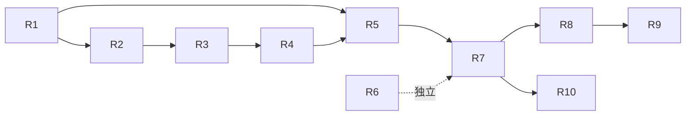

# PPO 重构计划：已证实缺陷、目标结构与原版 RCA 替换

状态：**实施中**。R1–R7 已于 2026-10-27 通过有界 Ubuntu 验收；R8 已于 2026-10-28 以**能力证据**验收（[19 项专项检查与受控三局原版 fixture](../verification/ppo_refactor_r8_20261028/RERUN.md)）；R9 已于 2026-10-28 以**能力证据**验收（[23 项专项检查与一局真实原版教师对局](../verification/ppo_refactor_r9_20261029/REPORT.md)）；R10 已于 2026-10-28 以**能力证据**验收（[33 项专项检查与可复现的仓库 bundle](../verification/ppo_refactor_r10_20261029/REPORT.md)）。R8b 关闭了 R8 的标签限制：已于 2026-10-28 **验收**，33 项专项检查与两局真实原版对局通过 BC 覆盖率门禁（[证据](../verification/ppo_refactor_r8b_20261030/REPORT.md)）。R3 按下文用户批准的语义修订实施。见 [R1 证据](../verification/ppo_refactor_r1_20261027/REPORT.md)、[R2 证据](../verification/ppo_refactor_r2_20261027/REPORT.md)、[R3 证据](../verification/ppo_refactor_r3_20261027/REPORT.md)。
证据：[verification/ppo_rootcause_20261026/REPORT.md](../verification/ppo_rootcause_20261026/REPORT.md)（十一次只读探针，退出码 0，冻结 run `v5_lite30h_20261025`）。
证据范围：一个已完成的 30 小时 CPU lite run；未训练、未跑原版对局、未改语料与检查点。

配合阅读：[architecture_zh.md](architecture_zh.md) §10.18（决策记录）与被取代的 [ppo_diagnosis_plan_zh.md](ppo_diagnosis_plan_zh.md)（假设 H1–H5，现已判定或收窄）。

## 1. 一页结论

### 1.1 效果不佳的来源

| # | 原因 | 类别 | 分级 | 锚点 |
| --- | --- | --- | --- | --- |
| F1 | PPO batch 在更新时丢掉 31% 的行：split 在 batch 冻结并提交身份之后才被应用 | 实现缺陷 | **已证实** | `learning/updates.py prepare()`、`learning/data.py split()`；duel v99 为 130/421 行 |
| F2 | 训练/验证 split 以「包含 seed 的 family 哈希」为键，物理等价场景同时落在两侧 | 数据/训练域 | **已证实** | `learning/maps.py decorate()`、`learning/data.py:12`；duel 6 个场景中 5 个跨 split |
| F3 | final 的 30 个 block 实为 3–6 个确定性对局重复 5–10 次；bootstrap 把重复当独立样本 | 评估 | **已证实** | `learning/maps.py SPLITS`、`learning/schedule.py factions()`、`learning/evaluate.py comparisons()`；duel 2 个签名×15，ffa4 1 个×30 |
| F4 | KL 门从 epoch 循环直接返回，冻结 batch 中未访问的 window 永不重访 | 实现缺陷（记账） | **已证实** | `learning/ppo.py update()`、`learning/experiment.py finish_train()`；duel 每 batch 计划约 8 步、实际 3.86 步，387/430 batch 因 KL 停止 |
| F5 | PPO 的模仿项是 10% 交叉熵，而模仿对象正是评估面板用来给学习者打分的那个策略 | 学习机制 | **支持但未证实** | `learning/ppo.py` rehearsal 项、`learning/experiment.py:381 control=self.teachers[0]`；cos(PG, rehearsal) +0.1006，梯度范数 2.46 对 10.44 |
| F6 | BC 门是教师轨迹上的分布内模仿（duel 99.19%），看不到策略实际落败的 on-policy 状态分布；其产物只报对局数，不报背后有多少个不同场景 | 评估 | “它度量的是这个”与“它不报场景数”**已证实**；其影响**支持但未证实** | `learning/experiment.py finish_train()` 门控段与 `g_trend` 对照；`bc_gate.json` 只有 `imitation`/`coverage`/`corpus`/`opening`/`passed`。门控证据设计归 R4 负责 |
| F7 | 学习者唯一持久信号是每局终局 ±1；势函数塑形在 γ=1 下自行相消，探索项总计约 0.042 | 学习机制（设计即如此） | 设计**已证实**，影响**无法判断** | `learning/rewards.py`、`learning/data.py advantages()`；手算 oracle 完全一致 |
| F8 | 采集与评估全部在确定性 lite 引擎（`expected_damage_v1`）上；开局一失即不可挽回，面板近似是开局的常函数 | 训练域 | 身份**已证实**，棋力影响**无法判断** | 该 run 每个 job：`engine lite-0.2`、`native_timings: []` |
| F9 | 一半采集对局在 vendored arena 棋盘上，而验证/留出用真实地图 | 数据 | 排程**已证实**，影响**无法判断** | `learning/maps.py decorate()`、`learning/schedule.py base_job()` |
| F10 | 策略确实在动（相对 v10 的 KL≈1.75 nats，33% 决策 argmax 改变），但没有任何面板改善；熵 0.43→1.33 | 学习机制 | **已证实**（测量） | `i_drift` 探针，291 条冻结行 |
| F11 | native 下的教师查询仍调用 Astra；lite 下 Astra 被替换成官方 baseline | 能力缺口 | **已证实** | `learning/experiment.py:275`、`learning/native_rpc.lua teacher()`、`learning/lite_host.py:126` |
| F12 | 原版 RCA 的 19 个候选动作中有 11 个是 C++（`combat_phase`、`default_recruitment` 等），Lua 动作包装无法观测攻击与招募 | 能力缺口 | **已证实** | `data/core/macros/ai_candidate_actions.cfg`；仅 9 个 `engine=lua` 位置 |

已排除的原因及证据：行为/更新输入合同（候选顺序、mask、动作索引、每回合记忆提交、`log_probability`、`value`）——421 条冻结行全部复现到 1.1e-05；批量与前向单行不一致；`train()`/`eval()` 差异（`learning/model.py` 无 dropout）；GAE、同回合增量、势函数塑形、截断 bootstrap、终态处理（手算 oracle 完全一致）；「PPO 没在更新」；Lua 导出数值误差（lite 推理走 PyTorch）；以及 §10.15 已修复的 KL 遍历、计数结算、BC 取消 RNG、final 提名与奖励滚动窗口——本计划不重开。

无法从冻结 run 判断：F5、F7、F8、F9 各自造成多少棋力损失，以及修正后的循环能恢复多少。这些需要下文定义的新 run 证据，而不是对旧数据的更多分析。

### 1.2 重构必须改变的三个性质

按顺序，且只有这三条：

1. **每条采集决策不再被 split 静默丢弃，计划工作明确记为已提交、中断或 KL 停止，且训练设计独立于评判设计**（F1、F2、F3；2026-10-27 用户批准 R3 修订）。
2. **更新的目标就是被度量的目标**——不存在朝面板对手的长期拉力，不存在被丢弃的计划工作，奖励语义不可能被误读（F4、F5、F6、F7）。
3. **所有竞争角色都是 1.18.8 原版 RCA**，并有使其标签可审计的采集与身份；不留下任何隐式 Astra 路径（F11、F12）。

纯风格整理、改名扫荡、新抽象层明确不在范围内。奖励系数、KL 阈值、网络规模、以调参为目的的面板扩充都不在范围内；本计划改变的是*度量什么、训练什么*，不是强度。

### 1.3 原版 RCA 替换

替换是 **native-only** 的，并按角色拆分：

- 必须*在与学生对局的游戏内*运行的角色（固定对手、FFA 补位、2v2 队友与对手、奖励校准、trend/promotion/champion/final 面板）改为 `--controller <side>:ai` 且不带 `--ai-config`：即所装 1.18.8 的内置默认 RCA。
- **教师**无法按决策查询，因为其攻击与招募阶段是 C++。标签来自**整局事件采集**，离线与共享候选生成器匹配。逐决策 DAgger 对原版教师**退役**；其替代是回合级接管，只有在 fixture 证明引擎支持时才新增。
- **lite 引擎根本无法承载官方 baseline**（`learning/lite_host.py:126`）。因此 lite batch 只能是自博弈与历史对手；任何含外部对手或参考面板的 batch 都是 native。既有的单 `engine_id`/单 `rules_version` batch 校验已禁止混用，所以这是排程决定，不是新不变量。

必须直说：PPO 修复（A/B 阶段）与教师/引擎变更（C 阶段）相互独立，C 阶段之后的第一次训练不能把结果归因于 PPO 单独修复。

## 2. 当前流程与缺陷位置

```mermaid
flowchart LR
  subgraph collect["采集 (learning/schedule.py, lite_host.py, sample.py)"]
    J["jobs: rollout / teacher / validation / reward_reference"]
    G["对局: lite-0.2, expected_damage_v1"]
    R["行: candidates, choice, intent, actual, memory_write, log_probability, value"]
  end
  subgraph data["数据 (sequences.py, data.py, updates.py)"]
    P["attach_histories: 每回合一次"]
    S["split(game_family) sha256%5"]
    D["prepare(): 丢弃非 train 行"]
    W["training_windows: 8 个回合"]
  end
  subgraph upd["更新 (ppo.py, rewards.py, model.py)"]
    A["advantages: GAE 0.95, γ1, 势函数塑形"]
    L["loss: 裁剪 PG + 0.5 MSE − 0.01 H + 0.10 CE(rehearsal)"]
    K["step 前 KL > 0.02 → 返回，未访问 window 丢失"]
  end
  subgraph eval["评估与选拔 (experiment.py, evaluate.py)"]
    V["验证: 1–3 个 block"]
    F["final: 30 block = 3–6 个不同对局"]
    C["selection_key, champion"]
  end
  J --> G --> R --> P --> S --> D --> W --> A --> L --> K
  K --> E["检查点 last_ppo → history"]
  E --> V
  E --> F
  F --> C
  C --> X["导出与打包"]
```



缺陷位置：`S`+`D`（F1/F2——split 由含 seed 的 family 计算，且在 batch 冻结后才应用）、`K`（F4——计划中的 window 被丢弃）、`L`（F5——模仿身份等于面板 control）、`F`（F3——重复的确定性对局被当作独立 block）、`V`（F3 在 trend 尺度上）。

当前职责与耦合：

| 模块 | 持有 | 耦合于 |
| --- | --- | --- |
| `learning/schedule.py` | job 构建、block/faction/seed 算术、教师门（`only Astra may provide teacher actions`） | Astra 身份、`maps.SPLITS`、`factions()` 周期 |
| `learning/maps.py` | 按 `index % len(names)` 选图、含 seed 的 `game_family` 哈希 | split 规则（经 family）、评估设计 |
| `learning/lite_host.py` | 每方 RNG、记忆提交、DAgger 触发、Astra provenance | 拒绝 `baseline`；Astra 附加包 |
| `learning/lite_policy.py` | 冻结策略推理（argmax/sample）、记忆上下文缓存 | 检查点布局、`is_astra` |
| `learning/data.py` | 行校验、split、BC 采样器、GAE | provenance 合同、教师身份 |
| `learning/sequences.py` | 历史挂接、window 切分、gzip 读取预算 | 每回合记忆约定 |
| `learning/updates.py` | `prepare()` 的 split 过滤、计划形状（windows/sequence_count/micro） | split 规则、batch 身份 |
| `learning/ppo.py` | 损失、KL 门、计划 cursor、记账 | 奖励配置、rehearsal 池、检查点 |
| `learning/rewards.py` | 势函数塑形、终局奖励、自适应系数 | 裁判结果字典 |
| `learning/evaluate.py` | block 聚合、bootstrap、状态、选拔键 | `schedule` 的 block 算术 |
| `learning/experiment.py` | 阶段机、Astra 替换、面板、final 选拔、留出 | 以上全部 |
| `learning/manifest.py` | 冻结配置/身份、`only gpt6astra` 教师校验 | 附加包打包 |
| `learning/native_rpc.lua` | native 观测/候选/合法/teacher(obs) | `teacher()` 依赖 Astra 附加包 |

## 3. 目标结构

### 3.1 职责变化

| 模块 | 目标职责 | 接口变化 |
| --- | --- | --- |
| `learning/maps.py` | 把*场景身份*与*运行身份*分开持有 | `scenario_identity(job)->dict`、`scenario_family(job)->str`、`run_family(job)->str`；`decorate()` 两者都写；`SPLITS` 为每个 split 给出显式场景清单 |
| `learning/data.py` | 按场景分区；校验 `split_rule`；采样器不得使用评估 control | `split(scenario_family)` 机制不变；`validate_record` 接受 `split_rule ∈ {'family-seed-v1','scenario-v2'}`；`BCSampler(pool, *, exclude_teacher_impl=None, exclude_teacher_sha=None)` |
| `learning/updates.py` | 拒绝静默丢弃；报告排除量 | `prepare(model, records, bc_records=None, *, allow_drop=False)`；抛 `ValueError('batch row excluded by split: N of M')` |
| `learning/ppo.py` | 显式记录计划、提交和 KL 停止工作；仅中断可延迟 | `planned_steps`、`committed_steps`、`stopped_by_kl_steps`、`deferred_steps` 和 window 访问计数；cursor 增加 `scope` |
| `learning/experiment.py` | 不再替换官方 baseline；显式面板设计；KL 终止结算一次、中断保持 pending；每个判决报告场景证据 | 移除 `[self.teachers[0] if bot=='baseline' …]`；`finish_train` 结算 batch 工作量，并写入 `bc_gate.json` 的 `distinct_scenarios`/`scope`；`validate_model(..., min_distinct=…)` |
| `learning/schedule.py` | 每个面板设计枚举一次场景；教师按能力而非身份 | `evaluation_jobs(..., scenarios=[...], repeats=int, min_distinct=int)`；`teacher_jobs` 接受任何 `query != 'none'` 的注册教师 |
| `learning/evaluate.py` | 对*不同场景*做聚类 bootstrap；新增 `insufficient_design` | `comparisons(jobs, results, *, min_blocks, min_distinct, team_contexts)`；结果增加 `distinct_scenarios` |
| `learning/manifest.py` | 教师身份记录，而非名字比对 | `teacher_identity(kind)->dict`；`active_teacher(manifest)`；`freeze()` 记录 kind/version/query/action_source/rules sha |
| 新增 `learning/stock_rca.py` | 原版 RCA 标签流水线：事件帧 → 候选匹配标签 | `frames_to_labels(frames, *, side, candidates_fn) -> (rows, coverage)` |
| 新增 `lua/stock_rca_capture/main.lua` | 观测任意一方的 `moveto/recruit/recall/attack/post advance` 并带可见性标记 | 经既有 sink 发 `LEARN` 帧 |
| `learning/native_rpc.lua` | 以 `teacher_turn(obs)` 取代 `teacher(obs)`；Astra 只保留在显式 `impl=gpt6astra` 回放路径 | `teacher_turn` 返回 `{actions, provenance}`；`query='none'` 合法 |
| `learning/bundle.py`、`learning/reward_metrics.py`、`learning/benchmark*.py` | 从 manifest 读取身份；活动 run 不再打包 Astra | 打包清单列出 `teacher.kind` |

### 3.2 身份流转

三个键，逐层嵌套，绝不合并：

```
scenario_family = sha256(format, board identity, factions, teams, starts, engine_id, combat_version, rules_version)
game_family     = sha256(scenario_family, seed)                 # 一次运行；旧行取值不变
split           = 'validation' if int(sha256(scenario_family)[:8],16) % 5 == 0 else 'train'
```

`scenario_family` 是 split 与所有面板设计的键。`game_family` 保持现义，使已记录 shard、检查点身份与 `data.py` 去重继续有效。行携带 `split_rule`，因此混合 batch 不可能出现；该检查与既有的单 `version`/`engine_id`/`rules_version`/`teacher_profile` 校验同层。

教师身份是记录，不是路径名：

```python
{'kind': 'wesnoth_default_rca' | 'gpt6astra',
 'version': '1.18.8',
 'rules_sha256': ...,
 'query': 'none' | 'per_turn' | 'per_decision',
 'action_source': 'engine_events' | 'lua_wrapper',
 'capture_sha256': ... }
```

一个 batch 只能含单一教师记录的标签。Astra 行永远保留 `kind='gpt6astra'`，绝不重标。

### 3.3 状态归属

| 状态 | 重构后的持有者 |
| --- | --- |
| 教师身份、规则身份、split 规则、面板设计 | run manifest（启动前冻结） |
| 每格式版本、计数（planned/committed/deferred）、pending batch scope、champion、选拔 | 每格式的 `state.json` |
| 场景身份与运行身份、split | 数据行 + `maps.py` |
| 面板场景集合、不同场景数、聚类 bootstrap | `evaluate.py` 结果，并抄入 `validation/v*.json` 与 final 报告 |
| 学生记忆、每方 RNG | `lite_host.py` / `learning/sample.py` 对局循环 |
| 裁判真值（快照、RNG、隐藏单位） | 仅在裁判内；绝不进入策略输入或采集标签 |

## 4. 阶段

一个 PR 一个行为。每个阶段给出还原即失败的断言。行数估算不含测试与 fixture。所有工作在分支上进行并向 `master` 提 PR；实现分支不自行合并。

### A 阶段 — 数据与度量完整性

#### R1. 场景键身份与 split

**2026-10-27 已验收：**实现 `be0a1ca`，27 项 Ubuntu 专项检查通过，还原实现失败、恢复后通过；见[报告](../verification/ppo_refactor_r1_20261027/REPORT.md)。未运行对局或训练。

- **行为：** 训练对局与验证对局不可能再是同一物理场景。
- **证据：** F2（5/6、7/9、4/9 场景跨 split）；`learning/maps.py` 把 `seed` 放进被哈希的 family。
- **模块：** `learning/maps.py`（`decorate`、`scenario_identity`、`scenario_family`、`run_family`、`SPLITS`）、`learning/data.py`（`split` 调用点、`validate_record`）、写入方 `learning/sample.py` / `learning/lite_host.py`。
- **接口：** `decorate()` 在 `job['game_family']` 旁写 `job['scenario_family']`；行携带 `scenario_family` 与 `split_rule='scenario-v2'`；v2 行要求 `r['split'] == split(r['scenario_family'])`，旧规则继续支持 `family-seed-v1`。
- **前置：** 无。
- **兼容与迁移：** 旧 shard 仍可读并标为 `family-seed-v1`，但不得进入 v2 batch。旧检查点可原样加载。新 run 复用旧语料需重新采集——如实说明，不隐藏。
- **必须保持的契约：** family 仍不跨 split；留出地图仍只作留出；每局等权。
- **本地验收：** 单测：仅 `seed` 不同的两个 job 共享 `scenario_family` 且落在同一侧；200 个 job 的排程中 train 场景不出现在 validation。
- **Ubuntu 验收：** `pytest tests/v5/test_scenario_identity.py`（新文件；不扩写已 1804 行的 `tests/v5/test_pipeline_contract.py`），并保持 `tests/v5/test_rollout_content_identity.py` 不变。
- **还原即失败的断言：** `test_seed_does_not_move_the_scenario_between_splits`——恢复 `split(game_family)` 后两个同场景 job 分落两侧，测试失败。
- **回退：** 回滚提交；带 `scenario_family` 的行在旧校验器下仍有效（未知字段），无数据损失。
- **完成条件：** 300/600/400 局排程中跨 split 场景为 0，跨 split family 为 0。

#### R2. Batch 资格与拒绝静默丢弃

**2026-10-27 已验收：**实现 `3a92436`，20 项 Ubuntu 专项检查加 1 项 FFA4/2v2 更新检查通过；还原实现失败、恢复后通过。见[报告](../verification/ppo_refactor_r2_20261027/REPORT.md)。未运行真实对局或正式训练。

- **行为：** 冻结 batch 只含可训练行，否则运行响亮失败。
- **证据：** F1，身份提交后有 130/421 行（30.9%）被丢弃。
- **模块：** `learning/schedule.py rollout_jobs`（仅从 train 场景组合，记录确定性的替换）、`learning/updates.py prepare`、`learning/experiment.py finish_train`（指标）、`learning/ppo.py result()`。
- **接口：** `prepare(..., allow_drop=False)` 抛 `ValueError('batch row excluded by split: {n} of {total}')`；指标增加 `excluded_decisions`、`excluded_games`、`eligible_decisions`；`history` 条目暴露这些值。
- **前置：** R1。
- **兼容：** 旧 run 的 pending batch 无法被新代码续跑（含验证行）——属设计，并由 manifest 守卫说明。
- **必须保持的契约：** 每局等权；`rollout_identity(rows)` 仍绑定实际训练的那批行（现在是全部）。
- **本地验收：** 10 行 batch 含 3 条验证行则抛错；10 条 train 行给出 `eligible_decisions == 10`。
- **Ubuntu 验收：** `pytest tests/v5/test_batch_eligibility.py` + `tests/v5/test_ppo_resume_counters.py`（语义不变）。
- **还原即失败的断言：** `test_validation_row_in_batch_raises`——恢复静默过滤后调用返回，测试失败。
- **回退：** 回滚；过滤器回归，指标字段缺失（调用方用 `.get`）。
- **完成条件：** 短链中三格式 batch 都报告 `excluded_decisions == 0`。

#### R3. KL 门记账：显式停止工作与可恢复中断

**2026-10-27 已验收：**实现 `3983cd0`，14 项 Ubuntu 专项检查通过，还原实现失败、恢复后通过；见[报告](../verification/ppo_refactor_r3_20261027/REPORT.md)。未运行真实对局或正式训练。

**2026-10-27 用户批准修订：**[最小复现](../verification/ppo_refactor_r3_probe_20261027/probe.py)先提交一步，下一步在 KL 0.900721 被拒绝。同一权重、冻结行连续恢复两次，KL 完全相同且没有新增更新。因此撤回“所有 KL 延迟 window 后续都会训练”的原承诺；它无法与固定的 step 前门控、冻结行为概率同时满足。

- **行为：** KL 终止该采集 batch，剩余工作显式记作 `stopped_by_kl`；仅截止时间/中断保留同一 paths、identity 和 cursor 的 pending。
- **证据：** F4 的工作量记账缺失；上述复现区分预期 KL 停止与可恢复中断。
- **模块：** `learning/ppo.py` 的 result/cursor；`learning/experiment.py finish_train` 的 counters/history。
- **接口：** `planned_steps`、`committed_steps`、`stopped_by_kl_steps`、`deferred_steps` 及对应 window 访问计数；仅中断为 `scope='deferred'`，否则为 `'batch'`。
- **前置：** R2。
- **兼容：** 旧 cursor 不要求新字段；新工作量累计字段缺失时从零开始，不编造历史计数；原 plan hash 与 rollout identity 检查保留。
- **必须保持的契约：** KL 0.02 仍在 step 前检查，拒绝后不应用梯度；零更新 KL 不升版本；部分提交的 batch 只升一次版本；中断尝试不结算全局计数、不产生升级候选。
- **本地验收：** 零步/部分提交 KL 停止，截止时间/检查点恢复，20 个微型 batch 满足计划 = 提交 + KL 停止 + pending 工作。
- **Ubuntu 验收：** `tests/v5/test_kl_defer.py`、既有 PPO plan 与恢复计数测试；无 pytest 时用标准库 unittest。
- **还原即失败的断言：** `test_kl_rejection_accounts_for_all_remaining_work` 缺少显式停止工作计数。
- **回退：** 回滚新增记账；模型更新与 KL 拒绝保持原有算术。
- **完成条件：** 20 个 batch 工作量守恒；中断只恢复一次，终止的 KL batch 没有 pending 重试；阈值与行为概率不变。

#### R4. 评估设计：不同场景、聚类 bootstrap、显式不足

**2026-10-27 已验收：**实现 `a05533f`，30 项 Ubuntu 专项检查通过；面板与 BC 门还原反例失败，恢复后通过。[报告](../verification/ppo_refactor_r4_20261027/REPORT.md)。现有 final 设计仅 6/3/3 个不同场景，低于门槛 12，继续报告不足；未新增对局或语料。

**场景名册 2026-10-28 已验收：**这一不足属于调度缺陷，而不只是数据缺口。`starting_factions` 现在枚举六个冻结阵营允许的全部不同初始分配（duel 15 对、FFA4 15 组、team2v2 15 种分队），因此 final 面板达到 duel 30 / FFA4 15 / team2v2 15，12 block 的升级面板在三种格式都达到 12，block 与对局数不变；`calibration_jobs` 保留原有三 block 轮换。`scenario_factions` 让教师采集循环同一名册——原先三个轮换 block 把语料上限压在 6/9/9 个场景，现在 12 局采集即覆盖 12 个。37 项 Ubuntu 专项检查通过，另有覆盖全部面板与采集形态的计划下限探针；恢复任一旧名册都会让已记录的断言失败。[报告](../verification/ppo_refactor_r4_20261029/REPORT.md)。

- **行为：** 本系统里的每个判决——面板与 BC 门一视同仁——都以不同场景数陈述其证据，而非重复次数；场景过少的设计不得通过。BC 门还须声明自身范围：它只证明对教师轨迹的模仿，属于初始化证据。
- **证据：** F3，duel 2 个签名×15、ffa4 1 个×30、team2v2 3 个×10；`min_blocks=30` 靠重复满足；`selection.json` 的理由。F6：`bc_gate.json` 只带 `imitation`/`coverage`/`corpus`/`opening`/`passed`，没有任何场景数；而支撑 99.19% 模仿率的 duel 语料是 300 局落在 **4 张棋盘**上，其中一张占 150 局（`k_gate_scope`，`verification/ppo_gate_scope_20261026/REPORT.md`）。
- **模块：** `learning/schedule.py evaluation_jobs`（显式场景枚举 + 重复数）、`learning/evaluate.py`（`scenario_of`、`comparisons(..., min_distinct)`、`_cluster_bootstrap`）、`learning/experiment.py validate_model`（面板设计、状态传播）、`learning/experiment.py final_evaluation`、`learning/experiment.py finish_train`（门控段写入场景数与范围并执行下限）。
- **接口：** `comparisons(...)` 返回 `{'blocks','distinct_scenarios','differences','status','reason'}`，`status ∈ {passed, not_passed, inconclusive, insufficient_design}`；bootstrap 重采样不同场景并平均其 block 均值；`min_distinct` 冻结在 manifest（升级/final 为 12，trend 为 3）。`bc_gate.json` 增加 `distinct_scenarios` 与 `scope: 'initialisation_only'`；语料场景数低于 `min_distinct_gate` 时门控段返回 `insufficient_design`。
- **前置：** R1（job 上需要 `scenario_family`）。
- **兼容：** `validation/v*.json` 增加 `distinct_scenarios`；读取方容忍缺失。旧面板仅在重算时才被读作 `insufficient_design`——历史报告不重写。
- **必须保持的契约：** 留出地图不用于调参或选拔；`min_blocks` 作为重复数下限保留；通过规则（`interval[0] > 0`）不变；门控保留现有的分类分母，只增加场景数与范围标签；任何报告或选拔路径都不得把 `passed` 当作 on-policy 棋力。
- **本地验收：** 30 个相同 block 不得得出 `passed`；12 个不同场景且差异一致为正则通过；4 张棋盘配 `min_distinct_gate = 12` 必须返回 `insufficient_design`。
- **Ubuntu 验收：** `pytest tests/v5/test_evaluation_design.py`；重跑 `tests/test_validation_cadence.py` 校验面板规模与接线。
- **还原即失败的断言：** `test_repeated_identical_blocks_are_insufficient`——恢复仅看 `min_blocks` 的逻辑后，面板给出 `passed`/`inconclusive` 而非 `insufficient_design`；`test_gate_reports_distinct_scenarios`——门控产物与 `insufficient_design` 分支同时消失。
- **回退：** 回滚；面板回到重复语义。
- **完成条件：** 短链中每个升级/final 面板都报告 `distinct_scenarios ≥ min_distinct` 或 `insufficient_design`，final 报告同时打印两个数，且 `bc_gate.json` 在其判决旁给出场景数与“仅作初始化证据”的范围。
- **剩余限制：** 现有语料达不到门控下限（duel：4 张棋盘）。R4 只负责让它可见；扩充语料或为更低下限给出理由属于另行授权的数据决策，在它落地之前门控判决是 `insufficient_design`，而不是质量结论。
- **本阶段阻塞棋力结论，不阻塞训练。**

### B 阶段 — 更新究竟在优化什么

#### R5. Rehearsal 不得模仿面板 control

**2026-10-27 已验收：**实现 `9fee653`，验收源码 `e7342e2`，23 项 Ubuntu 专项检查通过；关闭排除谓词后失败，恢复通过。[报告](../verification/ppo_refactor_r5_20261027/REPORT.md)。正权重下只有 control 数据会失败，未调低系数、未采集新数据。

**2026-10-29 前置复核：**没有任何代码路径能造出该池。排除谓词本身是精确的；run 唯一的 `train(...)` 调用从不传库层 opt-in，因此 `policy` 行不可达；策展语料中没有 1.18.8 `era_default` 标准多人局重放，`learning/human.py` 现在拒收其他版本录制的重放（`other_version`），不再把它标成 1.18.8 标签。对冻结语料重新生成的清单为 `{'skipped': 43}`，其中两条 `other_version`。补入重放、授权 run 级策略 opt-in、或接受空 rehearsal 池曾是数据决策，不是待修缺陷。见[审计](../verification/ppo_refactor_r5_20261029/REPORT.md)。

**2026-10-28 开启策略排练：**用户已授权 run 级 opt-in。`FormatExperiment` 现在持久化 `policy_shards`（每个成功的 PPO rollout shard）并加入 PPO rehearsal 池；只有 PPO 阶段以 `allow_policy_rehearsal=True` 调用 `train(...)`。当前批次被有意包含：排除它会在第一次 PPO 更新时复现空池错误，使 opt-in 失效。因此辅助项排练的是本 run 自己的冻结策略行，通过 `rehearsal_sources` 以 `source='policy'` 与 `policy_sha256` 披露；这是自模仿，不是专家监督，BC 阶段仍只读教师标签。Windows 检查：`tests/v5/test_rehearsal_source.py` 6 项通过，PPO-plan、validation-cadence 与 rehearsal 三套件合计 18 项通过；还原 opt-in 或池加入即抛 `no rehearsal data distinct from the evaluation control`。本阶段未运行 Ubuntu 验收，因此仅为能力证据。[证据](../verification/ppo_refactor_r5_policy_20261028/REPORT.md)。

- **行为：** PPO 的辅助模仿项永远不能取自被评分所对的策略。
- **证据：** F5（`control=self.teachers[0]`、rehearsal 与 PG 的 cos +0.1006、权重 10%）；F6（本应约束质量的门度量的是教师状态模仿）。
- **模块：** `learning/data.py BCSampler`、`learning/ppo.py update(..., rehearsal_exclude=...)`、`learning/experiment.py finish_train`（传 control 身份）、manifest（分阶段的 `bc_aux` 策略）。
- **接口：** `BCSampler(pool, *, exclude_teacher_impl=None, exclude_teacher_sha=None)`；`update(..., rehearsal_exclude=None)`；指标 `rehearsal_sources`、`rehearsal_rows_excluded`；排除后池为空则抛 `ValueError('no rehearsal data distinct from the evaluation control')`。
- **前置：** R1（身份）、R4（control 显式）。
- **兼容：** 池在读取时选择，无需重写 shard；旧 action 仍有效。
- **必须保持的契约：** 普通 rehearsal 的 `bc_aux` 默认 0.10；PPO 的 on-policy 要求；不弱化任何门。
- **设计决策：** 当教师*就是* control 时（正是 C 阶段后的情形，两者都是原版 RCA），模仿**作为初始化（BC 阶段）合法，作为每步 PPO 项不合法**。因此 PPO 期的 `bc_aux` 只作用于人类/自博弈/合格数据，原版 RCA 的模仿只发生在 BC 阶段。理由记入 §10.18。
- **本地验收：** 池中只有 control → 抛错；control + human → `bc_aux > 0` 时只采到 human。
- **Ubuntu 验收：** `pytest tests/v5/test_rehearsal_source.py`。
- **还原即失败的断言：** `test_control_policy_cannot_rehearse`——恢复旧采样器后 control 的行被抽取，测试失败。
- **回退：** 回滚；行为回到今日混合。
- **完成条件：** 20 个 batch 的链上 `rehearsal_sources` 不含 control 身份。

#### R6. 奖励行语义

**2026-10-27 有界验收通过：**实现 `30cd046`，37 项 Ubuntu 专项检查通过，421 行历史 GAE/returns 逐位一致，还原失败、恢复通过。[报告](../verification/ppo_refactor_r6_20261027/REPORT.md)明确列出本地旧夹具/扩展未通过项；特征版本仍为 5，rowpack 仍为 v2。教师/人类行缺原始奖励证据时 reward_step 明确为 null；策略行不允许未知值。

- **行为：** 行以自己的名字陈述本步奖励与整局终局奖励，不可能混淆。
- **证据：** F7 与报告 §9——`r['reward']` 在每一行都是终局奖励，且只有一个消费点（`learning/data.py:236`）；今天没有算术错误，但该字段对任何未来消费方都是陷阱，审计必须先读 `advantages` 才能分清步奖励与终局奖励。
- **模块：** 写入方 `learning/sample.py`、`learning/lite_host.py`；`learning/data.py`（`validate_record`、`advantages`、`transition_reward` 调用）；`learning/rowpack.py` schema 常量；`learning/reward_metrics.py` 读取方。
- **接口：** 行键 `terminal_reward`、`reward_step`（本步塑形奖励）、`reward_raw`、`reward_after`、`potential`；`schema: 6`；`validate_record` 接受 5（推导 `terminal_reward = reward`）与 6；`advantages` 仅在终局行读 `terminal_reward`，两者都在时断言 `reward_step == transition_reward(...)`。
- **前置：** 无。
- **兼容：** schema 5 行仍可在 schema 5 batch 中训练；batch 不混 schema（把既有单 `version` 校验扩展到 `schema`）。rowpack `v:2` 不变。
- **必须保持的契约：** 奖励数值逐字节不变；这是命名与可审计性改动，不是奖励改动。系数不动。
- **本地验收：** 手算 5 步序列断言每行 `reward_step` 与 `terminal_reward`；schema 5 行仍可训练。
- **Ubuntu 验收：** `pytest tests/v5/test_reward_row_schema.py`；`tests/v5/test_pipeline_contract.py` 奖励段（只读，不扩写）。
- **还原即失败的断言：** `test_row_reward_is_not_the_terminal_value`——恢复旧写入方后非终局获胜行带 +1.0，测试失败。
- **回退：** 回滚；读取方兼容两种 schema，只需写入方回退。
- **完成条件：** 奖励 oracle 重算一局的 `reward_step` 之和等于 `terminal_reward + shaping(Φ_end − Φ_start)`，误差 1e-9。

### C 阶段 — 原版 RCA 替换

#### R7. 教师身份与移除 baseline 替换

**2026-10-27 身份/接线验收通过：**实现 `e509a8d`，39 项 Ubuntu 专项检查与 Lua 语法检查通过；恢复 baseline 替换后失败、修复恢复后通过。[报告](../verification/ppo_refactor_r7_20261027/REPORT.md)。未运行原版对局；capture_sha256 仍为 null，R8/R9 完成前没有可用的 stock 教师采集/查询链。

- **行为：** 一个 run 声明唯一教师*记录*；官方 baseline 永不被附加包替换；lite 请求 baseline 时失败而非静默改为 Astra。
- **证据：** F11；`learning/experiment.py:275`、`learning/manifest.py:40-49`、`learning/lite_host.py:126`、`learning/schedule.py teacher_jobs`（`only Astra may provide teacher actions`）。
- **模块：** `learning/manifest.py`、`learning/schedule.py`、`learning/experiment.py`、`learning/lite_host.py`、`learning/data.py`（教师校验通用化为记录）、`learning/native_rpc.lua`（Astra require 改为条件）。
- **接口：** `manifest['teacher'] = teacher_identity(...)`；`teacher_identity(kind)` 支持 `wesnoth_default_rca`（`query='none'`、`action_source='engine_events'`）；`schedule.teacher_jobs` 要求 `teacher['query'] != 'none'`（故原版 RCA 不作为 DAgger 教师）并接受任何注册教师；`experiment.__init__` 由 manifest 构建 `self.reference_opponents`，不再 `'baseline' → teacher[0]`；`lite_host.play` 保持 `ValueError('official baseline is native-only')` 并对原版 RCA 教师请求同样抛错。
- **前置：** R1、R5（身份感知的池）。
- **兼容：** 旧 manifest 声明 `teacher.kind='gpt6astra'`，只能在旧代码下续跑；新 run 用新记录。`data/opponents/gpt6astra.zip` 留在磁盘，但不打包。
- **必须保持的契约：** 一个 run 一个活动教师；跨教师行仍被拒绝；裁判真值仍不进教师输入。
- **本地验收：** 原版 RCA manifest 可冻结与重载；lite job 请求它时抛错；任何代码路径都不把 `baseline` 映射到附加包（对 `experiment.execute` 的 job 字典断言）。
- **Ubuntu 验收：** `pytest tests/v5/test_teacher_identity.py`。
- **还原即失败的断言：** `test_baseline_is_never_substituted`——恢复替换后两座位 duel job 断言失败。
- **回退：** 回滚；Astra 替换仅对旧 manifest 回归。
- **完成条件：** 除非 manifest 声明 `kind='gpt6astra'`，native job 构建绝不引用 `gpt6astra`。

#### R8. 原版 RCA 事件采集与标签流水线

**已于 2026-10-28 以能力证据验收：**实现 `45e7146`；FX1 在冻结默认熵后通过（三条引擎事件流逐字节一致），FX2 对每个受观察事件记账且零未匹配（招募 11 → 2 匹配 + 9 合并；移动 8 → 1 匹配 + 2 歧义 + 5 合并；攻击 5 → 3 匹配 + 2 歧义），FX3 依 2 项能力探针与 6 项钩子探针记录 `takeover='unsupported_with_stock_rca'`。Ubuntu 运行 19 项专项检查加受控三局 fixture，两项还原证明均按预期失败。见[复跑报告](../verification/ppo_refactor_r8_20261028/RERUN.md)；此前失败尝试保留在 [REPORT.md](../verification/ppo_refactor_r8_20261028/REPORT.md)。

**标签质量已于 2026-10-28 关闭（R8b）：**攻击事件现在给出引擎所报武器序号（1.18.8 提供 `weapon` 表，仅当唯一匹配行动单位的攻击列表时才写入序号），只有评分字段不同的候选共享同一公开意图，整步移动与其提前停止变体不再读作歧义；覆盖率分母按决策而非事件计数，合并的招募批次与移动+攻击组合仍上报但不进分母。两局经 runner 自身教师 job 构造器产生的真实原版对局通过真实门禁——`全体 82/88 = 0.932`、`招募 11/11`、`移动 43/46 = 0.935`、`攻击 28/30 = 0.933`——歧义事件为零，另有 33 项专项检查；三项还原（意图去重、武器命名、合并分母）均按预期失败。六个未标注事件各有具名机制：三项撞上 128 候选上限，两次移动不在生成器选择内，一次 `advance` 行动者不可见。[R8b 报告](../verification/ppo_refactor_r8b_20261030/REPORT.md)。recall 与 advance 零事件，仍记为未观察；这只是能力证据，不是语料、训练或棋力。

- **行为：** 原版 RCA 对局产出引擎实际执行动作的逐动作标签，带可见性标记与显式的未匹配计数。
- **证据：** F12（19 个 CA 中 11 个是 C++，攻击与招募无法被 Lua 包装观测）；`core/macros/deprecated-utils.cfg:164` 显示全局附加包可按 side 过滤 `moveto,recruit,recall,attack,post advance,side turn`；`vendor/arena/match.py` 已采集 `LEARN` 帧与每回合 `SNAPSHOT`。
- **模块：** 新增 `lua/stock_rca_capture/main.lua`（事件处理器 → `LEARN` 帧）、`vendor/arena/match.py` 挂载 support 附加包（一行：把采集包加入 `learning['support']`）、新增 `learning/stock_rca.py`（`frames_to_labels(frames, *, side, candidates_fn)`）、`learning/sample.py`（provenance `teacher_impl='wesnoth_default_rca'`、`action_source='engine_events'`、`capture_sha256`）。
- **接口：** 帧 `{'type':'ACTION','side','kind':'recruit|recall|moveto|attack|advance','unit','to','target','type_id','visible','turn'}`；`frames_to_labels` 返回 `(rows, coverage)`，`coverage` 按 kind 计 `matched`、`unmatched`、`ambiguous`；ambiguous 指多个候选与执行动作一致，**不计入 exact-match 精度**并标 `label_ambiguous`。
- **前置：** R7。
- **兼容：** 新教师类型、新行；旧 Astra 语料不动。
- **必须保持的契约：** 标签只针对合法可见上下文——采集包按学生方的 `unit.visible` 过滤，绝不读裁判状态；匹配候选来自快照上运行共享 `candidates.lua`，而不是引擎内部计划。
- **本地验收：** 录制的帧清单 fixture 产出预期标签；攻击帧产出 `kind='attack'`；未见过的动作计为 `unmatched` 而不是被丢弃。
- **Ubuntu + 原版 fixture（≤3 场景 × ≤5 回合，仅能力/接线）：**
  - FX1：一张 duel arena 图，双方原版 RCA，挂载采集包 → 观测到 recruit/move/attack 事件；side 控制器不产生 `LEARN` 行；带/不带采集包时 `RESULT`、回合数、单位位置一致。
  - FX2：对 FX1 的快照跑标签流水线 → 报告每种 kind 的 `matched/unmatched`；若未匹配比例高，则在报告中下调标签主张，而不是隐藏。
  - FX3：回合级接管探针 → 判定 `query='per_turn'` 是否可能。
- **还原即失败的断言：** `test_attack_event_becomes_a_label`——移除事件处理器后标签缺失。
- **回退：** 移除采集包与标签流水线；native 参考对局回到无标签面板（即今日状态）。
- **完成条件：** FX2 报告每种 kind 的标签覆盖率，报告明确写出哪些 kind 完全覆盖、部分覆盖、未覆盖。

#### R9. 教师协议 v2 与逐决策 DAgger 退役

- **行为：** 教师只通过真实存在的能力被查询；DAgger 要么是回合级，要么被显式标为不支持，绝不换个名字继续用 Astra。
- **证据：** F12、`learning/native_rpc.lua teacher()` 即使 `engine=native` 也依赖 Astra 附加包；`learning/lite_host.py` 的 DAgger 触发；`vendor/arena/match.py` 对非 Astra 的 `dagger_teacher` 直接抛错。
- **模块：** `learning/native_rpc.lua`（`teacher_turn`、Astra 收进 `impl`）、`learning/native_transport.py`、`learning/lite_host.py`（DAgger 状态）、`learning/sample.py`（DAgger provenance）、`learning/experiment.py`（`dagger_shards`、计数）。
- **接口：** `teacher_turn(obs) -> {'actions': [...], 'provenance': teacher_identity}`；由 manifest 的 `teacher.query` 决定模式；每当零查询发生时，`dagger_status ∈ {'active','unsupported_with_stock_rca'}` 记入 `state.json` 与报告。
- **前置：** R7、R8，以及 FX3 结果。
- **兼容：** 旧 DAgger shard 保持 Astra 标签；新 run 声明教师记录，故池不可能混。
- **必须保持的契约：** 无静默回退；`dagger_shards` 是「带理由的零」，不是缺失。
- **本地验收：** `query='none'` 的教师对逐决策查询抛错并记录 `dagger_status`。
- **Ubuntu + 原版：** FX3 决定：(a) 接管可行 → 后续 PR 实现 `per_turn` 接管；(b) 不可行 → DAgger 保持 `unsupported_with_stock_rca`，BC 只用整局教师对局。
- **还原即失败的断言：** `test_stock_teacher_rejects_per_decision_query`。
- **回退：** 回滚；Astra `teacher()` 于显式 impl 后回归。
- **完成条件：** 除非 manifest 声明 `kind='gpt6astra'`，任何代码路径都无法产出 Astra 动作。

**2026-10-28 以能力证据验收**（[报告](../verification/ppo_refactor_r9_20261029/REPORT.md)）：23 项 Ubuntu 专项检查通过；一局真实原版教师对局（两端均 `baseline`、无教师查询）从 30 行记录中产出 7 个精确标注决策，`query=none` 与 `dagger_status=unsupported_with_stock_rca` 写入状态与报告。还原 job 构建器的路由后 `test_runner_collects_stock_games_without_a_teacher_seat` 失败。报告同时写明本证据未证明的部分：只覆盖一个场景四回合；17 个攻击事件中 14 个在当时未捕获武器序号而歧义。R8b 随后正是关闭这一点：攻击事件现给出引擎所报武器，两局真实对局以零歧义事件通过覆盖率门禁；R6 剩下的前提是语料、候选预算与训练长度日志上限，而非标签质量决定。

#### R10. 语料、打包与报告身份

- **行为：** 每个产物都写明其来源教师；活动 run 不打包 Astra。
- **证据：** `learning/bundle.py:51` 打包 `data/opponents/gpt6astra.zip`；`learning/reward_metrics.py`、`learning/benchmark*.py` 读取 Astra 产物；`learning/data.py` 的教师校验今天是 Astra 字面量。
- **模块：** `learning/bundle.py`、`learning/reward_metrics.py`、`learning/benchmark_protocol.py`/`benchmark_runner.py`、`learning/manifest.py`、`learning/data.py` 的池、`docs/bundle.md`。
- **接口：** bundle 写 `identities.teacher`；池携带 `teacher_impl`/`corpus_id`；报告打印 `teacher kind/version/query`、`distinct_scenarios`、`split_rule`。
- **前置：** R7。
- **兼容：** 历史包保留其 manifest；不重标任何东西。
- **必须保持的契约：** SDK 体积门；不回溯修改历史报告。
- **本地验收：** 原版 run 的 bundle manifest 含原版记录且无 Astra 路径。
- **Ubuntu 验收：** `pytest tests/v5/test_bundle_identity.py`。
- **还原即失败的断言：** `test_bundle_omits_unused_teacher`。
- **回退：** 回滚。
- **完成条件：** 打包的原版 RCA run 仅凭 manifest 即可自述身份。

**验收（2026-10-28）。** 已实现：`learning/bundle.py` 写入 `identities.teacher`（kind、version、query、动作来源、规则与采集哈希、声明的包），并丢弃教师未声明的全部对手包，因此原版 bundle 一个都不打包；校验器从随包采集源码重算两个哈希，并拒绝教师不需要的对手成员；没有 `identities` 的 manifest 保持历史含义。`learning/evaluate.py:gate_design` 记录 `split_rule`，`learning/report.py` 打印教师行与切分规则。Ubuntu 验收：33 项专项检查（`tests/v5/test_bundle_identity.py`、`tests/test_bundle.py`、`tests/test_bundle_scripts.py`），随后对解包源码执行真实 `python -m learning bundle`——重复构建字节一致、`verify-bundle` 无错误、preflight 通过、321 个文件、教师为 `wesnoth_default_rca` 且 `query: none`、`packages: []`、采集哈希 `26d2894a…` 与随包 LF 源码一致、无 `data/opponents/` 成员。还原（打包所有包、去掉 `identities`）会使 `test_bundle_omits_unused_teacher` 失败。证据见 [R10 报告](../verification/ppo_refactor_r10_20261029/REPORT.md)。记录一处决策冲突：本阶段的接口行提到池级 `corpus_id`，但未实现——身份已由教师记录、`rules_sha256` 与分片清单承载，且没有消费者读取独立语料 id。限制：bundle 仅静态校验，未安装也未从其中启动任何 run；目前只有原版教师这一种形态，可查询教师各自声明自己的包，其报告路径未被测试。

### 4.1 顺序、依赖与规模



| 阶段 | PR | 估算（实现行） | 阻塞新 run？ | 阻塞棋力结论？ |
| --- | --- | --- | --- | --- |
| A | R1 | ~250 | 是 | 是 |
| A | R2 | ~150 | 是 | 是 |
| A | R3 | ~220 | 是 | 是 |
| A | R4 | ~300 | 否（仅评估） | 是 |
| B | R5 | ~160 | 是 | 是 |
| B | R6 | ~250 | 是（schema） | 是 |
| C | R7 | ~350 | 是（任何原版 RCA run） | 是 |
| C | R8 | ~600（Lua + Python + fixture） | 是（BC/教师用途） | 是 |
| C | R9 | ~200 | 若期望 DAgger 则是 | 否 |
| C | R10 | ~250 | 否 | 否 |

### 4.2 不在本计划内

奖励系数改动、KL 阈值改动、网络或架构改动、以扩充面板代替独立性、引擎确定性改动、语料扩充，以及任何纯风格重构。每项都需要独立提案与自己的证据；F1–F4 的修复都不需要它们。

### 4.3 测试覆盖表

每个阶段只附带一个新测试文件，外加一条“还原修复即失败”的断言。R1–R10 已实现并有界验收；只有已实现且待验收的事项才进入 `TEST.md`。

| PR | 测试 | 还原即失败的断言 | 证明什么 | 必须保持绿色的既有套件 |
| --- | --- | --- | --- | --- |
| R1 | `tests/v5/test_scenario_identity.py` | `test_seed_does_not_move_the_scenario_between_splits` | 同一棋盘换 seed 仍落在切分同一侧；`game_family` 仍含 seed | `tests/v5/test_rollout_content_identity.py` |
| R2 | `tests/v5/test_batch_eligibility.py` | `test_validation_row_in_batch_raises` | 不合格行让 batch 明确失败，而不是被静默过滤 | `tests/v5/test_ppo_resume_counters.py` |
| R3 | `tests/v5/test_kl_defer.py` | `test_kl_rejection_accounts_for_all_remaining_work` | 计划工作 = 提交 + KL 停止 + 中断工作；仅中断恢复 | `tests/v5/test_ppo_resume_counters.py` |
| R4 | `tests/v5/test_evaluation_design.py` | `test_repeated_identical_blocks_are_insufficient`；`test_gate_reports_distinct_scenarios` | 面板与 BC 门都报告不同场景数，低于下限都返回 `insufficient_design` | `tests/test_validation_cadence.py` |
| R5 | `tests/v5/test_rehearsal_source.py` | `test_control_policy_cannot_rehearse` | 模仿池等于评估 control 时抛错而非照常训练 | — |
| R6 | `tests/v5/test_reward_row_schema.py` | `test_row_reward_is_not_the_terminal_value` | 行的步进奖励与终局奖励是两个字段，算术逐字节一致 | `tests/v5/test_pipeline_contract.py` |
| R7 | `tests/v5/test_teacher_identity.py` | `test_baseline_is_never_substituted` | `baseline` 以原版 RCA 身份直达 runner，任何路径都不把它换成教师包 | `tests/smoke_training_lite_8worker.py` |
| R8 | 原版 fixture FX1–FX3（`tests/v5/test_native_capture.py`） | `test_attack_event_becomes_a_label` | 通过事件采集观察到的原版 RCA 攻击成为带标签的候选行，且输入仅含合法可见信息 | — |
| R9 | `tests/v5/test_teacher_protocol.py` | `test_stock_teacher_rejects_per_decision_query` | 原版教师路径对逐决策查询明确拒绝，而不是换条路悄悄回答 | — |
| R10 | `tests/v5/test_bundle_identity.py` | `test_bundle_omits_unused_teacher` | 原版 RCA 包自报教师身份，且不打包未使用的 Astra 包 | — |

测试类型（便于评审判断每一行的分量）：

- **合成 fixture 的单元测试（R1、R2、R3、R5、R6、R9、R10）：** fixture 是能触及该契约的最小对象——一对双 seed job、一行不合格行、一个冻结 window 列表、一个模仿池、一对行、一条查询记录、一个 manifest。毫秒级、确定性。
- **录制数据上的单元测试（R4）：** 面板 fixture 就是本 run `jobs.jsonl` 的真实 block 表（2/1/3 个签名重复到 30），所以断言针对真实失败，而非虚构场景。
- **冻结更新路径上的集成测试（R2、R3、R6 在录得 batch 上重跑）：** 以 `rollout-00099-duel-g*.jsonl.gz` 作为参考输入；任何改动 PPO 算术的提交都必须在这里显出差异。
- **原版 fixture（R8、FX1–FX3）：** ≤3 场景 × ≤5 回合，只验接线。通过只证明采集与合法性，绝不证明棋力；某场景无法展示某项能力就记为 `not demonstrated`，不得放宽。

刻意不写测试的内容：奖励系数、KL 阈值、面板规模以及 §4.2 中的其他数字。它们属于调参；把它们钉进测试就把度量决策变成了被固定的实现细节。

## 5. 原版 RCA 迁移

### 5.1 全角色替换清单

| 角色 | 今天 | 之后 | 路线 |
| --- | --- | --- | --- |
| BC 教师对局 | lite 与 native 都用 `gpt6astra` zip（`schedule.teacher_jobs`） | native 中的原版 RCA，标签经事件采集 | native + R8 |
| DAgger 查询 | 每 4 个决策问一次 Astra `teacher(obs)`，每局 ≤32 | 无，除非 FX3 证明回合级接管 | native + R9 |
| PPO BC rehearsal | `gpt6astra` shard | PPO 期只用人类/自博弈/合格数据；原版 RCA 只进 BC 阶段 | R5（仅自博弈；人类语料缺） |
| 固定对手位 | `gpt6astra` zip | `baseline`（原版 RCA） | native |
| FFA4 补位 | `gpt6astra` zip | `baseline` | native |
| 2v2 队友与对手 | `astra_partner` / `gpt6astra` | `baseline` | native |
| opening probe | 经 `lite_host` 与 Astra 对局 | native 原版 RCA；若无法在 native 运行则删除 | native |
| 奖励校准 / control 指标 | 对 Astra 的 `reward_reference` 对局 | 对原版 RCA | native |
| trend / promotion / champion / final 面板 | Astra control（`self.teachers[0]`） | 原版 RCA control | native |
| 默认配置、manifest | `only gpt6astra` 校验、打包 Astra | 教师记录 `wesnoth_default_rca` | R7/R10 |
| 样本校验与分池 | Astra 字面量校验 | 身份记录校验 | R7/R10 |
| 检查点与导出 | `teacher_profile` 字符串 | 教师记录摘要 | R7 |
| 学生自博弈（current/history） | 不变 | **不变** | — |

历史 Astra 数据、包、模型与报告保留真实身份，不删除、不改标。

### 5.2 原版 RCA 参考对局的真实执行路径

1. `learning/schedule.py` 构建 job：`bots=['baseline', 'baseline', …]`、`teacher=None`、`engine='native'`。
2. `learning/experiment.py` 交给 `vendor/arena/match.py play_game`，后者挂载 support 采集包；对 `baseline` **不写** `--ai-config`：由引擎自带默认 RCA 驱动该方。
3. `lua/stock_rca_capture/main.lua` 观测任意一方的 `side turn / moveto / recruit / recall / attack / post advance`，按学生方可见性过滤，经既有 sink 发 `LEARN` 帧。
4. `vendor/arena` 照常给出 `RESULT` 与每回合 `SNAPSHOT`。
5. `learning/stock_rca.py` 把帧变成行：候选集来自回合快照上的 `candidates.lua`，执行动作来自事件，匹配后得到 `intent`/`actual`；未匹配与歧义分别计数。
6. `learning/sample.py` 写 shard，带 `teacher_impl='wesnoth_default_rca'`、`action_source='engine_events'`、`capture_sha256`、`engine='native'`。

### 5.3 能力缺口与决策分支

| 缺口 | 状态 | 分支 |
| --- | --- | --- |
| G1 逐决策教师查询 | 对 11/19 个 CA（含攻击与招募）**已证不可行** | A1 事件采集（采用）。A2 用 Lua 重写 C++ CA 被否决：那已不再是原版。 |
| G2 回合级接管查询 | **无法判断**（需 FX3） | B1 支持 → 新 PR 增加 `query='per_turn'`；B2 不支持 → DAgger 以 `dagger_status='unsupported_with_stock_rca'` 退役，BC 只用整局对局。 |
| G3 lite 无法承载原版 RCA | **已证实**（`lite_host.py:126`） | C1 lite batch 仅自博弈/历史，外部角色走 native（采用）。C2 若日后证明域差重要，再把 PPO 采集迁到 native。 |
| G4 动作→候选匹配 | **支持但未证实**（FX2） | D1 匹配标签 + 显式未匹配计数（采用）。D2 若匹配率低，标签仅作 `intent` 的辅助指标，BC 降权使用，`label_ambiguous` 不计入精度。 |
| G5 随机性与规则身份 | 原版 RCA 在随机 native 战斗（`native-1.18.8`）上，lite 为 `expected_damage_v1` | batch 绝不混引擎（既有检查）；每份报告同时打印两种身份；棋力结论只在 native 域成立。 |

### 5.4 路线取舍

- **全 native**（学生与参考同引擎）：同一域、同一奖励语义、面板名副其实。代价：随机结果需要更多对局才能达到同样区间宽度；吞吐约 5.3 s/局（据 2026-10-24 的 420 局评估 36 分 53 秒），可用但不免费。
- **lite 学生 + native 参考**：保留确定性、快速采集，以及当前流水线已利用的每局可复现性；参考面板与教师标签来自 native。风险：学生在与评判不同的动力学下被优化——这正是今天「一切都在 lite」而看不见的域差。
- **决策：** C 阶段先交付 native 参考路径（R7–R10），使所有竞争性数字都在部署域度量。训练引擎选择（全 native 还是 lite 学生）推迟到 R7–R10 之后的单次测量：用冻结检查点在同场景两引擎上各跑一个匹配面板，比较策略得分差。该测量属于新 run，需单独授权；本计划只定义它。

## 6. 验证状态与下一次训练入口

### 6.1 已运行、已复用、未运行

| 检查 | 状态 | 范围 |
| --- | --- | --- |
| 冻结 run 上 11 个只读探针 | **已运行**，退出码 0 | duel 深入；ffa4/2v2 为记账与面板级 |
| 零步复现，421 行 | **已运行** | duel v99 batch |
| 梯度分解 | **已运行** | 194 决策、4 个损失项 |
| 奖励/GAE oracle | **已运行** | 4 局，1 条手算序列 |
| 跨检查点策略漂移 | **已运行** | duel v10…v470，同一 batch |
| 面板重复度 | **已运行** | 三格式 final 面板 |
| Split 独立性 | **已运行** | 每格式 48 局 |
| BC 语料场景覆盖（`k_gate_scope`） | **已运行**，退出码 0 | duel 完整（300 shard）；ffa4/2v2 取 608/400 个 shard 的前 40 个；全量 ffa4/2v2 扫描在每条命令 300 s 预算处中止，记为未跑完 |
| 原版 RCA 候选动作清单 | **已运行**（静态，所装数据） | 19 个 CA，9 Lua / 11 C++ |
| native 原版对局、采集、标签匹配 | **已按能力证据验收** | 三局受控；FX1 事件流逐字节一致、FX2 零未匹配、FX3 接管不支持；[证据](../verification/ppo_refactor_r8_20261028/RERUN.md) |
| R1 Ubuntu 验收 | **27 项通过** | 场景身份、内容身份、日程与受影响读取；见[证据](../verification/ppo_refactor_r1_20261027/REPORT.md) |
| R2 Ubuntu 验收 | **20 + 1 项通过** | 资格、计数与四人赛制更新；见[证据](../verification/ppo_refactor_r2_20261027/REPORT.md) |
| R3 Ubuntu 验收 | **14 项通过** | 显式停止工作、中断与检查点记账；见[证据](../verification/ppo_refactor_r3_20261027/REPORT.md) |
| R4 Ubuntu 验收 | **30 项通过** | 场景证据、门控、选择与报告；[证据](../verification/ppo_refactor_r4_20261027/REPORT.md) |
| R4 场景名册验收 | **37 项通过 + 计划下限探针** | final 30/15/15、升级 12/12/12、采集 12/12/12；[证据](../verification/ppo_refactor_r4_20261029/REPORT.md) |
| R5 前置审计 | **5 项通过 + 受限清单** | 旧版本重放被拒收，无合格真人对局；[证据](../verification/ppo_refactor_r5_20261029/REPORT.md) |
| R5 Ubuntu 验收 | **23 项通过** | 来源排除、20 次微型更新、恢复、BC RNG 与 manifest；[证据](../verification/ppo_refactor_r5_20261027/REPORT.md) |
| R5 策略排练 | **6 项 + 18 项通过（Ubuntu）；保留 Windows 参考** | run 持久化并排练自身策略 shard；两处还原均失败；[证据](../verification/ppo_refactor_r5_policy_20261028/REPORT.md) |
| R6 Ubuntu 验收 | **37 项通过 + 421 行逐位一致** | 奖励行合同；本地未通过项见[证据](../verification/ppo_refactor_r6_20261027/REPORT.md) |
| R7 Ubuntu 验收 | **39 项通过 + Lua 语法通过** | 教师身份与参考角色接线；[证据](../verification/ppo_refactor_r7_20261027/REPORT.md) |
| R8 Ubuntu 验收 | **19 项通过 + 受控原版 fixture** | [复跑报告](../verification/ppo_refactor_r8_20261028/RERUN.md) |
| R8b 标签验收 | **33 项通过 + 两局原版对局通过门禁** | `全体 82/88 = 0.932`，歧义事件为零，三项还原均失败；[证据](../verification/ppo_refactor_r8b_20261030/REPORT.md) |
| R9 Ubuntu 验收 | **23 项通过 + 一局真实原版教师对局** | 教师协议、无教师席位、7 个已标注决策；[证据](../verification/ppo_refactor_r9_20261029/REPORT.md) |
| R10 Ubuntu 验收 | **33 项通过 + 可复现 bundle** | 教师身份、不打包未使用包、verify/preflight 无错误；[证据](../verification/ppo_refactor_r10_20261029/REPORT.md) |
| BC/升级/champion/final 门、全套测试 | **未重跑** | 复用冻结 run 与 §10.15 |

### 6.2 阻塞分类

- **新正式 run 的必备项：** R1–R7 实现证据已归档，含 R6 的限制。R8 已按能力证据验收，但只覆盖一个场景三局：原版教师采集/BC 仍需语料，recall/advance 标签仍未观察。R9 同样已按能力证据验收：不支持查询与 BC 调度接线就位，DAgger 以记录状态退役；而 R8b 已关闭该标签限制：攻击标注出引擎所报武器、同一移动的评分变体合并、覆盖率分母按决策计数，两局真实原版对局以零歧义通过真实门禁。R4 的下限已可由计划中的面板与采集达到（2026-10-28 验收）；R5 的 rehearsal 池已由 run 自身策略 shard 补上（2026-10-28 授权 opt-in），但这是自模仿而非专家监督；策展语料仍没有合格的 1.18.8 era_default 标准多人局重放。
- **阻塞棋力结论：** R6 语料决定；runner 原生日志上限已于 2026-10-28 由 16 MiB 提高到 80 MiB（2 项专项 Ubuntu 检查及还原检查验收），训练长度的原版对局不再因此被拒，捕获的 `STOCK` 帧属于学习数据，也不计入该上限，因此候选行很大的 ffa4 对局不会因自身采集流而失败，R5 的自排练池已存在，但其棋力效果未经度量。R4 的下限已可由计划中的面板与采集达到，但现有语料都达不到，也没有任何语料被重写。R10 身份工作已就位。其受限检查不能代替原版采集/无干扰验收。R8b 只用真实标签证明门禁算术，并不证明语料存在。
- **可选能力：** 完整回合接管未证明，query 保持 none，R9 以 `unsupported_with_stock_rca` 记录而不是留作隐含。单独的 lite/native 路线测量尚未运行。

### 6.3 下一次正式训练的前置条件（本轮未启动、未授权）

1. R1–R3、R5、R6 已合并，各自的还原即失败测试在 Ubuntu 上通过。
2. R4 已合并，`min_distinct` 冻结在 manifest，且名册能达到该下限。
3. FX1–FX3 已执行并报告；`dagger_status` 已记录。
4. 若该 run 对原版 RCA 训练，R7–R8 已合并；manifest 写明教师记录，run 声明 `split_rule='scenario-v2'`。
5. 缩减链（BC、≥2 个 PPO batch、一次显式记账的 KL 停止、一次检查点续跑、一个升级面板）在 Ubuntu 上通过，复用 C7 模式。
6. 启动命令、配额、时钟切分与门控与 `docs/instructions.md` 一致；run 由用户单独授权。

在第 5 步之前测到的任何东西都是接线证据，不是学习证据。

## 7. 风险与未决问题

- **R1 迁移成本。** 场景键 split 使现有语料无法用于新 run。这不可避免：当前 split 无法在不重新采集的情况下事后修复，假装不是只会保留泄漏。
- **R3 语义（用户批准修订）。** 固定 KL 拒绝终止该 batch；仅中断延迟工作，部分尝试不结算计数、不升版本。该修订明确记录停止工作，不承诺每个计划 window 都会被优化。
- **原版标签质量范围有限。** R8 在一个场景上度量（零未匹配、4 项歧义），R8b 在两局五回合对局上让真实门禁通过（零歧义，六个未标注事件均已具名）；recall/advance 仍无事件。原版 RCA 上的 BC 必须报告自身覆盖，非 Astra 路径不得静默回退。
- **F5 仍未证实。** R5 移除了一个可度量但尚未与平台期建立因果的冲突；计划不承诺强度随之上行。
- **F8/F9 仍无法判断。** 确定性与 arena 地图占比可能比以上任何一项都重要。§5.4 的匹配引擎测量是唯一便宜的判别器，需要单独授权。
- **不做棋力主张。** 本计划不声称重建后的循环会收敛或击败原版 RCA。A、B 阶段保证 split 不静默丢行，提交/中断/KL 停止工作显式记账，面板独立性和教师身份如实陈述。
| Runner native log cap | **2 PASS + 还原** | 接受超过 16 MiB 的对局，拒绝超过 80 MiB；[证据](../verification/native_log_cap_80mib_20261028/REPORT.md) |
